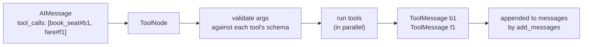

# Tools in LangGraph: ToolNode and tools_condition: The Complete Guide

> 📚 **Before you start**
>
> - [Building Agents](building-agents.md), for the agent loop that uses these pieces.
> - [Designing Good Tools](../../agentic-ai-fundamentals/04-tools-and-function-calling/designing-good-tools.md), for what makes a tool easy for a model to use.
> - [Custom Tools: @tool, StructuredTool and BaseTool](../../langchain-complete-guide/course.md#m7) in the LangChain Complete Guide, helpful but optional.

## Introduction

A railway booking clerk works from a window with a strict routine: take the requisition slip, check every field, run it through the system, hand back a printed result, and if something's wrong, write the reason on the slip rather than shouting at the queue. The clerk doesn't decide *where you travel*; that's your choice. The clerk makes sure whatever you asked for is carried out **correctly and safely**.

In your agents so far, `ToolNode` has been that clerk and `tools_condition` the person who points you to the window. You've used both with default settings. Real agents need more: clear tool schemas the model can't misread, tools that fail gracefully, tools that read the conversation or **update other parts of the state**, and a place to add checks like "1A bookings need approval".

This lesson opens both up. By the end you'll be able to write well-described tools, choose an error-handling policy, give tools access to state with `ToolRuntime`, let a tool update state with `Command`, intercept tool calls with `wrap_tool_call`, and replace either piece with your own code when you need to.

> 💡 **Key Insight**
>
> `ToolNode` has a simple contract: **read the tool calls in the last `AIMessage`, run each one, and return one `ToolMessage` per call with the matching `tool_call_id`.** Everything else (error policies, injected state, `Command` updates, wrappers) is a way to customise one of those three steps without breaking the contract.

---

## Core Explanation

### 1. The contract, end to end



Every customisation in this lesson plugs into one of these boxes. Let's set up a few tools and a helper that runs a `ToolNode` on a single `AIMessage`, so we can watch it work without a model.

```python
from typing import Annotated
from langchain_core.messages import AIMessage, ToolMessage
from langchain_core.tools import tool
from langgraph.graph import StateGraph, MessagesState, START, END
from langgraph.prebuilt import ToolNode, tools_condition

def run_tools(tool_node, *calls, state_schema=MessagesState, **extra_state):
    """Run a ToolNode on one AIMessage containing the given calls; return the new messages."""
    g = StateGraph(state_schema)
    g.add_node("tools", tool_node)
    g.add_edge(START, "tools")
    request = AIMessage("", tool_calls=[{"name": n, "args": a, "id": i} for n, a, i in calls])
    result = g.compile().invoke({"messages": [request], **extra_state})
    return result, result["messages"][1:]
```

(`ToolNode` is designed to run inside a graph, which is why the helper builds a one-node graph rather than calling it directly.)

### 2. Describing tools so the model can't misread them

The model never sees your Python code. It sees the tool's **name**, **description** and **argument schema**. `@tool` builds those from your function, and you can make each one richer.

**Argument descriptions from the docstring.** With `parse_docstring=True`, a Google-style `Args:` section becomes per-argument descriptions:

```python
@tool(parse_docstring=True)
def book_seat(train_no: str, travel_class: str = "3A") -> dict:
    """Hold a seat on a train.

    Args:
        train_no: Five-digit train number, e.g. 12951.
        travel_class: Coach class such as SL, 3A, 2A or 1A.
    """
    return {"train": train_no, "class": travel_class, "status": "HELD"}

import json
print(json.dumps(book_seat.tool_call_schema.model_json_schema(), indent=1))
```

Output:

```
{
 "description": "Hold a seat on a train.",
 "properties": {
  "train_no": {
   "description": "Five-digit train number, e.g. 12951.",
   "title": "Train No",
   "type": "string"
  },
  "travel_class": {
   "default": "3A",
   "description": "Coach class such as SL, 3A, 2A or 1A.",
   "title": "Travel Class",
   "type": "string"
  }
 },
 "required": [
  "train_no"
 ],
 "title": "book_seat",
 "type": "object"
}
```

That JSON is what a real model receives. Notice that `travel_class` has a default, so it isn't in `required`; the model may leave it out.

**Descriptions with `Annotated`.** If you prefer descriptions next to the parameter, put a string in `Annotated`:

```python
@tool
def sleeper_fare(distance_km: Annotated[int, "Distance in kilometres"]) -> str:
    """Estimate a sleeper-class fare in rupees for a journey."""
    return f"₹{distance_km * 0.5:.0f}"

print(sleeper_fare.args)
```

Output:

```
{'distance_km': {'description': 'Distance in kilometres', 'title': 'Distance Km', 'type': 'integer'}}
```

For complex inputs you can also pass a Pydantic model as `args_schema`, exactly as covered in the LangChain course. Whichever style you use, follow the rules from [Designing Good Tools](../../agentic-ai-fundamentals/04-tools-and-function-calling/designing-good-tools.md): say what the tool does, when to use it, and what each argument means, with an example value.

### 3. What `ToolNode` sends back

Each result becomes a `ToolMessage`. Strings are used as-is; other return values are serialised (a `dict` becomes JSON text), because the model reads text:

```python
_, results = run_tools(ToolNode([book_seat, sleeper_fare]),
                       ("book_seat", {"train_no": "12951"}, "b1"),
                       ("sleeper_fare", {"distance_km": 1384}, "f1"))
for m in results:
    print(f"{m.tool_call_id} {m.name:12} status={m.status:7} content={m.content!r}")
```

Output:

```
b1 book_seat    status=success content='{"train": "12951", "class": "3A", "status": "HELD"}'
f1 sleeper_fare status=success content='₹692'
```

| `ToolMessage` field | Meaning |
|---|---|
| `content` | The tool's output as text (what the model reads) |
| `tool_call_id` | The `id` of the call it answers; must match exactly |
| `name` | Which tool produced it |
| `status` | `"success"` or `"error"` |

Both calls in one `AIMessage` ran in the same step, and their results came back in the same order as the calls.

### 4. Error handling: the four policies

Tools fail. The question is whether a failure **crashes the run** or becomes a **message the model can react to**. `ToolNode`'s `handle_tool_errors` argument decides:

```python
@tool
def divide_fare(total: float, people: int) -> float:
    """Split a fare equally between people."""
    return round(total / people, 2)

bad_calls = [("divide_fare", {"total": 1500.0, "people": 0}, "d1")]        # ZeroDivisionError

for policy in [True, "Couldn't split that fare. Check the number of people."]:
    _, results = run_tools(ToolNode([divide_fare], handle_tool_errors=policy), *bad_calls)
    print(repr(policy)[:20], "->", repr(results[0].content), results[0].status)
```

Output:

```
True -> "Error: ZeroDivisionError('float division by zero')\n Please fix your mistakes." error
"Couldn't split that -> "Couldn't split that fare. Check the number of people." error
```

And with the **default** policy:

```python
try:
    run_tools(ToolNode([divide_fare]), *bad_calls)
except ZeroDivisionError as e:
    print("default policy raised:", type(e).__name__, e)

_, results = run_tools(ToolNode([divide_fare]),
                       ("divide_fare", {"total": "lots"}, "d2"),      # bad argument types
                       ("book_taxi", {}, "d3"))                       # tool that doesn't exist
for m in results:
    print(m.status, "|", m.content.replace("\n", " "))
```

Output:

```
default policy raised: ZeroDivisionError float division by zero
error | Error invoking tool 'divide_fare' with kwargs {'total': 'lots'} with error:  total: Input should be a valid number, unable to parse string as a number people: Field required  Please fix the error and try again.
error | Error: book_taxi is not a valid tool, try one of [divide_fare].
```

So the default is a middle ground: problems with the **call** (invalid arguments, unknown tool name) come back as error messages the model can fix, while exceptions raised **inside** your tool propagate so bugs aren't hidden.

| `handle_tool_errors=` | Invalid arguments | Exception inside the tool |
|---|---|---|
| *(default)* | Error `ToolMessage` with the validation details | **Raised** (run fails) |
| `True` | Error `ToolMessage` | Error `ToolMessage` with the exception text |
| `"some text"` | Error `ToolMessage` with your text | Error `ToolMessage` with your text |
| a function `f(e) -> str` | Error `ToolMessage` with `f(e)` | Error `ToolMessage` with `f(e)` |
| an exception class or tuple | Raised | Caught only for those types; others raise |
| `False` | Raised | Raised |

A call to a tool name that doesn't exist is always answered with an error `ToolMessage` listing the valid tools, whatever the policy.

**Which to choose?** For tools that call flaky external services, catch errors (a string or a function that hides internal details is a good choice) so the model can retry or apologise. For your own pure functions during development, the default makes bugs loud. Whatever you choose, make error text **actionable**: "Check the number of people" helps the model; a stack trace does not.

### 5. Tools that read the state: `ToolRuntime`

Sometimes a tool needs information the model shouldn't have to pass, such as the user's id, the conversation so far, or the id of the call itself. Add a parameter annotated with **`ToolRuntime`**. `ToolNode` fills it in, and it's **hidden from the model's schema**:

```python
from langgraph.prebuilt import ToolRuntime

class TripState(MessagesState):
    passenger: str
    held_seats: list

@tool
def my_bookings(runtime: ToolRuntime) -> str:
    """List the seats currently held for this passenger."""
    s = runtime.state
    return f"{s['passenger']} holds {len(s['held_seats'])} seat(s): {s['held_seats']}"

print("schema the model sees:", my_bookings.tool_call_schema.model_json_schema()["properties"])
_, results = run_tools(ToolNode([my_bookings]), ("my_bookings", {}, "q1"),
                       state_schema=TripState, passenger="Asha", held_seats=["12951/B3/41"])
print(results[0].content)
```

Output:

```
schema the model sees: {}
Asha holds 1 seat(s): ['12951/B3/41']
```

The model sees a tool with **no arguments**; at run time the tool reads the passenger's name and seats from the graph state. This is also the safe way to pass things like a user id: the model can't spoof a value it never supplies.

`ToolRuntime` also gives you `runtime.tool_call_id`, `runtime.config`, `runtime.context` (run-time context passed to the graph), `runtime.store` (long-term memory) and `runtime.stream_writer` (for custom progress updates).

### 6. Tools that update the state: `Command`

Normally a tool's only effect on the graph is a new `ToolMessage`. If a tool should also change **other fields**, it can return a **`Command(update=...)`**, the same `Command` you met in [Conditional Workflows](../03-workflow-patterns-in-langgraph/conditional-workflows.md). The update must still include a `ToolMessage` for the call, so the model gets its answer:

```python
from langgraph.types import Command

@tool
def hold_seat(train_no: str, runtime: ToolRuntime) -> Command:
    """Hold one seat on a train for the current passenger."""
    seat = f"{train_no}/B3/{40 + len(runtime.state['held_seats'])}"
    return Command(update={
        "held_seats": runtime.state["held_seats"] + [seat],
        "messages": [ToolMessage(f"Held seat {seat}.", tool_call_id=runtime.tool_call_id)],
    })

state, results = run_tools(ToolNode([hold_seat]), ("hold_seat", {"train_no": "12302"}, "h1"),
                           state_schema=TripState, passenger="Asha", held_seats=["12951/B3/41"])
print(results[0].content)
print(state["held_seats"])
```

Output:

```
Held seat 12302/B3/41.
['12951/B3/41', '12302/B3/41']
```

Now the state field `held_seats` is the source of truth, and later nodes (a payment node, a summary node) can read it directly instead of digging through tool messages.

### 7. Intercepting calls: `wrap_tool_call`

What if you want logging, a policy check or a retry around **every** tool call, without editing each tool? Pass a wrapper. It receives the request and an `execute` function; call `execute(request)` to run the tool, or return your own `ToolMessage` to block it:

```python
audit_log = []

def guard(request, execute):
    call = request.tool_call
    audit_log.append(f"{call['name']}({call['args']})")
    if call["name"] == "book_seat" and call["args"].get("travel_class") == "1A":
        return ToolMessage("1A bookings need a manager's approval. Offer 2A instead.",
                           tool_call_id=call["id"], status="error")
    return execute(request)

_, results = run_tools(ToolNode([book_seat], wrap_tool_call=guard),
                       ("book_seat", {"train_no": "12951", "travel_class": "1A"}, "g1"),
                       ("book_seat", {"train_no": "12302"}, "g2"))
for m in results:
    print(m.status, "|", m.content)
print(audit_log)
```

Output:

```
error | 1A bookings need a manager's approval. Offer 2A instead.
success | {"train": "12302", "class": "3A", "status": "HELD"}
["book_seat({'train_no': '12951', 'travel_class': '1A'})", "book_seat({'train_no': '12302'})"]
```

The 1A call never reached the tool; the model got an explanation it can act on. The wrapper is the natural place for audit logs, rate limits, caching and simple approval rules. (An `awrap_tool_call` argument does the same for async graphs.)

### 8. `tools_condition` in detail

`tools_condition(state, messages_key="messages")` looks at the last message under `messages_key` and returns `"tools"` if it has tool calls, otherwise `END`. Two practical details:

- If your state stores the conversation under a different key, both pieces need to know. `ToolNode(tools, messages_key="chat")` reads and writes that key, and you route with a small lambda, `lambda s: tools_condition(s, messages_key="chat")`.
- It only checks the **last** message. If another node appends something after the model's reply (a moderation note, say), the condition sees that message instead. Keep the model's reply last, or write your own router.

```python
state = {"chat": [AIMessage("", tool_calls=[{"name": "book_seat", "args": {"train_no": "12951"}, "id": "k1"}])]}
print(tools_condition(state, messages_key="chat"))
```

Output:

```
tools
```

### 9. Writing your own tool node

Understanding the contract means you can always write the node yourself, for example to run tools one at a time in a specific order, or to call an internal system that isn't a LangChain tool:

```python
TOOLS = {t.name: t for t in [book_seat, sleeper_fare]}

def my_tool_node(state: MessagesState):
    results = []
    for call in state["messages"][-1].tool_calls:
        tool_fn = TOOLS.get(call["name"])
        if tool_fn is None:
            content, status = f"Unknown tool {call['name']}.", "error"
        else:
            try:
                content, status = str(tool_fn.invoke(call["args"])), "success"
            except Exception as e:
                content, status = f"{type(e).__name__}: {e}", "error"
        results.append(ToolMessage(content, tool_call_id=call["id"], name=call["name"], status=status))
    return {"messages": results}

_, results = run_tools(my_tool_node, ("sleeper_fare", {"distance_km": 600}, "x1"), ("teleport", {}, "x2"))
for m in results:
    print(m.tool_call_id, m.status, m.content)
```

Output:

```
x1 success ₹300
x2 error Unknown tool teleport.
```

It's about fifteen lines, and it's exactly what you wrote in [Lab: Tool-using agent from scratch](../../agentic-ai-fundamentals/04-tools-and-function-calling/lab-tool-using-agent-from-scratch.md). Use `ToolNode` by default (it adds parallel execution, argument validation, `ToolRuntime` and `Command` support); write your own only when you need behaviour it can't express.

---

## Try It Yourself

1. **Error function.** Write a `handle_tool_errors` function that returns `"Service busy, try again."` for `ConnectionError` and `"Unexpected error."` for anything else. Test it with a tool that raises `ConnectionError`.
2. **Hidden user id.** Write a `my_wallet_balance` tool that reads `user_id` from the state through `ToolRuntime` and looks it up in `{"u1": 450.0}`. Confirm its model-facing schema has no properties.
3. **Approval wrapper.** Change `guard` so that any `book_seat` call for more than 6 `seats` (add a `seats: int = 1` argument) is blocked. Which call ids get blocked when the model asks for 2 seats and 8 seats?

<details>
<summary>Show answers</summary>

**1.**

```python
def friendly_errors(e: Exception) -> str:
    return "Service busy, try again." if isinstance(e, ConnectionError) else "Unexpected error."

@tool
def live_status(train_no: str) -> str:
    """Live running status of a train."""
    raise ConnectionError("NTES timeout")

_, results = run_tools(ToolNode([live_status], handle_tool_errors=friendly_errors),
                       ("live_status", {"train_no": "12951"}, "e1"))
print(results[0].status, results[0].content)
```

Output:

```
error Service busy, try again.
```

**2.**

```python
class WalletState(MessagesState):
    user_id: str

@tool
def my_wallet_balance(runtime: ToolRuntime) -> str:
    """The current user's wallet balance in rupees."""
    return f"₹{ {'u1': 450.0}[runtime.state['user_id']] :.2f}"

print(my_wallet_balance.tool_call_schema.model_json_schema()["properties"])
_, results = run_tools(ToolNode([my_wallet_balance]), ("my_wallet_balance", {}, "w1"),
                       state_schema=WalletState, user_id="u1")
print(results[0].content)
```

Output:

```
{}
₹450.00
```

**3.**

```python
@tool
def book_seats(train_no: str, seats: int = 1) -> str:
    """Hold one or more seats on a train."""
    return f"Held {seats} seat(s) on {train_no}."

def seat_limit(request, execute):
    call = request.tool_call
    if call["args"].get("seats", 1) > 6:
        return ToolMessage("Group bookings over 6 seats need approval.", tool_call_id=call["id"], status="error")
    return execute(request)

_, results = run_tools(ToolNode([book_seats], wrap_tool_call=seat_limit),
                       ("book_seats", {"train_no": "12951", "seats": 2}, "s2"),
                       ("book_seats", {"train_no": "12951", "seats": 8}, "s8"))
print([m.tool_call_id for m in results if m.status == "error"])
```

Output:

```
['s8']
```

</details>

---

## Real-World Examples

- **Payment and refund tools** use a wrapper to enforce limits and write an audit log, and return actionable error text when a bank API times out.
- **Multi-tenant SaaS agents** read `tenant_id` and `user_id` through `ToolRuntime`, so the model can never query another customer's data by changing an argument.
- **Shopping agents** use tools that return `Command` to update a `cart` field, which a checkout node reads directly.

---

## Common Misconceptions

### "If a tool raises, the agent always crashes"

It depends on the policy. With the default, argument errors and unknown tools come back as messages and only exceptions *inside* the tool propagate. `handle_tool_errors=True` (or a string or function) turns any exception into a message the model can read.

### "The model passes every argument a tool receives"

`ToolRuntime` parameters are filled by LangGraph and never appear in the schema. The model only supplies what it can see.

### "A tool returning `Command` doesn't need a `ToolMessage`"

It does. Every tool call must get an answer with the matching `tool_call_id`, or the next model call will fail because the conversation has an unanswered call.

### "`tools_condition` looks at every message"

Only the last one in the messages key.

---

## Interview Relevance

*"How does LangGraph's `ToolNode` handle errors?"* Explain `handle_tool_errors`: by default invalid arguments and unknown tools become error `ToolMessage`s and exceptions inside tools propagate; `True`, a string, a function or exception types change that. Mention returning actionable error text so the model can recover.

*"How would you give a tool access to the user's id without trusting the model?"* Inject it from state or context with `ToolRuntime` (or `InjectedState` in older code); it's excluded from the schema, so the model can't set it.

*"How can a tool update graph state?"* Return `Command(update={...})` including a `ToolMessage` with the right `tool_call_id`.

---

## Key Takeaways

- **`ToolNode`**: read the last `AIMessage`'s tool calls, run them (in parallel), return `ToolMessage`s with matching **`tool_call_id`s**.
- Describe tools well: **docstrings**, `parse_docstring=True` or **`Annotated`** descriptions, defaults for optional arguments.
- Choose an **error policy** with `handle_tool_errors`; make error text actionable.
- **`ToolRuntime`** gives tools state, context and the call id, hidden from the model; return **`Command`** to update state.
- **`wrap_tool_call`** intercepts every call for logging, limits and approvals; you can always write your own tool node.

---

**Up next:** [Using MCP Tools in LangGraph](using-mcp-tools-in-langgraph.md)
