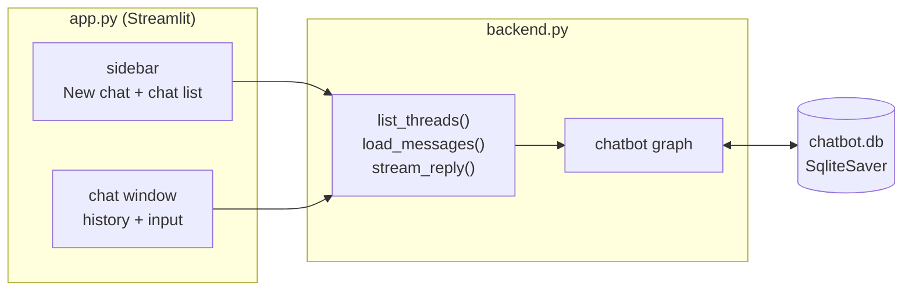

# Lab: Chatbot UI with Streamlit, Streaming and Saved Chats

> 📚 **Before you start**
>
> - [Building a Chatbot with LangGraph](building-a-chatbot-with-langgraph.md), for the chatbot graph and `stream_mode="messages"`.
> - [Persistent Storage with SQLite](persistent-storage-with-sqlite.md), for `SqliteSaver` and listing threads.
> - [Streamlit Basics](../../apis-and-apps-fastapi-streamlit-and-docker/course.md#m6) and [Session State](../../apis-and-apps-fastapi-streamlit-and-docker/course.md#m7) in APIs and Apps: FastAPI, Streamlit and Docker.

## What You'll Build

A small ChatGPT-style web app for your LangGraph chatbot:

- A **chat window** that shows the conversation and a message box at the bottom.
- Replies that **stream in word by word**.
- A **sidebar** listing your saved chats by title, with a **New chat** button.
- Chats that are **saved to SQLite**, so they're still there after you stop and restart the app.



You'll split the code into two files. **`backend.py`** holds the graph and three plain functions; it knows nothing about Streamlit. **`app.py`** is the UI and only calls those functions. That split is what lets you test the backend from a script (which is how this page runs it) and later reuse it behind an API.

> 💡 **Key Insight**
>
> Let the **checkpointer be the single source of truth**. Streamlit reruns your whole script on every click, so don't keep the conversation in `st.session_state`; keep only the **current `thread_id`** there, and load the messages from the graph each time. Saved chats, reloads and restarts then all just work.

To build and run the real app you'll need `pip install langgraph langgraph-checkpoint-sqlite langchain-anthropic streamlit` and an `ANTHROPIC_API_KEY`. On this page the backend runs offline with a scripted model and an in-memory checkpointer, so you can follow every step.

---

## Step 1: Project Layout

```
chat-app/
├── backend.py        # graph, checkpointer, list_threads, load_messages, stream_reply
├── app.py            # Streamlit UI
├── requirements.txt  # langgraph, langgraph-checkpoint-sqlite, langchain-anthropic, streamlit
├── .env              # ANTHROPIC_API_KEY=... (never commit)
└── chatbot.db        # created on first run
```

---

## Step 2: The Chatbot Graph

The graph is the chatbot from earlier in this module: one node with a system prompt. On this page we use a scripted model that streams like a real one.

```python
import uuid
from langchain_core.language_models.fake_chat_models import GenericFakeChatModel
from langchain_core.messages import AIMessage, SystemMessage
from langgraph.graph import StateGraph, MessagesState, START, END
from langgraph.checkpoint.memory import InMemorySaver

llm = GenericFakeChatModel(messages=iter([
    AIMessage("Namaste! For a weekend in Goa, budget around ₹12,000 per person excluding flights."),
    AIMessage("Try Palolem in the south: quieter beaches, good shacks, and kayaking."),
    AIMessage("For masala chai, simmer tea, milk, sugar, ginger and cardamom for 3 to 4 minutes."),
]))

SYSTEM = SystemMessage("You are a helpful, friendly assistant. Keep answers short.")

def chatbot(state: MessagesState):
    return {"messages": [llm.invoke([SYSTEM] + state["messages"])]}

builder = StateGraph(MessagesState)
builder.add_node(chatbot)
builder.add_edge(START, "chatbot")
builder.add_edge("chatbot", END)

checkpointer = InMemorySaver()          # backend.py uses SqliteSaver (Step 7)
graph = builder.compile(checkpointer=checkpointer)
```

---

## Step 3: The Backend Functions

Three functions are all the UI needs. Each takes a `thread_id`, so the backend serves any number of chats.

```python
def config_for(thread_id: str) -> dict:
    return {"configurable": {"thread_id": thread_id}}

def new_thread_id() -> str:
    return str(uuid.uuid4())

def load_messages(thread_id: str) -> list[tuple[str, str]]:
    """The conversation as (role, text) pairs, ready to display."""
    state = graph.get_state(config_for(thread_id))
    out = []
    for m in state.values.get("messages", []):
        if m.type in ("human", "ai") and m.content:
            out.append(("user" if m.type == "human" else "assistant", m.content))
    return out

def list_threads() -> list[tuple[str, str]]:
    """(thread_id, title) for every saved chat; the title is the first user message."""
    ids = {c.config["configurable"]["thread_id"] for c in checkpointer.list(None)}
    threads = []
    for tid in ids:
        messages = load_messages(tid)
        if messages:
            first_user = next(text for role, text in messages if role == "user")
            threads.append((tid, first_user[:40]))
    return sorted(threads, key=lambda t: t[1])

def stream_reply(thread_id: str, text: str):
    """Send one user message and yield the reply's text as it's generated."""
    for chunk, meta in graph.stream({"messages": [("user", text)]}, config_for(thread_id),
                                    stream_mode="messages"):
        if meta["langgraph_node"] == "chatbot" and chunk.content:
            yield chunk.content
```

A few design choices worth noting:

- `load_messages` returns **plain tuples**, not LangChain objects, so the UI doesn't depend on LangChain types. It skips tool messages and empty AI messages, which a chat window shouldn't show.
- `list_threads` uses the portable `checkpointer.list(None)`. For a big database you'd swap in the faster SQL query or your own threads table from the last lesson.
- `stream_reply` is a **generator**. Streamlit's `st.write_stream` can consume it directly, and it filters by node so only the chatbot's tokens reach the screen.

---

## Step 4: Test the Backend Without a UI

Always prove the backend works before building screens. Here's a conversation in two chats, exactly as the UI will drive it:

```python
goa = new_thread_id()
pieces = list(stream_reply(goa, "Plan a cheap weekend in Goa"))
print(len(pieces), "streamed pieces ->", "".join(pieces))
print("".join(stream_reply(goa, "Which beach is quieter?")))

chai = new_thread_id()
print("".join(stream_reply(chai, "How do I make masala chai?")))
```

Output:

```
25 streamed pieces -> Namaste! For a weekend in Goa, budget around ₹12,000 per person excluding flights.
Try Palolem in the south: quieter beaches, good shacks, and kayaking.
For masala chai, simmer tea, milk, sugar, ginger and cardamom for 3 to 4 minutes.
```

And the two functions the sidebar and chat window use:

```python
for tid, title in list_threads():
    label = "goa" if tid == goa else "chai"
    print(f"[{label}] {title}")

print()
for role, text in load_messages(goa):
    print(f"{role:9}: {text[:60]}")
```

Output:

```
[chai] How do I make masala chai?
[goa] Plan a cheap weekend in Goa

user     : Plan a cheap weekend in Goa
assistant: Namaste! For a weekend in Goa, budget around ₹12,000 per per
user     : Which beach is quieter?
assistant: Try Palolem in the south: quieter beaches, good shacks, and
```

The backend is complete: it streams, remembers each chat separately, and can list and reload them.

---

## Step 5: The Streamlit App

Now the UI. Streamlit reruns `app.py` from top to bottom every time the user does anything. The script below is written with that in mind: it reads the current chat id from `st.session_state`, draws the sidebar and history from the backend, and handles a new message if one was submitted.

```python
# not-run: app.py, run with `streamlit run app.py`
import streamlit as st
from backend import list_threads, load_messages, new_thread_id, stream_reply

st.set_page_config(page_title="LangGraph Chat", page_icon="💬")

# The only thing we keep in session state: which chat is open.
if "thread_id" not in st.session_state:
    st.session_state.thread_id = new_thread_id()

# ---------- Sidebar: new chat + saved chats ----------
with st.sidebar:
    st.title("💬 Chats")
    if st.button("➕ New chat", width="stretch"):
        st.session_state.thread_id = new_thread_id()
        st.rerun()
    st.divider()
    for tid, title in list_threads():
        is_current = tid == st.session_state.thread_id
        if st.button(title, key=tid, width="stretch",
                     type="primary" if is_current else "secondary"):
            st.session_state.thread_id = tid
            st.rerun()

# ---------- Main area: history + input ----------
thread_id = st.session_state.thread_id
for role, text in load_messages(thread_id):
    with st.chat_message(role):
        st.markdown(text)

if prompt := st.chat_input("Type a message"):
    with st.chat_message("user"):
        st.markdown(prompt)
    with st.chat_message("assistant"):
        st.write_stream(stream_reply(thread_id, prompt))
    st.rerun()        # refresh the sidebar so a brand-new chat appears in the list
```

What each Streamlit piece does:

| Call | Role in the app |
|---|---|
| `st.session_state.thread_id` | Remembers which chat is open across reruns |
| `st.sidebar` + `st.button` | The chat list; clicking switches `thread_id` and reruns |
| `st.chat_message(role)` | A chat bubble for `"user"` or `"assistant"` |
| `st.chat_input` | The message box pinned to the bottom; returns the text once submitted |
| `st.write_stream(generator)` | Writes each yielded piece as it arrives, producing the typing effect |
| `st.rerun()` | Starts a fresh run of the script, e.g. after switching chats |

Notice what's **not** here: no list of messages in session state, no code to append the reply to the history. The graph's checkpointer already saved both the user message and the reply, and the next rerun loads them with `load_messages`.

---

## Step 6: Run It

From the project folder:

```bash
streamlit run app.py
```

Example output:

```
  You can now view your Streamlit app in your browser.

  Local URL: http://localhost:8501
```

Open the URL, ask a question, and watch the reply stream in. Start a second chat with **New chat**, then click back to the first one in the sidebar: the old conversation reappears. Stop the server with Ctrl+C, start it again, and the chats are still there (once you've switched to SQLite in Step 7).

---

## Step 7: The Real `backend.py`

Here's the complete file with a real model and SQLite. Compared with Step 2 and 3, only the model and the checkpointer change.

```python
# not-run: backend.py, needs langgraph-checkpoint-sqlite, langchain-anthropic and ANTHROPIC_API_KEY
import sqlite3, uuid
from dotenv import load_dotenv
from langchain_anthropic import ChatAnthropic
from langchain_core.messages import SystemMessage
from langgraph.checkpoint.sqlite import SqliteSaver
from langgraph.graph import StateGraph, MessagesState, START, END

load_dotenv()                                   # reads ANTHROPIC_API_KEY from .env

llm = ChatAnthropic(model="claude-opus-5-5", max_tokens=1024)
SYSTEM = SystemMessage("You are a helpful, friendly assistant. Keep answers short.")

def chatbot(state: MessagesState):
    return {"messages": [llm.invoke([SYSTEM] + state["messages"])]}

builder = StateGraph(MessagesState)
builder.add_node(chatbot)
builder.add_edge(START, "chatbot")
builder.add_edge("chatbot", END)

conn = sqlite3.connect("chatbot.db", check_same_thread=False)
checkpointer = SqliteSaver(conn)
graph = builder.compile(checkpointer=checkpointer)

# ... config_for, new_thread_id, load_messages, list_threads, stream_reply exactly as in Step 3
```

(`python-dotenv` is an optional helper for reading `.env` files; you can also export the variable in your shell.)

Two things matter for Streamlit specifically:

- **`check_same_thread=False`**: Streamlit may run your script on different threads across reruns.
- **Module-level setup runs once.** Python caches imported modules, so `backend.py` (and its connection) is created once per server process, not on every rerun. If you build the graph inside `app.py` instead, wrap the builder in a function decorated with `@st.cache_resource` so it isn't rebuilt on every click.

---

## Step 8: Make It Nicer

A few small upgrades that real chat apps have:

**A spinner before the first token.** Models can take a second to start. Show a status while waiting:

```python
# not-run: inside the `with st.chat_message("assistant"):` block
import itertools

with st.spinner("Thinking..."):
    stream = stream_reply(thread_id, prompt)
    first = next(stream, "")                      # waits for the first token
st.write_stream(itertools.chain([first], stream))  # then streams the rest as it arrives
```

(`itertools.chain` matters here: writing `[first, *stream]` would wait for the whole reply before showing anything.)

**Better titles.** The first message makes an OK title. A nicer one comes from a tiny model call after the first reply ("Summarise this chat in 4 words"), saved in your own `threads` table from the last lesson.

**Delete a chat.** A small button next to each title that calls `checkpointer.delete_thread(tid)` (and deletes the title row), then `st.rerun()`.

---

## Try It Yourself

1. **Recent first.** Change `list_threads` to sort chats by their latest checkpoint time, newest first. (Hint: `graph.get_state(config).created_at`.) Test it on the two chats from Step 4.
2. **Hide the system prompt.** Suppose a teammate changes the chatbot node to store the `SystemMessage` in the state. What would `load_messages` show, and why does our version not need to filter system messages?
3. **Delete a chat in the backend.** Add `delete_thread(thread_id)` to the backend and check that `list_threads()` no longer includes it.

<details>
<summary>Show answers</summary>

**1.**

```python
def list_threads_recent_first():
    ids = {c.config["configurable"]["thread_id"] for c in checkpointer.list(None)}
    rows = []
    for tid in ids:
        snap = graph.get_state(config_for(tid))
        first_user = next(text for role, text in load_messages(tid) if role == "user")
        rows.append((snap.created_at, tid, first_user[:40]))
    return [(tid, title) for _, tid, title in sorted(rows, reverse=True)]

print([title for _, title in list_threads_recent_first()])
```

Output:

```
['How do I make masala chai?', 'Plan a cheap weekend in Goa']
```

The chai chat was updated last, so it comes first. `created_at` is an ISO timestamp string, so sorting the strings sorts by time.

**2.** It would still skip it: `load_messages` keeps only `human` and `ai` messages, so a stored `system` message never reaches the screen. Keeping the prompt out of the state (as our node does) is still better, because changing the prompt later then needs no data clean-up.

**3.**

```python
def delete_thread(thread_id: str) -> None:
    checkpointer.delete_thread(thread_id)

delete_thread(chai)
print([title for _, title in list_threads()])
```

Output:

```
['Plan a cheap weekend in Goa']
```

</details>

---

## What You've Learned

- Split a chat app into a **backend** (graph + plain functions) and a **UI** that only calls them.
- Keep **only the `thread_id`** in `st.session_state`; the **checkpointer** is the source of truth for messages.
- **`stream_mode="messages"`**, filtered by node, feeds **`st.write_stream`** for a typing effect.
- **List and reload chats** from the checkpointer; switch chats by changing `thread_id`.
- Swap **InMemorySaver → SqliteSaver** to make chats survive restarts, with `check_same_thread=False`.

---

**Up next:** [Trimming and Filtering Messages](../course.md#m7)
