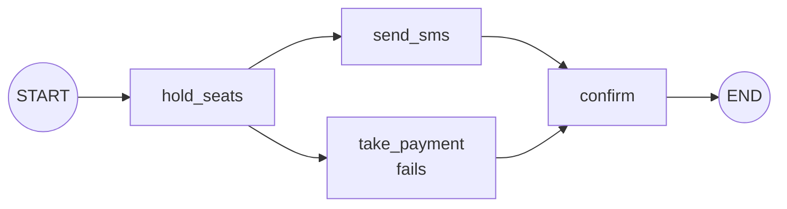

# Threads, Fault Tolerance and Resuming: The Complete Guide

> 📚 **Before you start**
>
> - [Persistence and Checkpointers](persistence-and-checkpointers.md), for snapshots, `next` and `invoke(None, config)`.
> - [Parallel Workflows](../03-workflow-patterns-in-langgraph/parallel-workflows.md), because section 4 relies on parallel branches.

## Introduction

It's 10:00:30 on a Tatkal booking morning. You've typed six passengers' names, ages and berth preferences, the seats are held, and then the payment page times out. If the site makes you start from scratch, the seats are gone. A well-built site keeps everything you did and lets you **retry just the payment**.

Long-running AI workflows have the same problem. An agent that has spent five minutes and twenty model calls researching should not start over because one API call failed at minute six. LangGraph's checkpoints make this easy: when a node fails, everything up to the last completed step is already saved, and you can **resume** from exactly that point once the problem is fixed. For short, temporary failures you can go further and let LangGraph **retry** the node automatically.

This lesson covers both halves of the topic: **threads** (how to name, list, label and delete saved runs) and **fault tolerance** (what's saved when things fail, how to resume, retry policies, timeouts, and writing nodes that are safe to run twice).

> 💡 **Key Insight**
>
> With a checkpointer, a failed run isn't lost; it's **paused at the failing step**. The thread's latest snapshot has `next` pointing at the node that failed, and calling `invoke(None, config)` picks up from there. Even parallel nodes that succeeded in the failed step aren't re-run, because their results were saved as *pending writes*.

---

## Core Explanation

### 1. Threads: one id per run of work

A **thread** is everything saved under one `thread_id`. What should a thread represent? It depends on the app:

| App | A sensible `thread_id` | Why |
|---|---|---|
| Chatbot | One per conversation, e.g. `f"{user_id}:{chat_id}"` | Users can have several chats |
| Support bot on WhatsApp | The customer's chat id | One ongoing conversation per customer |
| Batch job (e.g. summarise 1,000 PDFs) | One per document, e.g. `f"summary:{file_hash}"` | Each item can fail and resume independently |
| Approval workflow | The request id, e.g. `f"refund:{refund_id}"` | Reviewers find and resume it by id |

Two rules: the id must be **stable** (you need it again to resume) and **unique** to that piece of work (reusing an id continues the old thread). When there's no natural id, `str(uuid.uuid4())` works.

### 2. Listing, labelling and deleting threads

A checkpointer can list all its checkpoints with `list(None)`. Collecting their thread ids gives you the threads, which is how a chat app builds its "your conversations" sidebar:

```python
import operator, uuid
from typing import Annotated, TypedDict
from langgraph.graph import StateGraph, START, END
from langgraph.checkpoint.memory import InMemorySaver

class TripState(TypedDict):
    city: str
    log: Annotated[list, operator.add]

def plan(state: TripState):
    return {"log": [f"planned {state['city']}"]}

builder = StateGraph(TripState)
builder.add_node(plan)
builder.add_edge(START, "plan")
builder.add_edge("plan", END)

saver = InMemorySaver()
planner = builder.compile(checkpointer=saver)

for user, city in [("asha", "Goa"), ("asha", "Jaipur"), ("ravi", "Munnar")]:
    planner.invoke({"city": city, "log": []},
                   {"configurable": {"thread_id": f"{user}:{city.lower()}"},
                    "metadata": {"title": f"Trip to {city}"}})

threads = sorted({c.config["configurable"]["thread_id"] for c in saver.list(None)})
print(threads)
```

Output:

```
['asha:goa', 'asha:jaipur', 'ravi:munnar']
```

The `metadata` you pass in the config is saved with each checkpoint, which makes it a handy place for a human-readable title:

```python
for t in threads:
    snap = planner.get_state({"configurable": {"thread_id": t}})
    print(f"{t:14} {snap.metadata['title']:15} last step {snap.metadata['step']}")
```

Output:

```
asha:goa       Trip to Goa     last step 1
asha:jaipur    Trip to Jaipur  last step 1
ravi:munnar    Trip to Munnar  last step 1
```

To show only one user's chats, filter the ids (`t.startswith("asha:")`) or put a `user_id` in the metadata and filter with `saver.list(None, filter={"user_id": "asha"})`.

Deleting a thread removes all of its checkpoints, for example when a user deletes a chat or asks for their data to be erased:

```python
saver.delete_thread("ravi:munnar")
print(sorted({c.config["configurable"]["thread_id"] for c in saver.list(None)}))
print(planner.get_state({"configurable": {"thread_id": "ravi:munnar"}}).values)
```

Output:

```
['asha:goa', 'asha:jaipur']
{}
```

All checkpointers provide `delete_thread`, so the same code works with SQLite or Postgres.

### 3. What a failure looks like

Now a booking workflow that can fail. To simulate an outage, the payment node checks a flag:

```python
class Booking(TypedDict):
    passengers: list
    log: Annotated[list, operator.add]

calls = {"hold_seats": 0, "send_sms": 0, "take_payment": 0, "confirm": 0}
PAYMENT_GATEWAY_UP = False

def hold_seats(state: Booking):
    calls["hold_seats"] += 1
    return {"log": [f"held {len(state['passengers'])} seats"]}

def send_sms(state: Booking):
    calls["send_sms"] += 1
    return {"log": ["sms sent"]}

def take_payment(state: Booking):
    calls["take_payment"] += 1
    if not PAYMENT_GATEWAY_UP:
        raise ConnectionError("payment gateway timed out")
    return {"log": ["paid ₹4,820"]}

def confirm(state: Booking):
    calls["confirm"] += 1
    return {"log": ["PNR 4521873690 confirmed"]}

b = StateGraph(Booking)
for fn in [hold_seats, send_sms, take_payment, confirm]:
    b.add_node(fn)
b.add_edge(START, "hold_seats")
b.add_edge("hold_seats", "send_sms")          # send_sms and take_payment run in parallel
b.add_edge("hold_seats", "take_payment")
b.add_edge(["send_sms", "take_payment"], "confirm")
b.add_edge("confirm", END)
booking = b.compile(checkpointer=InMemorySaver())

cfg = {"configurable": {"thread_id": "tatkal-0930"}}
try:
    booking.invoke({"passengers": ["Asha", "Ravi"], "log": []}, cfg)
except ConnectionError as e:
    print("run failed:", e)
```

Output:

```
run failed: payment gateway timed out
```



The exception reached your code, as it should. But look at what the checkpointer kept:

```python
snap = booking.get_state(cfg)
print("saved log:", snap.values["log"])
print("next:", snap.next)
for task in snap.tasks:
    print(f"  task {task.name:12} error={task.error!r}")
```

Output:

```
saved log: ['held 2 seats', 'sms sent']
next: ('take_payment',)
  task send_sms     error=None
  task take_payment error="ConnectionError('payment gateway timed out')"
```

- The **log** has `held 2 seats` from the last completed super-step, and also `sms sent`: `send_sms` finished successfully in the failed step, and its output was saved as a *pending write*, which `get_state` includes in `values`.
- **`next`** names only `take_payment`, the node that still has to succeed.
- **`tasks`** shows that `send_sms` succeeded (no error) while `take_payment` failed with the `ConnectionError`.

### 4. Resuming after a failure

Fix the cause (here, the gateway comes back), then invoke with **`None`** as the input on the same thread:

```python
PAYMENT_GATEWAY_UP = True
result = booking.invoke(None, cfg)
print(result["log"])
print(calls)
```

Output:

```
['held 2 seats', 'sms sent', 'paid ₹4,820', 'PNR 4521873690 confirmed']
{'hold_seats': 1, 'send_sms': 1, 'take_payment': 2, 'confirm': 1}
```

The booking finished, and the `calls` counter tells the important part of the story:

- `hold_seats` ran **once**: its result was in the last snapshot.
- `send_sms` ran **once**, even though it was in the failed super-step. LangGraph saved its successful output as a **pending write** when it finished, so on resume it reused that result instead of sending a second SMS.
- `take_payment` ran **twice**: once failing, once succeeding.

Passing `None` means "no new input, just continue". Passing a new input instead would start a new run on the thread, appending to its state; for resuming, always use `None`.

### 5. Automatic retries with `RetryPolicy`

Many failures are temporary: a timeout, a rate limit, a 503. Rather than failing and waiting for someone to resume, you can tell LangGraph to **retry a node** a few times with growing delays:

```python
from langgraph.types import RetryPolicy

attempts = []

def flaky_payment(state: Booking):
    attempts.append(len(attempts) + 1)
    if len(attempts) < 3:
        raise ConnectionError("gateway busy")
    return {"log": [f"paid on attempt {len(attempts)}"]}

b = StateGraph(Booking)
b.add_node("take_payment", flaky_payment,
           retry_policy=RetryPolicy(max_attempts=4, initial_interval=0.01, backoff_factor=2.0, jitter=False))
b.add_edge(START, "take_payment")
b.add_edge("take_payment", END)
print(b.compile().invoke({"passengers": ["Asha"], "log": []}))
print("attempts:", attempts)
```

Output:

```
{'passengers': ['Asha'], 'log': ['paid on attempt 3']}
attempts: [1, 2, 3]
```

| `RetryPolicy` field | Default | Meaning |
|---|---|---|
| `max_attempts` | 3 | Total tries, including the first |
| `initial_interval` | 0.5 s | Wait before the first retry |
| `backoff_factor` | 2.0 | Multiply the wait by this after each retry |
| `max_interval` | 128 s | Upper bound on the wait |
| `jitter` | `True` | Add randomness so many clients don't retry in lockstep |
| `retry_on` | `default_retry_on` | Which exceptions to retry |

The default `retry_on` is sensible: it retries connection errors, HTTP 5xx errors from `httpx` and `requests`, and unknown exception types, but **not** programming errors like `ValueError`, `TypeError` or `KeyError`. Retrying a bug just fails three times more slowly:

```python
from langgraph.types import default_retry_on

for exc in [ConnectionError("reset"), ValueError("bad amount"), KeyError("seat"), TimeoutError("slow")]:
    print(f"{type(exc).__name__:16} retried: {default_retry_on(exc)}")
```

Output:

```
ConnectionError  retried: True
ValueError       retried: False
KeyError         retried: False
TimeoutError     retried: False
```

`TimeoutError` is a subclass of `OSError`, which the default doesn't retry. If your node raises timeouts you want retried, pass your own: `retry_on=(ConnectionError, TimeoutError)` or a function.

**Retry or resume?** Use **retries** for short, automatic recovery inside one run. **Resume** is for failures that need time or a human: a gateway down for an hour, a bug that needs a code fix, an expired API key. With a checkpointer you get both: if all retries fail, the run stops and can still be resumed later.

### 6. Timeouts

A node that hangs is worse than one that fails. LangGraph can cap how long a node attempt may take with the `timeout` argument of `add_node`. Because Python can't safely stop a running *synchronous* function, timeouts work only for **async** nodes:

```python
import asyncio

async def slow_seat_map(state: Booking):
    await asyncio.sleep(1.0)                  # pretend the seat-map service hangs
    return {"log": ["seat map loaded"]}

b = StateGraph(Booking)
b.add_node("seat_map", slow_seat_map, timeout=0.05)
b.add_edge(START, "seat_map")
b.add_edge("seat_map", END)
try:
    asyncio.run(b.compile().ainvoke({"passengers": [], "log": []}))
except Exception as e:
    print(type(e).__name__)
```

Output:

```
NodeTimeoutError
```

A timed-out attempt raises `NodeTimeoutError`, and if the node also has a retry policy, that policy decides whether to try again.

### 7. Writing nodes that are safe to run twice

Resuming and retrying both mean **a node can run more than once**. Look back at section 4: `take_payment` ran twice. That was fine because the first attempt failed before charging anyone. But what if a node charges the card and *then* crashes before returning? On resume it charges again.

The defence is **idempotency**: design side effects so that doing them twice has the same effect as doing them once.

- **Use idempotency keys.** Payment APIs (Razorpay, Stripe and others) accept a key per request; a repeated request with the same key is ignored. Derive the key from the thread and step, not from a random value created inside the node.
- **Check before acting.** "Is there already a confirmed booking for this request id?" before creating one.
- **Split risky work.** Put each side effect in its own small node, so a later failure doesn't force it to repeat. That's exactly why `send_sms` was safe in section 4: it was its own node, and its result was saved.
- **Keep randomness and time out of replay-sensitive logic**, or store the value you generated in the state so a re-run reuses it.

```python
def idempotency_key(config, purpose):
    """Same thread + same purpose -> same key, however many times the node runs."""
    return f"{config['configurable']['thread_id']}:{purpose}"

print(idempotency_key(cfg, "payment"), idempotency_key(cfg, "payment") == idempotency_key(cfg, "payment"))
```

Output:

```
tatkal-0930:payment True
```

Nodes can receive the run's `config` by declaring a second parameter (`def take_payment(state, config): ...`), which gives them the `thread_id` for such keys.

### 8. Resuming after the whole process dies

Everything above used `InMemorySaver`, so it survives a failed *run* but not a crashed *process*: if the Python process exits, the saved snapshots go with it. To resume after a server restart, deploy or crash, use a checkpointer backed by a file or database. That's the next lesson, [Persistent Storage with SQLite](persistent-storage-with-sqlite.md), and in production, Postgres or a managed deployment.

### 9. Pausing on purpose: a preview of interrupts

Failures aren't the only reason to stop mid-run. Sometimes you **want** to pause, for example before `take_payment`, so a human can approve the amount. LangGraph's `interrupt()` function pauses a node and saves the thread; the app later resumes it with `Command(resume=...)`, which delivers the human's answer as the return value of `interrupt()`:

```python
from langgraph.types import interrupt, Command

def approve_amount(state: Booking):
    decision = interrupt({"question": "Approve payment of ₹4,820?"})
    return {"log": [f"approval: {decision}"]}

b = StateGraph(Booking)
b.add_node(approve_amount)
b.add_edge(START, "approve_amount")
b.add_edge("approve_amount", END)
approvals = b.compile(checkpointer=InMemorySaver())

c = {"configurable": {"thread_id": "approval-1"}}
first = approvals.invoke({"passengers": ["Asha"], "log": []}, c)
print("paused with:", first["__interrupt__"][0].value)
print("next:", approvals.get_state(c).next)
print(approvals.invoke(Command(resume="yes"), c)["log"])
```

Output:

```
paused with: {'question': 'Approve payment of ₹4,820?'}
next: ('approve_amount',)
['approval: yes']
```

It uses the same machinery as fault tolerance: the thread is saved, `next` shows where it stopped, and a later call continues it. The full story, with approvals, edits and breakpoints, is in [Human-in-the-Loop and Debugging](../course.md#m8), later in this course.

---

## Try It Yourself

1. **Two failures.** Make `confirm` fail too (with a flag). Run the booking on a new thread, resume after fixing payment (confirm still fails), then resume again after fixing confirm. How many times did each node run?
2. **Custom `retry_on`.** Write a retry policy for a node that raises `TimeoutError` twice and then succeeds. Show that the default policy does *not* retry it but yours does.
3. **Find failed threads.** Write a function that, given a list of thread ids, returns those whose latest snapshot has a task with an error. Test it on `"tatkal-0930"` (now finished) and a freshly failed thread.

<details>
<summary>Show answers</summary>

**1.**

```python
for k in calls:
    calls[k] = 0
PAYMENT_GATEWAY_UP = False
CONFIRM_UP = False

def confirm(state: Booking):
    calls["confirm"] += 1
    if not CONFIRM_UP:
        raise RuntimeError("PRS server busy")
    return {"log": ["PNR confirmed"]}

b = StateGraph(Booking)
for fn in [hold_seats, send_sms, take_payment, confirm]:
    b.add_node(fn)
b.add_edge(START, "hold_seats")
b.add_edge("hold_seats", "send_sms")
b.add_edge("hold_seats", "take_payment")
b.add_edge(["send_sms", "take_payment"], "confirm")
b.add_edge("confirm", END)
booking2 = b.compile(checkpointer=InMemorySaver())
c2 = {"configurable": {"thread_id": "tatkal-1000"}}

for fix in [None, "payment", "confirm"]:
    if fix == "payment":
        PAYMENT_GATEWAY_UP = True
    if fix == "confirm":
        CONFIRM_UP = True
    try:
        booking2.invoke({"passengers": ["Asha"], "log": []} if fix is None else None, c2)
        print("finished")
    except Exception as e:
        print("failed:", type(e).__name__)
print(calls)
```

Output:

```
failed: ConnectionError
failed: RuntimeError
finished
{'hold_seats': 1, 'send_sms': 1, 'take_payment': 2, 'confirm': 2}
```

Every node that completed ran once; only the failing nodes ran again.

**2.**

```python
def make_flaky():
    tries = []
    def node(state: Booking):
        tries.append(1)
        if len(tries) < 3:
            raise TimeoutError("slow")
        return {"log": [f"ok after {len(tries)}"]}
    return node

for policy in [RetryPolicy(initial_interval=0.01, jitter=False),
               RetryPolicy(initial_interval=0.01, jitter=False, retry_on=(ConnectionError, TimeoutError))]:
    b = StateGraph(Booking)
    b.add_node("n", make_flaky(), retry_policy=policy)
    b.add_edge(START, "n")
    try:
        print(b.compile().invoke({"passengers": [], "log": []})["log"])
    except TimeoutError:
        print("not retried: TimeoutError")
```

Output:

```
not retried: TimeoutError
['ok after 3']
```

**3.**

```python
def failed_threads(app, thread_ids):
    out = []
    for t in thread_ids:
        snap = app.get_state({"configurable": {"thread_id": t}})
        if any(task.error for task in snap.tasks):
            out.append(t)
    return out

PAYMENT_GATEWAY_UP = False
try:
    booking.invoke({"passengers": ["Meera"], "log": []}, {"configurable": {"thread_id": "tatkal-1100"}})
except ConnectionError:
    pass
print(failed_threads(booking, ["tatkal-0930", "tatkal-1100"]))
```

Output:

```
['tatkal-1100']
```

A "failed runs" dashboard is this function plus a button that calls `invoke(None, config)`.

</details>

---

## Real-World Examples

- **Document pipelines** process thousands of files, one thread per file. A nightly job lists threads with errors and resumes them after an outage.
- **Payment and booking flows** use retries for gateway timeouts, idempotency keys for charges, and resume for longer outages.
- **Research agents** that run for many minutes use a database checkpointer, so a redeploy in the middle of a run doesn't lose the work.

---

## Common Misconceptions

### "If a run raises an exception, all its work is lost"

Not with a checkpointer. Everything up to the last completed super-step is saved, plus the outputs of nodes that succeeded in the failed step.

### "Resuming re-runs the whole failed super-step"

Only the nodes that didn't finish. Successful parallel nodes are restored from their pending writes.

### "Retry everything, just in case"

Retrying programming errors wastes time and money. The default `retry_on` deliberately skips errors like `ValueError` and `KeyError`.

### "Each node runs exactly once"

Retries and resumes can run a node again. Make side effects idempotent.

---

## Interview Relevance

*"How does LangGraph handle failures in long-running workflows?"* Checkpoints after each super-step; a failure leaves the thread with `next` at the failed node and errors in `tasks`; successful parallel nodes are kept as pending writes; resume with `invoke(None, config)`. Add `RetryPolicy` (backoff, jitter, `retry_on`) for transient errors and timeouts for hanging async nodes. Mention idempotency keys for side effects, and a durable checkpointer to survive process crashes.

*"How do you choose a `thread_id`?"* Stable and unique per unit of work: per conversation, per document, per request. Use metadata for titles and filtering, and `delete_thread` for user data deletion.

---

## Key Takeaways

- A **thread** is all checkpoints for one `thread_id`; list threads with `checkpointer.list(None)`, label them with config **metadata**, remove them with **`delete_thread`**.
- When a node fails, the thread keeps the last completed step; **`next`** and **`tasks`** show what failed.
- **`invoke(None, config)`** resumes; successful parallel nodes aren't re-run thanks to **pending writes**.
- **`RetryPolicy`** retries transient errors with backoff; async nodes can have a **`timeout`**.
- Nodes may run more than once, so make side effects **idempotent**.

---

**Up next:** [Persistent Storage with SQLite](persistent-storage-with-sqlite.md)
