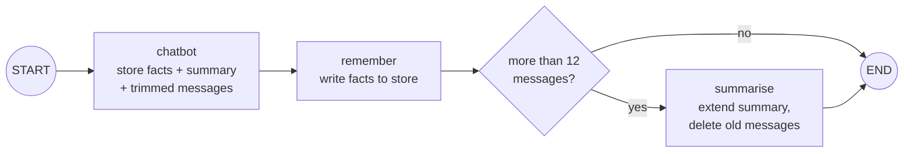

# Lab: Keep a Long Chat Under Budget

> 📚 **Before you start**
>
> - [Trimming and Filtering Messages](trimming-and-filtering-messages.md), [Summarising Long Conversations](summarising-long-conversations.md) and [Long-Term Memory with Stores](long-term-memory-with-stores.md): this lab combines all three.
> - [The LangGraph State System](../04-state-in-depth/the-langgraph-state-system.md), for runtime context.

## What You'll Build

A trip-planning chatbot for a family holiday in Rajasthan, tested over a **30-turn** conversation. The user mentions important details early (4 travellers, kids aged 8 and 11, a ₹1,20,000 budget, vegetarian food, a child who gets motion sickness) and keeps asking questions for a long time.

The goal is a hard rule: **no model call may send more than 400 tokens of prompt**, however long the chat runs, while the important details stay available. You'll first measure a naive bot that breaks the rule, then add three layers:

1. **A trimmed view** so each call sends only recent messages.
2. **A running summary** so older details survive the trimming.
3. **A store** for facts the user explicitly asks the bot to remember, available in every future chat too.



> 💡 **Key Insight**
>
> A token budget is a **guarantee you test**, not a hope. Measure the prompt on every call, run a long scripted conversation, and assert the maximum. Each memory technique covers a different gap: trimming caps the size, summaries carry older context, and the store carries facts across threads.

Run the blocks in order in one file or notebook (`pip install langgraph langchain-core`).

---

## Step 1: The Conversation and the Measuring Tape

Thirty scripted user turns, a scripted chat model, and a list that records the size of every prompt.

```python
from dataclasses import dataclass
from langchain_core.language_models.fake_chat_models import FakeListChatModel
from langchain_core.messages import AIMessage, HumanMessage, RemoveMessage, SystemMessage, trim_messages
from langchain_core.messages.utils import count_tokens_approximately
from langgraph.checkpoint.memory import InMemorySaver
from langgraph.graph import StateGraph, MessagesState, START, END
from langgraph.runtime import Runtime
from langgraph.store.memory import InMemoryStore

USER_TURNS = [
    "Hi, I'm planning a family trip to Rajasthan in December.",
    "Remember: we are vegetarian.",
    "We are 4 people, two adults and two kids aged 8 and 11.",
    "Our total budget is ₹1,20,000 including trains.",
    "We'll start from Pune.",
    "Which cities should we cover in 7 days?",
    "Is Jaisalmer too far for the kids?",
    "OK, let's do Jaipur, Udaipur and Jodhpur.",
    "How do we get from Pune to Jaipur?",
    "What does a 3AC ticket cost roughly?",
    "Remember: my son gets motion sickness on long road trips.",
    "What should we see in Jaipur?",
    "Is Amber Fort good for kids?",
    "Suggest a hotel area in Jaipur.",
    "How do we go from Jaipur to Udaipur?",
    "What about Udaipur sightseeing?",
    "Any boat rides on Lake Pichola?",
    "Food suggestions in Udaipur?",
    "Then Jodhpur, how far is it?",
    "What's special in Jodhpur?",
    "Is Mehrangarh Fort a lot of walking?",
    "How do we get back to Pune from Jodhpur?",
    "Can you total the rough costs?",
    "Are we within budget?",
    "What should we pack for December?",
    "Any festivals in December there?",
    "Should we book trains now?",
    "What is the IRCTC booking window?",
    "Anything else to keep in mind?",
    "Thanks! Can you recap the plan?",
]

def make_chat_llm():
    return FakeListChatModel(responses=[
        f"(answer {i}) Here's a detailed suggestion for your Rajasthan trip, keeping the kids, "
        f"the vegetarian food and your ₹1,20,000 budget in mind." for i in range(1, 31)])

SYSTEM = "You are a friendly Indian travel planner."
BUDGET = 400
prompt_sizes = []

def report(sizes):
    marks = ", ".join(f"t{i}={sizes[i - 1]}" for i in (1, 5, 10, 15, 20, 25, 30))
    print(marks, "| max:", max(sizes), "| over budget:", sum(s > BUDGET for s in sizes), "calls")

print(len(USER_TURNS), "turns;", count_tokens_approximately([AIMessage(make_chat_llm().responses[0])]),
      "tokens per reply")
```

Output:

```
30 turns; 40 tokens per reply
```

The replies are deliberately long-ish (about 40 tokens), like real assistant answers.

---

## Step 2: The Naive Bot

Everything in the thread goes to the model on every call:

```python
def naive_chatbot(state: MessagesState):
    prompt = [SystemMessage(SYSTEM)] + state["messages"]
    prompt_sizes.append(count_tokens_approximately(prompt))
    return {"messages": [chat_llm.invoke(prompt)]}

b = StateGraph(MessagesState)
b.add_node("chatbot", naive_chatbot)
b.add_edge(START, "chatbot")
naive = b.compile(checkpointer=InMemorySaver())

chat_llm = make_chat_llm()
prompt_sizes.clear()
cfg = {"configurable": {"thread_id": "naive"}}
for text in USER_TURNS:
    naive.invoke({"messages": [("user", text)]}, cfg)
report(prompt_sizes)
naive_sizes = list(prompt_sizes)
```

Output:

```
t1=33, t5=248, t10=516, t15=783, t20=1040, t25=1302, t30=1562 | max: 1562 | over budget: 23 calls
```

The prompt grows on every turn and blows through the budget well before the end. In a real app that's latency and cost climbing all conversation long.

---

## Step 3: The State, Context and Prompt Builder

The improved bot needs a `summary` field, the user's id in runtime context, and one function that assembles the prompt from three sources:

```python
@dataclass
class Traveller:
    user_id: str

class TripState(MessagesState):
    summary: str

def build_prompt(state: TripState, runtime: Runtime[Traveller]):
    facts = [i.value["text"] for i in runtime.store.search((runtime.context.user_id, "memories"))]
    system = SYSTEM
    if facts:
        system += " Remember about this user: " + "; ".join(facts) + "."
    if state.get("summary"):
        system += " Earlier in this chat: " + state["summary"] + "."
    return trim_messages([SystemMessage(system)] + state["messages"], max_tokens=BUDGET,
                         token_counter=count_tokens_approximately, strategy="last",
                         start_on="human", include_system=True)
```

The order of operations matters:

- **Store facts** and the **summary** go into the system message, built fresh each call.
- The whole prompt, system message included, is then **trimmed to the budget**. `include_system=True` keeps the system message, and its tokens count against the 400, so as facts and summary grow, fewer recent messages fit. The budget is never broken.
- `start_on="human"` keeps the window valid.

---

## Step 4: The Nodes

```python
def chatbot(state: TripState, runtime: Runtime[Traveller]):
    prompt = build_prompt(state, runtime)
    prompt_sizes.append(count_tokens_approximately(prompt))
    return {"messages": [chat_llm.invoke(prompt)]}

def remember(state: TripState, runtime: Runtime[Traveller]):
    text = state["messages"][-2].content                      # the user's latest message
    if text.lower().startswith("remember:"):
        ns = (runtime.context.user_id, "memories")
        key = f"m{len(runtime.store.search(ns)) + 1}"
        runtime.store.put(ns, key, {"text": text.split(":", 1)[1].strip().rstrip(".")})
    return {}
```

For the summariser we use a small pretend model, so the lab is deterministic. It does what we'd ask a real summariser to do: keep the previous summary and add the user's messages that contain **numbers** (counts, ages, budgets, durations), which are exactly the details that tend to get lost:

```python
class PretendSummariser:
    """Extends the summary with user messages that contain numbers. Same interface as a chat model."""
    def __init__(self):
        self.calls = 0

    def invoke(self, messages):
        self.calls += 1
        instruction = messages[-1].content
        old = instruction.split("Summary so far: ", 1)[1].split("\n", 1)[0]
        notes = [m.content.rstrip(".?") for m in messages[:-1]
                 if isinstance(m, HumanMessage) and any(ch.isdigit() for ch in m.content)]
        return AIMessage("; ".join(([old] if old else []) + notes))

SUMMARY_AT = 12      # summarise when the thread holds more than 12 messages
KEEP = 4             # keep the last 4 messages verbatim

def should_summarise(state: TripState):
    return "summarise" if len(state["messages"]) > SUMMARY_AT else END

def summarise(state: TripState):
    old = state["messages"][:-KEEP]
    instruction = (f"Summary so far: {state.get('summary', '')}\n"
                   "Extend the summary with the messages above. Keep every number and name.")
    new_summary = summariser.invoke(old + [HumanMessage(instruction)]).content
    return {"summary": new_summary, "messages": [RemoveMessage(id=m.id) for m in old]}
```

With a real model, `summariser` would be a chat model (often a cheaper one) and the instruction the same.

---

## Step 5: Wire It Up

```python
b = StateGraph(TripState, context_schema=Traveller)
b.add_node(chatbot)
b.add_node(remember)
b.add_node(summarise)
b.add_edge(START, "chatbot")
b.add_edge("chatbot", "remember")
b.add_conditional_edges("remember", should_summarise, ["summarise", END])
b.add_edge("summarise", END)

store = InMemoryStore()
planner = b.compile(checkpointer=InMemorySaver(), store=store)
print([n for n in planner.get_graph().nodes if not n.startswith("__")])
```

Output:

```
['chatbot', 'remember', 'summarise']
```

---

## Step 6: Run the 30 Turns

```python
chat_llm = make_chat_llm()
summariser = PretendSummariser()
prompt_sizes.clear()
asha = Traveller(user_id="asha")
cfg = {"configurable": {"thread_id": "rajasthan-trip"}}

for text in USER_TURNS:
    planner.invoke({"messages": [("user", text)]}, cfg, context=asha)

report(prompt_sizes)
print("summaries written:", summariser.calls)
print("messages kept in the thread:", len(planner.get_state(cfg).values["messages"]))
```

Output:

```
t1=33, t5=259, t10=286, t15=316, t20=306, t25=311, t30=309 | max: 368 | over budget: 0 calls
summaries written: 5
messages kept in the thread: 10
```

Every call stayed under 400 tokens. The pattern of sizes is a saw-tooth: the prompt grows for a few turns, the summariser compacts the thread, and the size drops again.

Compare the total prompt tokens sent across the whole conversation:

```python
print("naive total:  ", sum(naive_sizes))
print("planner total:", sum(prompt_sizes))
print(f"saved: {1 - sum(prompt_sizes) / sum(naive_sizes):.0%}")
```

Output:

```
naive total:   24112
planner total: 8092
saved: 66%
```

---

## Step 7: Did the Important Details Survive?

A budget is only half the job. Let's check what the model knows on the final turn, even though early messages were deleted long ago:

```python
final_state = planner.get_state(cfg).values
print("SUMMARY:", final_state["summary"])
print()
print("STORE:", [i.value["text"] for i in store.search(("asha", "memories"))])
print()
print("RECENT:", [m.content for m in final_state["messages"] if m.type == "human"])
```

Output:

```
SUMMARY: We are 4 people, two adults and two kids aged 8 and 11; Our total budget is ₹1,20,000 including trains; Which cities should we cover in 7 days; What does a 3AC ticket cost roughly

STORE: ['we are vegetarian', 'my son gets motion sickness on long road trips']

RECENT: ['Any festivals in December there?', 'Should we book trains now?', 'What is the IRCTC booking window?', 'Anything else to keep in mind?', 'Thanks! Can you recap the plan?']
```

| Detail | Where it survived |
|---|---|
| 4 people, kids aged 8 and 11 | Summary |
| ₹1,20,000 budget | Summary |
| 7 days | Summary |
| Vegetarian | Store |
| Son gets motion sickness | Store |
| The last few questions | Recent messages, verbatim |

One detail is **lost**: "We'll start from Pune." It has no number, so our pretend summariser skipped it. That's the honest weakness of summarisation: it keeps what the summariser thinks matters. A real model, asked to "keep every number and name", would very likely keep it, and the fix in our rules is equally simple. Exercise 2 handles it.

---

## Step 8: Memory That Follows the User

The store isn't tied to the thread. When Asha starts a brand-new chat next month, her facts are there from the first message:

```python
chat_llm = FakeListChatModel(responses=["Welcome back! Goa in March sounds lovely."])
new_cfg = {"configurable": {"thread_id": "goa-trip"}}
planner.invoke({"messages": [("user", "Now let's plan Goa in March.")]}, new_cfg, context=asha)

first_prompt_system = build_prompt(planner.get_state(new_cfg).values,
                                   type("R", (), {"store": store, "context": asha})())[0]
print(first_prompt_system.content)
```

Output:

```
You are a friendly Indian travel planner. Remember about this user: we are vegetarian; my son gets motion sickness on long road trips.
```

The new thread has no summary (it's a new conversation) but does have the store facts. (The `type("R", ...)` line builds a tiny stand-in for the runtime so we can call `build_prompt` outside the graph and print what the model saw.)

---

## Step 9: Make the Budget a Test

Turn the guarantee into an automated check, so a future change (a longer system prompt, more facts) can't silently break it:

```python
def check_budget(app, turns, budget, user_id="test-user"):
    global chat_llm, summariser
    chat_llm, summariser = make_chat_llm(), PretendSummariser()
    prompt_sizes.clear()
    c = {"configurable": {"thread_id": f"budget-test-{user_id}"}}
    for text in turns:
        app.invoke({"messages": [("user", text)]}, c, context=Traveller(user_id=user_id))
    assert max(prompt_sizes) <= budget, f"max prompt {max(prompt_sizes)} > {budget}"
    return max(prompt_sizes)

print("max prompt over 60 turns:", check_budget(planner, USER_TURNS * 2, BUDGET))
```

Output:

```
max prompt over 60 turns: 381
```

Sixty turns, still within budget. In a real project this belongs in your test suite with a scripted conversation that resembles your users'.

---

## Try It Yourself

1. **Tighter budget.** Set `BUDGET = 250` and rerun Step 6 on a new thread. Is the budget still respected? What does the model lose?
2. **Keep the starting city.** Change `PretendSummariser` so it also keeps user messages that mention a place from a list (`["Pune", "Jaipur", "Udaipur", "Jodhpur"]`). Rerun and check that "start from Pune" survives.
3. **Summary growth.** The summary keeps growing. Write `compact(summary, max_items=4)` that keeps only the last `max_items` "; "-separated notes, and use it in `summarise`. What risk does this introduce?

<details>
<summary>Show answers</summary>

**1.** The trim still enforces the budget, because the system message is counted first and fewer recent messages fit:

```python
BUDGET = 250
print("max prompt:", check_budget(planner, USER_TURNS, BUDGET, user_id="tight"))
last_prompt = build_prompt(planner.get_state({"configurable": {"thread_id": "budget-test-tight"}}).values,
                           type("R", (), {"store": store, "context": Traveller("tight")})())
print(len(last_prompt) - 1, "recent messages fit next to the system prompt")
BUDGET = 400
```

Output:

```
max prompt: 247
6 recent messages fit next to the system prompt
```

The cost is less recent context: at 250 tokens the final window held only 6 recent messages (3 exchanges) next to the facts and summary. As the summary grows, the window shrinks further, down to just the latest question.

**2.**

```python
PLACES = ["Pune", "Jaipur", "Udaipur", "Jodhpur"]

class PlaceAwareSummariser(PretendSummariser):
    def invoke(self, messages):
        self.calls += 1
        instruction = messages[-1].content
        old = instruction.split("Summary so far: ", 1)[1].split("\n", 1)[0]
        notes = [m.content.rstrip(".?") for m in messages[:-1] if isinstance(m, HumanMessage)
                 and (any(ch.isdigit() for ch in m.content) or any(p in m.content for p in PLACES))]
        return AIMessage("; ".join(([old] if old else []) + notes))

chat_llm, summariser = make_chat_llm(), PlaceAwareSummariser()
c = {"configurable": {"thread_id": "with-places"}}
for text in USER_TURNS:
    planner.invoke({"messages": [("user", text)]}, c, context=asha)
print("Pune" in planner.get_state(c).values["summary"])
```

Output:

```
True
```

**3.**

```python
def compact(summary: str, max_items: int = 4) -> str:
    return "; ".join(summary.split("; ")[-max_items:])

print(compact("4 people; budget ₹1,20,000; 7 days; 3AC fare; Jaipur to Udaipur; Jodhpur"))
```

Output:

```
7 days; 3AC fare; Jaipur to Udaipur; Jodhpur
```

The risk: the **oldest** notes are dropped first, and those are often the most important (group size, budget). A better compaction asks a model to rewrite the summary shorter while keeping key facts, or moves the most important facts into the store, where trimming never reaches them.

</details>

---

## What You've Learned

- **Measured** prompt size on every call and turned the budget into an **assertion**.
- Built a prompt from **store facts + running summary + trimmed recent messages**, trimming **after** adding the system message so the budget always holds.
- Used a **summary** to carry older details past trimming, and **`RemoveMessage`** to keep the thread small.
- Used a **store** for user facts that survive both trimming and new threads.
- Saw the honest limits: summaries keep only what the summariser values, and growing summaries need compaction.

---

**Up next:** [Streaming Real-Time Updates](../08-human-in-the-loop-and-debugging/streaming-real-time-updates.md)
