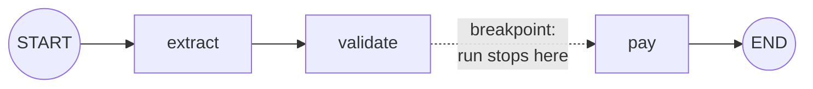

# Breakpoints: The Complete Guide

> 📚 **Before you start**
>
> - [Streaming Real-Time Updates](streaming-real-time-updates.md), for watching a run step by step.
> - [Persistence and Checkpointers](../06-chatbots-and-persistence/persistence-and-checkpointers.md), for `StateSnapshot`, `next` and resuming with `invoke(None, config)`.
> - [The LangGraph State System](../04-state-in-depth/the-langgraph-state-system.md), for what a node sees and returns.

## Introduction

When a programmer can't work out why their code misbehaves, they set a **breakpoint**: "stop just before this line". The program pauses, they look at every variable, maybe change one, and then press "continue" or "step" to move on one line at a time. It's one of the oldest and most effective debugging tools there is.

LangGraph has the same tool at the level of **nodes**. A **static breakpoint** says "pause the run just before (or just after) this node". The graph stops, the state is saved in a checkpoint, and control comes back to you. You inspect the state, optionally change it, and continue with one call. Because every step is checkpointed, the "paused program" isn't even a running process: you could come back to it tomorrow.

This lesson covers `interrupt_before` and `interrupt_after` at compile time and at run time, stepping through a whole graph one node at a time, what a paused thread looks like, editing state at a breakpoint, breakpoints in subgraphs and parallel steps, and why the LangGraph docs recommend breakpoints for **debugging** and the `interrupt()` function (next module) for **human approvals**.

> 💡 **Key Insight**
>
> A breakpoint doesn't stop a node halfway. It stops the run **between super-steps**: `interrupt_before=["pay"]` ends the run just before `pay` would start, with `next == ("pay",)` in the saved checkpoint. Resuming is simply `invoke(None, config)`: "no new input, carry on from the checkpoint".

---

## Core Explanation

### 1. A workflow to debug

An accounts-payable workflow for a small business: extract the invoice details, validate them, pay the vendor. The `pay` node is the risky one, so we count how often it really runs.

```python
import operator
from typing import Annotated, TypedDict
from langgraph.graph import StateGraph, START, END
from langgraph.checkpoint.memory import InMemorySaver

class Invoice(TypedDict):
    text: str
    vendor: str
    amount: float
    status: str
    log: Annotated[list, operator.add]

payments = []

def extract(state: Invoice):
    # A real app would use an LLM or OCR here. This one has a bug: it reads ₹48,000 as 4800.0.
    return {"vendor": "Shree Ganesh Traders", "amount": 4800.0, "log": ["extracted"]}

def validate(state: Invoice):
    ok = 0 < state["amount"] <= 100_000
    return {"status": "valid" if ok else "invalid", "log": [f"validated: {ok}"]}

def pay(state: Invoice):
    payments.append((state["vendor"], state["amount"]))
    return {"status": "paid", "log": [f"paid ₹{state['amount']:,.0f}"]}

builder = StateGraph(Invoice)
builder.add_sequence([extract, validate, pay])
builder.add_edge(START, "extract")
builder.add_edge("pay", END)

INVOICE = "Invoice #1182 from Shree Ganesh Traders. Amount payable: ₹48,000."
```

### 2. `interrupt_before`: stop before a node

Compile with a checkpointer and a list of node names to stop before:

```python
app = builder.compile(checkpointer=InMemorySaver(), interrupt_before=["pay"])
cfg = {"configurable": {"thread_id": "inv-1182"}}

result = app.invoke({"text": INVOICE, "log": []}, cfg)
print("returned:", result)
print("payments so far:", payments)

snap = app.get_state(cfg)
print("next:", snap.next)
print("amount about to be paid:", snap.values["amount"])
```

Output:

```
returned: {'text': 'Invoice #1182 from Shree Ganesh Traders. Amount payable: ₹48,000.', 'vendor': 'Shree Ganesh Traders', 'amount': 4800.0, 'status': 'valid', 'log': ['extracted', 'validated: True']}
payments so far: []
next: ('pay',)
amount about to be paid: 4800.0
```

The run stopped with `extract` and `validate` done and `pay` not started. `invoke` returned the state so far, as it would at the end of any run; nothing raised. The checkpoint's `next` says what will run when we continue, and the state shows the bug: ₹4,800 instead of ₹48,000.



A breakpoint needs a checkpointer. Without one the run still stops at the breakpoint, but nothing is saved, so there's no paused state to inspect or resume: the remaining nodes are simply never run.

### 3. Fix the state, then continue

At the breakpoint we can correct the amount with `update_state` (covered fully in [Editing State with Human Input](editing-state-with-human-input.md)) and resume with `None`:

```python
app.update_state(cfg, {"amount": 48000.0})
print("next is still:", app.get_state(cfg).next)

final = app.invoke(None, cfg)
print(final["log"])
print("payments:", payments)
```

Output:

```
next is still: ('pay',)
['extracted', 'validated: True', 'paid ₹48,000']
payments: [('Shree Ganesh Traders', 48000.0)]
```

The payment went out with the corrected amount, and `pay` ran exactly once. `update_state` here acted as if the node that last ran (`validate`) had returned the new amount, so the graph still continued to `pay`.

### 4. `interrupt_after`: inspect a node's output

`interrupt_after` stops just after the listed nodes finish, which is handy for checking what a node produced before anything uses it:

```python
inspector = builder.compile(checkpointer=InMemorySaver(), interrupt_after=["extract"])
cfg2 = {"configurable": {"thread_id": "inv-1183"}}

inspector.invoke({"text": INVOICE, "log": []}, cfg2)
snap = inspector.get_state(cfg2)
print("stopped after extract | next:", snap.next, "| extracted:", snap.values["vendor"], snap.values["amount"])
```

Output:

```
stopped after extract | next: ('validate',) | extracted: Shree Ganesh Traders 4800.0
```

"Before `validate`" and "after `extract`" are the same moment in this linear graph. The difference matters when a node has several possible successors (a router) or several predecessors: `interrupt_after=["router"]` pauses whatever the router chose; `interrupt_before=["refund"]` pauses only if the run actually reaches `refund`.

### 5. Breakpoints at run time

You don't have to bake breakpoints into the compiled graph. `invoke` and `stream` accept the same `interrupt_before` and `interrupt_after` arguments, which apply **to that call only**:

```python
plain = builder.compile(checkpointer=InMemorySaver())        # no breakpoints compiled in
payments.clear()
cfg3 = {"configurable": {"thread_id": "inv-1184"}}

plain.invoke({"text": INVOICE, "log": []}, cfg3, interrupt_before=["pay"])
print("paused before:", plain.get_state(cfg3).next, "| payments:", payments)

plain.invoke(None, cfg3)                                     # this call has no breakpoint
print("finished:", plain.get_state(cfg3).next, "| payments:", payments)
```

Output:

```
paused before: ('pay',) | payments: []
finished: () | payments: [('Shree Ganesh Traders', 4800.0)]
```

Run-time breakpoints are ideal for debugging a deployed graph without recompiling it: production calls run straight through; your debugging call stops where you ask.

### 6. Stepping through every node

Pass `"*"` instead of a list to break before (or after) **every** node. Combined with a loop, that's a step-through debugger:

```python
debugger = builder.compile(checkpointer=InMemorySaver())
payments.clear()
cfg4 = {"configurable": {"thread_id": "inv-1185"}}

debugger.invoke({"text": INVOICE, "log": []}, cfg4, interrupt_before="*")
step = 0
while debugger.get_state(cfg4).next:
    snap = debugger.get_state(cfg4)
    print(f"step {step}: about to run {snap.next[0]:9} | amount={snap.values.get('amount')} "
          f"| log={snap.values['log']}")
    debugger.invoke(None, cfg4, interrupt_before="*")
    step += 1
print("done:", debugger.get_state(cfg4).values["log"])
```

Output:

```
step 0: about to run extract   | amount=None | log=[]
step 1: about to run validate  | amount=4800.0 | log=['extracted']
step 2: about to run pay       | amount=4800.0 | log=['extracted', 'validated: True']
done: ['extracted', 'validated: True', 'paid ₹4,800']
```

In a notebook you'd replace the loop with "press Enter to step", printing whatever you're curious about at each stop. LangGraph Studio's "pause before each node" option does exactly this.

### 7. What a paused thread looks like

A thread paused at a static breakpoint is easy to recognise:

```python
paused = builder.compile(checkpointer=InMemorySaver(), interrupt_before=["pay"])
cfg5 = {"configurable": {"thread_id": "inv-1186"}}
paused.invoke({"text": INVOICE, "log": []}, cfg5)

snap = paused.get_state(cfg5)
print("next:      ", snap.next)
print("tasks:     ", [(t.name, t.error, t.interrupts) for t in snap.tasks])
print("interrupts:", snap.interrupts)

for part in paused.stream({"text": INVOICE, "log": []}, {"configurable": {"thread_id": "inv-1187"}},
                          stream_mode="updates", version="v2"):
    print("stream:", part["data"])
```

Output:

```
next:       ('pay',)
tasks:      [('pay', None, ())]
interrupts: ()
stream: {'extract': {'vendor': 'Shree Ganesh Traders', 'amount': 4800.0, 'log': ['extracted']}}
stream: {'validate': {'status': 'valid', 'log': ['validated: True']}}
stream: {'__interrupt__': ()}
```

- `next` names the node that will run.
- The pending task has no error (so it isn't a failure) and **no interrupt payload**: a breakpoint carries no question or data, unlike `interrupt()`.
- In the update stream, a breakpoint shows up as an `__interrupt__` entry with an **empty** tuple.

A failed run (see [Threads, Fault Tolerance and Resuming](../06-chatbots-and-persistence/threads-fault-tolerance-and-resuming.md)) also has `next` set, but its task carries an `error`. Checking `tasks` tells you which situation you're in.

### 8. Parallel steps and subgraphs

**Parallel nodes**: a breakpoint stops the whole super-step. If `pay` and `notify` would run in the same step, `interrupt_before=["pay"]` pauses before **both**, because LangGraph runs super-steps as a unit.

**Subgraphs**: compile the subgraph with its own breakpoint. The parent then pauses at the subgraph node, and `get_state(config, subgraphs=True)` shows where inside it stopped:

```python
class Steps(TypedDict):
    steps: Annotated[list, operator.add]

def check_gst(state: Steps):
    return {"steps": ["GST number checked"]}

def check_bank(state: Steps):
    return {"steps": ["bank account checked"]}

vendor_checks = StateGraph(Steps)
vendor_checks.add_sequence([check_gst, check_bank])
vendor_checks.add_edge(START, "check_gst")
vendor_checks = vendor_checks.compile(interrupt_before=["check_bank"])

class Onboarding(TypedDict):
    vendor: str
    steps: Annotated[list, operator.add]

def start(state: Onboarding):
    return {}

parent = StateGraph(Onboarding)
parent.add_node(start)
parent.add_node("vendor_checks", vendor_checks)
parent.add_edge(START, "start")
parent.add_edge("start", "vendor_checks")
onboarding = parent.compile(checkpointer=InMemorySaver())

cfg6 = {"configurable": {"thread_id": "vendor-77"}}
onboarding.invoke({"vendor": "Shree Ganesh Traders", "steps": []}, cfg6)
snap = onboarding.get_state(cfg6, subgraphs=True)
print("parent next:", snap.next, "| inside the subgraph, next:", snap.tasks[0].state.next)
print(onboarding.invoke(None, cfg6)["steps"])
```

Output:

```
parent next: ('vendor_checks',) | inside the subgraph, next: ('check_bank',)
['GST number checked', 'bank account checked']
```

The subgraph inherited the parent's checkpointer (you don't pass one to the subgraph's `compile`), which is what lets it pause and resume.

### 9. Breakpoints vs `interrupt()`

LangGraph has two ways to pause, and its docs are clear about which is for what: **static breakpoints are for debugging and testing**; for human-in-the-loop features in an app, use the **`interrupt()`** function inside a node. The reasons are visible in this lesson:

| | Static breakpoint | `interrupt()` |
|---|---|---|
| Where it's declared | Node names at compile or run time | A function call inside the node's code |
| Conditional? | No, always stops at that node | Yes, call it only when needed |
| Sends a question to the human? | No payload | Any JSON payload ("Approve ₹48,000 to Shree Ganesh?") |
| Receives an answer? | No; you edit state separately | Yes: `Command(resume=value)` becomes `interrupt()`'s return value |
| Resume with | `invoke(None, config)` | `invoke(Command(resume=...), config)` |
| Best for | Stepping through, inspecting, debugging in Studio | Approvals, edits, clarifying questions |

You'll build approvals properly with `interrupt()` later in this module, starting with [Pausing with interrupt and Resuming with Command](pausing-with-interrupt-and-resuming-with-command.md).

---

## Try It Yourself

1. **Catch the bad amount.** Compile the invoice graph with `interrupt_after=["validate"]`, run it on a new thread, and print the status and amount at the pause.
2. **Cancel a payment.** At a breakpoint before `pay`, how could you stop the payment from ever happening without resuming? Show that the thread stays paused and `payments` is unchanged.
3. **Step counter.** Using run-time `interrupt_after="*"`, count how many `invoke` calls a full run of the invoice graph takes.

<details>
<summary>Show answers</summary>

**1.**

```python
checker = builder.compile(checkpointer=InMemorySaver(), interrupt_after=["validate"])
c = {"configurable": {"thread_id": "ex-1"}}
checker.invoke({"text": INVOICE, "log": []}, c)
s = checker.get_state(c)
print(s.values["status"], s.values["amount"], "| next:", s.next)
```

Output:

```
valid 4800.0 | next: ('pay',)
```

The validator happily accepted ₹4,800, because it's within the allowed range. A human looking at the invoice text next to the extracted amount spots the problem instantly, which is the case for human review.

**2.** Simply don't resume. The thread stays paused forever (or until you delete it); `pay` never runs:

```python
payments.clear()
c = {"configurable": {"thread_id": "ex-2"}}
app.invoke({"text": INVOICE, "log": []}, c)
print("next:", app.get_state(c).next, "| payments:", payments)
```

Output:

```
next: ('pay',) | payments: []
```

To mark it cancelled explicitly, you could `update_state(c, {"status": "cancelled"}, as_node="pay")`, which pretends `pay` ran and returned that update, so the graph moves past it to `END`. The editing-state lesson covers `as_node` in detail.

**3.**

```python
payments.clear()
c = {"configurable": {"thread_id": "ex-3"}}
plain.invoke({"text": INVOICE, "log": []}, c, interrupt_after="*")
pauses = 1
while plain.get_state(c).next:
    plain.invoke(None, c, interrupt_after="*")
    pauses += 1
print(pauses, "calls;", plain.get_state(c).values["log"])
```

Output:

```
3 calls; ['extracted', 'validated: True', 'paid ₹4,800']
```

</details>

---

## Real-World Examples

- **Debugging in LangGraph Studio**: setting "interrupt before" on a node in the UI is a static breakpoint, and the state editor next to it is `update_state`.
- **Testing agents**: tests run a graph to a breakpoint, assert on the state, then resume and assert on the result, checking intermediate steps without mocking them away.
- **Investigating production issues**: a developer reproduces a customer's run on a copy of the graph with run-time breakpoints, without recompiling or redeploying.

---

## Common Misconceptions

### "A breakpoint pauses inside the node"

It pauses between super-steps: before the node starts or after it finishes. To pause in the middle of a node's logic, use `interrupt()`.

### "Breakpoints raise an exception I must catch"

`invoke` returns normally with the state so far. Check `get_state(config).next` to see that the run is paused.

### "Run-time breakpoints stay on the thread"

They apply only to the call they were passed to. A later `invoke(None, config)` without them runs to the end (or to compiled-in breakpoints).

### "Breakpoints are the way to build approval steps"

They work, but they can't be conditional, carry no question and receive no answer. The LangGraph docs recommend `interrupt()` for human-in-the-loop features.

---

## Interview Relevance

*"How do you debug a LangGraph graph step by step?"* Use static breakpoints: `interrupt_before` / `interrupt_after` with node names or `"*"`, at compile time or per call, with a checkpointer. At each pause inspect `get_state` (`values`, `next`, `tasks`), optionally `update_state`, and resume with `invoke(None, config)`. Mention `subgraphs=True` for nested graphs and Studio's UI for the same thing.

*"Breakpoints or interrupt() for an approval step?"* `interrupt()`: it's conditional, carries a payload to the reviewer and returns their answer through `Command(resume=...)`. Static breakpoints are for debugging.

---

## Key Takeaways

- **`interrupt_before` / `interrupt_after`** pause between super-steps at named nodes; they need a **checkpointer**.
- Set them at **compile time** (always on) or **per call** (just this run); `"*"` means every node.
- A paused thread has **`next`** set, a task with **no error and no payload**, and an empty **`__interrupt__`** in the update stream.
- **Resume with `invoke(None, config)`**, optionally after **`update_state`** to fix the state.
- Use breakpoints for **debugging**; use **`interrupt()`** for human approvals and questions.

---

**Up next:** [Pausing with interrupt and Resuming with Command](pausing-with-interrupt-and-resuming-with-command.md)
