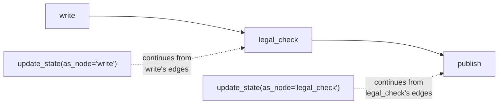
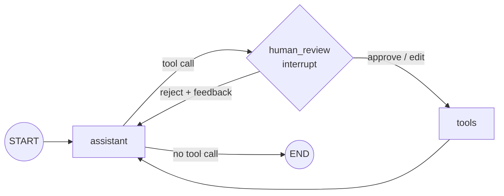

# Editing State with Human Input: The Complete Guide

> 📚 **Before you start**
>
> - [Pausing with interrupt and Resuming with Command](pausing-with-interrupt-and-resuming-with-command.md), for `interrupt()`, resume values and `Command(goto=...)`.
> - [Breakpoints](breakpoints.md), where you first fixed state at a pause with `update_state`.
> - [State Reducers](../04-state-in-depth/state-reducers.md), because every edit goes through the reducers, and `add_messages` replaces messages by id.
> - [Tools in LangGraph: ToolNode and tools_condition](../05-workflows-and-agents/tools-in-langgraph-toolnode-and-tools-condition.md), for the agent loop in section 5.

## Introduction

A junior lawyer drafts a legal notice and puts it on the senior partner's desk. The partner rarely says just "yes" or "no". Usually they pick up a pen: change "₹2,50,000" to "₹2,75,000", strike out a sentence, add "without prejudice" at the top. Then the notice goes out, **with the edits**, and the junior learns from them.

Approving and rejecting is only half of human-in-the-loop. The other half is **editing**: letting a person change what the agent produced or is about to do, before it takes effect. In LangGraph that means changing the graph's **state** while the run is paused: correcting a draft, fixing a tool call's arguments, adding a note for the model, or skipping a step altogether.

There are two mechanisms, and you'll use both:

1. **Edits through the resume value**: the human's answer to `interrupt()` contains the edited content, and the node writes it into the state.
2. **Edits with `update_state`**: your application writes to the paused thread directly, as if a node had returned the update, and can even choose **which node** it pretends to be with `as_node`.

By the end of this lesson you'll be able to build the classic "approve, edit or reject this tool call" review step, correct an agent's message in place, and redirect a paused graph.

> 💡 **Key Insight**
>
> An edit is just **another state update**, so it follows the same rules as a node's return value: it goes through the **reducers**, and it's recorded as a new **checkpoint**. With `update_state`, the `as_node` argument decides two things at once: whose update this is pretending to be, and therefore **which edges the graph follows next**.

---

## Core Explanation

### 1. Editing through the resume value

The simplest edit needs no new API: the reviewer sends back the corrected content, and the node uses it. A loan-approval letter drafted by a model, reviewed by a credit officer:

```python
import operator
from typing import Annotated, Literal, TypedDict
from langgraph.graph import StateGraph, START, END
from langgraph.checkpoint.memory import InMemorySaver
from langgraph.types import interrupt, Command

class Letter(TypedDict):
    customer: str
    draft: str
    final: str
    log: Annotated[list, operator.add]

def write_draft(state: Letter):
    # A model would write this; it has addressed the customer wrongly.
    return {"draft": "Dear Sir, your home loan of ₹45,00,000 is approved at 8.5% p.a.",
            "log": ["drafted"]}

def officer_review(state: Letter):
    decision = interrupt({"task": "Review the letter", "draft": state["draft"]})
    if decision["action"] == "approve":
        return {"final": state["draft"], "log": ["approved as is"]}
    return {"final": decision["text"], "log": ["edited by officer"]}

b = StateGraph(Letter)
b.add_sequence([write_draft, officer_review])
b.add_edge(START, "write_draft")
letters = b.compile(checkpointer=InMemorySaver())

cfg = {"configurable": {"thread_id": "loan-HL-3391"}}
paused = letters.invoke({"customer": "Asha Kulkarni", "log": []}, cfg)
print("officer sees:", paused["__interrupt__"][0].value["draft"])

edited = "Dear Ms Kulkarni, your home loan of ₹45,00,000 is approved at 8.5% p.a."
out = letters.invoke(Command(resume={"action": "edit", "text": edited}), cfg)
print("final:", out["final"])
print(out["log"])
```

Output:

```
officer sees: Dear Sir, your home loan of ₹45,00,000 is approved at 8.5% p.a.
final: Dear Ms Kulkarni, your home loan of ₹45,00,000 is approved at 8.5% p.a.
['drafted', 'edited by officer']
```

A small, explicit protocol (`{"action": "approve"}` or `{"action": "edit", "text": ...}`) keeps the UI and the graph in agreement. Keeping both `draft` and `final` means you can later compare what the model wrote with what humans approved, which is valuable data for improving prompts.

### 2. `update_state`: writing to a paused thread

Sometimes the edit doesn't fit the question the node asked, or the run is paused at a breakpoint that asks nothing. `update_state(config, values)` writes directly to the thread:

```python
cfg2 = {"configurable": {"thread_id": "loan-HL-3392"}}
letters.invoke({"customer": "Ravi Menon", "log": []}, cfg2)

new_config = letters.update_state(cfg2, {"draft": "Dear Mr Menon, your home loan of ₹45,00,000 is approved."})
snap = letters.get_state(cfg2)
print("next:", snap.next)
print("draft now:", snap.values["draft"])
print("saved as:", snap.metadata["source"], "| returns a config with a checkpoint id:",
      "checkpoint_id" in new_config["configurable"])
```

Output:

```
next: ('officer_review',)
draft now: Dear Mr Menon, your home loan of ₹45,00,000 is approved.
saved as: update | returns a config with a checkpoint id: True
```

- The update was saved as a **new checkpoint** with `source="update"`, so the history shows exactly when a human changed something.
- `update_state` returns the config of that new checkpoint.
- `next` is still `officer_review`: the update didn't move the graph.

What happens to the pending question? The update creates a fresh checkpoint, so the old interrupt is no longer listed on the snapshot, but `officer_review` still has to run. Resume with an answer and the re-run node receives it; resume with `None` and the node simply asks again, now showing the edited draft:

```python
again = letters.invoke(None, cfg2)
print("asked again with:", again["__interrupt__"][0].value["draft"])
print(letters.invoke(Command(resume={"action": "approve"}), cfg2)["final"])
```

Output:

```
asked again with: Dear Mr Menon, your home loan of ₹45,00,000 is approved.
Dear Mr Menon, your home loan of ₹45,00,000 is approved.
```

### 3. Updates go through the reducers

`update_state` behaves exactly like a node returning that dictionary, so reducers apply. `log` has `operator.add`, so an "update" to it **appends**:

```python
letters.update_state(cfg2, {"log": ["note: customer called to confirm"]})
print(letters.get_state(cfg2).values["log"])
```

Output:

```
['drafted', 'approved as is', 'note: customer called to confirm']
```

For a `messages` field with `add_messages`, this is what makes editing messages possible: send a message with the **same id** as an existing one and it's **replaced in place**; send `RemoveMessage(id=...)` and it's deleted. Section 5 relies on that.

### 4. `as_node`: whose update is this?

When the graph continues after an update, it needs to know which edges to follow. LangGraph treats the update as if it came from a node:

- **By default**, the node that ran most recently before that checkpoint.
- **With `as_node="name"`**, the node you name. The graph then continues along **that node's outgoing edges**.

That makes `as_node` a way to **skip** a node (pretend it ran and returned your update) or to **re-route** (pretend a different node produced the update). A publishing pipeline shows both:

```python
class Post(TypedDict):
    text: str
    status: str
    log: Annotated[list, operator.add]

def write(state: Post):
    return {"text": "Diwali sale! 40% off on all pressure cookers.", "log": ["written"]}

def legal_check(state: Post):
    return {"log": ["legal checked"]}

def publish(state: Post):
    return {"status": "published", "log": [f"published: {state['text']}"]}

b = StateGraph(Post)
b.add_sequence([write, legal_check, publish])
b.add_edge(START, "write")
posts = b.compile(checkpointer=InMemorySaver(), interrupt_before=["legal_check"])

# Case A: a human does the legal check themselves, editing the text, and skips the node
c = {"configurable": {"thread_id": "post-A"}}
posts.invoke({"log": []}, c)
posts.update_state(c, {"text": "Diwali sale! Up to 40% off on select pressure cookers. T&C apply.",
                       "log": ["legal checked by a human"]}, as_node="legal_check")
print("A next:", posts.get_state(c).next)
print("A:", posts.invoke(None, c)["log"])

# Case B: the human edits the text as if `write` had produced it; the legal check still runs
c = {"configurable": {"thread_id": "post-B"}}
posts.invoke({"log": []}, c)
posts.update_state(c, {"text": "Diwali sale! Up to 40% off. T&C apply."}, as_node="write")
print("B next:", posts.get_state(c).next)
print("B:", posts.invoke(None, c)["log"])
```

Output:

```
A next: ('publish',)
A: ['written', 'legal checked by a human', 'published: Diwali sale! Up to 40% off on select pressure cookers. T&C apply.']
B next: ('legal_check',)
B: ['written', 'legal checked', 'published: Diwali sale! Up to 40% off. T&C apply.']
```

In case A, `legal_check` never ran: the update stood in for it, and the graph moved on to `publish`. In case B the edit counted as `write`'s output, so `legal_check` still ran on the edited text. You'll use `as_node` again for time travel in module 4, where it decides how a fork continues.



### 5. Reviewing a tool call: approve, edit or reject

The most important editing pattern for agents: **before a risky tool runs, show the call to a human**, who can approve it, fix its arguments, or reject it with feedback for the model. Here's a UPI payment agent with a scripted model:

```python
from langchain_core.language_models.fake_chat_models import GenericFakeChatModel
from langchain_core.messages import AIMessage, ToolMessage
from langchain_core.tools import tool
from langgraph.graph import MessagesState
from langgraph.prebuilt import ToolNode

sent = []

@tool
def send_money(upi_id: str, amount: float, note: str) -> str:
    """Send money over UPI to upi_id."""
    sent.append((upi_id, amount))
    return f"Sent ₹{amount:,.0f} to {upi_id}. Ref UPI{len(sent):04d}."

class ToolFake(GenericFakeChatModel):
    """A scripted chat model that accepts bind_tools, for offline examples."""
    def bind_tools(self, tools, **kwargs):
        return self

def script(*replies):
    return ToolFake(messages=iter(replies)).bind_tools([send_money])

def assistant(state: MessagesState):
    return {"messages": [llm.invoke(state["messages"])]}

def human_review(state: MessagesState) -> Command[Literal["tools", "assistant"]]:
    call = state["messages"][-1].tool_calls[0]
    decision = interrupt({"tool": call["name"], "args": call["args"]})

    if decision["action"] == "approve":
        return Command(goto="tools")

    if decision["action"] == "edit":
        last = state["messages"][-1]
        fixed = AIMessage(content=last.content, id=last.id,          # same id -> replaces it
                          tool_calls=[{**call, "args": {**call["args"], **decision["args"]}}])
        return Command(update={"messages": [fixed]}, goto="tools")

    # reject: answer the tool call ourselves, so the model sees why it didn't happen
    refusal = ToolMessage(f"Not sent. The user said: {decision['feedback']}",
                          tool_call_id=call["id"], name=call["name"])
    return Command(update={"messages": [refusal]}, goto="assistant")

def route_after_assistant(state: MessagesState):
    return "human_review" if state["messages"][-1].tool_calls else END

b = StateGraph(MessagesState)
b.add_node(assistant)
b.add_node(human_review)
b.add_node("tools", ToolNode([send_money]))
b.add_edge(START, "assistant")
b.add_conditional_edges("assistant", route_after_assistant, ["human_review", END])
b.add_edge("tools", "assistant")
pay_agent = b.compile(checkpointer=InMemorySaver())

def pay_call(amount, upi="ramesh.kirana@okhdfc", call_id="c1"):
    return AIMessage("", tool_calls=[{"name": "send_money", "id": call_id,
                                      "args": {"upi_id": upi, "amount": amount, "note": "groceries"}}])
```



**Edit**: the model typed ₹24,000 instead of ₹2,400. The reviewer fixes the amount:

```python
llm = script(pay_call(24000.0), AIMessage("Done! ₹2,400 sent to Ramesh Kirana."))
c = {"configurable": {"thread_id": "pay-edit"}}
out = pay_agent.invoke({"messages": [("user", "Pay Ramesh Kirana 2400 for groceries")]}, c)
print("review:", out["__interrupt__"][0].value)

out = pay_agent.invoke(Command(resume={"action": "edit", "args": {"amount": 2400.0}}), c)
print("sent:", sent)
for m in out["messages"]:
    print(f"  {m.type:5} {m.content or m.tool_calls[0]['args']}")
```

Output:

```
review: {'tool': 'send_money', 'args': {'upi_id': 'ramesh.kirana@okhdfc', 'amount': 24000.0, 'note': 'groceries'}}
sent: [('ramesh.kirana@okhdfc', 2400.0)]
  human Pay Ramesh Kirana 2400 for groceries
  ai    {'upi_id': 'ramesh.kirana@okhdfc', 'amount': 2400.0, 'note': 'groceries'}
  tool  Sent ₹2,400 to ramesh.kirana@okhdfc. Ref UPI0001.
  ai    Done! ₹2,400 sent to Ramesh Kirana.
```

The tool ran with the corrected amount, and, importantly, the conversation history now shows the **corrected** tool call (the original AI message was replaced by id), so the history is consistent with what actually happened.

**Reject**: the reviewer refuses and says why. The model receives that as the tool result and can respond sensibly:

```python
llm = script(pay_call(2400.0, upi="ramesh.kirana@ybl"),
             AIMessage("Understood, I haven't sent anything. Please share Ramesh's correct UPI ID."))
c = {"configurable": {"thread_id": "pay-reject"}}
sent.clear()
pay_agent.invoke({"messages": [("user", "Pay Ramesh 2400")]}, c)
out = pay_agent.invoke(Command(resume={"action": "reject",
                                       "feedback": "wrong UPI ID, it should be @okhdfc"}), c)
print("sent:", sent)
for m in out["messages"][-2:]:
    print(f"  {m.type:5} {m.content}")
```

Output:

```
sent: []
  tool  Not sent. The user said: wrong UPI ID, it should be @okhdfc
  ai    Understood, I haven't sent anything. Please share Ramesh's correct UPI ID.
```

Answering the tool call with a `ToolMessage` matters: model APIs expect every tool call to be followed by a result. Simply skipping the tool would leave a dangling call and the next model request would fail.

**Approve** is just `Command(resume={"action": "approve"})`. You'll build the full version, with an amount threshold and an audit trail, in the lab.

### 6. The same edit with a breakpoint and `update_state`

Before `interrupt()` existed, the standard recipe was: stop **before** the tools node with a breakpoint, edit the AI message with `update_state`, then resume with `None`. You'll see it in many tutorials, and it's still handy when debugging:

```python
b = StateGraph(MessagesState)
b.add_node(assistant)
b.add_node("tools", ToolNode([send_money]))
b.add_edge(START, "assistant")
b.add_conditional_edges("assistant", lambda s: "tools" if s["messages"][-1].tool_calls else END,
                        ["tools", END])
b.add_edge("tools", "assistant")
classic = b.compile(checkpointer=InMemorySaver(), interrupt_before=["tools"])

llm = script(pay_call(24000.0), AIMessage("Sent ₹2,400."))
sent.clear()
c = {"configurable": {"thread_id": "classic"}}
classic.invoke({"messages": [("user", "Pay Ramesh 2400")]}, c)

last = classic.get_state(c).values["messages"][-1]
fixed_call = {**last.tool_calls[0], "args": {**last.tool_calls[0]["args"], "amount": 2400.0}}
classic.update_state(c, {"messages": [AIMessage("", id=last.id, tool_calls=[fixed_call])]})

classic.invoke(None, c)
print("sent:", sent)
```

Output:

```
sent: [('ramesh.kirana@okhdfc', 2400.0)]
```

It works, but the `interrupt()` version is better for real apps: the review is part of the graph's logic, it can be conditional ("only for amounts above ₹10,000"), and it sends the reviewer a clear payload.

### 7. Choosing an editing approach

| Situation | Approach |
|---|---|
| The reviewer edits the thing the node asked about | Return the edit in the **resume value**; the node writes it |
| An agent's tool call needs approval or fixes | A **review node** with `interrupt()`, routing with `Command(goto=...)`, replacing the AI message by id |
| A reviewer must reject with a reason | Add a **`ToolMessage`** explaining the refusal and route back to the model |
| An operator corrects state outside any question (support console, Studio) | **`update_state`** on the paused thread |
| A human did a step's work themselves | **`update_state(..., as_node="that_step")`** to skip it |
| Debugging | Breakpoint + `update_state` + `invoke(None, ...)` |

Whatever you choose, keep a record: the `source="update"` checkpoints and fields like `draft` vs `final` show what humans changed and why.

---

## Try It Yourself

1. **Edit the note too.** Resume the payment review with an edit that changes both `amount` to 2400 and `note` to `"October groceries"`. Print the tool call that ended up in the history.
2. **Skip with `as_node`.** In the publishing pipeline, a human decides not to publish at all. Use `update_state` with `as_node="publish"` and a `status` of `"cancelled"`. What's `next`, and what's the final log?
3. **Count the human edits.** For thread `"post-A"`, count the checkpoints whose `metadata["source"]` is `"update"` using `get_state_history`.

<details>
<summary>Show answers</summary>

**1.**

```python
llm = script(pay_call(24000.0), AIMessage("Sent."))
sent.clear()
c = {"configurable": {"thread_id": "ex-edit-note"}}
pay_agent.invoke({"messages": [("user", "Pay Ramesh 2400")]}, c)
out = pay_agent.invoke(Command(resume={"action": "edit",
                                       "args": {"amount": 2400.0, "note": "October groceries"}}), c)
print(out["messages"][1].tool_calls[0]["args"])
print("sent:", sent)
```

Output:

```
{'upi_id': 'ramesh.kirana@okhdfc', 'amount': 2400.0, 'note': 'October groceries'}
sent: [('ramesh.kirana@okhdfc', 2400.0)]
```

**2.**

```python
c = {"configurable": {"thread_id": "post-C"}}
posts.invoke({"log": []}, c)
posts.update_state(c, {"status": "cancelled", "log": ["cancelled by marketing head"]}, as_node="publish")
print("next:", posts.get_state(c).next)
print(posts.invoke(None, c)["log"])
```

Output:

```
next: ()
['written', 'cancelled by marketing head']
```

`publish` leads to `END`, so after the pretend-`publish` update there's nothing left to run, and neither `legal_check` nor the real `publish` ever executed.

**3.**

```python
updates = [s for s in posts.get_state_history({"configurable": {"thread_id": "post-A"}})
           if s.metadata["source"] == "update"]
print(len(updates), "human edit(s)")
```

Output:

```
1 human edit(s)
```

</details>

---

## Real-World Examples

- **Email and message drafting assistants** show the draft and let the user edit it before sending; the edited text is what goes out, and the diff is logged for prompt tuning.
- **Payment and procurement agents** route every money-moving tool call through an approve/edit/reject review, as LangChain's `HumanInTheLoopMiddleware` does for `create_agent` agents.
- **Support consoles** let a human agent correct a bot's state (a wrong order id, a misclassified category) mid-conversation with `update_state`.
- **Content pipelines** let an editor do a step themselves (legal review, translation) and mark it done with `as_node`.

---

## Common Misconceptions

### "`update_state` overwrites fields"

It's a normal update: reducers apply. Lists with `operator.add` append; `add_messages` appends, or replaces by id.

### "Rejecting a tool call means just not running it"

The model expects a result for every tool call. Add a `ToolMessage` explaining the rejection, or the next model call can fail.

### "`as_node` only changes a label"

It decides which edges the graph follows next, so it can skip or re-route steps.

### "Editing loses the original"

The original stays in earlier checkpoints, and the edit is recorded as a separate `source="update"` checkpoint. You can always see both.

---

## Interview Relevance

*"How would you let a human edit an agent's action before it runs?"* Add a review node before the tools node that calls `interrupt()` with the tool call; on resume, approve (goto tools), edit (replace the AI message by id with corrected `tool_calls`, then goto tools), or reject (add a `ToolMessage` with the reason and goto the model). Alternatives: a breakpoint plus `update_state`, or LangChain's `HumanInTheLoopMiddleware`.

*"What does `as_node` do in `update_state`?"* It makes the update appear to come from that node, so reducers run as normal and the graph continues along that node's edges: useful to skip a step, re-route, or fork during time travel.

---

## Key Takeaways

- Humans edit state either through the **resume value** or with **`update_state`** on the paused thread.
- Every edit is a normal **update through the reducers**, saved as a **`source="update"`** checkpoint.
- **`as_node`** decides whose update it is and therefore **where the graph goes next**.
- For tool calls: **approve**, **edit** (replace the AI message by **id**), or **reject** with a **`ToolMessage`**.
- Prefer an **`interrupt()` review node** in apps; use breakpoint + `update_state` for debugging.

---

**Up next:** [Dynamic Breakpoints](dynamic-breakpoints.md)
