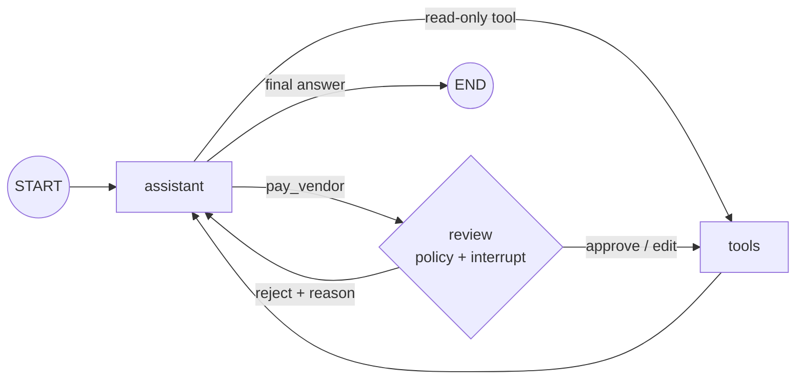

# Lab: Approval Step Before a Risky Tool

> 📚 **Before you start**
>
> - [Pausing with interrupt and Resuming with Command](pausing-with-interrupt-and-resuming-with-command.md), [Editing State with Human Input](editing-state-with-human-input.md) and [Dynamic Breakpoints](dynamic-breakpoints.md): this lab puts all three together.
> - [Streaming Real-Time Updates](streaming-real-time-updates.md), for the console in Step 8.
> - [State Reducers](../04-state-in-depth/state-reducers.md), for the audit-log field.

## What You'll Build

An accounts assistant for a small manufacturing business in Coimbatore. The owner chats with it: "Pay Sri Murugan Steels for invoice 7781." The agent can **look up invoices** (safe, read-only) and **pay vendors** (risky: money leaves the bank). Your job is the safety layer:

- Read-only tools run immediately.
- `pay_vendor` calls go through a **review step**. Small payments to known vendors are auto-approved by a **policy**; anything else pauses for the owner, who can **approve**, **edit** the amount or **reject** with a reason.
- Answers are **validated** with a schema, every decision lands in an **audit log**, and nothing is ever paid twice.



> 💡 **Key Insight**
>
> Put the human **between the decision and the action**: after the model has proposed the tool call, before any tool runs. At that point nothing has happened yet, so pausing for an hour, editing the call, or rejecting it are all completely safe, and the re-run of the review node on resume has no side effects to repeat.

Run the blocks in order in one file or notebook (`pip install langgraph langchain-core`).

---

## Step 1: The Tools and the "Bank"

```python
import operator
from typing import Annotated, Literal, TypedDict
from langchain_core.tools import tool

INVOICES = {
    "7781": {"vendor": "Sri Murugan Steels", "amount": 48250.0, "due": "2026-10-15"},
    "7790": {"vendor": "Kovai Packaging", "amount": 3600.0, "due": "2026-10-20"},
}
KNOWN_VENDORS = {"Sri Murugan Steels", "Kovai Packaging"}
BANK_LEDGER = []                                   # what actually left the account

@tool
def get_invoice(invoice_no: str) -> dict:
    """Look up an invoice: vendor, amount in rupees and due date."""
    return INVOICES.get(invoice_no, {"error": f"invoice {invoice_no} not found"})

@tool
def pay_vendor(vendor: str, amount: float, invoice_no: str) -> str:
    """Pay a vendor by NEFT for an invoice. Moves real money."""
    BANK_LEDGER.append({"vendor": vendor, "amount": amount, "invoice": invoice_no})
    return f"Paid ₹{amount:,.0f} to {vendor} for invoice {invoice_no}. UTR N{len(BANK_LEDGER):06d}."

TOOLS = [get_invoice, pay_vendor]
RISKY = {"pay_vendor"}
print(get_invoice.invoke({"invoice_no": "7781"}))
```

Output:

```
{'vendor': 'Sri Murugan Steels', 'amount': 48250.0, 'due': '2026-10-15'}
```

`RISKY` is the list of tools that need review. Keeping it as data, not scattered `if`s, makes it easy to audit and extend.

---

## Step 2: State with an Audit Log

```python
from langgraph.graph import MessagesState

class AccountsState(MessagesState):
    audit: Annotated[list, operator.add]       # one entry per review decision, append-only
```

The `operator.add` reducer means review decisions can only be **added**, never overwritten, which is what an audit trail should be.

---

## Step 3: A Scripted Model

The usual offline stand-in: a `GenericFakeChatModel` subclass whose `bind_tools` returns itself, plus a helper to build tool calls.

```python
from langchain_core.language_models.fake_chat_models import GenericFakeChatModel
from langchain_core.messages import AIMessage, ToolMessage

class ToolFake(GenericFakeChatModel):
    """A scripted chat model that accepts bind_tools, for offline examples."""
    def bind_tools(self, tools, **kwargs):
        return self

def call(name, call_id, **args):
    return AIMessage("", tool_calls=[{"name": name, "args": args, "id": call_id}])

def assistant(state: AccountsState):
    return {"messages": [llm.invoke(state["messages"])]}
```

With a real model you'd write `llm = ChatAnthropic(model="claude-opus-5-5").bind_tools(TOOLS)`.

---

## Step 4: The Review Policy

Which `pay_vendor` calls need a human? A policy function returns the reasons (empty list means auto-approve). It reads only the tool call's arguments, so it gives the same answer every time the review node runs:

```python
AUTO_APPROVE_LIMIT = 5_000

def review_reasons(args: dict) -> list[str]:
    reasons = []
    if args["amount"] > AUTO_APPROVE_LIMIT:
        reasons.append(f"amount ₹{args['amount']:,.0f} is above ₹{AUTO_APPROVE_LIMIT:,}")
    if args["vendor"] not in KNOWN_VENDORS:
        reasons.append(f"{args['vendor']} is not a known vendor")
    invoice = INVOICES.get(args["invoice_no"])
    if invoice and abs(invoice["amount"] - args["amount"]) > 1:
        reasons.append(f"amount differs from invoice (₹{invoice['amount']:,.0f})")
    return reasons

print(review_reasons({"vendor": "Kovai Packaging", "amount": 3600.0, "invoice_no": "7790"}))
print(review_reasons({"vendor": "Sri Murugan Steels", "amount": 4825.0, "invoice_no": "7781"}))
```

Output:

```
[]
['amount differs from invoice (₹48,250)']
```

The second case is the interesting one: ₹4,825 is under the limit, but it doesn't match the invoice (a decimal slipped). A pure amount threshold would have paid it automatically.

---

## Step 5: The Review Node

The reviewer's answer is validated with a `response_schema`, so the app can only send well-formed decisions:

```python
from pydantic import BaseModel, Field
from langgraph.types import interrupt, Command

class Decision(BaseModel):
    action: Literal["approve", "edit", "reject"]
    amount: float | None = Field(default=None, gt=0)       # for "edit"
    reason: str = ""                                       # for "reject" (or a note)

def review(state: AccountsState) -> Command[Literal["tools", "assistant"]]:
    last = state["messages"][-1]
    call = last.tool_calls[0]
    reasons = review_reasons(call["args"])

    if not reasons:
        return Command(goto="tools",
                       update={"audit": [{"call": call["id"], "decision": "auto-approved"}]})

    d = interrupt({"tool": call["name"], "args": call["args"], "reasons": reasons},
                  response_schema=Decision)

    if d.action == "approve":
        return Command(goto="tools",
                       update={"audit": [{"call": call["id"], "decision": "approved", "note": d.reason}]})

    if d.action == "edit":
        new_args = {**call["args"], "amount": d.amount}
        fixed = AIMessage(last.content, id=last.id, tool_calls=[{**call, "args": new_args}])
        return Command(goto="tools", update={
            "messages": [fixed],
            "audit": [{"call": call["id"], "decision": f"edited amount to {d.amount:,.0f}"}]})

    refusal = ToolMessage(f"Payment NOT made. Reviewer: {d.reason}", tool_call_id=call["id"], name=call["name"])
    return Command(goto="assistant", update={
        "messages": [refusal],
        "audit": [{"call": call["id"], "decision": "rejected", "note": d.reason}]})
```

What makes this node safe:

- It has **no side effects before `interrupt()`**: it reads the state and computes reasons, nothing else. Re-running it on resume is harmless.
- **Auto-approval** is recorded in the audit log too, so you can later check what the policy let through.
- **Edit** replaces the AI message **by id**, so the history matches what was actually paid.
- **Reject** answers the tool call with a `ToolMessage`, so the model knows what happened and the conversation stays valid.

This handles one tool call per message, which is enough for the lab. Exercise 3 extends it to several.

---

## Step 6: Routing and Wiring

After the assistant speaks, route to `review` if any call is risky, to `tools` if all calls are read-only, and to `END` if there are no calls:

```python
from langgraph.graph import StateGraph, START, END
from langgraph.prebuilt import ToolNode
from langgraph.checkpoint.memory import InMemorySaver

def route(state: AccountsState):
    calls = state["messages"][-1].tool_calls
    if not calls:
        return END
    return "review" if any(c["name"] in RISKY for c in calls) else "tools"

b = StateGraph(AccountsState)
b.add_node(assistant)
b.add_node(review)
b.add_node("tools", ToolNode(TOOLS))
b.add_edge(START, "assistant")
b.add_conditional_edges("assistant", route, ["review", "tools", END])
b.add_edge("tools", "assistant")
accounts = b.compile(checkpointer=InMemorySaver())
print(sorted(n for n in accounts.get_graph().nodes if not n.startswith("__")))
```

Output:

```
['assistant', 'review', 'tools']
```

---

## Step 7: Three Scenarios

A helper runs one conversation turn and returns either the pending review or the final reply:

```python
def turn(thread, text=None, resume=None):
    cfg = {"configurable": {"thread_id": thread}}
    payload = Command(resume=resume) if resume is not None else {"messages": [("user", text)]}
    out = accounts.invoke(payload, cfg, version="v2")
    if out.interrupts:
        return "NEEDS REVIEW", out.interrupts[0].value
    return "DONE", out.value["messages"][-1].content
```

**Scenario A: a small, matching payment is auto-approved.**

```python
llm = ToolFake(messages=iter([
    call("get_invoice", "c1", invoice_no="7790"),
    call("pay_vendor", "c2", vendor="Kovai Packaging", amount=3600.0, invoice_no="7790"),
    AIMessage("Paid ₹3,600 to Kovai Packaging for invoice 7790."),
]))
print(turn("pay-7790", "Pay Kovai Packaging's invoice 7790"))
print("ledger:", BANK_LEDGER)
```

Output:

```
('DONE', 'Paid ₹3,600 to Kovai Packaging for invoice 7790.')
ledger: [{'vendor': 'Kovai Packaging', 'amount': 3600.0, 'invoice': '7790'}]
```

**Scenario B: a large payment, approved after review.**

```python
llm = ToolFake(messages=iter([
    call("get_invoice", "c1", invoice_no="7781"),
    call("pay_vendor", "c2", vendor="Sri Murugan Steels", amount=48250.0, invoice_no="7781"),
    AIMessage("Done. ₹48,250 paid to Sri Murugan Steels; UTR N000002."),
]))
status, info = turn("pay-7781", "Pay Sri Murugan Steels for invoice 7781")
print(status, info["reasons"])
print("ledger before approval:", len(BANK_LEDGER), "payment(s)")
print(turn("pay-7781", resume={"action": "approve", "reason": "checked against the GRN"}))
print("ledger after approval: ", len(BANK_LEDGER), "payment(s)")
```

Output:

```
NEEDS REVIEW ['amount ₹48,250 is above ₹5,000']
ledger before approval: 1 payment(s)
('DONE', 'Done. ₹48,250 paid to Sri Murugan Steels; UTR N000002.')
ledger after approval:  2 payment(s)
```

**Scenario C: a typo caught and edited, then a duplicate rejected.**

```python
llm = ToolFake(messages=iter([
    call("pay_vendor", "c1", vendor="Sri Murugan Steels", amount=4825.0, invoice_no="7781"),
    AIMessage("Paid the corrected amount."),
]))
status, info = turn("pay-7781-again", "Pay Murugan Steels 7781 again, 4825")
print(status, info["reasons"])
print(turn("pay-7781-again", resume={"action": "edit", "amount": 48250.0}))

llm = ToolFake(messages=iter([
    call("pay_vendor", "c2", vendor="Sri Murugan Steels", amount=48250.0, invoice_no="7781"),
    AIMessage("Understood, I won't pay invoice 7781 again."),
]))
turn("pay-7781-again", "Pay it once more to be safe")
print(turn("pay-7781-again", resume={"action": "reject", "reason": "invoice 7781 is already paid"}))
print("ledger:", [(e["invoice"], e["amount"]) for e in BANK_LEDGER])
```

Output:

```
NEEDS REVIEW ['amount differs from invoice (₹48,250)']
('DONE', 'Paid the corrected amount.')
('DONE', "Understood, I won't pay invoice 7781 again.")
ledger: [('7790', 3600.0), ('7781', 48250.0), ('7781', 48250.0)]
```

The first review caught a ₹4,825 payment that didn't match the invoice and corrected it. The second payment request on the same invoice was a duplicate; the reviewer rejected it with a reason, which the model saw as the tool result.

But look at the ledger: invoice 7781 has now been paid **twice** in total (Scenario B and the edited payment in C). Our policy didn't check whether an invoice was already paid; a human noticed only on the third request. Exercise 1 fixes the policy.

---

## Step 8: A Reviewer Console with Streaming

In a real app the reviewer sees requests in a UI. This loop plays that part: it streams the run, prints progress, and when an `__interrupt__` arrives, takes the next decision from a queue (standing in for a human clicking buttons):

```python
def console(thread, text, decisions):
    cfg = {"configurable": {"thread_id": thread}}
    payload = {"messages": [("user", text)]}
    decisions = list(decisions)
    while True:
        paused = None
        for part in accounts.stream(payload, cfg, stream_mode="updates", version="v2"):
            for node, update in part["data"].items():
                if node == "__interrupt__":
                    paused = update[0].value
                else:
                    print(f"  [{node}] ran")
        if not paused:
            return accounts.get_state(cfg).values["messages"][-1].content
        decision = decisions.pop(0)
        print(f"  REVIEW {paused['args']['vendor']} ₹{paused['args']['amount']:,.0f} "
              f"({'; '.join(paused['reasons'])}) -> {decision['action']}")
        payload = Command(resume=decision)

INVOICES["7802"] = {"vendor": "Annapoorna Caterers", "amount": 12400.0, "due": "2026-10-25"}
llm = ToolFake(messages=iter([
    call("get_invoice", "c1", invoice_no="7802"),
    call("pay_vendor", "c2", vendor="Annapoorna Caterers", amount=12400.0, invoice_no="7802"),
    AIMessage("Paid Annapoorna Caterers ₹12,400 for the Diwali lunch."),
]))
print(console("pay-7802", "Pay the caterer for the Diwali lunch, invoice 7802",
              [{"action": "approve", "reason": "first-time vendor, verified GSTIN"}]))
```

Output:

```
  [assistant] ran
  [tools] ran
  [assistant] ran
  REVIEW Annapoorna Caterers ₹12,400 (amount ₹12,400 is above ₹5,000; Annapoorna Caterers is not a known vendor) -> approve
  [review] ran
  [tools] ran
  [assistant] ran
Paid Annapoorna Caterers ₹12,400 for the Diwali lunch.
```

The same loop works whether the decision comes back in a second or in a week, because each resume is a separate call on the saved thread.

---

## Step 9: The Audit Trail

Every decision is in the state, and every human input is a checkpoint in the history:

```python
for thread in ["pay-7790", "pay-7781", "pay-7781-again", "pay-7802"]:
    audit = accounts.get_state({"configurable": {"thread_id": thread}}).values["audit"]
    print(thread, [(a["call"], a["decision"]) for a in audit])

bad = {"action": "approve", "amount": -5}
try:
    from pydantic import ValidationError
    Decision(**bad)
except ValidationError as e:
    print("invalid decision rejected:", e.errors()[0]["loc"], e.errors()[0]["type"])
```

Output:

```
pay-7790 [('c2', 'auto-approved')]
pay-7781 [('c2', 'approved')]
pay-7781-again [('c1', 'edited amount to 48,250'), ('c2', 'rejected')]
pay-7802 [('c2', 'approved')]
invalid decision rejected: ('amount',) greater_than
```

The audit shows what was decided for each tool call (in a real app you'd also record the reviewer's user id and a timestamp); the `Decision` schema rejects malformed answers before they ever reach the graph (when sent as a resume value, the thread simply stays paused, as you saw in the interrupt lesson).

---

## Try It Yourself

1. **Block double payments.** Add a rule to `review_reasons`: if the invoice already appears in `BANK_LEDGER`, add the reason `"invoice already paid"`. Show that a repeat payment for 7790 now pauses for review.
2. **Read-only tools never pause.** Script a turn where the model only calls `get_invoice` twice and answers. Show the audit log stays empty and no interrupt happens.
3. **Several calls at once.** Change `review` so that if the last AI message has several `pay_vendor` calls, it sends **one** interrupt listing all of them and expects a list of decisions in the same order. (Sketch the code; approving all is enough to test.)

<details>
<summary>Show answers</summary>

**1.**

```python
_old_reasons = review_reasons

def review_reasons(args: dict) -> list[str]:
    reasons = _old_reasons(args)
    if any(e["invoice"] == args["invoice_no"] for e in BANK_LEDGER):
        reasons.append("invoice already paid")
    return reasons

llm = ToolFake(messages=iter([
    call("pay_vendor", "c1", vendor="Kovai Packaging", amount=3600.0, invoice_no="7790"),
    AIMessage("OK."),
]))
print(turn("repeat-7790", "Pay Kovai 7790"))
```

Output:

```
('NEEDS REVIEW', {'tool': 'pay_vendor', 'args': {'vendor': 'Kovai Packaging', 'amount': 3600.0, 'invoice_no': '7790'}, 'reasons': ['invoice already paid']})
```

`review` looks up `review_reasons` by name each time it runs, so redefining the function changes the policy immediately. A ₹3,600 payment to a known vendor would normally auto-approve; the new rule caught the duplicate.

**2.**

```python
llm = ToolFake(messages=iter([
    call("get_invoice", "c1", invoice_no="7781"),
    call("get_invoice", "c2", invoice_no="7790"),
    AIMessage("Invoice 7781 is ₹48,250 (due 15 Oct) and 7790 is ₹3,600 (due 20 Oct)."),
]))
print(turn("lookups", "What do we owe on 7781 and 7790?"))
print("audit:", accounts.get_state({"configurable": {"thread_id": "lookups"}}).values.get("audit", []))
```

Output:

```
('DONE', 'Invoice 7781 is ₹48,250 (due 15 Oct) and 7790 is ₹3,600 (due 20 Oct).')
audit: []
```

**3.** One way, reusing the single-call logic per call:

```python
def review_many(state: AccountsState) -> Command[Literal["tools", "assistant"]]:
    last = state["messages"][-1]
    calls = last.tool_calls
    decisions = interrupt({"calls": [{"id": c["id"], "args": c["args"],
                                      "reasons": review_reasons(c["args"])} for c in calls]})
    new_calls, refusals, audit = [], [], []
    for c, d in zip(calls, decisions):
        audit.append({"call": c["id"], "decision": d["action"]})
        if d["action"] == "approve":
            new_calls.append(c)
        elif d["action"] == "edit":
            new_calls.append({**c, "args": {**c["args"], "amount": d["amount"]}})
        else:
            refusals.append(ToolMessage(f"Payment NOT made: {d.get('reason', '')}",
                                        tool_call_id=c["id"], name=c["name"]))
    if not new_calls:
        return Command(goto="assistant", update={"messages": refusals, "audit": audit})
    fixed = AIMessage(last.content, id=last.id, tool_calls=new_calls)
    return Command(goto="tools", update={"messages": [fixed, *refusals], "audit": audit})

print(review_many.__name__, "defined; a real version would also auto-approve calls with no reasons.")
```

Output:

```
review_many defined; a real version would also auto-approve calls with no reasons.
```

Rejected calls are removed from the AI message and answered with a `ToolMessage`, approved and edited ones stay, so `ToolNode` runs only those. LangChain's `HumanInTheLoopMiddleware` uses the same idea: one interrupt per model turn with a list of actions and a matching list of decisions.

</details>

---

## What You've Learned

- Put the review **between the model's proposal and the tool's execution**, so pausing has nothing to repeat.
- Used a **policy** to auto-approve safe cases and explain risky ones to the reviewer.
- Implemented **approve, edit and reject** with `Command(goto=...)`, replacing the AI message **by id** and answering rejections with a **`ToolMessage`**.
- **Validated** reviewer answers with `response_schema` and kept an **append-only audit log**.
- Drove the whole flow from a **streaming console** that resumes on the reviewer's decision.

---

**Up next:** [Time Travel: Rewind and Replay](time-travel-rewind-and-replay.md)
