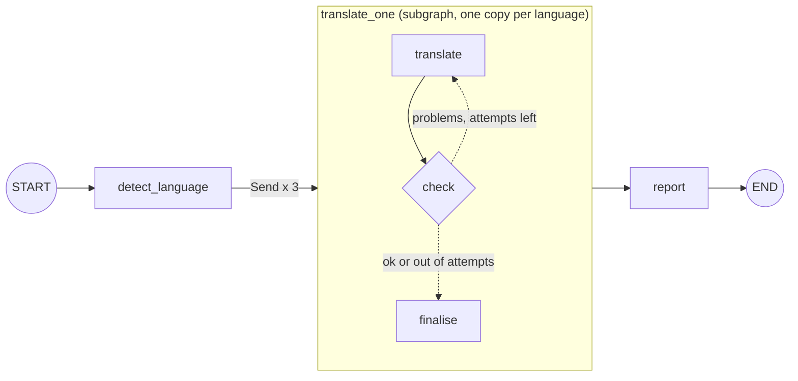

# Lab: Translation Workflow with a Subgraph

> 📚 **Before you start**
>
> - [What are Subgraphs?](what-are-subgraphs.md) and [Shared vs Different State in Subgraphs](shared-vs-different-state-in-subgraphs.md), for everything about the subgraph boundary.
> - [Parallel Workflows](../03-workflow-patterns-in-langgraph/parallel-workflows.md), for `Send`.
> - [Iterative (Looping) Workflows](../03-workflow-patterns-in-langgraph/iterative-looping-workflows.md), for the check-and-retry loop.

## What You'll Build

Indian Railways announcements go out in several languages. You'll build a workflow that takes one English announcement and produces checked translations into **Hindi, Tamil and Bengali**, in parallel.

The interesting part is that translating *one* language is itself a small workflow: translate, **check** the result (are all the numbers still there? did anything get dropped?), and if the check fails, **retry with feedback**, up to a limit. That per-language workflow becomes a **subgraph** with a clean interface, and the parent runs one copy per language with `Send`.



> 💡 **Key Insight**
>
> Design the subgraph's **interface first**: it takes `text`, `source_lang` and `target`, and returns one record in `translations`. Everything else (drafts, feedback, attempt counters) is private. A small, explicit interface is what lets the parent run three copies in parallel without them stepping on each other's state.

Run the blocks in order in one file or notebook (`pip install langgraph langchain-core`).

---

## Step 1: Design the States

Three schemas for the subgraph (input, output, and the full internal state) and one for the parent.

```python
import operator
from typing import Annotated, Literal, TypedDict
from langgraph.graph import StateGraph, START, END
from langgraph.types import Send

class TranslateInput(TypedDict):            # what a caller must provide
    text: str
    source_lang: str
    target: str

class TranslateOutput(TypedDict):           # what a caller gets back
    translations: Annotated[list, operator.add]

class TranslateState(TranslateInput, TranslateOutput):   # private working state
    draft: str
    feedback: str
    attempts: int

class JobState(TypedDict):                  # the parent
    text: str
    source_lang: str
    targets: list
    translations: Annotated[list, operator.add]
    report: str
```

`translations` is the **only** key the subgraph shares with the parent, and it has an `operator.add` reducer on both sides, because three parallel copies will each add one record. Each copy starts with an empty `translations` (its `Send` input doesn't include one), so there's no risk of the duplicate-entries trap from the last lesson.

---

## Step 2: A Pretend Translation Model

To run offline we need a model whose answers depend on the prompt (which language, which attempt), since three copies will call it in parallel in an unpredictable order. This small class has the same `.invoke(prompt) → AIMessage` interface as a chat model, and it makes one realistic mistake: its first Tamil attempt drops the platform number.

```python
import re
from langchain_core.messages import AIMessage

TRANSLATIONS = {
    ("hi", 1): "आपकी ट्रेन 12951 2 घंटे देरी से है। कृपया प्लेटफ़ॉर्म 3 पर प्रतीक्षा करें।",
    ("ta", 1): "உங்கள் ரயில் 12951 2 மணி நேரம் தாமதமாக உள்ளது. தயவுசெய்து நடைமேடையில் காத்திருக்கவும்.",
    ("ta", 2): "உங்கள் ரயில் 12951 2 மணி நேரம் தாமதமாக உள்ளது. தயவுசெய்து நடைமேடை 3 இல் காத்திருக்கவும்.",
    ("bn", 1): "আপনার ট্রেন 12951 2 ঘণ্টা দেরিতে চলছে। অনুগ্রহ করে প্ল্যাটফর্ম 3-এ অপেক্ষা করুন।",
}

class PretendTranslator:
    """Answers translation prompts like a chat model would, deterministically."""
    def __init__(self):
        self.calls = []

    def invoke(self, prompt: str) -> AIMessage:
        target = re.search(r"Target language: (\w+)", prompt).group(1)
        attempt = int(re.search(r"Attempt: (\d+)", prompt).group(1))
        self.calls.append((target, attempt))
        return AIMessage(TRANSLATIONS.get((target, attempt), TRANSLATIONS[(target, 1)]))

translator_llm = PretendTranslator()
print(translator_llm.invoke("Target language: hi\nAttempt: 1\nText: ...").content)
translator_llm.calls.clear()
```

Output:

```
आपकी ट्रेन 12951 2 घंटे देरी से है। कृपया प्लेटफ़ॉर्म 3 पर प्रतीक्षा करें।
```

---

## Step 3: The Subgraph Nodes

**Translate.** On a retry, the prompt includes the checker's feedback, just as you'd prompt a real model:

```python
LANG_NAMES = {"hi": "Hindi", "ta": "Tamil", "bn": "Bengali", "en": "English"}

def translate(state: TranslateState):
    attempt = state.get("attempts", 0) + 1
    prompt = (f"Translate this railway announcement from {LANG_NAMES[state['source_lang']]} to "
              f"{LANG_NAMES[state['target']]}. Keep every number exactly.\n"
              f"Target language: {state['target']}\nAttempt: {attempt}\n")
    if state.get("feedback"):
        prompt += f"Your previous translation had problems: {state['feedback']}\n"
    prompt += f"Text: {state['text']}"
    return {"draft": translator_llm.invoke(prompt).content, "attempts": attempt}
```

**Check.** A code check catches the mistakes that matter most in an announcement: missing or changed numbers (train, time, platform), an empty reply, or an untranslated copy of the source.

```python
def check(state: TranslateState):
    problems = []
    if not state["draft"].strip():
        problems.append("empty translation")
    if state["draft"].strip() == state["text"].strip():
        problems.append("text was not translated")
    source_numbers = re.findall(r"\d+", state["text"])
    missing = [n for n in source_numbers if n not in re.findall(r"\d+", state["draft"])]
    if missing:
        problems.append(f"missing numbers {missing}")
    return {"feedback": "; ".join(problems)}

MAX_ATTEMPTS = 3

def route_after_check(state: TranslateState) -> Literal["translate", "finalise"]:
    if state["feedback"] and state["attempts"] < MAX_ATTEMPTS:
        return "translate"
    return "finalise"

def finalise(state: TranslateState):
    return {"translations": [{
        "target": state["target"],
        "text": state["draft"],
        "attempts": state["attempts"],
        "ok": not state["feedback"],
    }]}
```

`finalise` is the only node that writes the shared key, and it writes exactly one record. If attempts run out, the record is still produced but marked `ok: False`, so the parent can flag it for a human instead of silently publishing a bad announcement.

---

## Step 4: Build and Test the Subgraph Alone

```python
sub = StateGraph(TranslateState, input_schema=TranslateInput, output_schema=TranslateOutput)
sub.add_node(translate)
sub.add_node(check)
sub.add_node(finalise)
sub.add_edge(START, "translate")
sub.add_edge("translate", "check")
sub.add_conditional_edges("check", route_after_check)
sub.add_edge("finalise", END)
translate_one = sub.compile()

ANNOUNCEMENT = "Your train 12951 is delayed by 2 hours. Please wait at platform 3."

for update in translate_one.stream({"text": ANNOUNCEMENT, "source_lang": "en", "target": "ta"},
                                   stream_mode="updates"):
    node, data = next(iter(update.items()))
    print(f"{node:9} {({k: v for k, v in data.items() if k != 'draft'})}")
```

Output:

```
translate {'attempts': 1}
check     {'feedback': "missing numbers ['3']"}
translate {'attempts': 2}
check     {'feedback': ''}
finalise  {'translations': [{'target': 'ta', 'text': 'உங்கள் ரயில் 12951 2 மணி நேரம் தாமதமாக உள்ளது. தயவுசெய்து நடைமேடை 3 இல் காத்திருக்கவும்.', 'attempts': 2, 'ok': True}]}
```

The loop works on its own: the first Tamil draft was missing `3`, the checker said so, the second attempt fixed it. Testing the subgraph in isolation like this, before wiring it into anything, is one of the main benefits of the design.

What does a caller get back? Only the output schema:

```python
translator_llm.calls.clear()
print(translate_one.invoke({"text": ANNOUNCEMENT, "source_lang": "en", "target": "hi"}))
```

Output:

```
{'translations': [{'target': 'hi', 'text': 'आपकी ट्रेन 12951 2 घंटे देरी से है। कृपया प्लेटफ़ॉर्म 3 पर प्रतीक्षा करें।', 'attempts': 1, 'ok': True}]}
```

No `draft`, `feedback` or `attempts` at the top level, only the record inside `translations`.

---

## Step 5: The Parent Graph

The parent detects the source language, fans out one `Send` per target to the subgraph, and writes a report once all copies have finished.

```python
def detect_language(state: JobState):
    # a real app might use a language-ID model; ASCII-only text is a fine heuristic here
    return {"source_lang": "en" if state["text"].isascii() else "unknown"}

def fan_out(state: JobState):
    return [Send("translate_one", {"text": state["text"], "source_lang": state["source_lang"], "target": t})
            for t in state["targets"]]

def report(state: JobState):
    lines = []
    for rec in sorted(state["translations"], key=lambda r: r["target"]):
        flag = "OK " if rec["ok"] else "CHECK"
        lines.append(f"[{flag}] {LANG_NAMES[rec['target']]:8} (attempts: {rec['attempts']}) {rec['text']}")
    return {"report": "\n".join(lines)}

job = StateGraph(JobState)
job.add_node(detect_language)
job.add_node("translate_one", translate_one)            # the compiled subgraph as a node
job.add_node(report)
job.add_edge(START, "detect_language")
job.add_conditional_edges("detect_language", fan_out, ["translate_one"])
job.add_edge("translate_one", "report")
job.add_edge("report", END)
pipeline = job.compile()
```

Notes on the wiring:

- `Send("translate_one", {...})` gives each copy of the subgraph its **own input**, matching `TranslateInput`.
- All copies run in the **same super-step**, and their `translations` records merge through the parent's `operator.add` reducer.
- `report` runs once, after all copies finish, and **sorts** the records, because parallel results can arrive in any order.

---

## Step 6: Run It

```python
translator_llm.calls.clear()
result = pipeline.invoke({"text": ANNOUNCEMENT, "targets": ["hi", "ta", "bn"], "translations": []})
print(result["report"])
print()
print("model calls:", sorted(translator_llm.calls))
```

Output:

```
[OK ] Bengali  (attempts: 1) আপনার ট্রেন 12951 2 ঘণ্টা দেরিতে চলছে। অনুগ্রহ করে প্ল্যাটফর্ম 3-এ অপেক্ষা করুন।
[OK ] Hindi    (attempts: 1) आपकी ट्रेन 12951 2 घंटे देरी से है। कृपया प्लेटफ़ॉर्म 3 पर प्रतीक्षा करें।
[OK ] Tamil    (attempts: 2) உங்கள் ரயில் 12951 2 மணி நேரம் தாமதமாக உள்ளது. தயவுசெய்து நடைமேடை 3 இல் காத்திருக்கவும்.

model calls: [('bn', 1), ('hi', 1), ('ta', 1), ('ta', 2)]
```

Four model calls for three languages: Tamil needed a second attempt, the others passed first time. Each copy of the subgraph kept its own `attempts` and `feedback`; they never mixed.

Watch the parallel copies with `subgraphs=True`. Because they run concurrently, we count events per namespace instead of printing them in arrival order:

```python
from collections import Counter

translator_llm.calls.clear()
inner_steps, copies = Counter(), set()
for namespace, update in pipeline.stream({"text": ANNOUNCEMENT, "targets": ["hi", "ta", "bn"], "translations": []},
                                         stream_mode="updates", subgraphs=True):
    if namespace:                                 # an event from inside a subgraph copy
        copies.add(namespace[0])                  # "translate_one:<task id>", unique per copy
        inner_steps[next(iter(update))] += 1
print(len(copies), "subgraph copies;", dict(sorted(inner_steps.items())))
```

Output:

```
3 subgraph copies; {'check': 4, 'finalise': 3, 'translate': 4}
```

Across the three copies: four `translate` steps, four `check` steps, three `finalise` steps, matching the model calls above.

---

## Step 7: Flagging Failures for a Human

What if a language never passes the check? Make the pretend model always drop the number for Bengali, and lower the attempt limit:

```python
TRANSLATIONS[("bn", 1)] = "আপনার ট্রেন 12951 2 ঘণ্টা দেরিতে চলছে। অনুগ্রহ করে প্ল্যাটফর্মে অপেক্ষা করুন।"
MAX_ATTEMPTS = 2
translator_llm.calls.clear()

result = pipeline.invoke({"text": ANNOUNCEMENT, "targets": ["hi", "bn"], "translations": []})
print(result["report"])
bad = [r for r in result["translations"] if not r["ok"]]
print("needs human review:", [LANG_NAMES[r["target"]] for r in bad])
```

Output:

```
[CHECK] Bengali  (attempts: 2) আপনার ট্রেন 12951 2 ঘণ্টা দেরিতে চলছে। অনুগ্রহ করে প্ল্যাটফর্মে অপেক্ষা করুন।
[OK ] Hindi    (attempts: 1) आपकी ट्रेन 12951 2 घंटे देरी से है। कृपया प्लेटफ़ॉर्म 3 पर प्रतीक्षा करें।
needs human review: ['Bengali']
```

The Bengali copy tried twice, ran out of attempts, and returned a record marked for review, while Hindi completed normally. One language failing didn't block the others. In a real system you'd pause here for a human editor using an interrupt (see [Human-in-the-Loop with LangGraph](../course.md)).

Restore the good Bengali translation for the exercises:

```python
TRANSLATIONS[("bn", 1)] = "আপনার ট্রেন 12951 2 ঘণ্টা দেরিতে চলছে। অনুগ্রহ করে প্ল্যাটফর্ম 3-এ অপেক্ষা করুন।"
MAX_ATTEMPTS = 3
```

---

## Step 8: With a Real Model

Only `translate` needs to change. A real model also makes a stronger checker possible: ask a second model to translate the draft **back** to English and compare meanings.

```python
# not-run: needs `pip install langchain-anthropic` and ANTHROPIC_API_KEY
from langchain_anthropic import ChatAnthropic

translator_llm = ChatAnthropic(model="claude-opus-5-5", temperature=0)
checker_llm = ChatAnthropic(model="claude-opus-5-5", temperature=0)

def back_translation_check(state: TranslateState):
    back = checker_llm.invoke(f"Translate to English, literally:\n{state['draft']}").content
    verdict = checker_llm.invoke(
        "Do these two announcements give the same information (train, delay, platform)? "
        f"Answer OK or list what differs.\nA: {state['text']}\nB: {back}").content
    return {"feedback": "" if verdict.strip().upper().startswith("OK") else verdict}
```

Keep the cheap number check too, and run the LLM check only when the numbers pass; the same "code check first, LLM judge second" idea from [Iterative (Looping) Workflows](../03-workflow-patterns-in-langgraph/iterative-looping-workflows.md).

---

## Try It Yourself

1. **A fourth language.** Add Marathi (`"mr"`) with the translation `"तुमची ट्रेन 12951 2 तास उशिराने धावत आहे. कृपया फलाट 3 वर थांबा."` and run the pipeline for all four targets. How many model calls are made?
2. **Reuse the subgraph elsewhere.** Build a tiny graph for a single SMS translation (state: `sms`, `lang`, `translated`) that calls `translate_one` from a **wrapper node**, mapping `sms → text`, `lang → target` and the first record's text back to `translated`.
3. **Check the boundary.** Run `translate_one` for `"ta"` and confirm that `attempts` is **not** a top-level key of the result, but is inside the record.

<details>
<summary>Show answers</summary>

**1.**

```python
LANG_NAMES["mr"] = "Marathi"
TRANSLATIONS[("mr", 1)] = "तुमची ट्रेन 12951 2 तास उशिराने धावत आहे. कृपया फलाट 3 वर थांबा."
translator_llm.calls.clear()
result = pipeline.invoke({"text": ANNOUNCEMENT, "targets": ["hi", "ta", "bn", "mr"], "translations": []})
print(len(translator_llm.calls), "calls;", [r["target"] for r in sorted(result["translations"], key=lambda r: r["target"])])
```

Output:

```
5 calls; ['bn', 'hi', 'mr', 'ta']
```

Five: one each for Hindi, Bengali and Marathi, two for Tamil. Adding a language needed no change to the graph, only data.

**2.**

```python
class SmsState(TypedDict):
    sms: str
    lang: str
    translated: str

def translate_sms(state: SmsState):
    out = translate_one.invoke({"text": state["sms"], "source_lang": "en", "target": state["lang"]})
    return {"translated": out["translations"][0]["text"]}

sb = StateGraph(SmsState)
sb.add_node(translate_sms)
sb.add_edge(START, "translate_sms")
print(sb.compile().invoke({"sms": ANNOUNCEMENT, "lang": "hi"})["translated"])
```

Output:

```
आपकी ट्रेन 12951 2 घंटे देरी से है। कृपया प्लेटफ़ॉर्म 3 पर प्रतीक्षा करें।
```

**3.**

```python
out = translate_one.invoke({"text": ANNOUNCEMENT, "source_lang": "en", "target": "ta"})
print(list(out), "| attempts inside the record:", out["translations"][0]["attempts"])
```

Output:

```
['translations'] | attempts inside the record: 2
```

</details>

---

## What You've Learned

- Design a subgraph's **interface first** with `input_schema` and `output_schema`; keep drafts and counters private.
- A **check-and-retry loop** inside a subgraph, with feedback in the retry prompt and an attempt cap.
- Run **one subgraph copy per item** with `Send`, merging results through a **reducer** on the shared key.
- **Test the subgraph alone** before wiring it in, and **reuse** it from a wrapper node in another graph.
- Mark failed items (`ok: False`) instead of letting one failure block or silently pass the rest.

---

**Up next:** [Deploying and Running LangGraph Apps](../10-deployment-and-observability/deploying-and-running-langgraph-apps.md)
