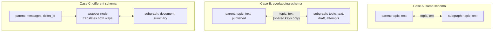

# Shared vs Different State in Subgraphs: The Complete Guide

> 📚 **Before you start**
>
> - [What are Subgraphs?](what-are-subgraphs.md), for adding a compiled graph as a node.
> - [Simple Graphs and Node Connections](../02-getting-started/simple-graphs-and-node-connections.md), for input and output schemas.
> - [The LangGraph Execution Model](../02-getting-started/the-langgraph-execution-model.md), for reducers.

## Introduction

When a company hires a CA firm to file its taxes, it doesn't hand over the entire office. It sends what the CA needs (income statements, investment proofs, the PAN) and gets back what it needs (the filed return and the tax payable). The CA's working papers, draft computations and internal checklists stay at the CA's office. The **interface** between the two is small and clear.

Subgraphs need the same clarity. Sometimes the subgraph works on exactly the same data as the parent, and you can plug it straight in. Often it has **private** working fields (drafts, retry counters, scratch notes) the parent shouldn't care about. And sometimes it was written for a completely **different schema**, perhaps by another team, and you need to translate on the way in and out.

This lesson covers each case, a reducer trap that catches almost everyone the first time, and how to give a subgraph a clean public interface with input and output schemas.

> 💡 **Key Insight**
>
> When you add a compiled subgraph directly as a node, LangGraph connects the two graphs through their **shared keys**: the parent's values for those keys go in, and the subgraph's final values for those keys come back as an **update**, applied with the parent's reducers. Keys only one side has are invisible to the other. When there are no shared keys, or the mapping isn't one-to-one, call the subgraph from a **wrapper node** and translate yourself.

---

## Core Explanation

### 1. The three situations



| Case | How to connect | Example |
|---|---|---|
| **A: same schema** | `add_node("x", subgraph)` | A "polish" subgraph over the same article state |
| **B: overlapping** (shared keys plus private ones) | `add_node("x", subgraph)` | A writer with private `draft` and `attempts` fields |
| **C: different** (no shared keys, or renamed/reshaped data) | A node function that calls `subgraph.invoke(...)` | Reusing a summariser written for `document → summary` inside a chat graph |

Case A you saw in the last lesson. Let's look at B and C.

### 2. Case B: private fields stay private

Here the writer subgraph has two private fields: `draft` (its working copy) and `attempts` (a retry counter for its own loop). The parent only has `topic`, `text` and `published`.

```python
import operator
from typing import Annotated, Literal, TypedDict
from langgraph.graph import StateGraph, START, END

class ParentState(TypedDict):
    topic: str
    text: str
    published: bool

class WriterState(TypedDict):
    topic: str          # shared with the parent
    text: str           # shared with the parent
    draft: str          # private
    attempts: int       # private

seen_by_subgraph = []

def write_draft(state: WriterState):
    seen_by_subgraph.append(sorted(state))
    attempts = state.get("attempts", 0) + 1
    draft = f"{state['topic']}: draft v{attempts}" + (" (too short)" if attempts < 2 else " with details")
    return {"draft": draft, "attempts": attempts}

def check(state: WriterState) -> Literal["write_draft", "finalise"]:
    return "write_draft" if "too short" in state["draft"] else "finalise"

def finalise(state: WriterState):
    return {"text": state["draft"].upper()}

wb = StateGraph(WriterState)
wb.add_node(write_draft)
wb.add_node(finalise)
wb.add_edge(START, "write_draft")
wb.add_conditional_edges("write_draft", check)
wb.add_edge("finalise", END)
writer = wb.compile()

def publish(state: ParentState):
    return {"published": True}

pb = StateGraph(ParentState)
pb.add_node("write", writer)
pb.add_node(publish)
pb.add_edge(START, "write")
pb.add_edge("write", "publish")
pb.add_edge("publish", END)
app = pb.compile()

result = app.invoke({"topic": "monsoon tips", "published": False})
print(result)
print("subgraph received keys:", seen_by_subgraph[0])
```

Output:

```
{'topic': 'monsoon tips', 'text': 'MONSOON TIPS: DRAFT V2 WITH DETAILS', 'published': True}
subgraph received keys: ['topic']
```

Two things happened at the boundary:

- **Going in**, the subgraph received only the keys it has (`topic`; `text` had no value yet). The parent's `published` wasn't passed, because the subgraph doesn't define it.
- **Coming out**, only `text` (a shared key) reached the parent. `draft` and `attempts` did their job inside the subgraph and then disappeared; the parent's result has no trace of them.

This is the most common setup in practice: a subgraph shares the few fields that matter and keeps its working state to itself.

### 3. Case C: different schemas with a wrapper node

Now suppose another team wrote a **summariser** subgraph. It takes `document` and returns `summary`. Your parent is a support chat with `messages` and a `ticket_note`. No keys in common, so adding it directly would pass nothing in and get nothing back. Instead, write a node that translates:

```python
from langchain_core.messages import AIMessage, HumanMessage
from langgraph.graph import MessagesState

class SummaryState(TypedDict):
    document: str
    summary: str

def summarise(state: SummaryState):
    sentences = [s.strip() for s in state["document"].split(".") if s.strip()]
    return {"summary": f"{len(sentences)} points; first: {sentences[0]}."}

sb = StateGraph(SummaryState)
sb.add_node(summarise)
sb.add_edge(START, "summarise")
sb.add_edge("summarise", END)
summariser = sb.compile()

class SupportState(MessagesState):
    ticket_note: str

def write_ticket_note(state: SupportState):
    # translate IN: parent messages -> subgraph document
    transcript = ". ".join(m.content for m in state["messages"] if m.type == "human")
    result = summariser.invoke({"document": transcript})
    # translate OUT: subgraph summary -> parent field
    return {"ticket_note": "Customer said: " + result["summary"]}

sp = StateGraph(SupportState)
sp.add_node(write_ticket_note)
sp.add_edge(START, "write_ticket_note")
sp.add_edge("write_ticket_note", END)
support = sp.compile()

out = support.invoke({"messages": [HumanMessage("My UPI payment failed"),
                                   AIMessage("Sorry! When did it happen?"),
                                   HumanMessage("Yesterday at 6 pm. The money was debited")]})
print(out["ticket_note"])
```

Output:

```
Customer said: 3 points; first: My UPI payment failed.
```

The wrapper does three things: build the subgraph's input from the parent state, run the subgraph, and turn its output into a parent update. Neither graph had to change to fit the other. The cost is a little code, and that the parent's drawing shows `write_ticket_note` as a plain node (LangGraph can't see inside a function call).

Even called from inside a function, the subgraph still takes part in the parent's run: its steps appear when you stream with `subgraphs=True`, and if the parent has a checkpointer, the subgraph's progress is checkpointed too.

### 4. The reducer trap: duplicated list entries

Here's the bug that surprises almost everyone. The parent has a `log` with an `operator.add` reducer, and the subgraph shares that key:

```python
class LogState(TypedDict):
    log: Annotated[list, operator.add]

def inner_step(state: LogState):
    return {"log": ["inner step"]}

ib = StateGraph(LogState)
ib.add_node(inner_step)
ib.add_edge(START, "inner_step")
ib.add_edge("inner_step", END)
inner = ib.compile()

ob = StateGraph(LogState)
ob.add_node("first", lambda s: {"log": ["first"]})
ob.add_node("sub", inner)
ob.add_edge(START, "first")
ob.add_edge("first", "sub")
ob.add_edge("sub", END)
print(ob.compile().invoke({"log": []})["log"])
```

Output:

```
['first', 'first', 'inner step']
```

Why is `first` there twice? Follow the boundary rules from the Key Insight:

1. The subgraph starts with the parent's `log`: `['first']`.
2. Inside, `inner_step` appends, so the subgraph's final `log` is `['first', 'inner step']`.
3. That **whole final value** comes back to the parent as an update, and the parent's reducer **appends** it to the parent's `['first']`.

The subgraph returns its full state, not "just what changed". With a replace-style field that's harmless; with an appending reducer it duplicates. Three ways to fix it:

**Fix 1: give the subgraph its own key** for its own entries (for example `inner_log`), so nothing is shared that can be double-counted.

**Fix 2: a wrapper that returns only the new entries:**

```python
def run_inner(state: LogState):
    result = inner.invoke({"log": state["log"]})
    return {"log": result["log"][len(state["log"]):]}      # only what the subgraph added

ob = StateGraph(LogState)
ob.add_node("first", lambda s: {"log": ["first"]})
ob.add_node("sub", run_inner)
ob.add_edge(START, "first")
ob.add_edge("first", "sub")
ob.add_edge("sub", END)
print(ob.compile().invoke({"log": []})["log"])
```

Output:

```
['first', 'inner step']
```

**Fix 3: start the subgraph from an empty list** in a wrapper (`inner.invoke({"log": []})`) when it doesn't need the earlier entries.

What about **`messages`**? The `add_messages` reducer **replaces by id**, so messages the subgraph received and returned unchanged are matched to the existing ones instead of being appended again. Sharing `messages` between a parent and an agent subgraph is safe for that reason:

```python
from langgraph.graph import MessagesState

ab = StateGraph(MessagesState)
ab.add_node("agent", lambda s: {"messages": [AIMessage("Refund initiated.")]})
ab.add_edge(START, "agent")
agent_sub = ab.compile()

pb2 = StateGraph(MessagesState)
pb2.add_node("support_agent", agent_sub)
pb2.add_edge(START, "support_agent")
print([m.content for m in pb2.compile().invoke({"messages": [("user", "Refund please")]})["messages"]])
```

Output:

```
['Refund please', 'Refund initiated.']
```

No duplicate. This is why multi-agent systems usually share `messages` freely but are careful with plain lists.

### 5. Designing a clean interface with input and output schemas

A subgraph built for reuse should state its interface explicitly: what it **needs** and what it **returns**. `StateGraph` accepts an `input_schema` and an `output_schema` alongside the full internal state:

```python
class TranslateIn(TypedDict):
    text: str
    target: str

class TranslateOut(TypedDict):
    translation: str

class TranslateInternal(TranslateIn, TranslateOut):
    attempts: int

def translate(state: TranslateInternal):
    words = {"hello": {"hi": "namaste", "ta": "vanakkam"}, "thanks": {"hi": "dhanyavaad", "ta": "nandri"}}
    return {"translation": words[state["text"]][state["target"]], "attempts": 1}

tb = StateGraph(TranslateInternal, input_schema=TranslateIn, output_schema=TranslateOut)
tb.add_node(translate)
tb.add_edge(START, "translate")
tb.add_edge("translate", END)
translator = tb.compile()

print(translator.invoke({"text": "thanks", "target": "ta"}))
```

Output:

```
{'translation': 'nandri'}
```

The caller gets only `translation`; `attempts` stays internal. When such a subgraph is added directly as a node, its **output schema** decides which keys can flow back to the parent, which is also a tidy way to avoid the reducer trap: leave the appending key out of the output schema.

### 6. Many copies of a subgraph in parallel

A subgraph can be the target of `Send`, just like a node, so you can run several copies in parallel, each with its own input (the map-reduce pattern from [Parallel Workflows](../03-workflow-patterns-in-langgraph/parallel-workflows.md)). Each copy's output merges into the parent, so the shared key **must** have a reducer:

```python
from langgraph.types import Send

class MultiState(TypedDict):
    text: str
    targets: list
    translation: Annotated[list, operator.add]

def fan_out(state: MultiState):
    return [Send("translate", {"text": state["text"], "target": t}) for t in state["targets"]]

def wrap_translation(state: TranslateIn):
    out = translator.invoke(state)
    return {"translation": [f"{state['target']}: {out['translation']}"]}

mb = StateGraph(MultiState)
mb.add_node("translate", wrap_translation)
mb.add_conditional_edges(START, fan_out, ["translate"])
mb.add_edge("translate", END)
result = mb.compile().invoke({"text": "hello", "targets": ["hi", "ta"], "translation": []})
print(sorted(result["translation"]))
```

Output:

```
['hi: namaste', 'ta: vanakkam']
```

We used a small wrapper so each result is labelled with its language and returned as a one-item list for the reducer. The lab that follows builds this pattern out fully.

### 7. Choosing the approach

| Question | If yes |
|---|---|
| Do parent and subgraph use the same field names for the shared data? | Add the subgraph directly (cases A and B) |
| Does the subgraph have working fields the parent shouldn't see? | Fine with direct add; consider an `output_schema` to make it explicit |
| Are names or shapes different (e.g. `messages` vs `document`)? | Wrapper node (case C) |
| Does a shared key use an appending reducer like `operator.add`? | Watch for duplicates: separate keys, a wrapper returning only new items, or an output schema |
| Will many copies run in parallel? | `Send` to the subgraph (or a wrapper), with a reducer on the result key |

One more tool exists for multi-agent designs: a node inside a subgraph can return `Command(goto="some_parent_node", graph=Command.PARENT)` to hand control to a node in the **parent** graph. That's how agent "handoffs" are built; you'll meet it in [Multi-Agent Systems and Agent Protocols](../../multi-agent-systems-and-agent-protocols/course.md).

---

## Try It Yourself

1. **What crosses the boundary?** Add a private field `notes: str` to `WriterState` and have `finalise` set it. Run `app` again. Does `notes` appear in the parent's result? Why?
2. **Fix 1 in code.** Rewrite the reducer-trap example so the subgraph writes to `inner_log` instead of `log`, and give the parent both fields. What are the final `log` and `inner_log`?
3. **A wrapper for renamed keys.** A blog graph calls its fields `subject` and `body`, but `writer` expects `topic` and produces `text`. Write a wrapper node that maps the parent's `subject` to the subgraph's `topic`, and the subgraph's `text` back to the parent's `body`.

<details>
<summary>Show answers</summary>

**1.**

```python
class WriterState2(WriterState):
    notes: str

def finalise_with_notes(state: WriterState2):
    return {"text": state["draft"].upper(), "notes": "took two attempts"}

wb2 = StateGraph(WriterState2)
wb2.add_node(write_draft)
wb2.add_node("finalise", finalise_with_notes)
wb2.add_edge(START, "write_draft")
wb2.add_conditional_edges("write_draft", check)
wb2.add_edge("finalise", END)

pb3 = StateGraph(ParentState)
pb3.add_node("write", wb2.compile())
pb3.add_edge(START, "write")
print(sorted(pb3.compile().invoke({"topic": "monsoon tips", "published": False})))
```

Output:

```
['published', 'text', 'topic']
```

No: `notes` isn't a key of `ParentState`, so it stays inside the subgraph like `draft` and `attempts`.

**2.**

```python
class ParentLogs(TypedDict):
    log: Annotated[list, operator.add]
    inner_log: Annotated[list, operator.add]

class InnerOnly(TypedDict):
    inner_log: Annotated[list, operator.add]

ib2 = StateGraph(InnerOnly)
ib2.add_node("inner_step", lambda s: {"inner_log": ["inner step"]})
ib2.add_edge(START, "inner_step")

ob2 = StateGraph(ParentLogs)
ob2.add_node("first", lambda s: {"log": ["first"]})
ob2.add_node("sub", ib2.compile())
ob2.add_edge(START, "first")
ob2.add_edge("first", "sub")
print(ob2.compile().invoke({"log": [], "inner_log": []}))
```

Output:

```
{'log': ['first'], 'inner_log': ['inner step']}
```

The subgraph never sees `log`, so it can't send it back twice.

**3.**

```python
class BlogState(TypedDict):
    subject: str
    body: str

def write_body(state: BlogState):
    result = writer.invoke({"topic": state["subject"]})
    return {"body": result["text"]}

bb = StateGraph(BlogState)
bb.add_node(write_body)
bb.add_edge(START, "write_body")
print(bb.compile().invoke({"subject": "street food"}))
```

Output:

```
{'subject': 'street food', 'body': 'STREET FOOD: DRAFT V2 WITH DETAILS'}
```

</details>

---

## Real-World Examples

- **Multi-agent assistants** share `messages` between a supervisor and agent subgraphs (safe thanks to `add_messages`), while each agent keeps private scratch fields.
- **Platform teams** publish subgraphs with explicit input/output schemas, like an API contract, so product teams can't accidentally depend on internals.
- **Translation and localisation** pipelines fan out one subgraph per language with `Send` and merge results with a reducer.

---

## Common Misconceptions

### "The subgraph returns only the fields it changed"

Added directly as a node, it returns its **final values** for the shared keys, including ones it merely received. That's what causes the duplicate-entries trap with appending reducers.

### "Subgraphs can't have fields the parent doesn't have"

They can. Private fields live and die inside the subgraph.

### "Different schemas mean the subgraph can't be reused"

A wrapper node translates in both directions; the subgraph doesn't change.

---

## Interview Relevance

*"How do parent and subgraph states interact?"* Added directly: communication through **shared keys**; inputs are the parent's values for keys the subgraph defines, outputs are the subgraph's final values for shared keys, applied with the **parent's reducers**; private keys stay inside. Different schemas: call the subgraph in a **wrapper node** and map fields. Mention input/output schemas for a clean interface, the duplicate-append pitfall with `operator.add` (and why `add_messages` is safe), and reducers for parallel subgraphs via `Send`.

---

## Key Takeaways

- Added directly, a subgraph talks to its parent through **shared keys**; private keys stay private.
- For **different schemas**, call the subgraph from a **wrapper node** that maps fields in and out.
- The subgraph returns its **final values**, so shared keys with **appending reducers can duplicate**; `add_messages` is safe because it matches ids.
- **`input_schema` / `output_schema`** give a subgraph a clear public interface.
- Parallel copies via **`Send`** need a **reducer** on the key they write.

---

**Up next:** [Lab: Translation workflow with a subgraph](lab-translation-workflow-with-a-subgraph.md)
