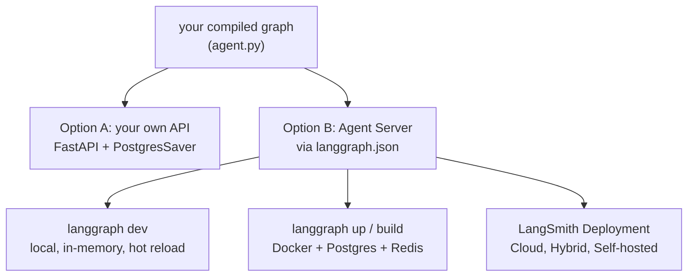

# Deploying and Running LangGraph Apps: The Complete Guide

> 📚 **Before you start**
>
> - [LangGraph Studio](../02-getting-started/langgraph-studio.md), where you met `langgraph.json` and `langgraph dev`.
> - [Persistence and Checkpointers](../06-chatbots-and-persistence/persistence-and-checkpointers.md) and [Threads, Fault Tolerance and Resuming](../06-chatbots-and-persistence/threads-fault-tolerance-and-resuming.md), because a deployed agent is mostly about threads and durable state.
> - [APIs and FastAPI Fundamentals](../../apis-and-apps-fastapi-streamlit-and-docker/course.md#m2) in Production APIs with FastAPI, for section 2.

## Introduction

A graph that works in your notebook is like a recipe that works in your home kitchen. Opening a restaurant is a different problem: many customers at once, orders that take a while and can't be lost if the power flickers, a way for the front desk to place and track orders, and someone watching the kitchen when things go wrong.

Deploying a LangGraph app raises the same questions. Who calls it, and how (HTTP, a chat UI, another service)? Where are threads stored so they survive restarts and scale across machines? What happens when a run takes ten minutes, or the user sends a second message while the first is still running? How do you stream progress to a browser?

There are two broad ways to answer them: **wrap the graph in your own API** (for example with FastAPI), or run it on **LangChain's Agent Server**, either locally with the `langgraph` CLI or managed through **LangSmith Deployment**. This lesson shows both, so you can choose with your eyes open.

> 💡 **Key Insight**
>
> Your compiled graph doesn't change between a notebook and production. What changes is everything **around** it: a durable checkpointer instead of memory, an HTTP layer that maps requests to `thread_id`s and runs, streaming to clients, and handling of long or overlapping runs. You can build that layer yourself, or use the Agent Server, which provides threads, runs, streaming, persistence and a task queue out of the box.

---

## Core Explanation

### 1. The options at a glance



| | Option A: your own API | Option B: Agent Server |
|---|---|---|
| What you write | Endpoints, thread handling, streaming, background jobs | `langgraph.json` (and optionally auth) |
| Persistence | You choose and wire a checkpointer | Built in (Postgres), plus a store for long-term memory |
| Long-running / background runs | You build a queue | Built in (Redis-backed task queue) |
| Double-texting, cron jobs, webhooks | You build them | Built in |
| Studio debugging | Not directly | Yes |
| Cost and lock-in | Just your infrastructure | Free locally for development; production needs a LangSmith plan or licence |
| Best for | Simple request/response agents, teams with an existing API stack | Long-running, stateful agents; teams that want the platform features |

**A note on names.** Product names here changed in late 2025, and you'll see both in tutorials. What used to be called **LangGraph Platform** is now **LangSmith Deployment**, and the server runtime formerly called LangGraph Server is now the **Agent Server**. Studio lives inside LangSmith. The `langgraph` CLI and `langgraph.json` kept their names.

### 2. Option A: wrap the graph in FastAPI

For many apps, a few endpoints are enough. Here's a chat API with a thread per conversation, a streaming endpoint and a history endpoint. It runs offline with a scripted model and an in-memory checkpointer; in production you'd swap in a real model and `PostgresSaver`.

```python
from fastapi import FastAPI, HTTPException
from fastapi.responses import StreamingResponse
from pydantic import BaseModel
from langchain_core.language_models.fake_chat_models import GenericFakeChatModel
from langchain_core.messages import AIMessage, SystemMessage
from langgraph.graph import StateGraph, MessagesState, START, END
from langgraph.checkpoint.memory import InMemorySaver

llm = GenericFakeChatModel(messages=iter([
    AIMessage("Your refund of ₹1,499 was initiated today."),
    AIMessage("Refunds reach UPI accounts within 3 to 5 working days."),
    AIMessage("Order 5521 ships tomorrow from Pune."),
]))
SYSTEM = SystemMessage("You are a helpful shopping support agent.")

def chatbot(state: MessagesState):
    return {"messages": [llm.invoke([SYSTEM] + state["messages"])]}

builder = StateGraph(MessagesState)
builder.add_node(chatbot)
builder.add_edge(START, "chatbot")
builder.add_edge("chatbot", END)
graph = builder.compile(checkpointer=InMemorySaver())     # production: PostgresSaver

api = FastAPI(title="Support agent")

class ChatRequest(BaseModel):
    thread_id: str
    message: str

def cfg(thread_id: str) -> dict:
    return {"configurable": {"thread_id": thread_id}}

@api.post("/chat")
def chat(req: ChatRequest):
    result = graph.invoke({"messages": [("user", req.message)]}, cfg(req.thread_id))
    return {"thread_id": req.thread_id, "reply": result["messages"][-1].content}

@api.post("/chat/stream")
def chat_stream(req: ChatRequest):
    def tokens():
        for chunk, meta in graph.stream({"messages": [("user", req.message)]}, cfg(req.thread_id),
                                        stream_mode="messages"):
            if meta["langgraph_node"] == "chatbot" and chunk.content:
                yield chunk.content
    return StreamingResponse(tokens(), media_type="text/plain")

@api.get("/threads/{thread_id}")
def history(thread_id: str):
    state = graph.get_state(cfg(thread_id))
    if not state.values:
        raise HTTPException(status_code=404, detail="thread not found")
    return [{"role": m.type, "content": m.content} for m in state.values["messages"]]
```

FastAPI's `TestClient` lets us call it without starting a server:

```python
from fastapi.testclient import TestClient

client = TestClient(api)
print(client.post("/chat", json={"thread_id": "cust-88", "message": "Where is my refund?"}).json())

with client.stream("POST", "/chat/stream", json={"thread_id": "cust-88", "message": "How long for UPI?"}) as r:
    print("streamed:", "".join(r.iter_text()))

print(client.get("/threads/cust-88").json())
print(client.get("/threads/nobody").status_code)
```

Output:

```
{'thread_id': 'cust-88', 'reply': 'Your refund of ₹1,499 was initiated today.'}
streamed: Refunds reach UPI accounts within 3 to 5 working days.
[{'role': 'human', 'content': 'Where is my refund?'}, {'role': 'ai', 'content': 'Your refund of ₹1,499 was initiated today.'}, {'role': 'human', 'content': 'How long for UPI?'}, {'role': 'ai', 'content': 'Refunds reach UPI accounts within 3 to 5 working days.'}]
404
```

In production you'd run it with an ASGI server (`uvicorn app:api --workers 4`), use `PostgresSaver` so every worker sees the same threads, read the model key from an environment variable, and add authentication so users can only read their own threads (never trust a `thread_id` from the client without checking who owns it).

What this option **doesn't** give you for free: background runs that outlive the HTTP request, protection when a user sends a second message while the first is still processing, scheduled runs, resumable streams after a dropped connection, and Studio. If you need those, look at Option B.

### 3. Option B: the Agent Server and `langgraph.json`

The Agent Server is LangChain's server for agent workloads. You don't write endpoints; you describe your project in `langgraph.json` and the server exposes a standard API for **assistants**, **threads**, **runs**, a long-term memory **store**, and **crons**.

The project layout from the [Studio lesson](../02-getting-started/langgraph-studio.md):

```
support-agent/
├── agent.py           # builds the graph; ends with: graph = builder.compile()
├── requirements.txt   # langgraph, langchain-anthropic, ...
├── .env               # ANTHROPIC_API_KEY=..., LANGSMITH_API_KEY=...
└── langgraph.json
```

```json
{
  "dependencies": ["."],
  "graphs": {
    "support": "./agent.py:graph"
  },
  "env": ".env",
  "python_version": "3.12"
}
```

| Key | Meaning |
|---|---|
| `dependencies` | What to install: `"."` means this folder (with its `requirements.txt` or `pyproject.toml`) |
| `graphs` | Graph id → `file.py:variable` (or a function that returns a graph) |
| `env` | A `.env` file path, or a mapping of variables |
| `python_version` | `3.11`, `3.12` or `3.13` |
| others | `auth` (custom authentication), `store` and `checkpointer` (configuration), `http` (custom routes), `image_distro`, `dockerfile_lines`, and more |

**Compile without a checkpointer** in `agent.py`. The server supplies its own persistence and attaches it to your graph; that's how threads work on the server.

The server's core concepts map directly onto what you've learned:

| Agent Server concept | What it is | You know it as |
|---|---|---|
| **Assistant** | A graph plus a configuration (prompt, model choice...) | Your compiled graph with a config |
| **Thread** | A conversation's saved state and history | `thread_id` + checkpointer |
| **Run** | One execution of an assistant on a thread (or stateless) | One `invoke`/`stream` call |
| **Store** | Long-term memory across threads | `BaseStore` |
| **Cron** | A run on a schedule | (no local equivalent) |

### 4. Running the server: `dev`, `up`, `build`, `deploy`

The `langgraph` CLI runs and packages the server:

```bash
pip install -U "langgraph-cli[inmem]"
```

| Command | What it does | Needs |
|---|---|---|
| `langgraph dev` | Lightweight local server with hot reload; state kept in a local folder | Python 3.11+, no Docker |
| `langgraph up` | Runs the server in Docker with Postgres and Redis, like production | Docker; a LangSmith API key for local use |
| `langgraph build -t my-image` | Builds a Docker image of your server | Docker |
| `langgraph dockerfile Dockerfile` | Writes a Dockerfile you can customise | Nothing extra |
| `langgraph deploy` | Builds and deploys to LangSmith Deployment in one step | A LangSmith account |

For development, `langgraph dev` is all you need:

```bash
langgraph dev
```

Example output (trimmed):

```
- API: http://127.0.0.1:2024
- Studio UI: https://smith.langchain.com/studio/?baseUrl=http://127.0.0.1:2024
- API Docs: http://127.0.0.1:2024/docs
```

The `/docs` page lists every endpoint. `langgraph up` serves on port 8123 by default and behaves like production (durable Postgres storage, a Redis-backed queue). Using the server in production, whether self-run or managed, requires a LangSmith plan or licence; check current terms before you commit.

### 5. Calling the server: the SDK

The `langgraph-sdk` package (installed with `langgraph`) talks to any Agent Server, local or deployed. The assistant id can be the graph id from `langgraph.json`:

```python
# not-run: needs a running server (`langgraph dev`)
import asyncio
from langgraph_sdk import get_client

async def main():
    client = get_client(url="http://127.0.0.1:2024")
    thread = await client.threads.create()

    # stream a run on that thread
    async for part in client.runs.stream(thread["thread_id"], "support",
                                         input={"messages": [{"role": "user", "content": "Where is my refund?"}]},
                                         stream_mode="updates"):
        print(part.event, part.data)

    # the thread's saved state, like graph.get_state()
    state = await client.threads.get_state(thread["thread_id"])
    print(state["values"]["messages"][-1]["content"])

asyncio.run(main())
```

Example output:

```
metadata {'run_id': '1f0...', 'attempt': 1}
updates {'chatbot': {'messages': [{'type': 'ai', 'content': 'Your refund of ₹1,499 was initiated today.', ...}]}}
Your refund of ₹1,499 was initiated today.
```

Useful variations:

- `client.runs.wait(thread_id, "support", input=...)` waits and returns the final state, like `invoke`.
- `client.runs.create(...)` starts a **background run** and returns immediately; poll it or receive a `webhook` when it finishes. Ideal for runs that take minutes.
- `multitask_strategy=` decides what happens when a new run arrives on a thread that's still busy (the user "double-texts"): `"reject"`, `"enqueue"`, `"interrupt"` or `"rollback"`.
- `get_sync_client(...)` gives the same API without `async`.
- `thread_id=None` runs **statelessly**, with nothing saved.

You can even use a deployed graph as if it were local, including as a node in another graph, with `RemoteGraph`:

```python
# not-run: needs a running server
from langgraph.pregel.remote import RemoteGraph

remote = RemoteGraph("support", url="http://127.0.0.1:2024")
result = remote.invoke({"messages": [("user", "Where is my refund?")]},
                       {"configurable": {"thread_id": "<an existing thread id>"}})
```

### 6. LangSmith Deployment options

When you deploy through LangSmith, every option runs the same Agent Server; they differ in who runs what:

| Option | Control plane (UI, management) | Agent Servers and data | Typical buyer |
|---|---|---|---|
| **Cloud** | LangChain | LangChain's cloud | Teams wanting zero infrastructure (paid plan) |
| **Hybrid** | LangChain | Your cloud | Data must stay in your network |
| **Self-hosted** | You (in your Kubernetes) | You | Enterprises with strict requirements |
| **Standalone server** | None | You run the server with Docker/Kubernetes plus your own Postgres and Redis | Teams that just want the server |

Plans, prices and which option needs which tier change over time; check the LangSmith pricing and deployment docs when you decide.

### 7. A production checklist

Whichever option you choose:

- **Durable state**: Postgres (or the server's built-in persistence), never `InMemorySaver`.
- **Secrets** from environment variables or a secret manager, not code; `.env` stays out of git.
- **Authentication and ownership**: users can access only their own threads. (Agent Server supports custom auth through the `auth` key in `langgraph.json`.)
- **Limits**: recursion limits, retry policies, timeouts, and maximum message history per thread.
- **Long runs** in the background, with progress streamed or polled, not held open on one HTTP request.
- **Double-texting** behaviour decided on purpose.
- **Observability**: tracing for every run, so you can see what the agent did when a user complains. That's the next lesson.

---

## Try It Yourself

1. **Add an endpoint.** Add `DELETE /threads/{thread_id}` to the FastAPI app that calls `graph.checkpointer.delete_thread(thread_id)` and returns `{"deleted": thread_id}`. Test it with `TestClient` and confirm `GET` then returns 404.
2. **Map the concepts.** For each, name the Agent Server feature: (a) "send a weekly summary every Monday at 9 am", (b) "the user sent a new message while the agent was still answering", (c) "a report that takes 15 minutes to generate".
3. **Read a `langgraph.json`.** What's wrong with `{"graphs": {"bot": "agent.py"}, "dependencies": ["."]}`?

<details>
<summary>Show answers</summary>

**1.**

```python
@api.delete("/threads/{thread_id}")
def delete(thread_id: str):
    graph.checkpointer.delete_thread(thread_id)
    return {"deleted": thread_id}

print(client.delete("/threads/cust-88").json())
print(client.get("/threads/cust-88").status_code)
```

Output:

```
{'deleted': 'cust-88'}
404
```

**2.** (a) A **cron** job on the assistant. (b) The run's **`multitask_strategy`** (double-texting: reject, enqueue, interrupt or rollback). (c) A **background run** (`runs.create`) with polling or a webhook.

**3.** The graph path must name the variable after a colon, like `"./agent.py:graph"`; the server can't guess which object in `agent.py` is the graph.

</details>

---

## Real-World Examples

- **Startups with a simple support bot** often choose FastAPI plus `PostgresSaver` on their existing cloud: a few endpoints and no new platform.
- **Teams building long-running research or coding agents** use the Agent Server for background runs, double-texting control and Studio debugging of production threads.
- **Regulated companies** (banks, hospitals) pick hybrid or self-hosted deployments so conversation data never leaves their network.

---

## Common Misconceptions

### "You need LangSmith Deployment to put LangGraph in production"

No. LangGraph is an open-source library; a FastAPI service with a Postgres checkpointer is a perfectly good production setup. The Agent Server adds features you'd otherwise build.

### "`langgraph dev` is a production server"

It's an in-memory development server with hot reload. Use `langgraph up`/`build` or a managed deployment for real traffic.

### "The deployed graph needs different code"

The same compiled graph runs everywhere. Just don't attach your own checkpointer when the Agent Server provides one.

### "LangGraph Platform and LangSmith Deployment are different products"

They're the same product under its old and new names.

---

## Interview Relevance

*"How would you deploy a LangGraph agent?"* Compare two approaches: your own API (FastAPI, Postgres checkpointer, `thread_id` per conversation, `stream_mode="messages"` for SSE or streaming responses, auth on thread ownership) versus the Agent Server (`langgraph.json`, `langgraph dev/up/build/deploy`, assistants/threads/runs, background runs, double-texting strategies, cron, built-in persistence; managed via LangSmith Deployment in cloud, hybrid or self-hosted modes). Name the production concerns: durability, long runs, concurrency per thread, limits and observability.

---

## Key Takeaways

- The graph is unchanged in production; the **layer around it** changes.
- **Option A**: wrap it in **FastAPI** with a durable checkpointer, streaming and thread-ownership checks.
- **Option B**: describe it in **`langgraph.json`** and run the **Agent Server** (`langgraph dev` locally; `up`/`build`/`deploy` for real use), which brings assistants, threads, runs, background jobs, double-texting control and crons.
- **LangSmith Deployment** (formerly LangGraph Platform) runs the Agent Server in Cloud, Hybrid or Self-hosted modes.
- Call deployed graphs with the **`langgraph_sdk`** client or **`RemoteGraph`**.

---

**Up next:** [LangSmith Observability for LangGraph](langsmith-observability-for-langgraph.md)
