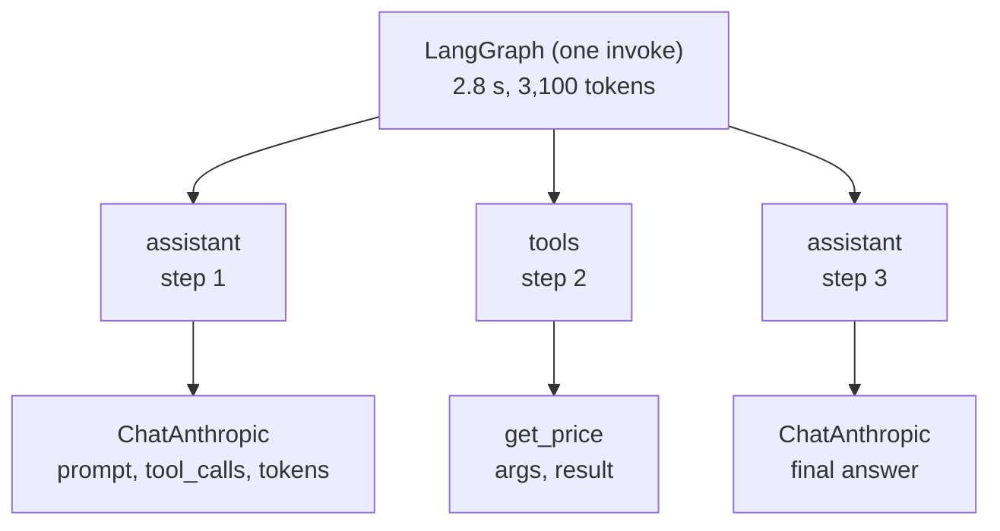

# LangSmith Observability for LangGraph: The Complete Guide

> 📚 **Before you start**
>
> - [Building Agents](../05-workflows-and-agents/building-agents.md), since agents are what you'll most often need to trace.
> - [Deploying and Running LangGraph Apps](deploying-and-running-langgraph-apps.md), for the production setting where tracing matters most.
> - [LangSmith Monitoring](../../langchain-complete-guide/course.md#m8) in the LangChain Complete Guide, helpful but optional.

## Introduction

When a flight lands safely, nobody reads the flight data recorder. When something goes wrong, it's the first thing investigators look for, because it records exactly what happened, second by second, without relying on anyone's memory.

Agents need a recorder too. A user reports "the bot told me my refund was approved, but it wasn't". To find out why, you need to see that exact run: which nodes ran, what the model was given, which tools it called with which arguments, what came back, how long each step took and what it cost. Print statements in a notebook don't help with a conversation that happened in production at 2 am.

**LangSmith** is LangChain's platform for tracing, monitoring and evaluating LLM applications, and LangGraph is built to work with it: set a couple of environment variables and every run is recorded as a **trace**, with each node, model call and tool call nested inside. This lesson shows how to turn tracing on, what a LangGraph trace contains, how to make traces easy to find, how to trace code that isn't LangChain, how to control what's recorded, and how to use traces to debug and improve an agent.

> 💡 **Key Insight**
>
> Every LangGraph run already produces a **tree of runs** (graph → nodes → model and tool calls) with names, inputs, outputs, tags and metadata, delivered through LangChain's callback system. LangSmith simply **records that tree**. That's why tracing needs no code changes, and why the tags, metadata and run names you put in the run's config show up in LangSmith for search and grouping.

---

## Core Explanation

### 1. What a trace is

| Term | Meaning |
|---|---|
| **Trace** | Everything that happened for one top-level call, e.g. one `invoke` of your graph |
| **Run** (or span) | One step inside it: the graph, a node, a model call, a tool call, a retriever call |
| **Project** | A named bucket of traces, usually one per app and environment ("support-bot-prod") |
| **Thread** | Several traces that belong to one conversation, grouped by a shared id in metadata |
| **Feedback** | A score attached to a run: a user's thumbs up, a reviewer's grade, an automated evaluator |

For an agent, one trace looks roughly like this:



### 2. Turning tracing on

Create an API key in LangSmith (the free tier is enough to learn), then set environment variables before your app starts:

```bash
export LANGSMITH_TRACING=true
export LANGSMITH_API_KEY="<your-langsmith-api-key>"
export LANGSMITH_PROJECT="support-bot-dev"        # optional; traces go to "default" otherwise
# export LANGSMITH_ENDPOINT="https://eu.api.smith.langchain.com"   # only for EU-region accounts
# export LANGSMITH_WORKSPACE_ID="<workspace-id>"                   # only if your key spans several workspaces
```

That's it. Every graph run, model call and tool call is now sent to LangSmith in the background, without slowing your app. In a `.env` file used by `langgraph dev` or the Agent Server, the same variables apply.

You'll still see the older names `LANGCHAIN_TRACING_V2`, `LANGCHAIN_API_KEY` and `LANGCHAIN_PROJECT` in tutorials; current versions accept the `LANGSMITH_` names shown above, which are the ones to use in new projects.

### 3. Seeing what LangSmith would receive

To understand a trace, it helps to look at the raw events. LangChain's callback system is how LangSmith's tracer receives them, and we can attach our own small handler to print the run tree, fully offline:

```python
from langchain_core.callbacks import BaseCallbackHandler
from langchain_core.language_models.fake_chat_models import GenericFakeChatModel
from langchain_core.messages import AIMessage
from langchain_core.tools import tool
from langgraph.graph import StateGraph, MessagesState, START
from langgraph.prebuilt import ToolNode, tools_condition
from langgraph.checkpoint.memory import InMemorySaver

class RunTreePrinter(BaseCallbackHandler):
    """Prints the run tree that a tracer such as LangSmith records."""
    def __init__(self, keys=("thread_id", "user_id", "langgraph_step")):
        self.depth, self.keys = {}, keys

    def _line(self, kind, name, run_id, parent_run_id, metadata):
        d = self.depth.get(parent_run_id, -1) + 1
        self.depth[run_id] = d
        meta = {k: metadata[k] for k in self.keys if metadata and k in metadata}
        print(f"{'  ' * d}{kind:5} {name:22} {meta}")

    def on_chain_start(self, serialized, inputs, *, run_id, parent_run_id=None, metadata=None, **kw):
        self._line("chain", kw.get("name"), run_id, parent_run_id, metadata)

    def on_chat_model_start(self, serialized, messages, *, run_id, parent_run_id=None, metadata=None, **kw):
        self._line("llm", kw.get("name") or serialized.get("name"), run_id, parent_run_id, metadata)

    def on_tool_start(self, serialized, input_str, *, run_id, parent_run_id=None, metadata=None, **kw):
        self._line("tool", kw.get("name") or serialized.get("name"), run_id, parent_run_id, metadata)

@tool
def get_price(item: str) -> float:
    """Price in rupees for one kg of a grocery item."""
    return {"basmati rice": 120.0}[item]

class ToolFake(GenericFakeChatModel):
    """A scripted chat model that accepts bind_tools, for offline examples."""
    def bind_tools(self, tools, **kwargs):
        return self

llm = ToolFake(messages=iter([
    AIMessage("", tool_calls=[{"name": "get_price", "args": {"item": "basmati rice"}, "id": "c1"}]),
    AIMessage("Basmati rice is ₹120 per kg."),
]))

def assistant(state: MessagesState):
    return {"messages": [llm.invoke(state["messages"])]}

b = StateGraph(MessagesState)
b.add_node(assistant)
b.add_node("tools", ToolNode([get_price]))
b.add_edge(START, "assistant")
b.add_conditional_edges("assistant", tools_condition)
b.add_edge("tools", "assistant")
agent = b.compile(checkpointer=InMemorySaver())

agent.invoke({"messages": [("user", "Price of basmati?")]},
             {"configurable": {"thread_id": "cust-42"}, "metadata": {"user_id": "u-1001"},
              "callbacks": [RunTreePrinter()]})
```

Output:

```
chain LangGraph              {'thread_id': 'cust-42', 'user_id': 'u-1001'}
  chain assistant              {'thread_id': 'cust-42', 'user_id': 'u-1001', 'langgraph_step': 1}
    llm   ToolFake               {'thread_id': 'cust-42', 'user_id': 'u-1001', 'langgraph_step': 1}
    chain tools_condition        {'thread_id': 'cust-42', 'user_id': 'u-1001', 'langgraph_step': 1}
  chain tools                  {'thread_id': 'cust-42', 'user_id': 'u-1001', 'langgraph_step': 2}
    tool  get_price              {'thread_id': 'cust-42', 'user_id': 'u-1001', 'langgraph_step': 2}
  chain assistant              {'thread_id': 'cust-42', 'user_id': 'u-1001', 'langgraph_step': 3}
    llm   ToolFake               {'thread_id': 'cust-42', 'user_id': 'u-1001', 'langgraph_step': 3}
    chain tools_condition        {'thread_id': 'cust-42', 'user_id': 'u-1001', 'langgraph_step': 3}
```

Read it top to bottom and you'll recognise the agent loop from module 5. A few details are worth noticing, because they're exactly what you'll see in LangSmith:

- The root run is called **`LangGraph`** by default. You'll rename it in the next section.
- Each node is a child run, and LangGraph adds metadata such as **`langgraph_step`** (and `langgraph_node`), so you can tell which super-step a call belongs to.
- Routing functions (here `tools_condition`) appear as their own small runs.
- The model call and the tool call are nested **inside** the node that made them.
- **`thread_id`** from the config was copied into the metadata of every run automatically, and so was our own `user_id`.

That last point matters: LangSmith groups traces into **threads** using a conversation id in the metadata (`thread_id`, `session_id` or `conversation_id`), so with LangGraph you get a per-conversation view for free.

### 4. Making traces easy to find

A busy app produces thousands of traces a day. Name and label them so you can filter later. Everything goes in the run's `config`:

```python
config = {
    "configurable": {"thread_id": "cust-42"},
    "run_name": "support_agent",                    # the root run's name instead of "LangGraph"
    "tags": ["prod", "v2.3", "hindi-ui"],           # short labels to filter on
    "metadata": {"user_id": "u-1001", "plan": "gold", "channel": "whatsapp"},   # key-value details
}
```

```python
class RootPrinter(BaseCallbackHandler):
    def on_chain_start(self, serialized, inputs, *, run_id, parent_run_id=None, tags=None, metadata=None, **kw):
        if parent_run_id is None:
            print(kw.get("name"), sorted(tags), {k: metadata[k] for k in ("user_id", "plan", "channel", "thread_id")})

llm = ToolFake(messages=iter([AIMessage("Namaste! How can I help?")]))
agent.invoke({"messages": [("user", "hi")]}, {**config, "callbacks": [RootPrinter()]})
```

Output:

```
support_agent ['hindi-ui', 'prod', 'v2.3'] {'user_id': 'u-1001', 'plan': 'gold', 'channel': 'whatsapp', 'thread_id': 'cust-42'}
```

| Put it in... | When | Examples |
|---|---|---|
| `run_name` | Always, for the root | `"support_agent"`, `"nightly_report"` |
| `tags` | Coarse categories you filter by often | environment, version, experiment arm |
| `metadata` | Details you search or group by | user id, tenant, channel, prompt version |
| `LANGSMITH_PROJECT` | Separate apps and environments | `support-bot-dev`, `support-bot-prod` |

Tags and metadata **flow down** to every child run, so filtering by `user_id` finds the model calls too, not just the top-level trace.

### 5. Tracing code that isn't LangChain

LangChain models, tools and graphs are traced automatically. If a node calls something else (your own function, a raw SDK, an HTTP API), decorate it with **`@traceable`** from the `langsmith` package so it appears as a run in the tree:

```python
# not-run: sends data to LangSmith when tracing is enabled
from langsmith import traceable

@traceable(run_type="tool", name="Railway PNR lookup")
def lookup_pnr(pnr: str) -> dict:
    return railway_api.get(f"/pnr/{pnr}")           # your own client

@traceable(run_type="retriever")
def search_policies(query: str) -> list[dict]:
    return vector_db.search(query, k=4)
```

For direct SDK calls, `langsmith.wrappers` provides wrappers such as `wrap_anthropic` and `wrap_openai`, which trace every call made through the wrapped client:

```python
# not-run: needs the anthropic SDK and an API key
import anthropic
from langsmith.wrappers import wrap_anthropic

client = wrap_anthropic(anthropic.Anthropic())
client.messages.create(model="claude-opus-5-5", max_tokens=512,
                       messages=[{"role": "user", "content": "Namaste!"}])
```

Called inside a LangGraph node, these runs nest under that node in the same trace.

### 6. Controlling what's recorded

Traces contain your users' messages, so decide deliberately what to send.

- **Turn tracing off for one block** of code with a context manager:

```python
# not-run: shown for reference
import langsmith

with langsmith.tracing_context(enabled=False):
    agent.invoke({"messages": [("user", "my Aadhaar number is ...")]}, config)
```

- **Send a run to a different project** (for example, an evaluation run) with `langsmith.tracing_context(project_name="support-bot-evals")`.
- **Hide inputs or outputs** for all runs with `LANGSMITH_HIDE_INPUTS=true` / `LANGSMITH_HIDE_OUTPUTS=true` (the trace structure, timings and errors are still recorded), or pass a function to the `langsmith.Client(hide_inputs=...)` to redact specific fields.
- **Sample** high-volume production traffic with `LANGSMITH_TRACING_SAMPLING_RATE` (for example `0.1` to keep 10% of traces).
- **Never** put secrets (API keys, passwords) in state or messages; anything in state can end up in a trace.

### 7. Using traces: debug, monitor, improve

**Debugging a bad answer.** Find the trace (filter by `user_id` or the conversation's thread), open the model run just before the bad answer, and read exactly what the model was given. Common discoveries: the retriever returned the wrong document, a tool returned an error the model glossed over, the prompt was missing a field, or the conversation was trimmed too aggressively. LangSmith's playground lets you re-run that model call with an edited prompt to test a fix. For graphs served by an Agent Server, you can also open the thread in **Studio** and replay from the failing step, using the checkpoint tools from module 6.

**Monitoring.** LangSmith dashboards chart trace counts, error rates, latency (median and slowest percentiles) and token cost over time, per project, and you can set alerts on them. A sudden jump in latency or errors after a deploy is usually visible here first.

**Feedback.** Attach scores to runs so quality becomes measurable. A thumbs-up/down button in your UI can send feedback for the run that produced the answer:

```python
# not-run: needs LANGSMITH_API_KEY; run_id comes from the traced run
from langsmith import Client

Client().create_feedback(run_id=run_id, key="user_thumbs", score=1, comment="Solved my issue")
```

**Evaluation.** Save interesting traces (especially failures) into a **dataset**, then run your agent against it after each change and score the results with code checks or LLM judges. That turns "it seemed better" into numbers. Building evaluation suites for agents has its own course: [Agent Evals, Observability and Reliability](../../agent-evals-observability-and-reliability/course.md#m2).

### 8. LangSmith and the alternatives

LangSmith is the natural fit for LangGraph (zero-code setup, Studio integration, thread grouping), but it's not the only option. Langfuse, Arize Phoenix, Braintrust and others also trace LangChain and LangGraph apps, usually through a callback handler you pass in the config (just like `RunTreePrinter` above) or through **OpenTelemetry**. LangSmith can also receive OpenTelemetry traces. If your company already has an observability stack, check its LangChain integration first. The comparison is covered in [LangSmith, Langfuse, Phoenix and Braintrust](../../agent-evals-observability-and-reliability/course.md#m4).

---

## Try It Yourself

1. **Count runs.** Modify `RunTreePrinter` to count runs by kind (`chain`, `llm`, `tool`) instead of printing. For the basmati question, how many of each are there?
2. **Label an experiment.** You're testing a new system prompt on 10% of users. What would you put in `tags` and `metadata` so you can compare the two groups in LangSmith?
3. **Find the culprit.** A user says the agent quoted the wrong price. Using only the trace tree from section 3, which run would you open first, and what would you look for?

<details>
<summary>Show answers</summary>

**1.**

```python
from collections import Counter

class RunCounter(BaseCallbackHandler):
    def __init__(self):
        self.counts = Counter()
    def on_chain_start(self, *a, **kw):
        self.counts["chain"] += 1
    def on_chat_model_start(self, *a, **kw):
        self.counts["llm"] += 1
    def on_tool_start(self, *a, **kw):
        self.counts["tool"] += 1

llm = ToolFake(messages=iter([
    AIMessage("", tool_calls=[{"name": "get_price", "args": {"item": "basmati rice"}, "id": "c2"}]),
    AIMessage("Basmati rice is ₹120 per kg."),
]))
counter = RunCounter()
agent.invoke({"messages": [("user", "Price of basmati?")]},
             {"configurable": {"thread_id": "count-demo"}, "callbacks": [counter]})
print(dict(counter.counts))
```

Output:

```
{'chain': 6, 'llm': 2, 'tool': 1}
```

Two model calls and one tool call; the chain runs are the graph itself, its node executions and the routing functions.

**2.** A tag for the arm, such as `"prompt-v7"` vs `"prompt-v6"`, plus metadata like `{"experiment": "short-system-prompt", "arm": "treatment"}`. Then filter each group and compare error rates, latency, cost and feedback scores.

**3.** Open the `get_price` tool run first and check its input (did the model pass the right item?) and output (did the price source return the right number?). If both are right, open the final model run and check whether the answer matches the tool result it was given.

</details>

---

## Real-World Examples

- **Support teams** link each conversation in their helpdesk to its LangSmith thread, so an engineer can see exactly what the bot did when a customer complains.
- **Platform teams** watch per-project dashboards for latency and cost after each release, with alerts on error-rate spikes.
- **ML teams** turn traces of failed conversations into evaluation datasets, and gate prompt or model changes on the eval scores.

---

## Common Misconceptions

### "Tracing needs code changes in every node"

For LangChain and LangGraph components, setting `LANGSMITH_TRACING` and `LANGSMITH_API_KEY` is enough. Use `@traceable` only for code outside LangChain.

### "Tracing slows the app down"

Traces are sent in the background. For very high traffic, sampling reduces volume further.

### "LangSmith only works if you deploy on LangSmith"

Tracing works from any Python process: a notebook, a FastAPI server, a cron job, or an Agent Server.

### "Observability is just logging"

Logs are flat lines. A trace keeps the **structure** (which model call happened inside which node, in which step) plus inputs, outputs, timings, tokens and feedback, which is what agent debugging needs.

---

## Interview Relevance

*"How do you monitor and debug a LangGraph agent in production?"* Tracing with LangSmith (env vars, no code changes), the trace tree (graph → nodes → model/tool calls, with `langgraph_step` metadata), searchable traces via `run_name`, `tags` and `metadata` (user id, thread id; threads grouped automatically), `@traceable` for custom code, privacy controls (hide inputs/outputs, sampling, `tracing_context`), dashboards and alerts for latency, errors and cost, feedback from users, and datasets plus evaluations to prevent regressions. Mention OpenTelemetry and alternatives such as Langfuse.

---

## Key Takeaways

- Set **`LANGSMITH_TRACING=true`** and **`LANGSMITH_API_KEY`** (optionally **`LANGSMITH_PROJECT`**) and every LangGraph run is traced.
- A trace is a **tree**: graph → nodes → model and tool calls, with **`langgraph_step`**, **`thread_id`** and your metadata on every run.
- Use **`run_name`, `tags` and `metadata`** in the config to make traces searchable; conversations group into **threads**.
- **`@traceable`** and SDK wrappers trace non-LangChain code; **`tracing_context`**, hiding and sampling control what's recorded.
- Use traces to **debug**, **monitor**, collect **feedback** and build **evaluation datasets**.

---

**Up next:** You've finished the LangGraph Complete Guide. Continue with [Agentic RAG Systems](../../agentic-rag-systems/course.md), where an agent built as a graph decides when and how to retrieve, then [Context Engineering and Agent Memory](../../context-engineering-and-agent-memory/course.md).
