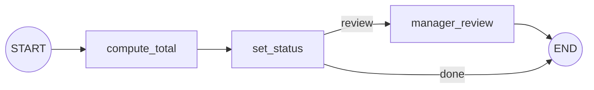

# Graphs, Nodes, Edges and State: The Complete Guide

> 📚 **Before you start**
>
> - [What is LangGraph?](what-is-langgraph.md), where you built your first graph.
> - [Pydantic Models](../../production-apis-with-fastapi/course.md#m4), for validated data classes (used in section 2).

## Introduction

Think of a factory assembly line for custom bicycles. A **work order** travels with each bike: frame size, colour, parts fitted so far, checks passed. Each **station** reads the work order, does one job (fit wheels, paint, inspect) and writes what it did back onto the order. **Conveyor belts** decide which station is next, and at the inspection station a **switch** sends the bike either to packing or back to repairs.

That's a LangGraph application. The work order is the **state**, the stations are **nodes**, the belts are **edges**, and the switch is a **conditional edge**. This lesson goes through each of the four in detail: how to define them, what rules they follow, and the mistakes people commonly make.

> 💡 **Key Insight**
>
> Design the **state first**. Once you know exactly what data travels through your app, nodes become small functions that read some fields and update others, and edges become simple rules over those fields. Most messy graphs come from a vague state.

---

## Core Explanation

### 1. State: the shared work order

The state is the single source of truth for one run of your graph. Every node receives the **current state** and returns **updates** to it.

You define the state's **schema** (its fields and types) with one of three Python tools:

| Schema type | Example | When to use it |
|---|---|---|
| `TypedDict` | `class S(TypedDict): topic: str` | The default. Light and fast; types are hints only. |
| Pydantic `BaseModel` | `class S(BaseModel): qty: int` | When you want **validation** of the input and default values. |
| `dataclass` | `@dataclass class S: topic: str = ""` | When you want default values without Pydantic. |

Here's a `TypedDict` state for a small order workflow:

```python
from typing import TypedDict
from langgraph.graph import StateGraph, START, END

class OrderState(TypedDict):
    item: str
    qty: int
    unit_price: float
    total: float
    status: str
```

Good state design tips:

- **Store facts, not formatted text.** Keep `qty: int` and `unit_price: float`, and format a message at the end.
- **One field per thing that changes.** `total` and `status` are updated by different nodes, so they're separate fields.
- **Name fields clearly.** Every node author (including future you) reads these names.

### 2. Validated state with Pydantic

With a Pydantic model as the schema, LangGraph validates the **input** you pass to `invoke`, and fields can have defaults:

```python
from pydantic import BaseModel

class CheckedOrder(BaseModel):
    item: str
    qty: int
    total: float = 0.0

def price(state: CheckedOrder):
    return {"total": state.qty * 120.0}       # Pydantic state: read fields as attributes

b = StateGraph(CheckedOrder)
b.add_node(price)                             # node name defaults to the function name
b.add_edge(START, "price")
b.add_edge("price", END)
checked = b.compile()

print(checked.invoke({"item": "chai", "qty": 3}))
try:
    checked.invoke({"item": "chai", "qty": "three"})
except Exception as e:
    print(type(e).__name__, "-", str(e).splitlines()[0])
```

Output:

```
{'item': 'chai', 'qty': 3, 'total': 360.0}
ValidationError - 1 validation error for CheckedOrder
```

The bad input never reached a node: Pydantic rejected `"three"` because `qty` must be an integer.

Two things to remember:

- With a Pydantic state, nodes read fields as **attributes** (`state.qty`), but they still **return a dictionary** of updates.
- The result of `invoke` is a plain dictionary.

### 3. Nodes: the stations

A node is a function that takes the state and returns a **dictionary of updates**. It can do anything Python can: call a model, query a database, run a calculation.

```python
def compute_total(state: OrderState):
    return {"total": state["qty"] * state["unit_price"]}

def set_status(state: OrderState):
    return {"status": "approved" if state["total"] <= 5000 else "needs review"}
```

Rules for nodes:

- **Return only what changed.** `compute_total` returns just `total`; LangGraph keeps every other field as it was.
- **Don't modify the state in place.** Write `return {"total": ...}`, not `state["total"] = ...`. In-place changes aren't tracked reliably and break features like streaming and checkpoints.
- **Keep them small.** One job per node makes graphs easy to read, test and reuse.
- **Name them by what they do**: `compute_total`, not `step2`.

You add nodes with `add_node(name, function)`, or just `add_node(function)` to use the function's name.

### 4. Edges: the conveyor belts

Normal edges say "after this node, always run that one":

```python
builder = StateGraph(OrderState)
builder.add_node("compute_total", compute_total)
builder.add_node("set_status", set_status)
builder.add_edge(START, "compute_total")      # entry point
builder.add_edge("compute_total", "set_status")
builder.add_edge("set_status", END)           # finish point
orders = builder.compile()

print(orders.invoke({"item": "chai", "qty": 10, "unit_price": 120.0}))
print(orders.invoke({"item": "laptop", "qty": 1, "unit_price": 64000.0}))
```

Output:

```
{'item': 'chai', 'qty': 10, 'unit_price': 120.0, 'total': 1200.0, 'status': 'approved'}
{'item': 'laptop', 'qty': 1, 'unit_price': 64000.0, 'total': 64000.0, 'status': 'needs review'}
```

`START` marks where the graph begins; `END` marks where it finishes. A graph must have at least one edge from `START`.

### 5. Conditional edges: the switch

A **conditional edge** runs a **routing function** on the state and follows the edge it names. Let's send big orders to a manager:

```python
def manager_review(state: OrderState):
    return {"status": "approved by manager"}

def route_by_status(state: OrderState):
    return "review" if state["status"] == "needs review" else "done"

builder = StateGraph(OrderState)
builder.add_node("compute_total", compute_total)
builder.add_node("set_status", set_status)
builder.add_node("manager_review", manager_review)
builder.add_edge(START, "compute_total")
builder.add_edge("compute_total", "set_status")
builder.add_conditional_edges("set_status", route_by_status,
                              {"review": "manager_review", "done": END})
builder.add_edge("manager_review", END)
orders = builder.compile()

print(orders.invoke({"item": "laptop", "qty": 1, "unit_price": 64000.0})["status"])
print(orders.invoke({"item": "chai", "qty": 2, "unit_price": 120.0})["status"])
```

Output:

```
approved by manager
approved
```



The third argument, `{"review": "manager_review", "done": END}`, is the **path map**: it translates what the router returns into node names. It's optional (the router can return node names directly), but it makes the graph self-documenting and lets LangGraph draw it correctly. Routing functions must **only decide**; they shouldn't update the state. You'll go much deeper in [Conditional Workflows](../03-workflow-patterns-in-langgraph/conditional-workflows.md).

### 6. Compile: checking the wiring

`compile()` turns the builder into a runnable app and **checks the structure**. It catches common wiring mistakes before anything runs:

```python
from langgraph.graph import StateGraph

class S(TypedDict):
    x: int

no_entry = StateGraph(S)
no_entry.add_node("work", lambda s: {"x": s["x"] + 1})
try:
    no_entry.compile()
except ValueError as e:
    print("ValueError:", e)

typo = StateGraph(S)
typo.add_node("work", lambda s: {"x": s["x"] + 1})
typo.add_edge(START, "wrok")
try:
    typo.compile()
except ValueError as e:
    print("ValueError:", e)
```

Output:

```
ValueError: Graph must have an entrypoint: add at least one edge from START to another node
ValueError: Found edge ending at unknown node `wrok`
```

### 7. A gotcha: updates to unknown fields

Compile can't catch everything. If a node returns a key that **isn't in the state schema**, it's silently dropped:

```python
def typo_node(state: S):
    return {"X": 99}           # capital X is not a field

g = StateGraph(S)
g.add_node("typo_node", typo_node)
g.add_edge(START, "typo_node")
g.add_edge("typo_node", END)
print(g.compile().invoke({"x": 1}))
```

Output:

```
{'x': 1}
```

No error, no update. When a value "mysteriously" doesn't change, check the spelling of the keys your node returns.

---

## Try It Yourself

1. **Add a discount.** Add a `discount` node between `compute_total` and `set_status` that takes 10% off orders over ₹10,000. What status does a ₹12,000 order get now?
2. **Route three ways.** Change `route_by_status` and the path map so orders over ₹50,000 go to a new `director_review` node, orders over ₹5,000 to `manager_review`, and the rest to `END`.
3. **Spot the bug.** A teammate's node does `state["total"] = 100; return state`. Why is this a bad idea even if it seems to work?

<details>
<summary>Show answers</summary>

**1.**

```python
def discount(state: OrderState):
    if state["total"] > 10000:
        return {"total": round(state["total"] * 0.9, 2)}
    return {}

builder = StateGraph(OrderState)
for name, fn in [("compute_total", compute_total), ("discount", discount), ("set_status", set_status)]:
    builder.add_node(name, fn)
builder.add_edge(START, "compute_total")
builder.add_edge("compute_total", "discount")
builder.add_edge("discount", "set_status")
builder.add_edge("set_status", END)
result = builder.compile().invoke({"item": "phone", "qty": 1, "unit_price": 12000.0})
print(result["total"], result["status"])
```

Output:

```
10800.0 needs review
```

A node may return `{}` when it has nothing to change.

**2.** A router like `return "director" if state["total"] > 50000 else "review" if state["total"] > 5000 else "done"` with the path map `{"director": "director_review", "review": "manager_review", "done": END}`, plus an edge from `director_review` to `END`.

**3.** It mutates the input in place and returns the whole state. Nodes should return only the fields they change; in-place mutation can cause surprising behaviour with reducers, streaming, parallel branches and checkpoints.

</details>

---

## Real-World Examples

- **Approval workflows** (expenses, refunds, loans) are naturally graphs: compute, check rules, route to automatic approval or human review.
- **Document processing** graphs keep fields like `raw_text`, `chunks`, `summary` and `errors` in the state, with one node per transformation.
- **Agents** keep `messages` in the state, with a model node and a tools node connected by a conditional edge (module 4).

---

## Common Misconceptions

### "The state is just the input"

It's the input **and** every intermediate result. By the end it holds everything the run produced.

### "Nodes should return the full state"

Return only the changes. LangGraph merges them.

### "Conditional edges can update the state"

Routing functions only decide where to go. Put changes in a node.

---

## Interview Relevance

*"Explain state, nodes and edges in LangGraph."* State: a typed schema (TypedDict, Pydantic or dataclass) shared across the run. Nodes: functions that read state and return partial updates. Edges: fixed transitions or conditional transitions chosen by a routing function, from `START` to `END`. Mention that compile validates the structure, and that nodes should never mutate state in place.

---

## Key Takeaways

- **State** is the shared work order; define its schema with **TypedDict** (default), **Pydantic** (validation) or **dataclass**.
- **Nodes** take the state and return **only the fields they update**; never mutate in place.
- **Edges** connect nodes from **START** to **END**; **conditional edges** use a routing function and an optional path map.
- **Compile** checks the wiring; keys outside the schema are **silently dropped**.
- Design the state first; the rest follows.

---

**Up next:** [The LangGraph Execution Model](the-langgraph-execution-model.md)
