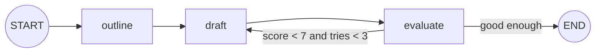
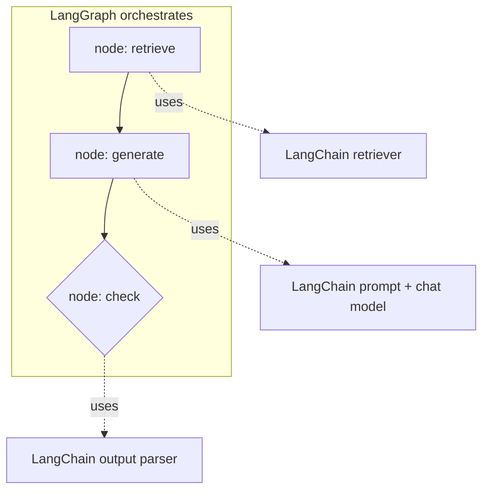

# LangChain vs LangGraph: Why LangGraph Exists: The Complete Guide

> 📚 **Before you start**
>
> - [Chains and Runnables](../../langchain-complete-guide/course.md#m6) in the LangChain Complete Guide, for what a chain is.
> - [The Agent Loop: Decide, Act, Observe](../../agentic-ai-fundamentals/03-the-agent-loop/the-agent-loop-decide-act-observe.md), for why agents need loops.
> - [Workflows vs Agents](../../agentic-ai-fundamentals/03-the-agent-loop/workflows-vs-agents.md), for the two kinds of LLM apps.

## Introduction

LangChain made it easy to connect the pieces of an LLM app: a prompt, a model, an output parser, a retriever. You snap them together with the `|` operator and get a **chain**: data flows in at one end and out the other.

Chains are perfect for pipelines that run **straight through**. But the moment your app needs to **go back** (retry, loop until good enough, call tools repeatedly), **choose between paths**, **run branches in parallel and merge them**, **pause for a human**, or **remember where it was after a crash**, a straight pipe isn't the right shape any more.

LangGraph was created by the LangChain team for exactly those apps. This lesson shows the problems that chains run into, how a graph solves each one, and how the two libraries fit together.

> 💡 **Key Insight**
>
> A **chain** is a straight line: A → B → C, once. A **graph** can have **branches, loops and pauses**, with an explicit **state** that every step reads and updates. Agents are loops, so agents need graphs.

---

## Core Explanation

### 1. What chains do well

Here's a two-step LangChain pipeline using `RunnableLambda`, which wraps an ordinary function so it can be piped (in a real app, these steps would be a prompt and a model):

```python
from langchain_core.runnables import RunnableLambda

outline = RunnableLambda(lambda topic: f"Outline for '{topic}': intro, 3 points, conclusion")
draft = RunnableLambda(lambda o: f"Draft written from [{o}]")

chain = outline | draft
print(chain.invoke("solar energy"))
```

Output:

```
Draft written from [Outline for 'solar energy': intro, 3 points, conclusion]
```

Simple, readable and composable. For fixed pipelines (summarise a document, extract fields, answer from retrieved context) this is all you need.

### 2. Where chains struggle

Now imagine the requirements grow:

- *"If the draft scores below 7/10, rewrite it, up to three times."* → a **loop**.
- *"Technical topics go to the expert writer; others to the general writer."* → **branching**.
- *"Score clarity, depth and grammar at the same time, then combine."* → **parallel** branches with a **merge**.
- *"Let an editor approve the outline before drafting."* → **pause and resume**, possibly hours later.
- *"If the server restarts mid-draft, continue from where it stopped."* → **persistence**.
- *"Show the user each step as it happens."* → **streaming** of intermediate state.

You *can* force these into chains with routers, nested chains and custom code, and LangChain's older `AgentExecutor` handled the agent loop internally. But the control flow ends up hidden inside the components, and data is passed implicitly from one step to the next. That makes it hard to see what's happening, hard to debug, and hard to resume.

The LangChain team summarised these pain points as challenges with **control flow**, **state management**, **event-driven execution** (pausing and resuming), **nesting** workflows inside workflows, and **observability**.

### 3. The graph answer

LangGraph makes three things explicit:



- **Nodes**: the steps (`outline`, `draft`, `evaluate`), each a plain function.
- **Edges**: what runs next, including **conditional edges** that branch or loop back.
- **State**: a typed object (topic, outline, draft, score, tries) that every node reads and updates.

Here's that loop running in LangGraph. Don't worry about every line yet; the next lessons explain each piece. The "scores" are faked so it runs offline:

```python
from typing import TypedDict
from langgraph.graph import StateGraph, START, END

class EssayState(TypedDict):
    topic: str
    outline: str
    draft: str
    score: int
    tries: int

def make_outline(state):
    return {"outline": f"intro, 3 points, conclusion on {state['topic']}"}

def write_draft(state):
    tries = state.get("tries", 0) + 1
    return {"draft": f"draft v{tries}", "tries": tries}

def evaluate(state):
    return {"score": [5, 6, 8][state["tries"] - 1]}      # pretend grader improves each time

def good_enough(state):
    return "done" if state["score"] >= 7 or state["tries"] >= 3 else "rewrite"

graph = StateGraph(EssayState)
graph.add_node("outline", make_outline)
graph.add_node("draft", write_draft)
graph.add_node("evaluate", evaluate)
graph.add_edge(START, "outline")
graph.add_edge("outline", "draft")
graph.add_edge("draft", "evaluate")
graph.add_conditional_edges("evaluate", good_enough, {"rewrite": "draft", "done": END})
app = graph.compile()

for step in app.stream({"topic": "solar energy"}):
    print(step)
```

Output:

```
{'outline': {'outline': 'intro, 3 points, conclusion on solar energy'}}
{'draft': {'draft': 'draft v1', 'tries': 1}}
{'evaluate': {'score': 5}}
{'draft': {'draft': 'draft v2', 'tries': 2}}
{'evaluate': {'score': 6}}
{'draft': {'draft': 'draft v3', 'tries': 3}}
{'evaluate': {'score': 8}}
```

Look at what you got for free:

- **The loop is visible** in the graph definition (`"rewrite": "draft"`), not buried in a component.
- **Every step's update is streamed**, so a UI could show progress live.
- **State is explicit**: at any moment you can see topic, outline, draft, score and tries.

Add a **checkpointer** (module 5) and the same graph can pause, resume and survive crashes. Add an **interrupt** and a human can approve the outline before drafting.

### 4. Side by side

| | LangChain (chains, LCEL) | LangGraph |
|---|---|---|
| Shape | Directed pipeline, usually no cycles | Graph with branches, **cycles** and merges |
| Data passing | Output of one step is input to the next | Shared, typed **state** updated by each node |
| Control flow | Mostly implicit | **Explicit** edges and conditional edges |
| Loops / agents | Prebuilt executors hide the loop | You see and control the loop |
| Pause and resume | Not built in | **Interrupts** + **checkpointers** |
| Persistence | Not built in | Built in (memory, SQLite, Postgres, ...) |
| Streaming | Streams tokens from components | Streams tokens **and** state updates per node |
| Best for | Prompt → model → parser pipelines, RAG chains | Agents, multi-step workflows, multi-agent systems |

### 5. They work together

Choosing LangGraph doesn't mean dropping LangChain. A typical LangGraph app uses LangChain **inside** its nodes:



- **LangChain** gives you the components: chat models, prompt templates, structured output, tools, retrievers, document loaders.
- **LangGraph** decides **when** each component runs, **what state** it sees, and **what happens next**.

You can also use LangGraph with no LangChain at all, calling a model SDK directly inside a node.

### 6. When to use which

- **Use a LangChain chain** when the steps are fixed and run once, top to bottom.
- **Use LangGraph** when you need any of: loops, branching, parallel branches with merging, tools called repeatedly, human approval, persistence/resume, or multiple agents.
- **Use neither** when a single model call does the job.

---

## Try It Yourself

1. **Change the threshold.** In the essay graph, change `good_enough` so the essay needs a score of at least 9. What happens, and why does it still stop?
2. **Count the steps.** How many node executions happened in the stream above? How many would there be if the first draft scored 8?
3. **Classify.** Chain or graph? (a) Translate a document to Hindi. (b) A support bot that looks up orders and may call several tools. (c) Generate a quiz, check every question has one correct answer, regenerate bad ones. (d) Summarise a PDF.

<details>
<summary>Show answers</summary>

**1.** No score reaches 9, so it rewrites until `tries` reaches 3, then stops. The `tries >= 3` check is the safety limit, exactly like `max_steps` in your scratch agent.

**2.** Seven (outline, then draft and evaluate three times). With a first score of 8, three: outline, draft, evaluate.

```python
def evaluate(state):
    return {"score": 8}

graph = StateGraph(EssayState)
graph.add_node("outline", make_outline)
graph.add_node("draft", write_draft)
graph.add_node("evaluate", evaluate)
graph.add_edge(START, "outline")
graph.add_edge("outline", "draft")
graph.add_edge("draft", "evaluate")
graph.add_conditional_edges("evaluate", good_enough, {"rewrite": "draft", "done": END})
print(len(list(graph.compile().stream({"topic": "tea"}))))
```

Output:

```
3
```

**3.** (a) Chain. (b) Graph (agent loop with tools). (c) Graph (check-and-retry loop). (d) Chain (unless it needs to retry or branch).

</details>

---

## Real-World Examples

- **Coding and research agents** built on LangGraph rely on loops (call tools until done) and checkpoints (resume long tasks).
- **Customer-support systems** use conditional edges to route between specialised agents and interrupts to hand off to humans.
- **Content pipelines** use parallel branches (several reviewers at once) and evaluator loops (rewrite until it passes).

---

## Common Misconceptions

### "LangGraph is LangChain version 2"

It's a separate library for orchestration. LangChain still provides the components, and both are actively used together.

### "Chains are obsolete"

For straight-through pipelines, chains remain the simplest, clearest tool.

### "You need LangChain to use LangGraph"

You don't. Nodes are plain Python functions; call any model SDK you like inside them.

---

## Interview Relevance

*"Why would you use LangGraph instead of LangChain?"* Answer: LangChain chains are great for linear pipelines; LangGraph adds **explicit state**, **cycles** (needed for agents and retry loops), **conditional and parallel edges**, **persistence and resume**, **human-in-the-loop interrupts** and **per-node streaming**. Then add that they're complementary: LangChain components run inside LangGraph nodes.

---

## Key Takeaways

- **Chains** are straight pipelines; **graphs** add **branches, loops, parallelism and pauses**.
- LangGraph makes **nodes, edges and state** explicit, which makes control flow visible and debuggable.
- It adds **persistence, interrupts and streaming** that chains don't provide.
- LangChain components usually run **inside** LangGraph nodes.
- Use a chain for fixed pipelines; use LangGraph for agents and non-linear workflows.

---

**Up next:** [What is LangGraph?](what-is-langgraph.md)
