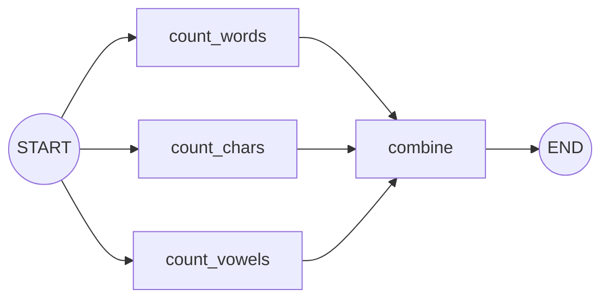

# Simple Graphs and Node Connections: The Complete Guide

> 📚 **Before you start**
>
> - [Graphs, Nodes, Edges and State](graphs-nodes-edges-and-state.md), for nodes, edges and state schemas.
> - [The LangGraph Execution Model](the-langgraph-execution-model.md), for super-steps and reducers.

## Introduction

You now know the theory. This lesson is about **wiring**: the practical ways to connect nodes, the shortcuts LangGraph offers, and the small features that keep graphs tidy as they grow. Think of it as learning the different kinds of pipe fittings a plumber carries: straight joints, splitters, joiners, and the tidy shortcut for a long straight run.

We'll build a text-cleaning graph and keep improving its wiring, covering sequences, fan-out and fan-in, passing run settings into nodes through `config`, and hiding internal fields with input and output schemas.

> 💡 **Key Insight**
>
> There are only a few connection shapes: **a line** (one after another), **a fan-out** (one to many), **a fan-in** (many to one), **a branch** (one of several) and **a loop** (back to an earlier node). Every graph you'll ever build is a combination of these five.

---

## Core Explanation

### 1. A line of nodes, the long way and the short way

Here's a cleaning pipeline: strip spaces, lower-case, then title-case.

```python
from typing import TypedDict
from langgraph.graph import StateGraph, START, END

class TextState(TypedDict):
    text: str

def clean(state):
    return {"text": state["text"].strip()}

def lower(state):
    return {"text": state["text"].lower()}

def title(state):
    return {"text": state["text"].title()}

long_way = StateGraph(TextState)
long_way.add_node("clean", clean)
long_way.add_node("lower", lower)
long_way.add_node("title", title)
long_way.add_edge(START, "clean")
long_way.add_edge("clean", "lower")
long_way.add_edge("lower", "title")
long_way.add_edge("title", END)
print(long_way.compile().invoke({"text": "  hELLO wORLD  "}))
```

Output:

```
{'text': 'Hello World'}
```

For a straight run, `add_sequence` adds the nodes **and** the edges between them in one call (names come from the function names):

```python
short_way = StateGraph(TextState)
short_way.add_sequence([clean, lower, title])
short_way.add_edge(START, "clean")
short_way.add_edge("title", END)
app = short_way.compile()
print(app.invoke({"text": "  hELLO wORLD  "}))
print([(e.source, e.target) for e in app.get_graph().edges])
```

Output:

```
{'text': 'Hello World'}
[('__start__', 'clean'), ('clean', 'lower'), ('lower', 'title'), ('title', '__end__')]
```

Same graph, less code.

### 2. Fan-out and fan-in

Adding several edges **from** one node creates a **fan-out**: the targets run in the same super-step. Adding edges from several nodes **to** one node creates a **fan-in**: the target waits until all of them have finished.

Let's analyse a sentence three ways at once, then combine the results:

```python
import operator
from typing import Annotated

class AnalysisState(TypedDict):
    text: str
    facts: Annotated[list, operator.add]      # parallel writers need a reducer
    report: str

def count_words(state):
    return {"facts": [f"words={len(state['text'].split())}"]}

def count_chars(state):
    return {"facts": [f"chars={len(state['text'])}"]}

def count_vowels(state):
    return {"facts": [f"vowels={sum(c in 'aeiou' for c in state['text'].lower())}"]}

def combine(state):
    return {"report": ", ".join(sorted(state["facts"]))}

g = StateGraph(AnalysisState)
for fn in [count_words, count_chars, count_vowels, combine]:
    g.add_node(fn)
for name in ["count_words", "count_chars", "count_vowels"]:
    g.add_edge(START, name)          # fan-out from START
    g.add_edge(name, "combine")      # fan-in to combine
g.add_edge("combine", END)
analysis = g.compile()
print(analysis.invoke({"text": "LangGraph runs nodes in parallel"})["report"])
```

Output:

```
chars=32, vowels=9, words=5
```



Two details:

- `facts` uses `operator.add` because three nodes write it in the same super-step (see [the execution model](the-langgraph-execution-model.md)).
- `combine` sorts the facts. The order of parallel results isn't something to rely on, so make the merge step order-independent.

You'll use this shape a lot in [Parallel Workflows](../03-workflow-patterns-in-langgraph/parallel-workflows.md).

### 3. Passing run settings with `config`

Some values aren't part of the data being processed but change how nodes behave: a user's language, a feature flag, a model name. Put these in the **config**, not the state. A node receives it if it accepts a second parameter named `config`:

```python
from langchain_core.runnables import RunnableConfig

class GreetState(TypedDict):
    name: str
    message: str

def greet(state: GreetState, config: RunnableConfig):
    language = config["configurable"].get("language", "en")
    word = {"en": "Hello", "hi": "Namaste", "ta": "Vanakkam"}[language]
    return {"message": f"{word}, {state['name']}!"}

g = StateGraph(GreetState)
g.add_node(greet)
g.add_edge(START, "greet")
g.add_edge("greet", END)
greeter = g.compile()

print(greeter.invoke({"name": "Ravi"})["message"])
print(greeter.invoke({"name": "Ravi"}, {"configurable": {"language": "ta"}})["message"])
```

Output:

```
Hello, Ravi!
Vanakkam, Ravi!
```

Rule of thumb: if it's **what** the graph works on, it's state; if it's **how** this run should behave, it's config.

### 4. Input and output schemas

As graphs grow, the state collects internal fields (intermediate results, counters, scratch data) that callers shouldn't have to provide or see. You can give the graph a narrower **input schema** and **output schema** while nodes still use the full state:

```python
class FullState(TypedDict):
    question: str
    search_terms: str      # internal
    answer: str

class Input(TypedDict):
    question: str

class Output(TypedDict):
    answer: str

def plan(state: FullState):
    return {"search_terms": state["question"].lower().replace("?", "")}

def answer(state: FullState):
    return {"answer": f"(answer based on searching: {state['search_terms']})"}

g = StateGraph(FullState, input_schema=Input, output_schema=Output)
g.add_sequence([plan, answer])
g.add_edge(START, "plan")
g.add_edge("answer", END)
qa = g.compile()
print(qa.invoke({"question": "What is LangGraph?"}))
```

Output:

```
{'answer': '(answer based on searching: what is langgraph)'}
```

The caller sends only `question` and gets back only `answer`; `search_terms` stays internal. This is especially useful when the graph becomes a component of a bigger one ([Subgraphs](../06-subgraphs/what-are-subgraphs.md)).

### 5. Choosing names and structure

A few habits that keep graphs readable:

- **Name nodes by action**: `fetch_order`, `score_essay`, `route_question`.
- **One responsibility per node.** If a node's name needs "and", split it.
- **Draw it.** `print(app.get_graph().draw_mermaid())` and paste into any Mermaid viewer; wiring mistakes jump out visually.
- **Test nodes as plain functions.** A node is just a function: call `count_words({"text": "a b"})` directly in a unit test.

```python
print(count_words({"text": "a b c"}))
```

Output:

```
{'facts': ['words=3']}
```

---

## Try It Yourself

1. **Extend the sequence.** Add a node `remove_digits` to the cleaning pipeline (before `lower`) using `add_sequence`. Test it on `"  Room 101 IS free  "`.
2. **Add an analyser.** Add a fourth parallel node `count_spaces` to the analysis graph. What does the report show?
3. **Config or state?** For each, decide: (a) the document being summarised; (b) "summaries must be under 100 words"; (c) the user's preferred language; (d) the summary produced.

<details>
<summary>Show answers</summary>

**1.**

```python
def remove_digits(state):
    return {"text": "".join(c for c in state["text"] if not c.isdigit())}

g = StateGraph(TextState)
g.add_sequence([clean, remove_digits, lower, title])
g.add_edge(START, "clean")
g.add_edge("title", END)
print(g.compile().invoke({"text": "  Room 101 IS free  "}))
```

Output:

```
{'text': 'Room  Is Free'}
```

(The double space is where "101" was; a real cleaner would also collapse repeated spaces.)

**2.** Add `count_spaces` returning `{"facts": [f"spaces={state['text'].count(' ')}"]}`, connect `START → count_spaces → combine`. The report becomes `chars=32, spaces=4, vowels=9, words=5`.

**3.** (a) State. (b) Config (or a constant), since it's a rule for this run. (c) Config. (d) State.

</details>

---

## Real-World Examples

- **Document pipelines** chain cleaning, chunking and embedding nodes with `add_sequence`.
- **Review systems** fan out to several checkers (safety, style, accuracy) and fan in to a decision node.
- **Multi-tenant apps** pass the tenant or user id through `config` so the same graph serves everyone.

---

## Common Misconceptions

### "Fan-in nodes run once per incoming edge"

A fan-in node waits for all its incoming branches in the same super-step and runs once.

### "Everything should go in the state"

Run settings belong in `config`; only the data being processed belongs in the state.

### "Input/output schemas change what nodes see"

Nodes still see the full state. The schemas only shape what callers send and receive.

---

## Interview Relevance

You might be asked to *"sketch a LangGraph graph for X"*. Using the right shapes (sequence, fan-out/fan-in with a reducer, branch, loop), naming nodes by action, and separating **state** from **config** shows practical experience. Mentioning **input/output schemas** to hide internal fields is a nice extra.

---

## Key Takeaways

- Five shapes: **line, fan-out, fan-in, branch, loop**.
- `add_sequence([...])` wires a straight line in one call.
- **Fan-out** runs branches in one super-step; **fan-in** waits for all; parallel writers need a **reducer**.
- Put run settings in **`config`** (`config["configurable"]`), data in **state**.
- **Input/output schemas** hide internal fields from callers.

---

**Up next:** [LangGraph Studio](langgraph-studio.md)
