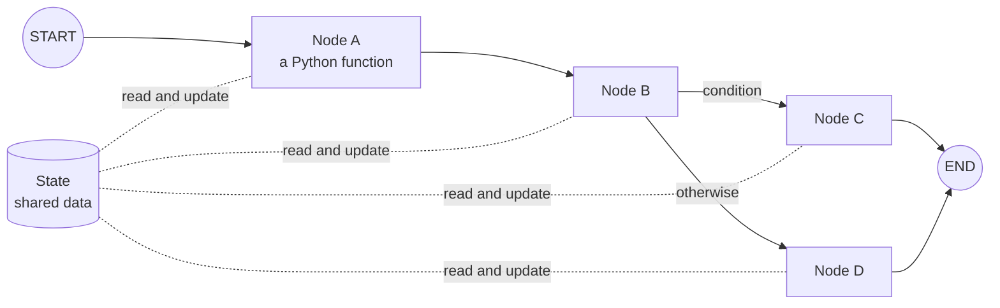
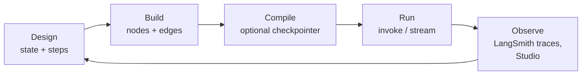

# What is LangGraph? The Complete Guide

> 📚 **Before you start**
>
> - [LangChain vs LangGraph: Why LangGraph Exists](langchain-vs-langgraph-why-langgraph-exists.md), for the problems LangGraph solves.
> - [Anatomy of an Agent](../../agentic-ai-fundamentals/03-the-agent-loop/anatomy-of-an-agent.md), for the parts every agent has.

## Introduction

**LangGraph** is an open-source Python (and JavaScript) library for building **stateful, multi-step LLM applications as graphs**. It's made by the team behind LangChain and is used for everything from simple two-step workflows to large multi-agent systems.

The name says it all: **Lang** (language models) + **Graph** (the shape of the program). You draw your application as boxes and arrows, LangGraph runs it, and along the way it handles the hard parts of real-world agents: remembering state, pausing for people, recovering from failures, and showing you what happened.

This lesson gives you the big picture: the core idea, the main building blocks you'll use throughout the course, the life cycle of a LangGraph app, and the wider ecosystem around it. You'll also run your first, tiny graph.

> 💡 **Key Insight**
>
> LangGraph is a **low-level orchestration** library. It doesn't decide *what* your agent should do; it gives you precise control over **which step runs when**, **what data each step sees**, and **how to save, pause and resume** the whole thing. You stay in charge of the logic.

---

## Core Explanation

### 1. The core idea in one picture



- **State**: the data your app works on, defined as a typed structure.
- **Nodes**: functions that receive the current state and return **updates** to it.
- **Edges**: arrows that decide which node runs next, either always (normal edges) or based on the state (conditional edges).
- **START and END**: special markers for where execution begins and finishes.

Every LangGraph application, however complex, is built from these four things.

### 2. Your first graph

Install LangGraph (`pip install langgraph`) and run this:

```python
from typing import TypedDict
from langgraph.graph import StateGraph, START, END

class GreetingState(TypedDict):     # 1. the state
    name: str
    greeting: str

def greet(state: GreetingState):     # 2. a node
    return {"greeting": f"Namaste, {state['name']}!"}

builder = StateGraph(GreetingState)  # 3. a graph builder for this state
builder.add_node("greet", greet)
builder.add_edge(START, "greet")     # 4. edges
builder.add_edge("greet", END)

app = builder.compile()              # 5. compile into a runnable app
print(app.invoke({"name": "Asha"}))
```

Output:

```
{'name': 'Asha', 'greeting': 'Namaste, Asha!'}
```

Five steps, the same in every LangGraph app:

1. **Define the state** (here, a `TypedDict` with two fields).
2. **Write nodes** as functions that take the state and return a dictionary of fields to update.
3. **Create a `StateGraph`** for that state and add the nodes.
4. **Connect them with edges**, from `START` to `END`.
5. **Compile** the builder into an app, then **invoke** it with an initial state.

Notice that `greet` returned only `{"greeting": ...}`, yet the result contains both fields. Nodes return **updates**, and LangGraph **merges** them into the state. That's one of the most important ideas in LangGraph; the next lesson explains it fully.

### 3. Looking at the compiled graph

The compiled app knows its own structure, which is handy for checking your wiring:

```python
graph = app.get_graph()
print("nodes:", list(graph.nodes))
print("edges:", [(e.source, e.target) for e in graph.edges])
```

Output:

```
nodes: ['__start__', 'greet', '__end__']
edges: [('__start__', 'greet'), ('greet', '__end__')]
```

`START` and `END` show up as the special nodes `__start__` and `__end__`. Call `graph.draw_mermaid()` to get a Mermaid diagram of any graph, or `graph.draw_mermaid_png()` to render an image (in a notebook, wrap it in `IPython.display.Image`).

### 4. The building blocks you'll use

Here's a map of the main pieces of LangGraph and where you'll learn each:

| Building block | What it does | Where you'll learn it |
|---|---|---|
| `StateGraph`, `START`, `END` | Define a graph over a state | This module |
| `add_node`, `add_edge` | Add steps and fixed connections | [Graphs, Nodes, Edges and State](graphs-nodes-edges-and-state.md) |
| `add_conditional_edges` | Branch or loop based on state | [Conditional Workflows](../03-workflow-patterns-in-langgraph/conditional-workflows.md) |
| Reducers (`Annotated[list, operator.add]`) | Control how updates merge, e.g. append instead of overwrite | [The LangGraph Execution Model](the-langgraph-execution-model.md) |
| `invoke`, `stream` | Run the graph; get the final state or step-by-step updates | [The LangGraph Execution Model](the-langgraph-execution-model.md) |
| `Send` | Fan out to many parallel tasks (map-reduce) | [Parallel Workflows](../03-workflow-patterns-in-langgraph/parallel-workflows.md) |
| `MessagesState`, `add_messages` | State for chat-style message lists | [Building a Chatbot](../05-chatbots-and-persistence/building-a-chatbot-with-langgraph.md) |
| `ToolNode`, `tools_condition` | Run tool calls and route the agent loop | [Tools in LangGraph](../04-workflows-and-agents/tools-in-langgraph-toolnode-and-tools-condition.md) |
| Checkpointers (`InMemorySaver`, SQLite, Postgres) | Save state after every step; threads; resume | [Persistence and Checkpointers](../05-chatbots-and-persistence/persistence-and-checkpointers.md) |
| `interrupt`, `Command` | Pause for a human and resume with their input | [Human-in-the-Loop with LangGraph](../../human-in-the-loop-with-langgraph/course.md) |
| Subgraphs | Use a compiled graph as a node in another graph | [Subgraphs](../06-subgraphs/what-are-subgraphs.md) |

### 5. The life cycle of a LangGraph app



1. **Design** the state (what data flows) and the steps (what work happens).
2. **Build** nodes and edges.
3. **Compile**, optionally with a **checkpointer** for memory and resume.
4. **Run** it with `invoke` (wait for the final state) or `stream` (see each step).
5. **Observe** what happened with tracing (LangSmith) or visually (LangGraph Studio), then improve the design.

### 6. The wider ecosystem

LangGraph the library is free and open source. Around it sit optional products from the same company:

- **LangSmith**: tracing, evaluation and monitoring for LLM apps, including LangGraph runs. → [LangSmith Observability for LangGraph](../07-deployment-and-observability/langsmith-observability-for-langgraph.md)
- **LangGraph Studio**: a visual IDE that shows your graph, lets you run it step by step, inspect state and edit it. → [LangGraph Studio](langgraph-studio.md)
- **Deployment platform** (LangGraph Platform / LangSmith Deployment): hosting for LangGraph apps with APIs for threads, runs and background jobs. → [Deploying and Running LangGraph Apps](../07-deployment-and-observability/deploying-and-running-langgraph-apps.md)
- **Prebuilt agents**: ready-made agent loops (in LangChain 1.x, `create_agent` builds a LangGraph agent for you).

You can use the library without any of these; everything in modules 2 and 3 runs locally with no account.

### 7. What LangGraph is not

- **Not a model.** It calls whatever models you call inside your nodes.
- **Not a prompt library.** Prompts, parsers and retrievers come from LangChain or your own code.
- **Not magic autonomy.** It runs exactly the graph you define. Any "intelligence" comes from the models and logic inside your nodes.

---

## Try It Yourself

1. **Add a node.** Add a node `shout` that turns the greeting into upper case, and connect `greet → shout → END`. What does `invoke` return?
2. **Add a field.** Add `language: str` to the state and make `greet` say "Hello" when `language` is `"en"` and "Namaste" otherwise. Invoke it both ways.
3. **Inspect.** After step 1, print the edges of the compiled graph.

<details>
<summary>Show answers</summary>

**1 and 3.**

```python
def shout(state: GreetingState):
    return {"greeting": state["greeting"].upper()}

builder = StateGraph(GreetingState)
builder.add_node("greet", greet)
builder.add_node("shout", shout)
builder.add_edge(START, "greet")
builder.add_edge("greet", "shout")
builder.add_edge("shout", END)
app = builder.compile()
print(app.invoke({"name": "Asha"}))
print([(e.source, e.target) for e in app.get_graph().edges])
```

Output:

```
{'name': 'Asha', 'greeting': 'NAMASTE, ASHA!'}
[('__start__', 'greet'), ('greet', 'shout'), ('shout', '__end__')]
```

**2.** Add `language: str` to `GreetingState`, then in `greet`: `word = "Hello" if state.get("language") == "en" else "Namaste"` and return `{"greeting": f"{word}, {state['name']}!"}`.

</details>

---

## Real-World Examples

- **Agent products** use LangGraph to run tool-calling loops with checkpoints, so a long task can resume after a failure.
- **Enterprise assistants** use it to route requests between specialised sub-agents and to pause for approval before sensitive actions.
- **Data and document pipelines** use it for parallel processing (map-reduce over many documents) with a final merge step.

---

## Common Misconceptions

### "LangGraph decides what the agent does"

You decide. LangGraph runs the nodes and edges you wrote; models inside nodes make the content decisions.

### "Every LangGraph app needs a paid platform"

No. The library is open source and runs anywhere Python runs. The hosted products are optional.

### "Nodes must return the whole state"

Nodes return only the fields they want to **update**. LangGraph merges them in.

---

## Interview Relevance

*"What is LangGraph and what are its core concepts?"* Answer: an orchestration library for stateful, multi-step LLM apps modelled as graphs. Core concepts: **state** (typed shared data), **nodes** (functions returning partial updates), **edges** (fixed and conditional), **START/END**, **compile**, and **invoke/stream**. Then name what it adds: **checkpointing and threads**, **interrupts for human-in-the-loop**, **streaming**, **subgraphs**.

---

## Key Takeaways

- LangGraph builds LLM apps as **graphs** of **nodes** and **edges** over a shared **state**.
- The recipe: **state → nodes → StateGraph → edges → compile → invoke/stream**.
- Nodes return **partial updates**, which LangGraph **merges** into the state.
- Around the library: **LangSmith** (tracing), **Studio** (visual debugging), **deployment** and **prebuilt agents**, all optional.
- It's **low-level orchestration**: you keep control of the logic.

---

**Up next:** [Graphs, Nodes, Edges and State](graphs-nodes-edges-and-state.md)
