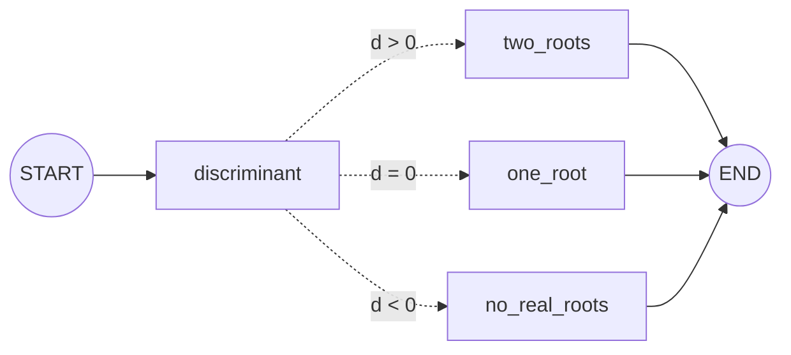

# Conditional Workflows: The Complete Guide

> 📚 **Before you start**
>
> - [Graphs, Nodes, Edges and State](../02-getting-started/graphs-nodes-edges-and-state.md), where you first met conditional edges.
> - [Structured Output with Pydantic and JSON Schema](../../langchain-complete-guide/course.md#m5), used for LLM-based routing in section 4.

## Introduction

A hospital reception desk doesn't send every patient down the same corridor. A nurse asks a few questions and routes each person: emergency, general physician, pharmacy, or lab. The routing decision is quick, but it determines everything that happens next.

**Conditional workflows** add that kind of decision to a graph. After a node runs, a **routing function** looks at the state and chooses which node runs next. The choice can be based on simple rules ("amount over ₹10,000 goes to a manager") or on an LLM's judgement ("is this review positive or negative?").

This lesson covers rule-based routing, LLM-based routing with structured output, multi-way branches, the `Command` shortcut that routes and updates state in one step, and how to keep routing reliable.

> 💡 **Key Insight**
>
> Keep **deciding** separate from **doing**. A routing function reads the state and returns a label; the nodes it routes to do the work. When the decision needs an LLM, put the LLM call in a **node** that writes its decision to the state, and let a simple routing function read that field.

---

## Core Explanation

### 1. Rule-based routing: solving a quadratic equation

A neat example with no LLM: solving *ax² + bx + c = 0*. Compute the discriminant *d = b² − 4ac*, then route: two roots if *d* > 0, one root if *d* = 0, no real roots if *d* < 0.

```python
import math
from typing import Literal, TypedDict
from langgraph.graph import StateGraph, START, END

class QuadraticState(TypedDict):
    a: float
    b: float
    c: float
    d: float
    result: str

def discriminant(state: QuadraticState):
    return {"d": state["b"] ** 2 - 4 * state["a"] * state["c"]}

def route_on_d(state: QuadraticState) -> Literal["two_roots", "one_root", "no_real_roots"]:
    if state["d"] > 0:
        return "two_roots"
    if state["d"] == 0:
        return "one_root"
    return "no_real_roots"

def two_roots(state: QuadraticState):
    r = math.sqrt(state["d"])
    x1, x2 = (-state["b"] + r) / (2 * state["a"]), (-state["b"] - r) / (2 * state["a"])
    return {"result": f"x = {x1}, {x2}"}

def one_root(state: QuadraticState):
    return {"result": f"x = {-state['b'] / (2 * state['a'])}"}

def no_real_roots(state: QuadraticState):
    return {"result": "no real roots"}

g = StateGraph(QuadraticState)
for fn in [discriminant, two_roots, one_root, no_real_roots]:
    g.add_node(fn)
g.add_edge(START, "discriminant")
g.add_conditional_edges("discriminant", route_on_d)
for name in ["two_roots", "one_root", "no_real_roots"]:
    g.add_edge(name, END)
solver = g.compile()

for a, b, c in [(1, -3, 2), (1, 2, 1), (1, 0, 1)]:
    print(f"{a}x² + {b}x + {c} = 0  ->", solver.invoke({"a": a, "b": b, "c": c})["result"])
```

Output:

```
1x² + -3x + 2 = 0  -> x = 2.0, 1.0
1x² + 2x + 1 = 0  -> x = -1.0
1x² + 0x + 1 = 0  -> no real roots
```



Notice there's **no path map** here. The routing function returns node names directly, and its `Literal[...]` return type tells LangGraph the possible targets, so it can still draw the graph correctly. Use either a path map or a `Literal` return type; both document your branches.

### 2. The routing function's rules

- **Input**: the current state. **Output**: a label (a node name, a path-map key, or `END`).
- **No side effects.** Don't update state, send emails or call APIs in a router. It may be called again during debugging or replay.
- **Cover every case.** Returning a label that isn't a node (or a path-map key) raises an error at run time.
- **Keep it simple.** If the decision is complex, compute it in a node and store it in the state; the router just reads it.

### 3. Routing on an LLM's judgement

For decisions that need understanding (sentiment, intent, topic), use the LLM in a **classifier node**, then route on the field it writes. Here's a review responder: positive reviews get a thank-you; negative ones get a diagnosis and then an empathetic reply.

```python
from langchain_core.language_models.fake_chat_models import FakeListChatModel

class ReviewState(TypedDict):
    review: str
    sentiment: str
    diagnosis: str
    reply: str

classifier_llm = FakeListChatModel(responses=["negative", "positive"])

def classify(state: ReviewState):
    raw = classifier_llm.invoke(
        "Classify the sentiment of this review as exactly one word, positive or negative.\n\n"
        + state["review"]).content.strip().lower()
    sentiment = raw if raw in ("positive", "negative") else "negative"   # safe default
    return {"sentiment": sentiment}

def diagnose(state: ReviewState):
    issue = "battery" if "battery" in state["review"].lower() else "other"
    return {"diagnosis": issue}

def apologise(state: ReviewState):
    return {"reply": f"We're sorry about the {state['diagnosis']} issue. Our team will contact you today."}

def thank(state: ReviewState):
    return {"reply": "Thank you for the kind words! We're glad you're enjoying it."}

def route_on_sentiment(state: ReviewState):
    return "diagnose" if state["sentiment"] == "negative" else "thank"

g = StateGraph(ReviewState)
for fn in [classify, diagnose, apologise, thank]:
    g.add_node(fn)
g.add_edge(START, "classify")
g.add_conditional_edges("classify", route_on_sentiment, {"diagnose": "diagnose", "thank": "thank"})
g.add_edge("diagnose", "apologise")
g.add_edge("apologise", END)
g.add_edge("thank", END)
responder = g.compile()

print(responder.invoke({"review": "Battery dies by lunchtime. Disappointed."})["reply"])
print(responder.invoke({"review": "Fantastic phone, superb camera!"})["reply"])
```

Output:

```
We're sorry about the battery issue. Our team will contact you today.
Thank you for the kind words! We're glad you're enjoying it.
```

Two reliability habits are visible here:

- **Constrain the output.** The prompt asks for exactly one of two words.
- **Validate and default.** If the model says something unexpected ("mixed!"), the node falls back to a safe choice instead of crashing the router.

### 4. Structured output for routing decisions

With a real model, the most reliable way to get a routing decision is **structured output**: you give the model a schema and get back a validated object, not free text.

```python
# not-run: needs langchain-anthropic and an API key
from pydantic import BaseModel, Field
from langchain_anthropic import ChatAnthropic

class SentimentDecision(BaseModel):
    sentiment: Literal["positive", "negative"] = Field(description="Overall sentiment of the review")
    reason: str = Field(description="One short sentence explaining the choice")

router_llm = ChatAnthropic(model="claude-opus-5-5").with_structured_output(SentimentDecision)

def classify(state: ReviewState):
    decision = router_llm.invoke(f"Classify this review:\n\n{state['review']}")
    return {"sentiment": decision.sentiment}
```

The `Literal` type in the schema means the model can only return one of the allowed values, so the router can trust the field.

### 5. Routing and updating in one step with `Command`

Sometimes a node naturally decides where to go next **and** updates the state at the same time. Instead of splitting that into a node plus a router, a node can return a **`Command`** with both an `update` and a `goto`:

```python
from langgraph.types import Command

class ExpenseState(TypedDict):
    amount: int
    status: str

def check_expense(state: ExpenseState) -> Command[Literal["auto_approve", "manager_review"]]:
    if state["amount"] > 10_000:
        return Command(update={"status": "flagged"}, goto="manager_review")
    return Command(update={"status": "ok"}, goto="auto_approve")

def auto_approve(state: ExpenseState):
    return {"status": state["status"] + " -> approved"}

def manager_review(state: ExpenseState):
    return {"status": state["status"] + " -> sent to manager"}

g = StateGraph(ExpenseState)
for fn in [check_expense, auto_approve, manager_review]:
    g.add_node(fn)
g.add_edge(START, "check_expense")       # no conditional edge needed: Command does the routing
g.add_edge("auto_approve", END)
g.add_edge("manager_review", END)
expenses = g.compile()

print(expenses.invoke({"amount": 2_500}))
print(expenses.invoke({"amount": 48_000}))
```

Output:

```
{'amount': 2500, 'status': 'ok -> approved'}
{'amount': 48000, 'status': 'flagged -> sent to manager'}
```

The `Command[Literal[...]]` return annotation tells LangGraph which nodes this node can go to, so the graph drawing stays correct.

**Conditional edge or `Command`?**

| Use a conditional edge when... | Use `Command` when... |
|---|---|
| The decision is a pure read of the state | The node computes something **and** decides where to go |
| You want routing visible in the graph wiring | You want the decision next to the logic that produces it |
| Several nodes share the same routing rule | Handing off between agents (common in multi-agent graphs) |

Both are fine; pick the one that reads more clearly.

### 6. Branches that rejoin

Branches don't have to end at `END`. They can **rejoin** a shared node, for example a `send_reply` node after either `apologise` or `thank`. Only one branch runs, so the shared node runs once with whichever branch's update.

### 7. Making routing reliable

- **Constrain** LLM decisions with structured output and `Literal` types.
- **Default safely** when a decision is missing or unexpected (often to the more cautious branch, like human review).
- **Log the decision** in the state (`sentiment`, `reason`) so you can see why a branch was taken.
- **Test each branch** with inputs designed to reach it.
- **Prefer rules** when a rule works. An `if amount > 10000` never hallucinates.

---

## Try It Yourself

1. **Add a branch.** Add a `neutral` sentiment that routes to a `ask_for_details` node. Change `classify`'s validation and the router. What does a review classified as `"neutral"` get?
2. **Command version.** Rewrite `classify` + `route_on_sentiment` as one node returning `Command`. What wiring do you remove?
3. **Find the bug.** A router returns `"Manager_Review"` but the node is called `"manager_review"`. When does the error appear: at compile time or run time?

<details>
<summary>Show answers</summary>

**1.** Allow `"neutral"` in the validation tuple, add `ask_for_details` returning a reply like "Could you tell us more?", update the router to return `"ask"` for neutral, and add `"ask": "ask_for_details"` to the path map plus an edge to `END`.

**2.**

```python
classifier_llm = FakeListChatModel(responses=["positive"])

def classify_and_route(state: ReviewState) -> Command[Literal["diagnose", "thank"]]:
    raw = classifier_llm.invoke(state["review"]).content.strip().lower()
    sentiment = raw if raw in ("positive", "negative") else "negative"
    return Command(update={"sentiment": sentiment},
                   goto="diagnose" if sentiment == "negative" else "thank")

g = StateGraph(ReviewState)
for fn in [classify_and_route, diagnose, apologise, thank]:
    g.add_node(fn)
g.add_edge(START, "classify_and_route")
g.add_edge("diagnose", "apologise")
g.add_edge("apologise", END)
g.add_edge("thank", END)
print(g.compile().invoke({"review": "Lovely!"})["reply"])
```

Output:

```
Thank you for the kind words! We're glad you're enjoying it.
```

The `add_conditional_edges` call and the separate router function are gone.

**3.** At run time, only when that branch is taken, because the router's return value isn't known until it runs. That's why every branch needs a test.

</details>

---

## Real-World Examples

- **Support bots** route by intent (billing, technical, sales) to specialised sub-flows.
- **Content moderation** routes posts as safe, needs review, or block.
- **RAG systems** route questions to a vector store, a SQL database or a web search depending on the question type (the idea behind [Adaptive RAG](../../agentic-rag-systems/course.md)).

---

## Common Misconceptions

### "The router should call the LLM"

Put LLM calls in nodes and store the decision in the state. Routers should be pure and cheap.

### "Conditional edges must use a path map"

A `Literal` return type works too. Use one of them so the graph is documented.

### "`Command` replaces conditional edges"

They overlap. `Command` is convenient when a node both updates and routes; conditional edges keep routing separate.

---

## Interview Relevance

*"How do you implement routing in LangGraph?"* Conditional edges with a routing function (path map or `Literal` return type), or `Command(update=..., goto=...)` returned from a node. For LLM-based routing: a classifier node with **structured output** and constrained values, validation with a safe default, and the decision logged in state. Mention testing each branch.

---

## Key Takeaways

- **Conditional edges** call a **routing function** that reads state and returns the next node.
- Document branches with a **path map** or a **`Literal`** return type.
- For LLM decisions, use a **classifier node** with **structured output**, **validate**, and **default safely**.
- **`Command(update=..., goto=...)`** lets a node update state and choose the next node in one step.
- Routers are **pure**; test **every branch**.

---

**Up next:** [Iterative (Looping) Workflows](iterative-looping-workflows.md)
