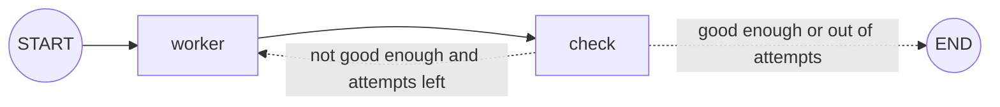

# Iterative (Looping) Workflows: The Complete Guide

> 📚 **Before you start**
>
> - [Conditional Workflows](conditional-workflows.md), because every loop is a conditional edge that points backwards.
> - [The LangGraph Execution Model](../02-getting-started/the-langgraph-execution-model.md), for reducers and the recursion limit.
> - [Planning and Reflection](../../agentic-ai-fundamentals/05-reasoning-patterns/planning-and-reflection.md), where you met the critic loop in plain Python.

## Introduction

Nobody writes a good essay in one pass. You write a draft, read it back, notice what's weak, and fix it, then repeat until it's good enough or you run out of time.

An **iterative workflow** gives a graph that same habit. A node produces something, another node (or a code check) judges it, and a conditional edge either **loops back** to improve it or **exits**. This is the pattern behind self-correcting writers, code that fixes its own failing tests, and every agent loop you'll build later.

This lesson covers how loops are wired, the two stopping rules every loop needs, keeping a history of attempts, and when an LLM judge is worth it compared with a code check.

> 💡 **Key Insight**
>
> A loop is just a conditional edge whose target is an **earlier** node. What makes it safe is the **stopping rule**: a "good enough" test **and** a maximum number of iterations. Without the second, a judge that is never satisfied keeps you looping (and paying) until the recursion limit stops you with an error.

---

## Core Explanation

### 1. The shape of a loop

Every iterative workflow has three parts:

1. **A worker** that produces or improves something (a draft, a guess, some code).
2. **A check** that decides whether it's good enough (a code test or an LLM evaluator).
3. **A router** that loops back to the worker or exits.



### 2. A loop with no LLM: square roots by guessing

Before adding models, here's a loop you can verify by hand. Newton's method finds √n by repeatedly improving a guess: *new guess = (guess + n / guess) / 2*. We stop when the guess squared is close enough to *n*, or after 20 steps.

```python
import operator
from typing import Annotated, Literal, TypedDict
from langgraph.graph import StateGraph, START, END

class SqrtState(TypedDict):
    n: float
    guess: float
    steps: int
    history: Annotated[list, operator.add]   # every guess, appended

def improve(state: SqrtState):
    guess = (state["guess"] + state["n"] / state["guess"]) / 2
    return {"guess": guess, "steps": state["steps"] + 1, "history": [round(guess, 6)]}

def good_enough(state: SqrtState) -> Literal["improve", "__end__"]:
    if abs(state["guess"] ** 2 - state["n"]) < 1e-6:   # quality test
        return END
    if state["steps"] >= 20:                            # safety cap
        return END
    return "improve"

g = StateGraph(SqrtState)
g.add_node(improve)
g.add_edge(START, "improve")
g.add_conditional_edges("improve", good_enough)
sqrt_graph = g.compile()

result = sqrt_graph.invoke({"n": 10, "guess": 1.0, "steps": 0, "history": []})
print(result["guess"], "after", result["steps"], "steps")
print(result["history"])
```

Output:

```
3.162277665175675 after 5 steps
[5.5, 3.659091, 3.196005, 3.162456, 3.162278]
```

Here the worker and the check are combined: `improve` runs, and the router checks its result. `END` is the string `"__end__"`, which is why it appears in the `Literal`. The graph has a **self-loop**, an edge from `improve` back to itself:

```python
for edge in sqrt_graph.get_graph().edges:
    print(edge.source, "->", edge.target, "(conditional)" if edge.conditional else "")
```

Output:

```
__start__ -> improve 
improve -> __end__ (conditional)
improve -> improve (conditional)
```

### 3. The two stopping rules

| Rule | What it protects against | Example |
|---|---|---|
| **Quality test** | Stopping too early | `abs(guess² − n) < 1e-6`, evaluator says "approved", all tests pass |
| **Iteration cap** | Never stopping | `steps >= 20`, `iteration >= max_iterations` |

The cap is not optional. LLM evaluators can be impossible to satisfy, and a worker can keep making the same mistake. Put the cap in the **state** (like `max_iterations`) so callers can choose it per run.

LangGraph also has its own backstop, the **recursion limit** (25 super-steps by default). If your loop hits it, the run fails with `GraphRecursionError`. Treat that as a bug signal: your own cap should always trigger first, so the run ends cleanly with the best result so far.

### 4. A writer that revises its own work

Now with a model. The writer drafts a product summary; a **code check** counts the words; if it's over the limit, the router sends it back with feedback. A code check is perfect here, because "under 25 words" is something code can measure exactly.

```python
from langchain_core.language_models.fake_chat_models import FakeListChatModel

writer_llm = FakeListChatModel(responses=[
    "This stainless steel bottle keeps drinks cold for twenty-four hours and hot for twelve, "
    "has a leak-proof lid, fits car cup holders, and comes in six colours for every taste.",
    "Keeps drinks cold for 24 hours and hot for 12. Leak-proof lid, fits cup holders, six colours.",
])

class SummaryState(TypedDict):
    product: str
    summary: str
    feedback: str
    attempt: int
    max_attempts: int
    drafts: Annotated[list, operator.add]

def write_summary(state: SummaryState):
    prompt = f"Write a product summary under 25 words for: {state['product']}."
    if state.get("feedback"):
        prompt += f"\nYour last draft had a problem: {state['feedback']}"
    text = writer_llm.invoke(prompt).content
    return {"summary": text, "attempt": state["attempt"] + 1, "drafts": [text]}

def check_length(state: SummaryState):
    words = len(state["summary"].split())
    return {"feedback": "" if words < 25 else f"It is {words} words. Cut it below 25."}

def route_after_check(state: SummaryState) -> Literal["write_summary", "__end__"]:
    if not state["feedback"] or state["attempt"] >= state["max_attempts"]:
        return END
    return "write_summary"

g = StateGraph(SummaryState)
g.add_node(write_summary)
g.add_node(check_length)
g.add_edge(START, "write_summary")
g.add_edge("write_summary", "check_length")
g.add_conditional_edges("check_length", route_after_check)
summariser = g.compile()

result = summariser.invoke({"product": "steel water bottle", "attempt": 0, "max_attempts": 3})
print("attempts:", result["attempt"])
for d in result["drafts"]:
    print(len(d.split()), "words:", d[:50] + "...")
```

Output:

```
attempts: 2
30 words: This stainless steel bottle keeps drinks cold for ...
17 words: Keeps drinks cold for 24 hours and hot for 12. Lea...
```

Three things to notice:

- The **feedback travels through the state** into the next prompt, so each attempt knows what was wrong with the last.
- `drafts` uses an `operator.add` reducer, so every version is kept for inspection, not just the last.
- `state.get("feedback")` handles the first pass, when the feedback field hasn't been written yet.

### 5. Code checks vs LLM judges

| Check with code when... | Check with an LLM judge when... |
|---|---|
| The rule is measurable (length, format, valid JSON, tests pass) | The quality is subjective (tone, humour, clarity) |
| You need it cheap, fast and certain | A human would need to read it to judge |

Often you combine them: code checks first (cheap, certain), then an LLM judge only if those pass. You'll build an LLM judge with structured feedback in [Lab: Post generator with an evaluator loop](lab-post-generator-with-an-evaluator-loop.md). This generator/evaluator pair is often called the **evaluator-optimizer** pattern.

### 6. Designing good feedback

The loop improves only if the feedback is **specific and actionable**:

- ❌ "Make it better." The worker has nothing to act on.
- ✅ "It is 30 words. Cut it below 25." The worker knows exactly what to change.

For LLM judges, ask for a **verdict** (from a fixed set, like `approved` / `needs_improvement`) **and** concrete feedback, using structured output so the router can trust the verdict field.

### 7. Common loop bugs

- **Forgetting to increment the counter.** The cap never triggers; you hit the recursion limit.
- **Resetting state on each pass.** A node that writes `{"drafts": [text]}` *without* a reducer overwrites history.
- **Feedback not reaching the worker.** The prompt doesn't include the feedback, so every attempt is the same.
- **Exit test reads stale data.** The router checks a field the check node never updated.

---

## Try It Yourself

1. **Cube roots.** Change `improve` to find ∛n using *new = (2·guess + n / guess²) / 3*. How many steps for n = 27, starting at 1.0?
2. **Never satisfied.** Make `check_length` always return feedback. With `max_attempts: 3`, how many times does `write_summary` run? What happens if you remove the cap and the writer keeps getting feedback?
3. **Best-so-far.** When the loop ends because of the cap, the last draft may not be the best. Write a function that picks the shortest draft from `result["drafts"]`.

<details>
<summary>Show answers</summary>

**1.**

```python
def improve(state: SqrtState):
    guess = (2 * state["guess"] + state["n"] / state["guess"] ** 2) / 3
    return {"guess": guess, "steps": state["steps"] + 1, "history": [round(guess, 6)]}

def good_enough(state: SqrtState) -> Literal["improve", "__end__"]:
    if abs(state["guess"] ** 3 - state["n"]) < 1e-6 or state["steps"] >= 20:
        return END
    return "improve"

g = StateGraph(SqrtState)
g.add_node(improve)
g.add_edge(START, "improve")
g.add_conditional_edges("improve", good_enough)
r = g.compile().invoke({"n": 27, "guess": 1.0, "steps": 0, "history": []})
print(round(r["guess"], 6), "after", r["steps"], "steps")
```

Output:

```
3.0 after 8 steps
```

**2.** Three times: attempts 1, 2 and 3, then the cap ends the run. Without the cap, the loop continues until LangGraph's recursion limit (25 super-steps) raises `GraphRecursionError`.

**3.**

```python
def best_draft(drafts: list[str]) -> str:
    return min(drafts, key=lambda d: len(d.split()))

print(best_draft(["one two three", "one two", "one two three four"]))
```

Output:

```
one two
```

</details>

---

## Real-World Examples

- **Coding agents** loop: write code, run tests, read the failures, fix, until the tests pass or attempts run out.
- **Data extraction** loops until the output validates against a schema, feeding the validation error back to the model.
- **Marketing tools** generate copy, score it with an LLM judge against brand guidelines, and revise.

---

## Common Misconceptions

### "The recursion limit is my stopping rule"

It's a crash barrier, not a brake. Hitting it raises an error and you lose the clean result. Always add your own cap.

### "More iterations always means better output"

Quality usually plateaus after two or three rounds, and LLM judges can push work in circles. Measure and keep caps small.

### "Loops are only for agents"

Any retry, refine or converge step is a loop: Newton's method, validation retries, polling.

---

## Interview Relevance

*"How do you build a self-correcting LLM workflow?"* Describe the **evaluator-optimizer** loop: a generator node, an evaluator (code checks and/or an LLM judge with structured verdict and feedback), and a conditional edge looping back. Stress **two stopping rules** (quality and an iteration cap in state), passing **specific feedback** into the next prompt, keeping **history with a reducer**, and the **recursion limit** as a last-resort backstop.

---

## Key Takeaways

- A loop is a **conditional edge back to an earlier node**.
- Every loop needs a **quality test** and an **iteration cap**; the recursion limit is only a backstop.
- **Feed specific feedback** into the next attempt through the state.
- Keep **every attempt** with an `operator.add` reducer.
- Use **code checks** for measurable rules and **LLM judges** for subjective quality.

---

**Up next:** [Lab: Essay evaluator with parallel graders](lab-essay-evaluator-with-parallel-graders.md)
