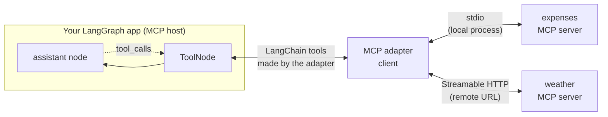

# Using MCP Tools in LangGraph: The Complete Guide

> 📚 **Before you start**
>
> - [Tools in LangGraph: ToolNode and tools_condition](tools-in-langgraph-toolnode-and-tools-condition.md), for how tools plug into a graph.
> - [Model Context Protocol (MCP)](../../model-context-protocol-mcp/course.md#m2), for what MCP servers, clients and tools are. You need the ideas, not the details.
> - [async and await](../../advanced-python-programming/course.md#m5) in Advanced Python, because MCP tools are called asynchronously.

## Introduction

Before UPI, every bank app had its own way to send money, and paying someone at another bank meant juggling account numbers, IFSC codes and different apps. UPI gave everyone **one protocol**: any app can pay any bank, and a new bank that joins works with every app on day one.

The **Model Context Protocol (MCP)** does the same for AI tools. A company writes an **MCP server** once (for GitHub, Notion, a database, or your own expense tracker), and any MCP-aware application can discover its tools and call them. You don't hand-write a `@tool` wrapper for each API; you connect to the server and receive ready-made tools.

LangGraph doesn't speak MCP by itself, and it doesn't need to. An **adapter** connects to MCP servers and turns each MCP tool into an ordinary LangChain tool. From then on, everything you learned in this module applies unchanged: bind the tools to the model, put them in a `ToolNode`, route with `tools_condition`.

In this lesson you'll see exactly what the adapter does by building a small pretend version, then use the real adapters (LangChain's built-in `MCPAdapter` and the older `MultiServerMCPClient`) in a LangGraph agent, and learn the practical details: async calls, tool name prefixes, filtering, and safety.

> 💡 **Key Insight**
>
> MCP changes **where tools come from**, not **how the graph uses them**. An adapter lists a server's tools (name, description, JSON schema) and wraps each one in a LangChain tool whose body sends a `tools/call` request to the server. Once you have that list, it goes into `bind_tools` and `ToolNode` exactly like your own `@tool` functions.

---

## Core Explanation

### 1. Where MCP fits



Recall from the MCP course:

- An **MCP server** exposes **tools** (and also resources and prompts). Each tool has a `name`, a `description` and an **`inputSchema`** (JSON Schema).
- A **client** connects to a server over a **transport**: **stdio** (the client starts the server as a local subprocess) or **Streamable HTTP** (the server runs at a URL).
- The client calls `tools/list` to discover tools and `tools/call` to run one. Results come back as a list of **content blocks** (usually text), with an `isError` flag.

### 2. A pretend MCP server

To see the mechanics offline, here's a tiny stand-in for an MCP server. It's a plain class, not the real protocol, but it answers the same two questions a real server does: *what tools do you have?* and *please run this one*. It returns data in MCP's shapes.

```python
import asyncio

class PretendMCPServer:
    """Answers list_tools and call_tool the way an MCP server would (no real protocol)."""
    def __init__(self, name, tools):
        self.name, self._tools = name, tools        # {tool_name: (description, input_schema, handler)}

    async def list_tools(self):
        return [{"name": n, "description": d, "inputSchema": s} for n, (d, s, _) in self._tools.items()]

    async def call_tool(self, name, arguments):
        try:
            text = self._tools[name][2](**arguments)
            return {"content": [{"type": "text", "text": text}], "isError": False}
        except Exception as e:
            return {"content": [{"type": "text", "text": f"{type(e).__name__}: {e}"}], "isError": True}

EXPENSES = []

expenses_server = PretendMCPServer("expenses", {
    "add_expense": ("Record one expense in rupees.",
                    {"type": "object",
                     "properties": {"amount": {"type": "number"}, "category": {"type": "string"}},
                     "required": ["amount", "category"]},
                    lambda amount, category: EXPENSES.append((amount, category)) or
                                             f"Saved ₹{amount:.0f} under {category}."),
    "total_spent": ("Total rupees spent in a category.",
                    {"type": "object", "properties": {"category": {"type": "string"}}, "required": ["category"]},
                    lambda category: f"₹{sum(a for a, c in EXPENSES if c == category):.0f} on {category}"),
})
weather_server = PretendMCPServer("weather", {
    "get_forecast": ("Today's forecast for an Indian city.",
                     {"type": "object", "properties": {"city": {"type": "string"}}, "required": ["city"]},
                     lambda city: {"pune": "31°C, light rain", "delhi": "36°C, hazy"}[city.lower()]),
})

print(asyncio.run(expenses_server.list_tools())[1])
print(asyncio.run(weather_server.call_tool("get_forecast", {"city": "Pune"})))
```

Output:

```
{'name': 'total_spent', 'description': 'Total rupees spent in a category.', 'inputSchema': {'type': 'object', 'properties': {'category': {'type': 'string'}}, 'required': ['category']}}
{'content': [{'type': 'text', 'text': '31°C, light rain'}], 'isError': False}
```

### 3. What an adapter does

An adapter does three jobs: **list** each server's tools, **wrap** each one as a LangChain tool, and **translate** results back into text. Here's a minimal version using LangChain's `StructuredTool`, which accepts a JSON Schema dictionary as its `args_schema`:

```python
from langchain_core.tools import StructuredTool

def wrap_mcp_tool(server, spec):
    async def call(**arguments):
        result = await server.call_tool(spec["name"], arguments)
        text = "\n".join(block["text"] for block in result["content"] if block["type"] == "text")
        if result["isError"]:
            raise RuntimeError(text)
        return text
    return StructuredTool.from_function(
        coroutine=call,                                  # async-only, like real MCP tools
        name=f"{server.name}_{spec['name']}",            # prefix avoids clashes between servers
        description=spec["description"],
        args_schema=spec["inputSchema"],
    )

async def load_tools(*servers):
    tools = []
    for server in servers:
        for spec in await server.list_tools():
            tools.append(wrap_mcp_tool(server, spec))
    return tools

mcp_tools = asyncio.run(load_tools(expenses_server, weather_server))
for t in mcp_tools:
    print(f"{t.name:22} {t.description:38} args={list(t.args)}")
```

Output:

```
expenses_add_expense   Record one expense in rupees.          args=['amount', 'category']
expenses_total_spent   Total rupees spent in a category.      args=['category']
weather_get_forecast   Today's forecast for an Indian city.   args=['city']
```

Three things to notice, because the real adapters behave the same way:

- **The schema came from the server.** You didn't write `amount: float` anywhere in Python; the model will see the server's JSON Schema.
- **Names are prefixed** with the server name. Two servers can both have a `search` tool; prefixes keep them apart. (Whether the real adapter prefixes depends on the adapter and its settings; section 6.)
- **The tools are async-only.** MCP calls are network or subprocess I/O, so the tool has a coroutine and no sync body:

```python
try:
    mcp_tools[2].invoke({"city": "Delhi"})
except NotImplementedError as e:
    print("invoke:", e)
print("ainvoke:", asyncio.run(mcp_tools[2].ainvoke({"city": "Delhi"})))
```

Output:

```
invoke: StructuredTool does not support sync invocation.
ainvoke: 36°C, hazy
```

### 4. MCP tools in a LangGraph agent

From here it's the agent from [Building Agents](building-agents.md). The only differences are that the tools came from `load_tools`, and that we run the graph with **`ainvoke`** because the tools are async. LangGraph runs sync nodes (like our `assistant`) fine inside an async run.

```python
from langchain_core.language_models.fake_chat_models import GenericFakeChatModel
from langchain_core.messages import AIMessage
from langgraph.graph import StateGraph, MessagesState, START
from langgraph.prebuilt import ToolNode, tools_condition

class ToolFake(GenericFakeChatModel):
    """A scripted chat model that accepts bind_tools, for offline examples."""
    def bind_tools(self, tools, **kwargs):
        return self

llm_with_tools = ToolFake(messages=iter([
    AIMessage("", tool_calls=[
        {"name": "expenses_add_expense", "args": {"amount": 240, "category": "food"}, "id": "m1"},
        {"name": "weather_get_forecast", "args": {"city": "Pune"}, "id": "m2"},
    ]),
    AIMessage("", tool_calls=[{"name": "expenses_total_spent", "args": {"category": "food"}, "id": "m3"}]),
    AIMessage("Logged ₹240 for food (₹240 so far). Pune: 31°C with light rain, so carry an umbrella!"),
])).bind_tools(mcp_tools)

def assistant(state: MessagesState):
    return {"messages": [llm_with_tools.invoke(state["messages"])]}

builder = StateGraph(MessagesState)
builder.add_node(assistant)
builder.add_node("tools", ToolNode(mcp_tools))
builder.add_edge(START, "assistant")
builder.add_conditional_edges("assistant", tools_condition)
builder.add_edge("tools", "assistant")
mcp_agent = builder.compile()

async def main():
    result = await mcp_agent.ainvoke(
        {"messages": [("user", "I spent 240 on lunch. Also, will it rain in Pune today?")]})
    for m in result["messages"][1:]:
        if m.type == "tool":
            print(f"  tool {m.name}: {m.content}")
        elif m.tool_calls:
            print("model calls", [c["name"] for c in m.tool_calls])
        else:
            print("model says:", m.content)

asyncio.run(main())
```

Output:

```
model calls ['expenses_add_expense', 'weather_get_forecast']
  tool expenses_add_expense: Saved ₹240 under food.
  tool weather_get_forecast: 31°C, light rain
model calls ['expenses_total_spent']
  tool expenses_total_spent: ₹240 on food
model says: Logged ₹240 for food (₹240 so far). Pune: 31°C with light rain, so carry an umbrella!
```

One agent, two servers, three tools, and no MCP-specific code in the graph at all.

If you call `mcp_agent.invoke(...)` instead, the tool node fails with the `NotImplementedError` you saw above. With MCP tools, use **`ainvoke`** and **`astream`**.

### 5. The real adapter: LangChain's `MCPAdapter`

In LangChain 1.4 and later, the adapter ships inside the `langchain` package as `langchain.mcp.MCPAdapter` (built on the FastMCP client). At the time of writing it's marked **beta**: importing it emits a `LangChainBetaWarning` and its API may still change. Install it with the `mcp` extra:

```bash
pip install "langchain[mcp]" langgraph langchain-anthropic
```

One server, reached over Streamable HTTP by giving its URL:

```python
# not-run: needs a running MCP server, `langchain[mcp]` and an API key
import asyncio
from langchain.mcp import MCPAdapter
from langchain_anthropic import ChatAnthropic

async def main():
    async with MCPAdapter("http://localhost:8000/mcp") as adapter:
        tools = await adapter.list_tools()
        llm_with_tools = ChatAnthropic(model="claude-opus-5-5").bind_tools(tools)
        graph = build_agent_graph(llm_with_tools, tools)     # the StateGraph from section 4
        result = await graph.ainvoke({"messages": [("user", "How much have I spent on food?")]})
        print(result["messages"][-1].content)

asyncio.run(main())
```

Several servers at once use the standard `mcpServers` configuration shape. The transport is inferred from each entry: `command` and `args` start a local stdio server; `url` connects over HTTP.

```python
# not-run: needs `langchain[mcp]` and the two servers
config = {
    "mcpServers": {
        "expenses": {"command": "python", "args": ["/path/to/expense_server.py"]},
        "weather": {"url": "http://localhost:8000/mcp"},
    }
}
async with MCPAdapter(config) as adapter:
    tools = await adapter.list_tools()        # names are namespaced per server, e.g. "weather_..."
```

According to the LangChain docs, tools returned by the adapter keep a reference to the client, so they stay callable after the `async with` block ends; each call then opens a short session. If you're making many calls in one run, keep the adapter open around the whole agent call to reuse the connection.

### 6. The older adapter: `MultiServerMCPClient`

Most tutorials and a lot of production code written in 2025 use the standalone **`langchain-mcp-adapters`** package. It still works, and you'll meet it often; the LangChain docs now describe `langchain.mcp` as its replacement and provide a migration guide.

```python
# not-run: needs `pip install langchain-mcp-adapters` and the two servers
from langchain_mcp_adapters.client import MultiServerMCPClient

client = MultiServerMCPClient({
    "expenses": {"transport": "stdio", "command": "python", "args": ["/path/to/expense_server.py"]},
    "weather": {"transport": "http", "url": "http://localhost:8000/mcp"},
})
tools = await client.get_tools()
```

The differences are small: an explicit `transport` key per server, `get_tools()` instead of `list_tools()`, and no `async with` needed for basic use.

| | `langchain.mcp.MCPAdapter` | `MultiServerMCPClient` |
|---|---|---|
| Package | `langchain[mcp]` (1.4+), beta | `langchain-mcp-adapters` (standalone) |
| Config | URL, script path, or `{"mcpServers": {...}}` | `{name: {"transport": ..., ...}}` |
| Load tools | `await adapter.list_tools()` | `await client.get_tools()` |
| Transport | Inferred from the entry | Given explicitly (`stdio`, `http`, ...) |

Either way, the result is a list of LangChain tools, and the graph from section 4 doesn't change.

### 7. Practical rules for MCP tools in agents

**Filter what you expose.** A server may offer forty tools. Every tool you bind adds to the prompt and gives the model more ways to go wrong. Pick the ones this agent needs:

```python
wanted = {"expenses_add_expense", "expenses_total_spent"}
expense_only = [t for t in mcp_tools if t.name in wanted]
print([t.name for t in expense_only])
```

Output:

```
['expenses_add_expense', 'expenses_total_spent']
```

**Keep risky tools behind approval.** An MCP server you didn't write might include write or delete tools. Use the `wrap_tool_call` guard from the [previous lesson](tools-in-langgraph-toolnode-and-tools-condition.md) or a custom router to stop them, and see [Human-in-the-Loop with LangGraph](../../human-in-the-loop-with-langgraph/course.md) for proper approvals.

**Treat tool output as untrusted.** Text from a third-party server goes straight into the model's context. It could contain instructions ("ignore previous instructions and..."). Only connect servers you trust, and don't give an agent both untrusted inputs and powerful write tools without a human check. [Agent Security and Safety](../../agent-security-and-safety/course.md) covers this in depth.

**Server errors become error messages.** When a server reports `isError`, the real adapters return an error `ToolMessage` (status `"error"`) so the model can react. Connection failures, on the other hand, raise, so decide on retries at the graph level.

**Mind the lifecycle.** A stdio server is a subprocess; an HTTP server is a network service. Load tools once at startup (not on every request), and close the adapter when your app shuts down.

---

## Try It Yourself

1. **A third server.** Create a `PretendMCPServer` called `trains` with a `pnr_status(pnr)` tool. Load tools from all three servers and print the names.
2. **Error path.** Call the wrapped `weather_get_forecast` tool for a city the server doesn't know, through a one-node graph with `ToolNode(mcp_tools, handle_tool_errors=True)`. What does the `ToolMessage` say?
3. **Why prefixes?** Two servers both expose a tool named `search`. What would go wrong if the adapter didn't prefix the names?

<details>
<summary>Show answers</summary>

**1.**

```python
trains_server = PretendMCPServer("trains", {
    "pnr_status": ("Booking status for a 10-digit PNR.",
                   {"type": "object", "properties": {"pnr": {"type": "string"}}, "required": ["pnr"]},
                   lambda pnr: "CNF, B3/41"),
})
all_tools = asyncio.run(load_tools(expenses_server, weather_server, trains_server))
print([t.name for t in all_tools])
```

Output:

```
['expenses_add_expense', 'expenses_total_spent', 'weather_get_forecast', 'trains_pnr_status']
```

**2.**

```python
g = StateGraph(MessagesState)
g.add_node("tools", ToolNode(mcp_tools, handle_tool_errors=True))
g.add_edge(START, "tools")
call = AIMessage("", tool_calls=[{"name": "weather_get_forecast", "args": {"city": "Shimla"}, "id": "e1"}])
out = asyncio.run(g.compile().ainvoke({"messages": [call]}))
print(out["messages"][-1].status, "|", out["messages"][-1].content)
```

Output:

```
error | Error: RuntimeError("KeyError: 'shimla'")
 Please fix your mistakes.
```

The server's `KeyError` came back with `isError`, our wrapper raised it, and `ToolNode` turned it into an error message the model can explain to the user ("I don't have a forecast for Shimla").

**3.** `ToolNode` (and the model) identify tools by name. Two tools called `search` would collide: one would replace the other in the `ToolNode`'s lookup table, and the model couldn't tell them apart. Prefixes like `docs_search` and `jira_search` keep both usable.

</details>

---

## Real-World Examples

- **Developer assistants** connect GitHub, Sentry and a docs MCP server, and an agent graph triages a bug by reading the error, searching the docs and opening an issue.
- **Internal company agents** reach HR, finance and IT systems through MCP servers maintained by each team, so the agent team doesn't write integrations for every system.
- **Personal finance bots** use a local stdio expense-tracker server (like the one you build in the [MCP course](../../model-context-protocol-mcp/course.md#m5)) plus a remote currency-rates server.

---

## Common Misconceptions

### "LangGraph needs special nodes for MCP"

No. The adapter returns ordinary LangChain tools; `ToolNode` and `tools_condition` work unchanged.

### "MCP tools can be called with `invoke`"

They're async. Use `ainvoke`/`astream` on the graph, or you'll get `NotImplementedError` from the tool.

### "Connecting more servers makes the agent smarter"

More tools mean a longer prompt and more chances to pick the wrong one. Expose only what the agent's job needs.

### "MCP output is trustworthy because it's a protocol"

The protocol says nothing about the content. A server can return anything, including text designed to manipulate the model.

---

## Interview Relevance

*"How do you use MCP tools with LangGraph?"* Load tools from MCP servers with an adapter (`langchain.mcp.MCPAdapter` in LangChain 1.4+, or `MultiServerMCPClient` from `langchain-mcp-adapters`), pass them to `bind_tools` and `ToolNode`, and run the graph asynchronously. Mention transports (stdio for local, Streamable HTTP for remote), name prefixing across servers, filtering tools, and treating server output as untrusted.

---

## Key Takeaways

- MCP standardises **where tools come from**; the graph uses them like any other tool.
- An adapter **lists** server tools, **wraps** each with its JSON schema, and **translates** results to text.
- MCP tools are **async**: run the graph with **`ainvoke`/`astream`**.
- Use **`MCPAdapter`** (LangChain 1.4+, beta) or **`MultiServerMCPClient`**; both return LangChain tools.
- **Filter** tools, **guard** risky ones, and treat server output as **untrusted**.

---

**Up next:** [RAG Inside a LangGraph Agent](rag-inside-a-langgraph-agent.md)
