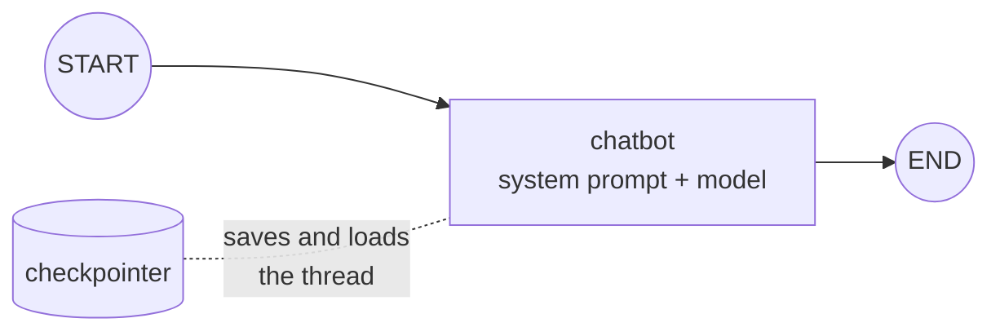

# Building a Chatbot with LangGraph: The Complete Guide

> 📚 **Before you start**
>
> - [Chains in LangGraph](../04-workflows-and-agents/chains-in-langgraph.md), for `MessagesState` and `add_messages`.
> - [Agents with Memory](../04-workflows-and-agents/agents-with-memory.md), for checkpointers and `thread_id`.
> - [The LangGraph Execution Model](../02-getting-started/the-langgraph-execution-model.md), for `stream` modes.

## Introduction

Think about the apps you chat with every day: a bank's WhatsApp assistant, Swiggy's help chat, a college admissions bot. Under the hood they need the same four things: a **model** that replies, **memory** of the conversation, **separate threads** for every user, and **replies that appear word by word** instead of after a long pause.

You already have the first three pieces from module 4. This module turns them into a proper chatbot and then makes it durable: saved to disk, able to survive crashes, and wired to a web UI. This first lesson builds the chatbot itself. By the end you'll be able to write a chatbot graph with a system prompt and per-user settings, run a multi-turn conversation, stream tokens as they're generated, and edit or delete messages in a saved conversation.

> 💡 **Key Insight**
>
> A LangGraph chatbot is the smallest useful graph: **one node** that sends the conversation to a model, compiled with a **checkpointer**. Everything that makes it feel like a product (memory, multiple users, streaming, editing history) comes from features of the graph runtime, not from extra nodes.

---

## Core Explanation

### 1. The smallest chatbot



```python
from langchain_core.language_models.fake_chat_models import FakeListChatModel
from langchain_core.messages import SystemMessage
from langgraph.graph import StateGraph, MessagesState, START, END
from langgraph.checkpoint.memory import InMemorySaver

llm = FakeListChatModel(responses=[
    "Namaste! I'm Chai Bot. Ask me anything about tea.",
    "Masala chai is black tea brewed with milk, sugar and spices like cardamom, ginger and cloves.",
    "For two cups: 1 cup water, 1 cup milk, 2 tsp tea, 2 crushed cardamoms, a little ginger. "
    "Boil the water with spices, add tea, then milk, simmer 3 minutes, strain.",
])

SYSTEM = SystemMessage("You are Chai Bot, a friendly expert on Indian tea. Keep answers short.")

def chatbot(state: MessagesState):
    return {"messages": [llm.invoke([SYSTEM] + state["messages"])]}

builder = StateGraph(MessagesState)
builder.add_node(chatbot)
builder.add_edge(START, "chatbot")
builder.add_edge("chatbot", END)
chat_app = builder.compile(checkpointer=InMemorySaver())
```

That's the whole bot. With a real model you'd replace one line:

```python
# not-run: needs `pip install langchain-anthropic` and ANTHROPIC_API_KEY
from langchain_anthropic import ChatAnthropic
llm = ChatAnthropic(model="claude-opus-5-5", max_tokens=1024)
```

### 2. A conversation loop

A terminal chatbot is a `while` loop around `invoke`, always on the same thread:

```python
# not-run: interactive, reads from the keyboard
config = {"configurable": {"thread_id": "terminal-session"}}
while True:
    text = input("You: ")
    if text.strip().lower() in {"quit", "exit", "bye"}:
        break
    result = chat_app.invoke({"messages": [("user", text)]}, config)
    print("Bot:", result["messages"][-1].content)
```

Here's the same loop with the user's lines in a list, so it runs on this page:

```python
config = {"configurable": {"thread_id": "asha"}}
for text in ["Hi!", "What is masala chai?", "How do I make it for two?"]:
    result = chat_app.invoke({"messages": [("user", text)]}, config)
    print("You:", text)
    print("Bot:", result["messages"][-1].content)
    print()

print(len(chat_app.get_state(config).values["messages"]), "messages saved in thread 'asha'")
```

Output:

```
You: Hi!
Bot: Namaste! I'm Chai Bot. Ask me anything about tea.

You: What is masala chai?
Bot: Masala chai is black tea brewed with milk, sugar and spices like cardamom, ginger and cloves.

You: How do I make it for two?
Bot: For two cups: 1 cup water, 1 cup milk, 2 tsp tea, 2 crushed cardamoms, a little ginger. Boil the water with spices, add tea, then milk, simmer 3 minutes, strain.

6 messages saved in thread 'asha'
```

Each turn sends only the new message; the checkpointer supplies the rest, so on the third turn the model saw the whole chat (and could tell that "it" meant masala chai).

### 3. Per-user settings in the state

Real bots personalise: the user's name, preferred language, plan tier. Put those in the state next to `messages` and build the system prompt from them. Because they're saved in the thread, you only send them once:

```python
class ChaiState(MessagesState):
    user_name: str
    language: str

prompts_seen = []
llm = FakeListChatModel(responses=["Namaste Ravi! Aaj kaunsi chai?", "Adrak wali chai sardi mein best hai!"])

def personal_chatbot(state: ChaiState):
    system = SystemMessage(f"You are Chai Bot. The user's name is {state['user_name']}. "
                           f"Reply in {state['language']}. Keep answers short.")
    prompts_seen.append(system.content)
    return {"messages": [llm.invoke([system] + state["messages"])]}

b = StateGraph(ChaiState)
b.add_node("chatbot", personal_chatbot)
b.add_edge(START, "chatbot")
b.add_edge("chatbot", END)
personal_app = b.compile(checkpointer=InMemorySaver())

cfg = {"configurable": {"thread_id": "ravi"}}
first = personal_app.invoke({"messages": [("user", "Hello")], "user_name": "Ravi", "language": "Hinglish"}, cfg)
second = personal_app.invoke({"messages": [("user", "Best chai for winter?")]}, cfg)   # no settings sent
print(first["messages"][-1].content)
print(second["messages"][-1].content)
print(prompts_seen[1])
```

Output:

```
Namaste Ravi! Aaj kaunsi chai?
Adrak wali chai sardi mein best hai!
You are Chai Bot. The user's name is Ravi. Reply in Hinglish. Keep answers short.
```

On the second turn, `user_name` and `language` came from the saved thread. To change a setting later without running the model, write it straight into the thread with `update_state` (section 6 and the next lesson).

### 4. Streaming tokens as they're generated

A real model takes a few seconds to write a long reply. Showing the words as they arrive makes the bot feel fast. In LangGraph, **`stream_mode="messages"`** streams the tokens of every chat model called inside any node, as `(chunk, metadata)` pairs.

`FakeListChatModel` returns its whole reply at once, so for streaming we use `GenericFakeChatModel`, which streams its scripted reply in small pieces like a real model does:

```python
from langchain_core.language_models.fake_chat_models import GenericFakeChatModel
from langchain_core.messages import AIMessage

llm = GenericFakeChatModel(messages=iter([
    AIMessage("Cutting chai is half a glass of strong, sweet tea, a Mumbai favourite."),
]))

def chatbot(state: MessagesState):
    return {"messages": [llm.invoke([SYSTEM] + state["messages"])]}

b = StateGraph(MessagesState)
b.add_node(chatbot)
b.add_edge(START, "chatbot")
b.add_edge("chatbot", END)
stream_app = b.compile(checkpointer=InMemorySaver())

cfg = {"configurable": {"thread_id": "stream-demo"}}
pieces = []
for chunk, metadata in stream_app.stream({"messages": [("user", "What is cutting chai?")]},
                                         cfg, stream_mode="messages"):
    pieces.append(chunk.content)
print(pieces[:6], "...")
print("".join(pieces))
print("from node:", metadata["langgraph_node"])
```

Output:

```
['Cutting', ' ', 'chai', ' ', 'is', ' '] ...
Cutting chai is half a glass of strong, sweet tea, a Mumbai favourite.
from node: chatbot
```

Notice the node calls `llm.invoke`, not `llm.stream`. LangGraph still captures the tokens, because chat models report each token to the run's callbacks while generating. You don't have to change your nodes to support streaming.

In a terminal you'd print each piece as it arrives:

```python
# not-run: shown for the terminal; the output appears word by word
for chunk, metadata in stream_app.stream({"messages": [("user", "And Irani chai?")]}, cfg, stream_mode="messages"):
    if metadata["langgraph_node"] == "chatbot":
        print(chunk.content, end="", flush=True)
print()
```

**Filter by node.** In a bigger graph, several nodes may call models: a classifier, a summariser, the main chatbot. You usually want to show only the chatbot's tokens to the user, which is what the `metadata["langgraph_node"]` check does.

| `stream_mode` | Yields | Use it for |
|---|---|---|
| `"values"` | Full state after each step | Debugging, simple UIs |
| `"updates"` | `{node: update}` after each node | Progress ("searching...", "writing...") |
| `"messages"` | `(token_chunk, metadata)` while models generate | Typing effect in chat UIs |
| a list, e.g. `["updates", "messages"]` | `(mode, data)` pairs | Progress *and* tokens together |

### 5. Async streaming for web servers

Web frameworks like FastAPI and many UI libraries are asynchronous. Every method has an async twin: `ainvoke`, `astream`, `aget_state`. The streaming loop looks the same with `async for`:

```python
import asyncio

llm = GenericFakeChatModel(messages=iter([AIMessage("Irani chai is slow-cooked and creamy, served with bun maska.")]))

async def reply(text, thread_id):
    out = []
    async for chunk, meta in stream_app.astream({"messages": [("user", text)]},
                                                {"configurable": {"thread_id": thread_id}},
                                                stream_mode="messages"):
        out.append(chunk.content)
    return "".join(out)

print(asyncio.run(reply("And Irani chai?", "stream-demo")))
```

Output:

```
Irani chai is slow-cooked and creamy, served with bun maska.
```

### 6. Editing and deleting messages

Because the conversation is saved state merged with `add_messages`, you can change it after the fact.

**Delete** messages with `RemoveMessage`. A common use is a "keep only recent messages" step to save tokens, or a "delete this message" button in the UI. Here a node removes everything but the last two messages before replying:

```python
from langchain_core.messages import RemoveMessage

llm = FakeListChatModel(responses=["Reply 1", "Reply 2", "Reply 3"])

def forget_old(state: MessagesState):
    return {"messages": [RemoveMessage(id=m.id) for m in state["messages"][:-2]]}

def chatbot(state: MessagesState):
    return {"messages": [llm.invoke([SYSTEM] + state["messages"])]}

b = StateGraph(MessagesState)
b.add_node(forget_old)
b.add_node(chatbot)
b.add_edge(START, "forget_old")
b.add_edge("forget_old", "chatbot")
b.add_edge("chatbot", END)
short_memory = b.compile(checkpointer=InMemorySaver())

cfg = {"configurable": {"thread_id": "short"}}
for text in ["one", "two", "three"]:
    out = short_memory.invoke({"messages": [("user", text)]}, cfg)
print([m.content for m in out["messages"]])
```

Output:

```
['Reply 2', 'three', 'Reply 3']
```

Unlike trimming inside the node (module 4), `RemoveMessage` **really deletes** messages from the saved thread. Use trimming when you want to keep the full record; use removal when you don't want old messages stored at all.

**Edit** a message by sending a new one with the **same id**. For example, a moderation step that redacts a phone number the user typed:

```python
from langchain_core.messages import HumanMessage

thread = chat_app.get_state({"configurable": {"thread_id": "asha"}}).values["messages"]
first = thread[0]
redacted = HumanMessage("Hi! (phone number removed)", id=first.id)
chat_app.update_state({"configurable": {"thread_id": "asha"}}, {"messages": [redacted]})

after = chat_app.get_state({"configurable": {"thread_id": "asha"}}).values["messages"]
print(after[0].content, "| same id:", after[0].id == first.id, "| total:", len(after))
```

Output:

```
Hi! (phone number removed) | same id: True | total: 6
```

`update_state` writes to a thread as if a node had returned that update, so the reducer replaced the message in place. You'll see more of `update_state` in the next lesson.

### 7. What makes a chatbot production-ready

| Need | How in LangGraph | Where |
|---|---|---|
| Remember the chat | Checkpointer + `thread_id` | This lesson |
| Survive restarts | A database checkpointer | [Persistent Storage with SQLite](persistent-storage-with-sqlite.md) |
| Recover from errors | Resume from the last checkpoint | [Threads, Fault Tolerance and Resuming](threads-fault-tolerance-and-resuming.md) |
| Typing effect | `stream_mode="messages"` | This lesson |
| A UI with a chat list | Streamlit + saved threads | [Lab: Chatbot UI with Streamlit](lab-chatbot-ui-with-streamlit-streaming-and-saved-chats.md) |
| Keep costs down | Trim, remove or summarise messages | [LangGraph State and Memory](../../langgraph-state-and-memory/course.md#m4) |
| See what happened | LangSmith tracing | [LangSmith Observability](../07-deployment-and-observability/langsmith-observability-for-langgraph.md) |

---

## Try It Yourself

1. **Two users.** Using `chat_app`, have thread `"meera"` say "Hi" once. How many messages are in `"meera"`, and did `"asha"` change?
2. **Change a setting.** In the `personal_app` thread `"ravi"`, change the language to English **without** calling the model. Print the saved language.
3. **Stream only one node.** Build a graph with two model-calling nodes, `classify` then `chatbot` (each with its own `GenericFakeChatModel`). Stream with `stream_mode="messages"` and collect only the `chatbot` node's tokens.

<details>
<summary>Show answers</summary>

**1.**

```python
llm = FakeListChatModel(responses=["Namaste Meera!"])

def chatbot(state: MessagesState):
    return {"messages": [llm.invoke([SYSTEM] + state["messages"])]}

chat_app.invoke({"messages": [("user", "Hi")]}, {"configurable": {"thread_id": "meera"}})
for t in ["meera", "asha"]:
    print(t, len(chat_app.get_state({"configurable": {"thread_id": t}}).values["messages"]))
```

Output:

```
meera 2
asha 6
```

(`chat_app` was compiled with the first `chatbot` function, which reads the global `llm`, so reassigning `llm` changed its replies. Meera has 2 messages; Asha still has her 6.)

**2.**

```python
cfg = {"configurable": {"thread_id": "ravi"}}
personal_app.update_state(cfg, {"language": "English"})
print(personal_app.get_state(cfg).values["language"])
```

Output:

```
English
```

**3.**

```python
classifier_llm = GenericFakeChatModel(messages=iter([AIMessage("tea_question")]))
reply_llm = GenericFakeChatModel(messages=iter([AIMessage("Kadak chai means extra strong.")]))

class TopicState(MessagesState):
    topic: str

def classify(state: TopicState):
    return {"topic": classifier_llm.invoke(state["messages"]).content}

def chatbot2(state: TopicState):
    return {"messages": [reply_llm.invoke(state["messages"])]}

b = StateGraph(TopicState)
b.add_node(classify)
b.add_node("chatbot", chatbot2)
b.add_edge(START, "classify")
b.add_edge("classify", "chatbot")
b.add_edge("chatbot", END)
two_models = b.compile()

shown = [c.content for c, meta in two_models.stream({"messages": [("user", "What is kadak chai?")]},
                                                    stream_mode="messages")
         if meta["langgraph_node"] == "chatbot"]
print("".join(shown))
```

Output:

```
Kadak chai means extra strong.
```

The classifier's tokens (`tea_question`) were streamed too, but the filter kept them out of what the user sees.

</details>

---

## Real-World Examples

- **Customer support bots** keep the customer's name, account tier and language in state, and stream replies into a web widget.
- **Edtech tutors** keep one thread per student per subject and delete or redact messages when students share personal details.
- **Internal assistants** stream only the final answering node's tokens while showing "searching documents..." progress from `updates` mode.

---

## Common Misconceptions

### "I need to call `llm.stream` in my node to stream tokens"

No. `stream_mode="messages"` captures tokens from `invoke` calls too.

### "A chatbot needs a loop inside the graph"

The conversation loop is **outside** the graph: each user message is one `invoke` on the same thread. The graph itself can be a single node.

### "Deleting messages and trimming are the same"

Trimming changes what the model sees on one call; `RemoveMessage` deletes from the saved thread permanently.

---

## Interview Relevance

*"How would you build a chatbot with LangGraph?"* `MessagesState` (plus fields for user settings), a single chat node that prepends a system prompt, compile with a checkpointer, one `thread_id` per conversation, `stream_mode="messages"` for token streaming (filtered by `langgraph_node`), and a production checkpointer like Postgres. Mention context management (trim, remove, summarise).

---

## Key Takeaways

- A chatbot is **one node + a checkpointer**; the conversation loop lives outside the graph.
- Keep **per-user settings** in the state and build the system prompt from them.
- **`stream_mode="messages"`** streams tokens from any model call; filter by **`langgraph_node`**.
- Use **`astream`/`ainvoke`** in async web apps.
- **`RemoveMessage`** deletes from the saved thread; a message with the **same id** edits it; `update_state` applies such changes from outside.

---

**Up next:** [Persistence and Checkpointers](persistence-and-checkpointers.md)
