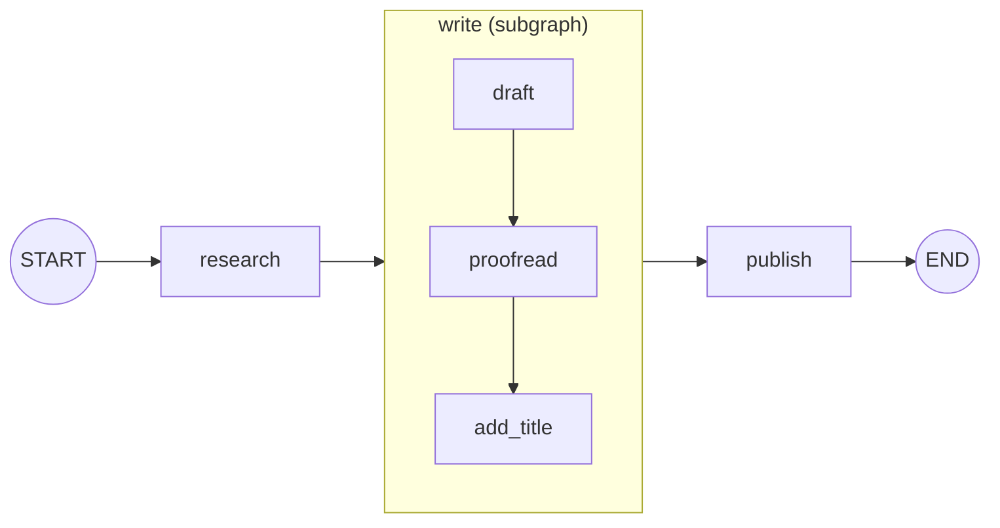

# What are Subgraphs?: The Complete Guide

> 📚 **Before you start**
>
> - [Simple Graphs and Node Connections](../02-getting-started/simple-graphs-and-node-connections.md), for input and output schemas.
> - [Persistence and Checkpointers](../05-chatbots-and-persistence/persistence-and-checkpointers.md), for `get_state` and threads.
> - [Building Agents](../04-workflows-and-agents/building-agents.md), since agents are a common thing to wrap as a subgraph.

## Introduction

A big wedding caterer doesn't run one giant kitchen where everyone does everything. There's a tandoor section, a chaat counter, a sweets team. The head chef sends each section an order ("200 rotis, 9 pm") and gets back finished food. How the tandoor team organises itself (who kneads, who rolls, who watches the fire) is their business. Each section can be trained, tested and improved on its own, and the same sweets team can work at three different weddings.

Your graphs will grow the same way. A support assistant might have a research step that's really a small agent of its own, a drafting step that loops until a checker is happy, and an approval step. Writing all of that as one flat graph of twenty nodes gets hard to read, test and reuse.

A **subgraph** is a graph used as a node inside another graph. The parent sees one box; inside the box is a complete graph with its own nodes, edges and possibly its own state. In this lesson you'll learn why subgraphs are useful, how to add one, how to look inside it (drawing, streaming, inspecting state) and how persistence works across the parent and child.

> 💡 **Key Insight**
>
> A compiled graph is itself a runnable, the same kind of thing as a node function. So you can pass it straight to `add_node`, and LangGraph runs it as one step of the parent. From the parent's point of view a subgraph is **just a node**; from the inside it's **just a graph**. That's what makes large systems composable.

---

## Core Explanation

### 1. Why subgraphs?

| Reason | Example |
|---|---|
| **Organisation** | Split a 20-node graph into 4 named stages you can understand at a glance |
| **Reuse** | One "translate and check" subgraph used by a support bot and a marketing tool |
| **Team ownership** | The retrieval team owns the retrieval subgraph; the app team only calls it |
| **Encapsulation** | Internal scratch fields (retry counters, drafts) stay inside the subgraph |
| **Multi-agent systems** | Each agent is its own graph; a supervisor graph routes between them |
| **Testing** | Test the subgraph alone with its own inputs before wiring it into the parent |

### 2. Your first subgraph

A publishing pipeline. The parent does `research → write → publish`, where **`write` is a whole graph**: draft, proofread, and add a title.

```python
import operator
from typing import Annotated, TypedDict
from langgraph.graph import StateGraph, START, END

class ArticleState(TypedDict):
    topic: str
    notes: str
    text: str

# ----- the subgraph: a little writing team -----
def draft(state: ArticleState):
    return {"text": f"{state['topic']} matters because {state['notes']}. teh end"}

def proofread(state: ArticleState):
    return {"text": state["text"].replace("teh", "the")}

def add_title(state: ArticleState):
    return {"text": f"# {state['topic'].title()}\n{state['text']}"}

writer_builder = StateGraph(ArticleState)
writer_builder.add_sequence([draft, proofread, add_title])
writer_builder.add_edge(START, "draft")
writer_builder.add_edge("add_title", END)
writer = writer_builder.compile()

# ----- the parent graph -----
def research(state: ArticleState):
    return {"notes": "UPI handles billions of payments a month"}

def publish(state: ArticleState):
    return {"text": state["text"] + "\n(published)"}

parent_builder = StateGraph(ArticleState)
parent_builder.add_node(research)
parent_builder.add_node("write", writer)          # a compiled graph as a node
parent_builder.add_node(publish)
parent_builder.add_edge(START, "research")
parent_builder.add_edge("research", "write")
parent_builder.add_edge("write", "publish")
parent_builder.add_edge("publish", END)
pipeline = parent_builder.compile()

print(pipeline.invoke({"topic": "digital payments"})["text"])
```

Output:

```
# Digital Payments
digital payments matters because UPI handles billions of payments a month. the end
(published)
```

The only new thing is `add_node("write", writer)`, where `writer` is a **compiled** graph rather than a function. Because the parent and the subgraph use the same state schema, LangGraph passes the parent's state in and merges the subgraph's final state back, exactly as it would for a node's return value.

You can still run and test the subgraph on its own:

```python
print(writer.invoke({"topic": "chai", "notes": "it is everywhere"})["text"])
```

Output:

```
# Chai
chai matters because it is everywhere. the end
```



### 3. Two ways to use a subgraph

There are two ways to connect a subgraph to a parent:

**A: Add the compiled graph as a node** (what you just did). This works when the parent and the subgraph **share state keys**: LangGraph sends the shared keys in and merges the outputs back.

**B: Call the subgraph from inside a node function.** This works for any schemas, because *you* translate the parent's state into the subgraph's input and its output back into a parent update:

```python
def write_via_function(state: ArticleState):
    result = writer.invoke({"topic": state["topic"], "notes": state["notes"]})
    return {"text": result["text"]}

b = StateGraph(ArticleState)
b.add_node(research)
b.add_node("write", write_via_function)
b.add_node(publish)
b.add_edge(START, "research")
b.add_edge("research", "write")
b.add_edge("write", "publish")
b.add_edge("publish", END)
print(b.compile().invoke({"topic": "digital payments"})["text"] == pipeline.invoke({"topic": "digital payments"})["text"])
```

Output:

```
True
```

Same result. The next lesson, [Shared vs Different State in Subgraphs](shared-vs-different-state-in-subgraphs.md), is all about choosing between these two and handling the schema differences.

### 4. Seeing inside: drawing with `xray`

By default the parent's drawing shows the subgraph as one box. Pass `xray=True` to expand it:

```python
flat = pipeline.get_graph().draw_mermaid()
expanded = pipeline.get_graph(xray=True).draw_mermaid()

print("flat drawing mentions proofread:", "proofread" in flat)
print([line.strip() for line in expanded.splitlines() if "subgraph" in line or "write\\3a" in line][:5])
```

Output:

```
flat drawing mentions proofread: False
['research --> write\\3adraft;', 'write\\3aadd_title --> publish;', 'subgraph write', 'write\\3adraft(draft)', 'write\\3aproofread(proofread)']
```

The expanded drawing contains a Mermaid `subgraph write` block with the inner nodes (their ids are prefixed with `write:`, which Mermaid writes as `write\3a`). With nested subgraphs, `xray=1` expands one level, `xray=2` two levels, and `True` everything.

### 5. Seeing inside: streaming with `subgraphs=True`

Normally `stream` only reports parent-level steps, so the whole subgraph appears as one `write` update. Pass `subgraphs=True` to get updates from inside it too. Each item then becomes a pair `(namespace, update)`: the namespace is empty for the parent and names the subgraph node for events inside it.

```python
for namespace, update in pipeline.stream({"topic": "digital payments"}, stream_mode="updates", subgraphs=True):
    where = namespace[0].split(":")[0] if namespace else "parent"
    node = next(iter(update))
    print(f"{where:7} {node}")
```

Output:

```
parent  research
write   draft
write   proofread
write   add_title
parent  write
parent  publish
```

(The full namespace looks like `('write:<task id>',)`; we print only the part before the colon.) Notice the order: the three inner steps stream first, then the parent reports `write` as finished, then `publish`. This is how a UI can show "Writing: proofreading..." while a long subgraph runs.

### 6. Persistence: the parent's checkpointer covers the child

Compile **only the parent** with a checkpointer. Subgraphs automatically use it, and their state is saved under their own namespace in the same thread. That matters most when something pauses **inside** a subgraph, such as a human approval:

```python
from langgraph.checkpoint.memory import InMemorySaver
from langgraph.types import interrupt, Command

def editor_approval(state: ArticleState):
    verdict = interrupt("Approve this draft?")
    return {"text": state["text"] + f"\n[editor: {verdict}]"}

wb = StateGraph(ArticleState)
wb.add_sequence([draft, proofread, editor_approval])
wb.add_edge(START, "draft")
wb.add_edge("editor_approval", END)
reviewed_writer = wb.compile()                     # no checkpointer here

pb = StateGraph(ArticleState)
pb.add_node(research)
pb.add_node("write", reviewed_writer)
pb.add_node(publish)
pb.add_edge(START, "research")
pb.add_edge("research", "write")
pb.add_edge("write", "publish")
pb.add_edge("publish", END)
reviewed_pipeline = pb.compile(checkpointer=InMemorySaver())   # only the parent

cfg = {"configurable": {"thread_id": "article-7"}}
reviewed_pipeline.invoke({"topic": "digital payments"}, cfg)

outer = reviewed_pipeline.get_state(cfg)
print("parent paused at:", outer.next)
inner = reviewed_pipeline.get_state(cfg, subgraphs=True).tasks[0].state
print("inside the subgraph, next:", inner.next)
print("inside the subgraph, text:", inner.values["text"])
```

Output:

```
parent paused at: ('write',)
inside the subgraph, next: ('editor_approval',)
inside the subgraph, text: digital payments matters because UPI handles billions of payments a month. the end
```

The parent only knows it's waiting on `write`. Asking with `subgraphs=True` reveals the subgraph's own snapshot: the draft is proofread and the subgraph is paused at `editor_approval`. Resuming works from the parent as usual:

```python
final = reviewed_pipeline.invoke(Command(resume="approved"), cfg)
print(final["text"])
```

Output:

```
digital payments matters because UPI handles billions of payments a month. the end
[editor: approved]
(published)
```

The subgraph resumed at `editor_approval` (not from `draft`), finished, and the parent carried on to `publish`.

Two rules to remember:

- **Don't** give the subgraph its own checkpointer when it's used inside a parent; the parent's is used automatically.
- If a subgraph needs its **own separate memory** that persists across parent runs (for example, a sub-agent that should remember its earlier conversations), compile it with `checkpointer=True`. That's an advanced case; the default is right most of the time.

### 7. Subgraph or just more nodes?

| Make it a subgraph when... | Keep it as plain nodes when... |
|---|---|
| The steps form a meaningful unit with a name ("write", "research") | It's two or three simple steps |
| You'll reuse it in another graph | It's used only here |
| It has internal fields the parent shouldn't see | All fields matter to the parent |
| A different person or team owns it | One person maintains the whole graph |
| It's an agent with its own loop inside a bigger workflow | The loop is the whole app |

Subgraphs aren't free: an extra layer to understand, namespaces in streams and state, and schema boundaries to manage. Use them when they make the system clearer, not by default.

---

## Try It Yourself

1. **Reuse.** Build a second parent graph, `newsletter`, that runs `writer` twice in a row as two different nodes (`write_intro` and `write_body`) on the same topic. What does the final text look like, and why?
2. **Count events.** How many `(namespace, update)` items does `pipeline.stream(..., subgraphs=True)` produce, and how many have a non-empty namespace?
3. **Inspect a finished run.** After the resumed run in section 6, what does `reviewed_pipeline.get_state(cfg, subgraphs=True).tasks` contain, and why?

<details>
<summary>Show answers</summary>

**1.**

```python
nb = StateGraph(ArticleState)
nb.add_node(research)
nb.add_node("write_intro", writer)
nb.add_node("write_body", writer)
nb.add_edge(START, "research")
nb.add_edge("research", "write_intro")
nb.add_edge("write_intro", "write_body")
nb.add_edge("write_body", END)
print(nb.compile().invoke({"topic": "upi"})["text"])
```

Output:

```
# Upi
upi matters because UPI handles billions of payments a month. the end
```

The second run **overwrote** `text` with a fresh draft, because `draft` builds `text` from `topic` and `notes` and ignores the existing text. Reusing a subgraph means reusing its exact behaviour, so check what it reads and writes before wiring it in twice.

**2.**

```python
events = list(pipeline.stream({"topic": "digital payments"}, stream_mode="updates", subgraphs=True))
print(len(events), sum(1 for ns, _ in events if ns))
```

Output:

```
6 3
```

Three from inside `write` (draft, proofread, add_title) and three from the parent (research, write, publish).

**3.**

```python
print(reviewed_pipeline.get_state(cfg, subgraphs=True).tasks)
```

Output:

```
()
```

An empty tuple. The run finished, so there are no pending tasks and therefore no paused subgraph to show.

</details>

---

## Real-World Examples

- **Multi-agent systems**: a supervisor graph with a "researcher" subgraph (a tool-using agent) and a "writer" subgraph (a draft-and-critique loop).
- **Shared components across products**: a company maintains one "PII redaction" subgraph used by every chatbot and document pipeline.
- **Agentic RAG**: the retrieval step from module 4 (retrieve, grade, rewrite, retry) wrapped as a subgraph and used as one node in a larger assistant.

---

## Common Misconceptions

### "A subgraph runs as a separate program"

It runs inside the parent's run, as one node in one super-step from the parent's point of view, with its own super-steps inside.

### "Each subgraph needs its own checkpointer"

The parent's checkpointer is propagated automatically. Only give a subgraph its own persistence (`checkpointer=True`) when it must keep separate memory across runs.

### "Subgraphs must have the same state as the parent"

Only when you add them directly as a node. Calling them from a node function works with any schema; that's the next lesson.

---

## Interview Relevance

*"What are subgraphs in LangGraph and why use them?"* A compiled graph used as a node (or called from a node) in a parent graph. Benefits: modularity, reuse, encapsulation, team ownership, and they're how multi-agent systems are composed. Mention `get_graph(xray=True)`, `stream(..., subgraphs=True)` with namespaces, `get_state(config, subgraphs=True)`, and that the parent's checkpointer covers subgraphs, including interrupts inside them.

---

## Key Takeaways

- A **subgraph** is a compiled graph used as a node: one box outside, a full graph inside.
- Add it **directly** with `add_node(name, compiled_graph)` when states share keys, or **call it inside a node** to translate between schemas.
- See inside with **`get_graph(xray=True)`**, **`stream(..., subgraphs=True)`** and **`get_state(config, subgraphs=True)`**.
- Compile **only the parent** with a checkpointer; pauses inside subgraphs resume correctly.
- Use subgraphs when they make the system clearer: reuse, encapsulation, ownership, multi-agent designs.

---

**Up next:** [Shared vs Different State in Subgraphs](shared-vs-different-state-in-subgraphs.md)
