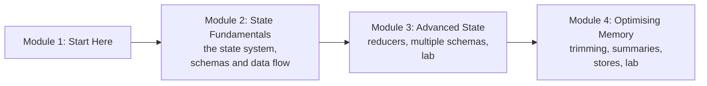

# How This Course Works

## Introduction

In [LangGraph Fundamentals](../../langgraph-fundamentals/course.md) you used state all the time: a `TypedDict` here, an `operator.add` there, `MessagesState` for every chatbot, a checkpointer for memory. You learned enough to build working graphs. This course goes back to those pieces and makes you an expert in them, because sooner or later every real LangGraph app runs into a state or memory problem:

- A parallel branch overwrites another branch's result, and an `InvalidUpdateError` appears.
- A graph's callers can see (and accidentally depend on) internal scratch fields.
- A chatbot that was cheap in week one becomes slow and expensive by week six, because every call sends the whole conversation.
- A user says "remember that I'm vegetarian", and the bot forgets as soon as they open a new chat.

Each of those has a clean LangGraph answer: the right **reducer**, **input, output and private schemas**, **trimming, deleting and summarising messages**, and a **store** for long-term memory. That's what this course teaches.

> 💡 **Key Insight**
>
> Everything a LangGraph app "knows" lives in one of three places: the **state** of the current run, the **checkpoints** of a thread (short-term memory), or a **store** shared across threads (long-term memory). Most memory bugs are really "this data is in the wrong place" bugs. By the end of this course you'll know which place each piece of data belongs in, and how to control what flows in and out of it.

---

## What You Will Learn

By the end of this course you will be able to:

- **Explain the state system**: how input becomes state, how nodes read a snapshot and return partial updates, and how those updates are merged at the end of each super-step.
- **Choose a schema type** (`TypedDict`, dataclass or Pydantic) and design state that's easy to read and hard to misuse.
- **Write reducers**, from `operator.add` and `add_messages` to your own merge functions, and know when to bypass them.
- **Use multiple schemas**: a public input, a public output and private internal state in one graph.
- **Keep conversations under budget** with `trim_messages`, `filter_messages`, `RemoveMessage` and running summaries.
- **Add long-term memory** with `InMemoryStore`: namespaces, `put`, `get`, `search` and semantic search.

### The course at a glance



| Module | Lessons | You'll build |
|---|---|---|
| 2. State Fundamentals | The LangGraph State System; State Schemas and Data Flow | Small graphs that make every state rule visible |
| 3. Advanced State | State Reducers; Multiple Schemas; Lab | A support agent whose callers see only a question and an answer |
| 4. Optimising Memory | Trimming and Filtering; Summarising; Long-Term Memory with Stores; Lab | A chatbot that stays under a token budget for a long conversation and remembers facts across chats |

After this course, [Human-in-the-Loop with LangGraph](../../human-in-the-loop-with-langgraph/course.md) uses the same state and checkpoint machinery to pause graphs for people, let them edit state, and rewind to earlier checkpoints.

---

## What You Need Before Starting

- **LangGraph Fundamentals**, especially [Graphs, Nodes, Edges and State](../../langgraph-fundamentals/02-getting-started/graphs-nodes-edges-and-state.md), [The LangGraph Execution Model](../../langgraph-fundamentals/02-getting-started/the-langgraph-execution-model.md), [Chains in LangGraph](../../langgraph-fundamentals/04-workflows-and-agents/chains-in-langgraph.md) (messages and `add_messages`) and [Agents with Memory](../../langgraph-fundamentals/04-workflows-and-agents/agents-with-memory.md) (checkpointers and threads).
- **How LLMs see text**: tokens and context windows. Module 4 relies on it; [How LLMs Work](../../generative-ai-and-llm-foundations/course.md#m3) in Generative AI and LLM Foundations covers it.

### Installing

The same two packages as LangGraph Fundamentals:

```bash
pip install langgraph langchain-core
```

The examples were tested with **LangGraph 1.2** and **langchain-core 1.6**. Check your versions with:

```bash
python -c "import importlib.metadata as m; print(m.version('langgraph'), m.version('langchain-core'))"
```

### Do I need an API key?

**No.** Every runnable example uses plain Python functions, LangChain's `FakeListChatModel`, or the small `GenericFakeChatModel` subclass from Fundamentals whose `bind_tools` returns itself. Even semantic search in the store lesson runs offline, using a tiny hand-written embedding function. Where a lesson shows the real-model version (Claude, a real embedding model, a Postgres store), the block is marked as not run on this site and the expected output is labelled "Example output".

---

## How Every Lesson Is Built

Lessons follow the same template as the rest of the platform: **Before you start** links, an **Introduction**, a **Key Insight**, a **Core Explanation** with diagrams and runnable code, **Try It Yourself** exercises with hidden answers, **Real-World Examples**, **Common Misconceptions**, **Interview Relevance** and **Key Takeaways**. **Labs** are guided builds from an empty file to something that works.

A tip specific to this course: when state behaves unexpectedly, **print it after every step**. `app.stream(inputs, stream_mode="values")` shows the full state after each super-step, and `stream_mode="updates"` shows exactly what each node returned. Almost every state bug becomes obvious once you can see the update next to the result.

---

## Common Misconceptions

### "State and memory are the same thing"

State is the data of one run. Memory is state that's been **saved** (by a checkpointer, per thread) or **stored** (in a store, across threads). A graph without a checkpointer has state but no memory.

### "Memory problems are solved by bigger context windows"

A larger window delays the problem; it doesn't remove it. Every token you send costs money and time, and models often pay less attention to the middle of a very long prompt. Deciding what the model sees is a design job.

### "This is advanced material I can skip"

Reducers and schemas decide whether parallel branches work, whether subgraphs compose and whether your chatbot stays affordable. They're everyday tools, not extras.

---

## Key Takeaways

- Data in a LangGraph app lives in **run state**, **thread checkpoints** or a **cross-thread store**.
- Module 2 explains the **state system and schemas**; module 3 covers **reducers and multiple schemas**; module 4 covers **trimming, summarising and long-term stores**.
- You need **LangGraph Fundamentals**; module 4 also assumes you know what **tokens** are.
- Every example runs **offline** with fake models; real-model versions are shown but not run.

---

**Up next:** [The LangGraph State System](../02-state-fundamentals/the-langgraph-state-system.md)
