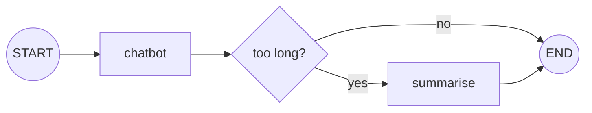

# Summarising Long Conversations: The Complete Guide

> 📚 **Before you start**
>
> - [Trimming and Filtering Messages](trimming-and-filtering-messages.md), for windows, token counting and `RemoveMessage`.
> - [State Reducers](../03-advanced-state/state-reducers.md), for how `add_messages` deletes by id.
> - [Conditional Workflows](../../langgraph-fundamentals/03-workflow-patterns-in-langgraph/conditional-workflows.md), because the summary step runs only when needed.

## Introduction

Your friend missed the first hour of a Test match and joins you at tea. You don't replay every ball; you say "India were 45 for 3, Rahul's still in, the pitch is turning a lot." Thirty seconds, and they can follow everything that happens next.

Trimming a conversation is like turning up at tea with no update at all: the model sees the last few exchanges and nothing before. That's fine for small talk, but in a support chat the customer may have said "my order number is 4471" twenty messages ago, and a trimmed bot will ask for it again. **Summarisation** is the friend's update: every so often, a model condenses the older part of the conversation into a short paragraph, the old messages are removed (or hidden from the model), and the summary rides along with every future call.

In this lesson you'll build the classic LangGraph summarisation pattern step by step: a `summary` field, a conditional edge that decides when to summarise, a node that writes or extends the summary and deletes old messages, and a chatbot that reads the summary. Then you'll trigger it by tokens instead of message count, keep tool calls valid, and see the prebuilt options.

> 💡 **Key Insight**
>
> A running summary is just **state**: a string field that one node writes and another node reads. The trick is in the timing. Summarise only when the conversation crosses a threshold, **extend** the previous summary rather than starting over, and **keep the most recent messages verbatim**, because the model needs exact wording for the current topic and gist for everything older.

---

## Core Explanation

### 1. The shape of the graph



- `chatbot` answers, reading the summary (if any) plus the recent messages.
- After answering, a routing function checks the conversation's length.
- `summarise` writes a new summary and deletes all but the last few messages.

Running the summary **after** the reply means the user isn't kept waiting for it on the turn that crosses the threshold (in a streaming UI, the answer has already been shown).

### 2. State and models

The state is `MessagesState` plus one string. We need two models: the chat model, and a (usually cheaper) model for summaries. Both are scripted here so the lesson runs offline, and each records what it was sent.

```python
from langchain_core.language_models.fake_chat_models import FakeListChatModel
from langchain_core.messages import HumanMessage, RemoveMessage, SystemMessage
from langgraph.graph import StateGraph, MessagesState, START, END
from langgraph.checkpoint.memory import InMemorySaver

class ChatState(MessagesState):
    summary: str

class Recording(FakeListChatModel):
    """FakeListChatModel that remembers every prompt it received."""
    prompts: list = []

    def invoke(self, messages, *args, **kwargs):
        self.prompts.append(messages)
        return super().invoke(messages, *args, **kwargs)

chat_llm = Recording(responses=[
    "Namaste! Which order is this about?",
    "Got it, order 4471: a Prestige pressure cooker.",
    "I see it was delivered with a dented lid.",
    "I can offer a replacement or a refund.",
    "Replacement booked. Pickup tomorrow, 10 am to 1 pm.",
    "You're welcome! Anything else about order 4471?",
], prompts=[])

summary_llm = Recording(responses=[
    "The customer contacted support about order 4471, a Prestige pressure cooker.",
    "Order 4471 (Prestige pressure cooker) was delivered with a dented lid. "
    "The agent offered a replacement or a refund.",
], prompts=[])
```

With real models you'd typically use your main model for chat and a smaller one for summaries:

```python
# not-run: needs `pip install langchain-anthropic` and ANTHROPIC_API_KEY
from langchain_anthropic import ChatAnthropic

chat_llm = ChatAnthropic(model="claude-opus-5-5")
summary_llm = ChatAnthropic(model="claude-opus-5-5", max_tokens=300)
```

### 3. The chatbot reads the summary

The summary goes in as a system message, built fresh on every call, so it's never stored inside `messages`:

```python
SYSTEM = "You are a helpful support agent for an Indian kitchenware store."

def chatbot(state: ChatState):
    prompt = [SystemMessage(SYSTEM)]
    if state.get("summary"):
        prompt.append(SystemMessage(f"Summary of the conversation so far: {state['summary']}"))
    prompt += state["messages"]
    return {"messages": [chat_llm.invoke(prompt)]}
```

### 4. Deciding when to summarise

The simplest trigger is a message count. Here, summarise once there are more than four messages (two turns). That's far too small for a real app, but it lets us watch several summaries in a short conversation:

```python
MAX_MESSAGES = 4

def should_summarise(state: ChatState):
    return "summarise" if len(state["messages"]) > MAX_MESSAGES else END
```

### 5. The summarise node: extend, then delete

```python
KEEP_LAST = 2

def summarise(state: ChatState):
    old_summary = state.get("summary", "")
    if old_summary:
        instruction = (f"This is the summary so far: {old_summary}\n\n"
                       "Extend it with the new messages above. Keep names, numbers and decisions.")
    else:
        instruction = "Summarise the conversation above. Keep names, numbers and decisions."

    to_summarise = state["messages"][:-KEEP_LAST]
    summary = summary_llm.invoke(to_summarise + [HumanMessage(instruction)]).content

    delete = [RemoveMessage(id=m.id) for m in to_summarise]
    return {"summary": summary, "messages": delete}
```

Three choices are made here:

- **Extend, don't restart.** The previous summary is passed in with only the messages that aren't summarised yet. Re-summarising the whole history each time would cost more and slowly blur details.
- **Summarise only what you delete.** The last `KEEP_LAST` messages stay verbatim, so the model still has exact wording for the current topic.
- **Ask for what matters.** "Keep names, numbers and decisions" is short, but it's the difference between a summary that remembers order 4471 and one that says "the customer had a problem with an order".

### 6. Wire it and run a conversation

```python
b = StateGraph(ChatState)
b.add_node(chatbot)
b.add_node(summarise)
b.add_edge(START, "chatbot")
b.add_conditional_edges("chatbot", should_summarise, ["summarise", END])
b.add_edge("summarise", END)
app = b.compile(checkpointer=InMemorySaver())

cfg = {"configurable": {"thread_id": "asha-order-4471"}}
user_turns = ["Hi", "It's order 4471", "The cooker lid came dented",
              "What can you do?", "Replacement please", "Thanks!"]

for i, text in enumerate(user_turns, start=1):
    state = app.invoke({"messages": [("user", text)]}, cfg)
    print(f"turn {i}: {len(state['messages'])} messages saved, "
          f"summary: {'yes' if state.get('summary') else 'no'}")
```

Output:

```
turn 1: 2 messages saved, summary: no
turn 2: 4 messages saved, summary: no
turn 3: 2 messages saved, summary: yes
turn 4: 4 messages saved, summary: yes
turn 5: 2 messages saved, summary: yes
turn 6: 4 messages saved, summary: yes
```

On turn 3 the thread reaches 6 messages, a summary is written, and the thread drops back to the last 2. It climbs again and is summarised again on turn 5. Here's the final state:

```python
final = app.get_state(cfg).values
print("SUMMARY:", final["summary"])
for m in final["messages"]:
    print(f"{m.type:5}: {m.content}")
```

Output:

```
SUMMARY: Order 4471 (Prestige pressure cooker) was delivered with a dented lid. The agent offered a replacement or a refund.
human: Replacement please
ai   : Replacement booked. Pickup tomorrow, 10 am to 1 pm.
human: Thanks!
ai   : You're welcome! Anything else about order 4471?
```

### 7. What each model actually received

The real benefit shows in the prompts. Here's what the chat model received on its last call, and what the summariser received the second time:

```python
last_chat_prompt = chat_llm.prompts[-1]
print("chat model, last call:")
for m in last_chat_prompt:
    print(f"  {m.type:6} {m.content[:70]}")

print("summariser, second call:")
for m in summary_llm.prompts[1]:
    print(f"  {m.type:6} {m.content[:70]}")
```

Output:

```
chat model, last call:
  system You are a helpful support agent for an Indian kitchenware store.
  system Summary of the conversation so far: Order 4471 (Prestige pressure cook
  human  Replacement please
  ai     Replacement booked. Pickup tomorrow, 10 am to 1 pm.
  human  Thanks!
summariser, second call:
  human  The cooker lid came dented
  ai     I see it was delivered with a dented lid.
  human  What can you do?
  ai     I can offer a replacement or a refund.
  human  This is the summary so far: The customer contacted support about order
```

The chat model never sees more than the summary and a handful of recent messages, yet it still "knows" the order number. The summariser's second call contains only the messages added since the first summary, plus the old summary in the instruction.

### 8. Triggering by tokens instead of count

Message counts are crude: one pasted error log can be longer than fifty "ok"s. A token trigger is a one-line change with `count_tokens_approximately`:

```python
from langchain_core.messages.utils import count_tokens_approximately

TOKEN_BUDGET = 120

def should_summarise_tokens(state: ChatState):
    used = count_tokens_approximately(state["messages"])
    return "summarise" if used > TOKEN_BUDGET else END

short = {"messages": [HumanMessage("ok"), HumanMessage("thanks")]}
long_log = {"messages": [HumanMessage("Error log: " + "TimeoutError at payment gateway; " * 20)]}
print(should_summarise_tokens(short), should_summarise_tokens(long_log))
```

Output:

```
__end__ summarise
```

### 9. Keeping tool calls valid when cutting

In an agent, the messages you keep verbatim must not begin with a tool result whose call was summarised away. The fix is to choose the cut point with `trim_messages` and `start_on="human"`, exactly as in the last lesson, and summarise everything before it:

```python
from langchain_core.messages import AIMessage, ToolMessage, trim_messages

def split_for_summary(messages, keep_tokens):
    keep = trim_messages(messages, max_tokens=keep_tokens, token_counter=count_tokens_approximately,
                         strategy="last", start_on="human")
    cut = len(messages) - len(keep)
    return messages[:cut], messages[cut:]

agent_chat = [
    HumanMessage("Track order 4471", id="1"),
    AIMessage("", tool_calls=[{"name": "track", "args": {"order": "4471"}, "id": "t1"}], id="2"),
    ToolMessage("Out for delivery", tool_call_id="t1", id="3"),
    AIMessage("It's out for delivery.", id="4"),
    HumanMessage("And order 4502?", id="5"),
    AIMessage("", tool_calls=[{"name": "track", "args": {"order": "4502"}, "id": "t2"}], id="6"),
    ToolMessage("Delivered yesterday", tool_call_id="t2", id="7"),
    AIMessage("Delivered yesterday.", id="8"),
]
old, recent = split_for_summary(agent_chat, keep_tokens=60)
print("summarise:", [m.id for m in old], "| keep:", [m.id for m in recent])
```

Output:

```
summarise: ['1', '2', '3', '4'] | keep: ['5', '6', '7', '8']
```

The cut falls on a human message, so the kept part is a complete exchange.

### 10. Prebuilt options

You'll often write the pattern yourself (it's short and easy to tune), but two libraries package it:

- **LangMem** (`pip install langmem`) has a `SummarizationNode` you can put before your model node. It keeps a running summary in state and decides when to summarise by token counts.
- **LangChain's `create_agent`** accepts a `SummarizationMiddleware` that summarises automatically when a trigger is reached:

```python
# not-run: needs `pip install langchain langchain-anthropic` and ANTHROPIC_API_KEY
from langchain.agents import create_agent
from langchain.agents.middleware import SummarizationMiddleware
from langgraph.checkpoint.memory import InMemorySaver

agent = create_agent(
    model="anthropic:claude-opus-5-5",
    tools=[],
    middleware=[SummarizationMiddleware(model="anthropic:claude-opus-5-5",
                                        trigger=("tokens", 4000), keep=("messages", 20))],
    checkpointer=InMemorySaver(),
)
```

Check each library's docs for the current arguments; these helpers evolve quickly.

### 11. What summaries lose

| Risk | Mitigation |
|---|---|
| Exact values drift ("₹2,450" becomes "about ₹2,500") | Ask explicitly to keep numbers, ids, dates; keep recent messages verbatim |
| Summary grows forever | Ask for a maximum length; occasionally re-summarise the summary |
| A wrong summary misleads every later turn | Log summaries; review them in traces; keep the deleted messages elsewhere if you need an audit trail |
| User facts that matter across chats ("I'm allergic to peanuts") | Put them in a **store**, not just the summary: [Long-Term Memory with Stores](long-term-memory-with-stores.md) |

---

## Try It Yourself

1. **Keep more.** Change `KEEP_LAST` to 4 and rerun the six turns on a new thread (recreate both scripted models). On which turns does summarisation happen now, and why is that a bad setting?
2. **Hide instead of delete.** Write `summarise_keep_history` that writes `summary` and a new integer field `summarised_upto` (how many messages are summarised) **without** deleting, and a chatbot that sends only `messages[summarised_upto:]`. What's the trade-off?
3. **Summary length guard.** Write `needs_compaction(summary, max_words=60)` that returns `True` when the summary is too long, and test it on the second scripted summary.

<details>
<summary>Show answers</summary>

**1.** Summarisation now happens on **every** turn from turn 3 on:

```python
def fresh_models():
    global chat_llm, summary_llm
    chat_llm = Recording(responses=[f"Reply {i}" for i in range(1, 7)], prompts=[])
    summary_llm = Recording(responses=["Summary A", "Summary B", "Summary C", "Summary D"], prompts=[])

fresh_models()
KEEP_LAST = 4
cfg4 = {"configurable": {"thread_id": "keep-four"}}
for i, text in enumerate(user_turns, start=1):
    state = app.invoke({"messages": [("user", text)]}, cfg4)
    print(i, len(state["messages"]), state.get("summary", "-"))
KEEP_LAST = 2
```

Output:

```
1 2 -
2 4 -
3 4 Summary A
4 4 Summary B
5 4 Summary C
6 4 Summary D
```

After each summary 4 messages remain, so the very next turn (+2) crosses the threshold of 4 again. Keeping nearly as many messages as the threshold means paying for a summary on every turn. Leave a clear gap: for example, summarise above 40 messages and keep the last 10.

**2.** Nothing is deleted, so the checkpoint keeps the full history (good for audits), but storage grows and you must track the offset yourself:

```python
class HiddenState(MessagesState):
    summary: str
    summarised_upto: int

def summarise_keep_history(state: HiddenState):
    start = state.get("summarised_upto", 0)
    end = len(state["messages"]) - KEEP_LAST
    summary = summary_llm.invoke(state["messages"][start:end] + [HumanMessage("Summarise.")]).content
    return {"summary": summary, "summarised_upto": end}

def chatbot_hidden(state: HiddenState):
    view = state["messages"][state.get("summarised_upto", 0):]
    return {"messages": [chat_llm.invoke(view)]}

fresh_models()
b = StateGraph(HiddenState)
b.add_node("chatbot", chatbot_hidden)
b.add_node("summarise", summarise_keep_history)
b.add_edge(START, "chatbot")
b.add_conditional_edges("chatbot",
    lambda s: "summarise" if len(s["messages"]) - s.get("summarised_upto", 0) > MAX_MESSAGES else END,
    ["summarise", END])
b.add_edge("summarise", END)
hidden = b.compile(checkpointer=InMemorySaver())
c = {"configurable": {"thread_id": "hidden"}}
for text in user_turns:
    s = hidden.invoke({"messages": [("user", text)]}, c)
print(len(s["messages"]), "saved |", s["summarised_upto"], "summarised |", s["summary"])
```

Output:

```
12 saved | 8 summarised | Summary B
```

**3.**

```python
def needs_compaction(summary: str, max_words: int = 60) -> bool:
    return len(summary.split()) > max_words

long_summary = ("Order 4471 (Prestige pressure cooker) was delivered with a dented lid. "
                "The agent offered a replacement or a refund.")
print(needs_compaction(long_summary), needs_compaction(long_summary, max_words=15))
```

Output:

```
False True
```

</details>

---

## Real-World Examples

- **E-commerce support bots** summarise long chats so that "order 4471" and "already offered a refund" survive while the prompt stays small.
- **Meeting and call assistants** keep a running summary of a two-hour call and only the last few minutes verbatim.
- **Coding agents** compact long sessions into a summary of decisions and file changes when they approach the context limit, then continue.

---

## Common Misconceptions

### "Summarise every turn"

That adds a model call per turn and blurs details. Summarise when a threshold is crossed.

### "The summary should go into `messages`"

Keep it in its own field and inject it as a system message at call time. Then it can be replaced cleanly and never gets trimmed away by accident.

### "A summary replaces long-term memory"

It's per thread. Facts that should follow the user across chats belong in a store.

### "Summarisation is free compression"

It costs a model call and loses detail. Keep recent messages verbatim and ask the summariser to preserve exact values.

---

## Interview Relevance

*"How would you handle a chatbot conversation that exceeds the context window?"* Combine a recent window with a running summary: a `summary` field, a conditional edge that triggers on message count or tokens, a summarise node that extends the previous summary and deletes (or hides) old messages with `RemoveMessage`, and a chatbot that injects the summary as a system message. Mention cheaper summary models, keeping tool calls valid at the cut, and moving durable facts to a long-term store.

*"Trim or summarise?"* Trim for casual chat where old context rarely matters; summarise when earlier facts and decisions must survive; usually both.

---

## Key Takeaways

- A running summary is a **state field** written by a summarise node and read by the chatbot.
- Trigger summarisation on **message count or tokens** via a **conditional edge**, ideally after the reply.
- **Extend** the previous summary with only the new messages; **keep recent messages verbatim**.
- Delete summarised messages with **`RemoveMessage`**, or hide them with an offset if you need the full record.
- Cut at a **human message** so kept tool calls stay valid; put cross-chat facts in a **store**.

---

**Up next:** [Long-Term Memory with Stores](long-term-memory-with-stores.md)
