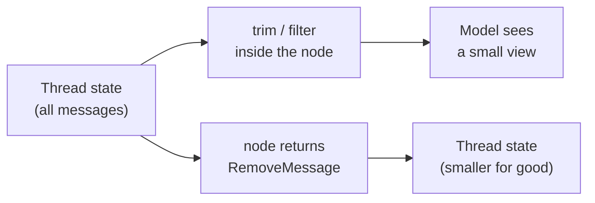

# Trimming and Filtering Messages: The Complete Guide

> 📚 **Before you start**
>
> - [How LLMs Work](../../generative-ai-and-llm-foundations/course.md#m3) in Generative AI and LLM Foundations, for tokens and context windows.
> - [State Reducers](../03-advanced-state/state-reducers.md), for `add_messages`, `RemoveMessage` and `REMOVE_ALL_MESSAGES`.
> - [Agents with Memory](../../langgraph-fundamentals/04-workflows-and-agents/agents-with-memory.md), where you first trimmed what a model sees.

## Introduction

A WhatsApp support chat for a phone repair shop starts small: "Is my screen replacement ready?" "Tomorrow, 4 pm." But some customers chat with the bot every day for weeks. Each reply from the model is generated from the **entire** conversation the app sends it, so on day 30 every "ok thanks" costs as much as reading a short novel. Responses slow down, the monthly bill climbs, and eventually a request fails because the conversation no longer fits in the model's **context window** (the maximum number of tokens it can read at once).

The cure is to decide **what the model sees**. Usually that's the most recent part of the conversation, plus the system prompt, plus anything important from earlier, with the structure kept valid (a tool result must never appear without the tool call that asked for it). LangChain gives you two helpers for building that view, `trim_messages` and `filter_messages`, and LangGraph's `add_messages` reducer lets you go further and actually **delete** old messages from the saved thread.

By the end of this lesson you'll be able to measure a conversation in tokens, trim it to a budget with every option `trim_messages` offers, filter out message types, keep tool calls valid, and choose between trimming a view and deleting from state.

> 💡 **Key Insight**
>
> There are two different decisions: **what the model sees on this call** and **what the thread keeps forever**. Trimming or filtering inside a node changes only the first; the full history stays in the checkpoint. Returning `RemoveMessage`s changes the second. Most apps trim the view and keep the history, and delete only when they don't want old messages stored at all.

---

## Core Explanation

### 1. Why conversations get expensive

Each model call reads the whole prompt. If every turn adds roughly the same number of tokens, turn *n* sends about *n* turns' worth, so the **total** you pay for grows with the square of the conversation length. LangChain's `count_tokens_approximately` estimates tokens from characters (about 4 characters per token plus a few per message), which is good enough for budgeting:

```python
from langchain_core.messages import AIMessage, HumanMessage, SystemMessage, ToolMessage
from langchain_core.messages.utils import count_tokens_approximately

turn = [HumanMessage("Is my screen replacement for the Redmi Note ready yet?"),
        AIMessage("Not yet. It will be ready tomorrow after 4 pm at the Andheri branch.")]
per_turn = count_tokens_approximately(turn)

sent_total = 0
for n in [1, 10, 50, 100]:
    sent_this_call = per_turn * n
    print(f"turn {n:3}: this call sends ~{sent_this_call:5} tokens")
print("total sent over 100 turns:", sum(per_turn * n for n in range(1, 101)))
print("with a 10-turn window:   ", sum(per_turn * min(n, 10) for n in range(1, 101)))
```

Output:

```
turn   1: this call sends ~   41 tokens
turn  10: this call sends ~  410 tokens
turn  50: this call sends ~ 2050 tokens
turn 100: this call sends ~ 4100 tokens
total sent over 100 turns: 207050
with a 10-turn window:    39155
```

A sliding window of ten turns cuts the total by more than five times here, and, just as important, keeps every call the **same** size no matter how long the chat runs.

### 2. Three tools, two effects

| Tool | What it does | Changes saved state? |
|---|---|---|
| `trim_messages` | Keeps the first or last messages that fit a token budget | No, returns a new list |
| `filter_messages` | Keeps or drops messages by type, name, id or tool calls | No, returns a new list |
| `RemoveMessage` (returned from a node) | Deletes messages through the `add_messages` reducer | **Yes** |



We'll use this cricket-stats conversation throughout. It has a system prompt, a tool call and its result:

```python
chat = [
    SystemMessage("You are a cricket stats assistant."),
    HumanMessage("Who won the 2011 World Cup?"),
    AIMessage("India, beating Sri Lanka in the final at the Wankhede."),
    HumanMessage("Top scorer for India?"),
    AIMessage("", tool_calls=[{"name": "stats", "args": {"q": "India top scorer 2011"}, "id": "t1"}]),
    ToolMessage("Sachin Tendulkar: 482 runs", tool_call_id="t1", name="stats"),
    AIMessage("Sachin Tendulkar, with 482 runs."),
    HumanMessage("And the top wicket-taker?"),
]

def show(messages):
    return [type(m).__name__.replace("Message", "") for m in messages]

print([count_tokens_approximately([m]) for m in chat], "total", count_tokens_approximately(chat))
```

Output:

```
[13, 11, 19, 10, 29, 13, 14, 11] total 120
```

### 3. `trim_messages`: the basics

The two required arguments are `max_tokens` (the budget) and `token_counter` (how to measure). `strategy="last"` (the default) keeps the most recent messages; `strategy="first"` keeps the earliest.

```python
from langchain_core.messages import trim_messages

print(show(trim_messages(chat, max_tokens=4, token_counter=len)))
print(show(trim_messages(chat, max_tokens=40, token_counter=count_tokens_approximately)))
print(show(trim_messages(chat, max_tokens=40, token_counter="approximate")))
print(show(trim_messages(chat, max_tokens=3, token_counter=len, strategy="first")))
```

Output:

```
['AI', 'Tool', 'AI', 'Human']
['Tool', 'AI', 'Human']
['Tool', 'AI', 'Human']
['System', 'Human', 'AI']
```

`token_counter` accepts:

- **`len`**: counts messages, not tokens. Handy for "keep the last N messages" and for examples.
- **`count_tokens_approximately`** or the string **`"approximate"`**: a fast, offline estimate.
- **A chat model**: uses that model's own counting method (for some providers this is an API call, so it's slower but exact).
- **Any function** that takes a list of messages and returns an int.

Look at the second and third results: the window starts with a `Tool` message whose tool call was cut off. Sending that to a model is an error with most providers. The next options fix it.

### 4. Keeping the view valid: `start_on`, `end_on`, `include_system`

```python
view = trim_messages(chat, max_tokens=60, token_counter=count_tokens_approximately,
                     strategy="last", start_on="human", include_system=True)
print(show(view))

view = trim_messages(chat, max_tokens=90, token_counter=count_tokens_approximately,
                     strategy="last", start_on="human", include_system=True)
print(show(view))
```

Output:

```
['System', 'Human']
['System', 'Human', 'AI', 'Tool', 'AI', 'Human']
```

- **`include_system=True`** keeps the first message if it's a `SystemMessage` (only with `strategy="last"`). Its tokens count against the budget.
- **`start_on="human"`** drops messages from the front of the window until it starts on a human message. At a budget of 60, the 47 tokens left after the system prompt (13) reached back only as far as the tool result, so the trimmer dropped forward until the last question. Only one human message survived, which is valid but thin.
- At 90, the window reaches back to "Top scorer for India?" and includes the whole tool exchange.

**`end_on`** is the mirror image for `strategy="first"`: drop messages from the end until the window ends on the given type(s), for example `end_on=("human", "tool")` so an opening window never ends with a dangling tool call:

```python
print(show(trim_messages(chat, max_tokens=5, token_counter=len, strategy="first",
                         end_on=("human", "tool"))))
```

Output:

```
['System', 'Human', 'AI', 'Human']
```

The common recipe for chat models is: `strategy="last"`, `start_on="human"`, `include_system=True`, and a budget comfortably below the model's context window (leaving room for the reply).

### 5. `filter_messages`: choose by type, name or id

Trimming chooses by **position**; filtering chooses by **kind**:

```python
from langchain_core.messages import filter_messages

print(show(filter_messages(chat, include_types=["system", "human"])))
print(show(filter_messages(chat, exclude_tool_calls=True)))
print(show(filter_messages(chat, exclude_types=[ToolMessage])))
```

Output:

```
['System', 'Human', 'Human', 'Human']
['System', 'Human', 'AI', 'Human', 'AI', 'Human']
['System', 'Human', 'AI', 'Human', 'AI', 'AI', 'Human']
```

- `include_types` / `exclude_types` take type strings (`"human"`, `"ai"`, `"tool"`, `"system"`) or classes.
- `exclude_tool_calls=True` removes AI messages that made tool calls **together with** their tool results, which keeps the history valid. Use it when a summariser or a second model doesn't need to see tool chatter.
- `exclude_types=[ToolMessage]` alone is a trap: it leaves an AI tool call with no result, which most providers reject.
- `include_names` / `exclude_names` and `include_ids` / `exclude_ids` match the `name` and `id` fields, useful in multi-agent chats where each agent names its messages.

Filtering and trimming compose: filter first, then trim the result to the budget.

### 6. Trimming the view inside a graph

Here's a chatbot that keeps everything in the thread but sends the model only the last part. A recording list shows what the model received each turn:

```python
from langchain_core.language_models.fake_chat_models import FakeListChatModel
from langgraph.checkpoint.memory import InMemorySaver
from langgraph.graph import StateGraph, MessagesState, START, END

SYSTEM = SystemMessage("You are a phone-repair shop assistant. Be brief.")
model_saw = []

def make_bot(node_fn):
    b = StateGraph(MessagesState)
    b.add_node("chatbot", node_fn)
    b.add_edge(START, "chatbot")
    b.add_edge("chatbot", END)
    return b.compile(checkpointer=InMemorySaver())

def view_trimming_chatbot(state: MessagesState):
    view = trim_messages([SYSTEM] + state["messages"], max_tokens=60,
                         token_counter=count_tokens_approximately,
                         strategy="last", start_on="human", include_system=True)
    model_saw.append(len(view))
    return {"messages": [llm.invoke(view)]}

llm = FakeListChatModel(responses=[f"Reply {i}" for i in range(1, 9)])
bot = make_bot(view_trimming_chatbot)
cfg = {"configurable": {"thread_id": "customer-91"}}
for i in range(1, 9):
    bot.invoke({"messages": [("user", f"Message number {i} about my phone repair")]}, cfg)

print("messages the model saw per turn:", model_saw)
print("messages saved in the thread:   ", len(bot.get_state(cfg).values["messages"]))
```

Output:

```
messages the model saw per turn: [2, 4, 4, 4, 4, 4, 4, 4]
messages saved in the thread:    16
```

The model's view stops growing after the second turn while the thread keeps all sixteen messages, so the full history is still available for audits, analytics or a later summary.

### 7. Deleting from the thread with `RemoveMessage`

If you don't want to store old messages at all (privacy rules, storage cost), delete them. A separate node before the chatbot returns `RemoveMessage` for everything outside the window:

```python
from langchain_core.messages import RemoveMessage

def delete_old(state: MessagesState):
    keep = trim_messages(state["messages"], max_tokens=4, token_counter=len,
                         strategy="last", start_on="human")
    keep_ids = {m.id for m in keep}
    return {"messages": [RemoveMessage(id=m.id) for m in state["messages"] if m.id not in keep_ids]}

def chatbot(state: MessagesState):
    model_saw.append(len(state["messages"]))
    return {"messages": [llm.invoke([SYSTEM] + state["messages"])]}

b = StateGraph(MessagesState)
b.add_node(delete_old)
b.add_node(chatbot)
b.add_edge(START, "delete_old")
b.add_edge("delete_old", "chatbot")
b.add_edge("chatbot", END)
pruning_bot = b.compile(checkpointer=InMemorySaver())

llm = FakeListChatModel(responses=[f"Reply {i}" for i in range(1, 9)])
model_saw.clear()
cfg = {"configurable": {"thread_id": "customer-92"}}
for i in range(1, 9):
    pruning_bot.invoke({"messages": [("user", f"Message number {i}")]}, cfg)

print("model saw:", model_saw)
print("saved:", [m.content for m in pruning_bot.get_state(cfg).values["messages"]])
```

Output:

```
model saw: [1, 3, 3, 3, 3, 3, 3, 3]
saved: ['Message number 7', 'Reply 7', 'Message number 8', 'Reply 8']
```

The thread itself now holds only the recent window. Two practical notes:

- The trimming logic was reused to decide what to **keep**, and everything else was removed by id. This keeps the "valid structure" rules in one place.
- An alternative that replaces the whole list in one update is `[RemoveMessage(id=REMOVE_ALL_MESSAGES), *keep]`, from `langgraph.graph.message`. It's simpler when you're also rewriting messages (for example, replacing old ones with a summary, as the next lesson does).

### 8. Choosing a strategy

| Situation | Approach |
|---|---|
| You want the full record (support, compliance, analytics) | Trim the **view** in the node; keep the thread |
| You must not keep old messages (privacy, data minimisation) | **Delete** with `RemoveMessage` |
| Tool chatter is noise for a second model (router, summariser) | `filter_messages(exclude_tool_calls=True)` |
| Early details matter ("my order id is..."), but the chat is long | **Summarise** older turns (next lesson) or move facts to a **store** |
| Budget must be exact for a specific model | Pass the model (or its tokenizer) as `token_counter` |

With a real model, counting with the model itself looks like this:

```python
# not-run: needs `pip install langchain-anthropic` and ANTHROPIC_API_KEY
from langchain_anthropic import ChatAnthropic

model = ChatAnthropic(model="claude-opus-5-5")
view = trim_messages(state["messages"], max_tokens=50_000, token_counter=model,
                     strategy="last", start_on="human", include_system=True)
```

---

## Try It Yourself

1. **Last N turns.** Write `last_turns(messages, n)` using `trim_messages` with `token_counter=len` that keeps the last `n` human messages and everything after each. Test it on `chat` with `n=1` and `n=2`. (Hint: you don't know how many messages a turn has, so trim by counting human messages with a custom counter.)
2. **Router view.** A router model only needs human messages and the system prompt. Build that view from `chat` and count its tokens.
3. **Never drop the first question.** Some apps always keep the user's **first** message (it often states the problem). Build a view: system prompt + first human message + the last 2 messages by count.

<details>
<summary>Show answers</summary>

**1.** A token counter can count anything; counting human messages gives "turns":

```python
def count_humans(messages):
    return sum(isinstance(m, HumanMessage) for m in messages)

def last_turns(messages, n):
    return trim_messages(messages, max_tokens=n, token_counter=count_humans,
                         strategy="last", start_on="human")

print(show(last_turns(chat, 1)))
print(show(last_turns(chat, 2)))
```

Output:

```
['Human']
['Human', 'AI', 'Tool', 'AI', 'Human']
```

**2.**

```python
router_view = filter_messages(chat, include_types=["system", "human"])
print(show(router_view), count_tokens_approximately(router_view))
```

Output:

```
['System', 'Human', 'Human', 'Human'] 45
```

**3.**

```python
def anchored_view(messages):
    system = [m for m in messages[:1] if isinstance(m, SystemMessage)]
    first_human = next(m for m in messages if isinstance(m, HumanMessage))
    tail = trim_messages(messages, max_tokens=2, token_counter=len, strategy="last")
    tail = [m for m in tail if m is not first_human]      # don't include it twice
    return system + [first_human] + tail

print([m.content[:28] or "(tool call)" for m in anchored_view(chat)])
```

Output:

```
['You are a cricket stats assi', 'Who won the 2011 World Cup?', 'Sachin Tendulkar, with 482 r', 'And the top wicket-taker?']
```

The last two messages here are an AI answer and a human question, so the view is valid. If the tail could start with a tool result, add `start_on="human"` to the trim.

</details>

---

## Real-World Examples

- **Customer support bots** keep complete transcripts for quality checks but send the model a trimmed window plus a summary.
- **Coding assistants** filter out bulky tool outputs (file listings, test logs) from older turns, keeping only the latest ones.
- **Health and finance apps** under data-minimisation rules delete messages older than a window with `RemoveMessage` and keep durable facts in a store.

---

## Common Misconceptions

### "Trimming inside a node deletes history"

It builds a new list for that call. The thread keeps every message until you return `RemoveMessage`s.

### "Any window of recent messages is fine"

A window that starts with a tool result, or contains a tool call without its result, is invalid for most providers. Use `start_on="human"`, `exclude_tool_calls`, and trim before filtering only with care.

### "`max_tokens` should equal the context window"

The reply needs room too, and so do tools and the system prompt. Budget well below the limit.

### "Approximate counting is useless"

For budgets and alarms it's usually close enough, and it's free and instant. Use the model's own counter only where exactness matters.

---

## Interview Relevance

*"How do you manage context length in a long-running LangGraph chat?"* Separate the model's view from stored history: trim with `trim_messages` (strategy, `max_tokens`, `token_counter`, `start_on="human"`, `include_system`), filter with `filter_messages`, and delete with `RemoveMessage` when data shouldn't be kept. Mention validity rules for tool calls, the quadratic cost of growing prompts, and summarisation or long-term stores for facts that must survive trimming.

*"How would you count tokens?"* Approximate counting for budgets, the model or its tokenizer for exactness, and remember the system prompt, tool schemas and the reply all consume the window.

---

## Key Takeaways

- Growing prompts make total cost grow **quadratically**; a **fixed window** keeps every call the same size.
- **`trim_messages`** keeps the first or last messages within `max_tokens`; `token_counter` can be `len`, approximate, a model or your function.
- Keep views valid with **`start_on="human"`**, **`include_system=True`** and **`end_on`**.
- **`filter_messages`** selects by type, name, id or tool calls; `exclude_tool_calls=True` removes calls **with** their results.
- **Trim the view** to keep history; return **`RemoveMessage`** to delete it from the thread.

---

**Up next:** [Summarising Long Conversations](summarising-long-conversations.md)
