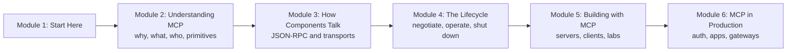
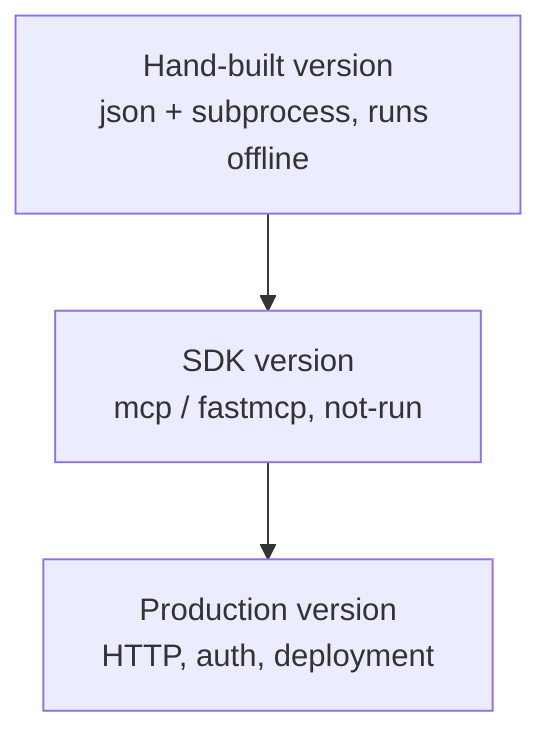

# How This Course Works

## Introduction

Think about the charging cables in an Indian household ten years ago. One phone wanted a round pin charger, another wanted micro-USB, the tablet wanted its own thing, and the drawer was full of cables nobody could match to a device. Then USB-C arrived, and slowly one cable started to charge everything.

AI applications went through the same mess. Every chat app, code editor and agent framework had its own way of plugging in tools and data. If you wrote a GitHub integration for one app, you rewrote it for the next. The **Model Context Protocol (MCP)** is the USB-C of that world: one open standard that lets any AI application talk to any tool or data source that speaks it.

This course teaches MCP from first principles to production. It is written against the **current specification, version `2026-07-28`**, and it also explains the older handshake-based versions you will still meet in real servers and tutorials.

> 💡 **Key Insight**
>
> MCP is not a framework and not a model feature. It is a **protocol**: an agreed set of JSON messages and rules for sending them. Once you can read those messages, every MCP tool, SDK and product becomes easy to understand, because they are all just different ways of producing and consuming the same JSON.

---

## What You Will Learn

By the end of this course you will be able to:

- **Explain why MCP exists** and the problem it solves, in one minute, to an interviewer or a manager.
- **Draw the architecture**: hosts, clients and servers, and who is responsible for what.
- **Read and write raw MCP messages**: `tools/list`, `tools/call`, `resources/read`, `prompts/get`, `server/discover` and the rest, as JSON-RPC.
- **Choose a transport**: stdio for local servers, Streamable HTTP for remote ones.
- **Understand the lifecycle**: how a client and server agree on a version and capabilities, how they work, and how they shut down. Both the modern per-request model and the older `initialize` handshake.
- **Build servers and clients** in Python with the official SDK and FastMCP, deploy a remote server, and wrap LangChain tools as an MCP server.
- **Run MCP in production**: OAuth 2.1 authorization, MCP Apps (interactive UI), registries, gateways and the Docker MCP Toolkit.
- **Know where MCP stops**: it connects an agent to tools and data. Agent-to-agent messaging (the A2A protocol) is a different job, taught later in [Multi-Agent Systems and Agent Protocols](../../multi-agent-systems-and-agent-protocols/course.md#m3).

### The course at a glance



Module 2 gives you the vocabulary. Module 3 shows the wire format. Module 4 shows how a conversation between client and server starts and ends. Module 5 is where you build things. Module 6 covers what changes when real users, real money and real security reviews arrive.

---

## How Every Lesson Is Built

| Section | What it gives you |
|---|---|
| **Before you start** | Links to the earlier lessons this one depends on. |
| **Introduction** | Why the topic matters, with an everyday example. |
| **Key Insight** | The one idea to remember. |
| **Core Explanation** | The topic step by step, with real JSON messages, diagrams and code. |
| **Try It Yourself** | Exercises with answers hidden in a fold. |
| **Real-World Examples** | Where you will see the idea in real products. |
| **Common Misconceptions** | Mistakes almost everyone makes, corrected. |
| **Interview Relevance** | What interviewers ask and what a strong answer covers. |
| **Key Takeaways** | A one-minute review. |

**Labs** are guided builds. You will build two: a small MCP server you connect to a real host, and an expense tracker server with tools, resources and prompts.

---

## How the Code in This Course Works

There are two kinds of Python blocks in this course.

1. **Runnable blocks.** These use only the Python standard library plus a few pinned packages (`pydantic`, `fastapi`, `httpx`, `langchain-core`). Many of them build tiny MCP servers and clients **by hand**, with nothing but `json` and `subprocess`, so you can see every byte that crosses the wire. Every printed output you see was produced by running the code.
2. **`# not-run` blocks.** These use the official `mcp` Python SDK (version 2.x at the time of writing), the standalone `fastmcp` package (4.x), or need a network, an API key or a running server. They are kept short and match the real libraries, and any output is labelled **Example output**.



Learning the hand-built version first means the SDK never feels like magic. When something breaks in production, you will know what the SDK was doing for you.

### Setting up your machine (for the not-run parts)

You need **Python 3.10 or newer** and, ideally, [uv](https://docs.astral.sh/uv/), a fast Python package manager.

```bash
# Official SDK, with the `mcp` command-line tool (mcp dev, mcp run)
uv add "mcp[cli]"
# Standalone FastMCP framework (optional, used in some lessons)
uv add fastmcp
```

For testing servers interactively, the **MCP Inspector** is the standard tool. It is a small web app that connects to any server and lets you click through its tools, resources and prompts. You'll use it from Module 5.

---

## What You Need Before Starting

- **Agentic AI basics.** You should know what a tool is and how function calling works: the model writes a structured tool call, your code runs it, the result goes back to the model. [Agentic AI Fundamentals › Tools and Function Calling](../../agentic-ai-fundamentals/04-tools-and-function-calling/function-calling-step-by-step.md) covers this.
- **Comfortable Python.** Functions, dictionaries, `async`/`await` at a reading level, and decorators.
- **A little HTTP and JSON.** What a POST request, a header and a status code are. [APIs and Apps: FastAPI, Streamlit and Docker](../../apis-and-apps-fastapi-streamlit-and-docker/course.md) covers this if you need it.

---

## A Note on Versions

MCP moves quickly. The specification is versioned by **date**:

| Version | What it is remembered for |
|---|---|
| `2024-11-05` | The first public release, with stdio and an HTTP+SSE transport |
| `2025-03-26` | Streamable HTTP replaces HTTP+SSE; OAuth-based authorization |
| `2025-06-18` | Structured tool output, elicitation, resource links |
| `2025-11-25` | URL-mode elicitation, experimental tasks, icons |
| **`2026-07-28`** | **Current.** Stateless core: no `initialize` handshake, no sessions, `server/discover`, multi round-trip requests, extensions |

This course teaches `2026-07-28` as the default and explains the older handshake wherever you are likely to meet it. When a detail changed between versions, the lesson says so.

---

## Common Misconceptions

### "MCP is an Anthropic-only thing"

Anthropic introduced MCP in November 2024, but it is an open specification. Since December 2025 it has been governed under the Agentic AI Foundation at the Linux Foundation, and it is supported by clients and SDKs from many companies.

### "I need to learn an SDK first"

The SDK is a convenience. The protocol is a few dozen JSON message shapes. You'll write a working server with nothing but the standard library in Module 3, then use the SDK.

### "MCP replaces function calling"

It doesn't. The model still calls functions exactly as before. MCP standardises **where those functions come from** and **how the app talks to them**.

---

## Key Takeaways

- **MCP is a protocol**: JSON-RPC messages plus rules, shared by every host, client and server that speaks it.
- **The course follows the `2026-07-28` specification** and explains the older handshake-based versions you will still meet.
- **Runnable blocks** build MCP by hand with the standard library; **not-run blocks** show the real SDKs.
- **You need** function-calling basics, comfortable Python and a little HTTP.

---

**Up next:** [Why MCP Exists: The Fragmentation Problem](../02-understanding-mcp/why-mcp-exists-the-fragmentation-problem.md)
