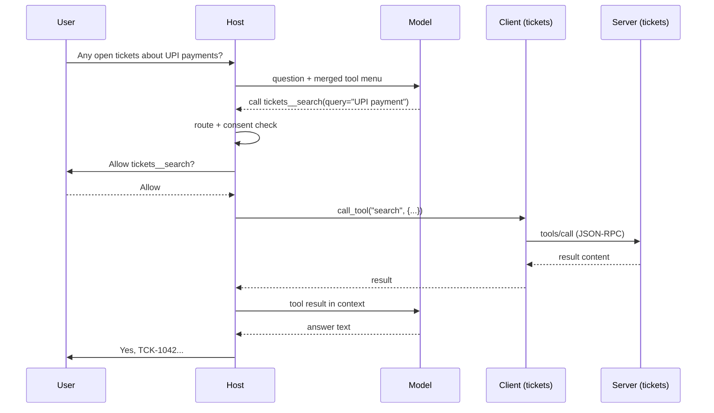

# Hosts, Clients and Servers: The Complete Guide

> 📚 **Before you start**
>
> - [What is MCP?](what-is-mcp.md), for the definition, the three primitives and a complete tool call on the wire.

## Introduction

Picture a busy restaurant in Bengaluru. You (the guest) talk only to your waiter. The waiter takes your order to the kitchen counter, where separate stations handle dosa, chaat and juice. Each station has its own cook who knows only their own recipes and pantry. The **manager** decides which waiters serve which tables, what the restaurant offers today, and whether a guest's special request is allowed.

MCP's architecture has the same three roles with the same separation of duties. The **host** is the restaurant and its manager. Each **client** is a waiter assigned to one station. Each **server** is a station with its own cook and pantry. The guest never walks into the kitchen; the cook never sees the dining hall.

By the end of this lesson you'll know exactly what each role is responsible for, why there is one client per server, how a host merges tools from many servers into one menu for the model, where security decisions are made, and how real products map onto these roles.

> 💡 **Key Insight**
>
> The **host** owns the user, the model and every decision about trust and consent. A **client** is a single connection from the host to one server. A **server** offers capabilities and knows nothing about the model, the conversation or the other servers. Keeping these duties separate is what makes MCP safe to compose.

---

## Core Explanation

### 1. The three roles at a glance


*The host coordinates; each client is one connection; each server wraps one system.*

| Role | What it is | Examples | Knows about |
|---|---|---|---|
| **Host** | The AI application the user runs | Claude Desktop, VS Code with Copilot, Cursor, your own agent | The user, the model, the conversation, all servers |
| **Client** | A component inside the host managing one server connection | One `Client` object in the Python SDK | One server: its version, capabilities and tools |
| **Server** | A program offering tools, resources and prompts | A filesystem server, the GitHub MCP server, your expense server | Only its own data and the requests it receives |

### 2. The host: the one in charge

The host is the only part that sees the whole picture, so it carries most of the responsibility:

1. **Creates and manages clients**: starts a client (and, for local servers, the server process) for every configured server.
2. **Builds the model's context**: merges the tools from every server into one list for the model, decides which resources and prompts to include.
3. **Runs the model** and interprets its tool calls.
4. **Routes each tool call** to the client that owns that tool.
5. **Enforces consent and security**: shows the user which tools are exposed, asks before risky calls, decides which servers are trusted.
6. **Handles user interaction** for server requests, such as showing an elicitation form.

The specification is explicit that hosts must get the user's consent before invoking tools and before exposing user data to servers. A server can *ask*; only the host can *allow*.

### 3. The client: one connection, one server

A client is deliberately simple. It holds **one** connection to **one** server and handles the protocol on that connection:

- Sends requests (`tools/list`, `tools/call`, `resources/read`, ...) with the right `_meta` (version, capabilities).
- Matches responses to requests by `id`.
- Handles server notifications such as "tool list changed" on a subscription stream.
- Retries when the server says it needs more input (`input_required`), after the host collects that input.
- Caches list results when the server allows it (`ttlMs`, `cacheScope`).

Why not one client for all servers? Because **isolation** is the point:

| One client per server gives you... | Because... |
|---|---|
| **Security isolation** | A misbehaving server can't read another server's messages or results |
| **Independent failure** | One server crashing doesn't break the others |
| **Separate capabilities and versions** | Server A can speak `2026-07-28` while server B still speaks `2025-11-25` |
| **Simple routing** | Each tool belongs to exactly one client |

### 4. The server: focused and unaware

A server is a focused program that exposes one system. It:

- Offers **tools**, **resources** and **prompts**, and says so in its capabilities.
- Validates every input and enforces its own access control.
- Never sees the conversation unless the host chooses to pass parts of it as arguments.
- Can't see other servers, and can't talk to the model directly.

Servers come in two shapes:

| | Local server | Remote server |
|---|---|---|
| Runs | On the user's machine, launched by the host as a subprocess | On someone's infrastructure, already running |
| Transport | stdio | Streamable HTTP (HTTPS) |
| Auth | Credentials from environment variables | OAuth 2.1 access tokens |
| Typical use | Files, local Git, a local database, developer tools | SaaS products (GitHub, ticketing, payments), company-wide services |
| Who it serves | One user | Many users at once |

### 5. Merging many servers into one menu (runnable)

The host's trickiest everyday job is turning several servers' tool lists into one menu for the model, and routing each call back. Two servers might both offer a tool called `search`. The spec says hosts that aggregate tools **should** disambiguate, for example by prefixing the server's name. Let's build that with pretend clients:

```python
class PretendClient:
    """Stands in for one MCP client connected to one server."""
    def __init__(self, server_name, tools):
        self.server_name = server_name
        self._tools = tools            # name -> (description, function)
    def list_tools(self):
        return [{"name": n, "description": d} for n, (d, _) in self._tools.items()]
    def call_tool(self, name, arguments):
        _, fn = self._tools[name]
        return {"content": [{"type": "text", "text": fn(**arguments)}], "isError": False}

files = PretendClient("files", {
    "search": ("Search file names in the project folder.", lambda query: f"found notes/{query}.md"),
    "read_file": ("Read a text file.", lambda path: f"<contents of {path}>"),
})
tickets = PretendClient("tickets", {
    "search": ("Search open support tickets.", lambda query: f"TCK-1042: {query} fails on UPI"),
})

class Host:
    def __init__(self, clients):
        self.clients = {c.server_name: c for c in clients}
        self.routes = {}                       # model-facing name -> (client, real tool name)
    def build_menu(self):
        menu = []
        for server, client in self.clients.items():
            for tool in client.list_tools():
                exposed = f"{server}__{tool['name']}"
                self.routes[exposed] = (client, tool["name"])
                menu.append({"name": exposed, "description": f"[{server}] {tool['description']}"})
        return menu
    def run_tool_call(self, name, arguments):
        client, real_name = self.routes[name]
        return client.call_tool(real_name, arguments)

host = Host([files, tickets])
for tool in host.build_menu():
    print(f"{tool['name']:<18} {tool['description']}")
print(host.run_tool_call("tickets__search", {"query": "payment"})["content"][0]["text"])
```

Output:

```
files__search      [files] Search file names in the project folder.
files__read_file   [files] Read a text file.
tickets__search    [tickets] Search open support tickets.
TCK-1042: payment fails on UPI
```

Without the prefix, the model would see two tools named `search` and the host couldn't know where to send the call. Real hosts use variations of this (prefixes, display groups, or letting the user enable servers per conversation). The spec also warns that a server's self-reported name isn't guaranteed unique, so hosts often use the name from their own configuration file instead.

### 6. The host is the security boundary

Because only the host sees everything, it is where trust decisions belong. Here's a minimal consent gate: tools that the user hasn't approved for "always allow" need a yes each time, and tools from untrusted servers are hidden entirely.

```python
TRUSTED_SERVERS = {"files", "tickets"}
ALWAYS_ALLOW = {"files__search", "files__read_file"}

def gate(tool_name, ask_user):
    server = tool_name.split("__", 1)[0]
    if server not in TRUSTED_SERVERS:
        return "blocked: server not trusted"
    if tool_name in ALWAYS_ALLOW:
        return "run"
    return "run" if ask_user(tool_name) else "denied by user"

say_no = lambda name: False
for name in ["files__read_file", "tickets__search", "random__delete_everything"]:
    print(f"{name:<26} -> {gate(name, say_no)}")
```

Output:

```
files__read_file           -> run
tickets__search            -> denied by user
random__delete_everything  -> blocked: server not trusted
```

Two security rules from the specification are worth memorising:

- **Tool descriptions and annotations from a server are untrusted** unless the server itself is trusted. A malicious server could describe a dangerous tool as harmless, or hide instructions in a description (this is called *tool poisoning*).
- **Hosts must get explicit user consent** before invoking tools and before sending user data to a server.

### 7. Who does what in one tool call



Read the arrows by role: the **model** only proposes, the **host** decides and routes, the **client** speaks the protocol, the **server** does the work.

### 8. Mapping real products onto the roles

| Product or setup | Host | Clients | Servers |
|---|---|---|---|
| Claude Desktop with a filesystem server | Claude Desktop | One per configured server | `@modelcontextprotocol/server-filesystem` (local, stdio) |
| VS Code with GitHub Copilot and the GitHub MCP server | VS Code + Copilot | One per server in `mcp.json` | GitHub MCP server (remote, HTTP) |
| Your Python agent using LangChain's MCP adapters | Your agent program | One per entry in the adapter's config | Whatever servers you list |
| Docker MCP Toolkit | The AI app you connect | One client to the Docker gateway | The gateway, which fans out to many containerised servers |

The last row shows that a program can play **two roles**: a gateway is a *server* to the host and a *client* to the servers behind it. You'll meet gateways in [Gateways, Registries and Server Discovery](../course.md#m6).

### 9. Clients can offer features too

The relationship isn't entirely one-way. A client can declare **client capabilities** that let a server ask for help during a request:

| Client feature | What the server can ask for | Status in `2026-07-28` |
|---|---|---|
| **Elicitation** | "Ask the user for this information" (a form or a URL to open) | Active |
| **Sampling** | "Ask your model to generate this text for me" | Deprecated |
| **Roots** | "Tell me which folders I'm allowed to work in" | Deprecated |

In the current spec, the server doesn't send its own requests to the client. Instead it answers the client's request with `resultType: "input_required"` listing what it needs, and the client retries with the answers. [MCP Primitives](mcp-primitives-tools-resources-and-prompts.md) shows the JSON.

---

## Try It Yourself

1. **Add a third server.** Create a `PretendClient("calendar", ...)` with a `search` tool and rebuild the menu. How many tools named `search` does the model see now, and are they distinguishable?
2. **Make one tool always allowed.** Change `ALWAYS_ALLOW` so `tickets__search` runs without asking, and rerun the gate loop.
3. **Classify.** In a setup where your Python script uses an SDK to connect to a remote GitHub MCP server and passes the tools to a model, name the host, the client and the server.

<details>
<summary>Show answers</summary>

**1.**

```python
calendar = PretendClient("calendar", {"search": ("Search calendar events.", lambda query: f"Standup about {query}")})
host = Host([files, tickets, calendar])
print([t["name"] for t in host.build_menu() if t["name"].endswith("search")])
```

Output:

```
['files__search', 'tickets__search', 'calendar__search']
```

Three `search` tools, each with a unique exposed name and a description tagged with its server.

**2.**

```python
ALWAYS_ALLOW.add("tickets__search")
print(gate("tickets__search", say_no))
```

Output:

```
run
```

**3.** Your Python script is the **host** (it owns the model and decides what runs). The SDK's client object is the **client**. The GitHub MCP server is the **server**.

</details>

---

## Real-World Examples

- **Claude Desktop** starts one client per server listed in `claude_desktop_config.json`, shows the tools per server, and asks for approval before running them.
- **VS Code** groups MCP tools by server in its tools picker and lets users turn individual servers or tools on and off per chat.
- **Cursor** asks for approval before running MCP tools by default and lets users allowlist specific tools.
- **Gateways** such as the Docker MCP Gateway act as one server to the host while managing many servers behind them.

---

## Common Misconceptions

### "The client is the app"

The client is one connection inside the app. An app with five servers has five clients. The app is the host.

### "Servers can see the whole conversation"

A server only sees the arguments of calls made to it. Anything else must be passed deliberately.

### "If a server says a tool is read-only, it's safe"

Annotations like `readOnlyHint` are hints from the server. They're only as trustworthy as the server itself.

### "One client can talk to many servers to save resources"

The protocol model is one client per server connection. Libraries that connect to "many servers" internally create one client per server.

---

## Interview Relevance

*"Explain MCP's architecture."* A strong answer defines **host** (the AI app: owns the user, the model, context building, routing and consent), **client** (one stateful-or-not connection per server, speaks the protocol), and **server** (offers tools, resources and prompts, unaware of the model and other servers). Explain **why one client per server** (isolation, independent failure, per-server versions), how a host **merges and namespaces tools** from many servers, and that **security decisions live in the host**: tool descriptions are untrusted, tool calls need consent. Mentioning that gateways are both server and client shows depth.

---

## Key Takeaways

- **Host**: the AI application; owns the model, the user, context building, routing and consent.
- **Client**: one connection to one server; speaks the protocol and nothing else.
- **Server**: offers tools, resources and prompts; sees only the requests sent to it.
- **Hosts merge tool lists** from many servers and must disambiguate clashing names.
- **Trust lives in the host**: server descriptions are untrusted, and tool calls need user consent.

---

**Up next:** [MCP Primitives: Tools, Resources and Prompts](mcp-primitives-tools-resources-and-prompts.md)
