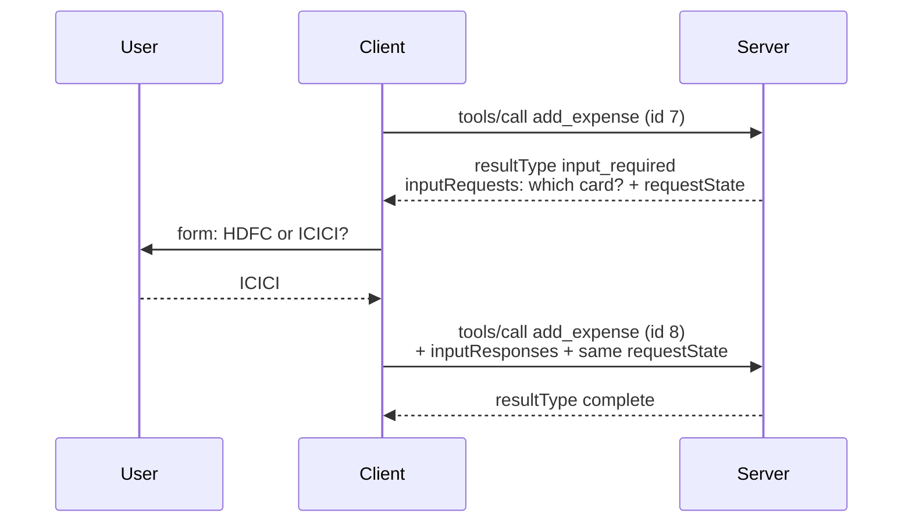
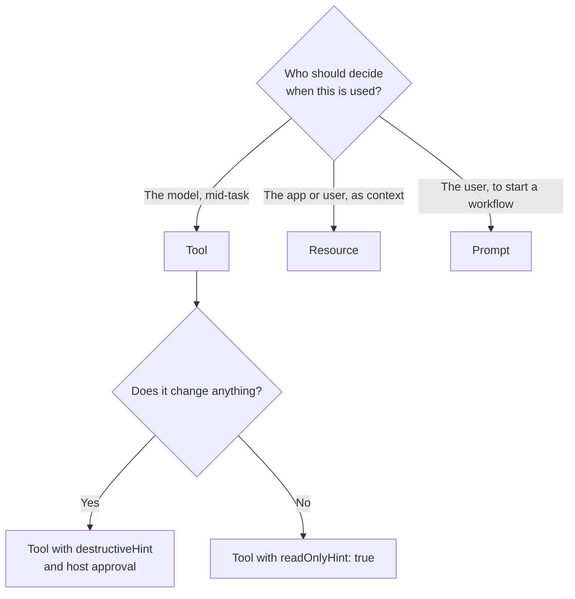

# MCP Primitives: Tools, Resources and Prompts: The Complete Guide

> 📚 **Before you start**
>
> - [What is MCP?](what-is-mcp.md), for the message flow of a tool call.
> - [Hosts, Clients and Servers](hosts-clients-and-servers.md), for who decides what.
> - [Designing Good Tools](../../agentic-ai-fundamentals/04-tools-and-function-calling/designing-good-tools.md), for tool names, descriptions and schemas.

## Introduction

A good chartered accountant's office offers you three different kinds of help. There are **services** they perform when needed (file your return, compute advance tax). There are **documents** they keep for you to look at (last year's return, your Form 26AS). And there are **standard checklists** you can pick from ("I'm a salaried employee with one house loan, what do I need?").

An MCP server offers the same three kinds of things, called **primitives**:

- **Tools**: actions the model can decide to take.
- **Resources**: data the application can read and put into context.
- **Prompts**: ready-made templates the user can pick.

The difference between them isn't the data format. It's **who is in control** of using each one. Get that right and you'll design servers that hosts can use well.

By the end of this lesson you'll know every primitive's messages, fields and control model, how a server asks the user for more information mid-request (elicitation), which older features are deprecated, and how to choose the right primitive for a capability.

> 💡 **Key Insight**
>
> **Tools are model-controlled, resources are application-controlled, prompts are user-controlled.** When you're unsure whether something should be a tool, a resource or a prompt, ask: *who should decide when this is used?*

---

## Core Explanation

### 1. The three primitives side by side

| | Tools | Resources | Prompts |
|---|---|---|---|
| **Control** | Model decides to call | Application (or user) decides to read | User picks explicitly |
| **Typical UI** | Invisible; approval dialog before running | File picker, "attach context" menu, auto-included | Slash command, menu entry |
| **Side effects** | Can change things | Read-only | None; they only produce messages |
| **Identified by** | `name` | `uri` | `name` |
| **List method** | `tools/list` | `resources/list`, `resources/templates/list` | `prompts/list` |
| **Use method** | `tools/call` | `resources/read` | `prompts/get` |
| **Capability** | `tools` | `resources` | `prompts` |
| **Example** | `add_expense(amount, category)` | `expense://2026/10/summary` | `monthly-review(month)` |

Every list result is **paginated** (`cursor` in, `nextCursor` out) and, since `2026-07-28`, carries **cache hints**: `ttlMs` (how long the client may reuse the list) and `cacheScope` (`"public"` or `"private"`).

### 2. Tools in depth

A tool definition is what the host shows the model. Here is a realistic one for an expense server:

```json
{
  "name": "add_expense",
  "title": "Add an expense",
  "description": "Record one expense in rupees. Use for spending the user reports, not for income.",
  "inputSchema": {
    "type": "object",
    "properties": {
      "amount": {"type": "number", "exclusiveMinimum": 0, "description": "Amount in INR"},
      "category": {"type": "string", "enum": ["food", "travel", "rent", "bills", "other"]},
      "note": {"type": "string", "description": "Short note, e.g. 'lunch at office canteen'"}
    },
    "required": ["amount", "category"]
  },
  "outputSchema": {
    "type": "object",
    "properties": {"id": {"type": "integer"}, "month_total": {"type": "number"}},
    "required": ["id", "month_total"]
  },
  "annotations": {"readOnlyHint": false, "destructiveHint": false, "idempotentHint": false, "openWorldHint": false}
}
```

| Field | Purpose |
|---|---|
| `name` | Programmatic id. 1 to 128 characters: letters, digits, `_`, `-`, `.`. Unique within the server |
| `title` | Human-friendly display name |
| `description` | What the tool does **and when to use it**; the model's main signal |
| `inputSchema` | JSON Schema (2020-12 by default) for the arguments. For no arguments use `{"type": "object", "additionalProperties": false}` |
| `outputSchema` | Optional JSON Schema for `structuredContent` in the result |
| `annotations` | Hints: `readOnlyHint`, `destructiveHint`, `idempotentHint`, `openWorldHint` (untrusted unless the server is trusted) |
| `icons` | Optional icons for the UI |

A result can carry **unstructured content** (a list of blocks: `text`, `image`, `audio`, `resource_link`, embedded `resource`) and **structured content** (any JSON value matching `outputSchema`). For backwards compatibility, a tool returning structured content should also return the same JSON as a text block:

```json
{
  "resultType": "complete",
  "content": [{"type": "text", "text": "{\"id\": 41, \"month_total\": 18230.0}"}],
  "structuredContent": {"id": 41, "month_total": 18230.0},
  "isError": false
}
```

**Stateful tools without sessions.** Since the protocol is stateless, a tool that needs state across calls (a shopping cart, an open browser tab) returns an explicit **handle** from one call, such as `"basket_id": "bsk_a1b2c3"`, and accepts it as an argument on later calls. The model carries it forward.

### 3. Resources in depth

A resource is data with a **URI**. It might be a real file (`file:///home/asha/notes.md`), a row in a database, or something computed on demand. Servers can use standard schemes (`file://`, `https://`, `git://`) or their own (`expense://`).

`resources/list` returns concrete resources:

```json
{"uri": "expense://2026/10/summary", "name": "october-2026-summary", "title": "October 2026 spending summary",
 "mimeType": "application/json", "annotations": {"audience": ["user", "assistant"], "priority": 0.8}}
```

`resources/templates/list` returns **templates** with placeholders (RFC 6570 URI templates), for families of resources too many to list:

```json
{"uriTemplate": "expense://{year}/{month}/summary", "name": "monthly-summary",
 "title": "Monthly spending summary", "mimeType": "application/json"}
```

`resources/read` returns the contents, either `text` or base64 `blob`:

```json
{"resultType": "complete",
 "contents": [{"uri": "expense://2026/10/summary", "mimeType": "application/json",
               "text": "{\"total\": 18230.0, \"food\": 6120.0, \"travel\": 2110.0}"}],
 "ttlMs": 60000, "cacheScope": "private"}
```

Annotations help the host decide what to include: `audience` (`"user"`, `"assistant"` or both), `priority` (0 to 1), `lastModified`. A missing resource returns JSON-RPC error `-32602` (it was `-32002` in older versions, so clients still accept both).

Clients can follow changes by opening a **subscription stream** with `subscriptions/listen` and naming resource URIs; the server then sends `notifications/resources/updated` when they change. You'll see the full mechanics in [Operation and Shutdown](../course.md#m4).

### 4. Prompts in depth

A prompt is a named template with arguments. `prompts/list` shows what's available:

```json
{"name": "monthly-review", "title": "Review my month",
 "description": "Summarise a month of spending and suggest one saving",
 "arguments": [{"name": "month", "description": "Month as YYYY-MM", "required": true}]}
```

When the user picks it (say, typing `/monthly-review 2026-10`), the client sends `prompts/get` and receives **messages** ready to put into the conversation. Prompt messages can embed resources, so the server can attach the actual data:

```json
{"resultType": "complete", "description": "Monthly review for 2026-10",
 "messages": [
   {"role": "user", "content": {"type": "resource",
     "resource": {"uri": "expense://2026/10/summary", "mimeType": "application/json",
                  "text": "{\"total\": 18230.0, \"food\": 6120.0}"}}},
   {"role": "user", "content": {"type": "text",
     "text": "Review my spending for 2026-10 above. Point out the biggest category and suggest one realistic saving."}}
 ]}
```

Prompts are the right primitive for **workflows a user starts on purpose**: "review this PR", "draft the weekly status", "explain this stack trace".

### 5. A server with all three primitives (runnable)

Let's build a small hand-made server that serves all three, so you can see the routing.

```python
import json

EXPENSES = [
    {"id": 1, "date": "2026-10-02", "amount": 450.0, "category": "food", "note": "office lunch"},
    {"id": 2, "date": "2026-10-03", "amount": 1200.0, "category": "travel", "note": "Pune to Mumbai train"},
    {"id": 3, "date": "2026-10-05", "amount": 15000.0, "category": "rent", "note": "October rent"},
]

def month_summary(year, month):
    prefix = f"{year}-{month}"
    rows = [e for e in EXPENSES if e["date"].startswith(prefix)]
    by_cat = {}
    for e in rows:
        by_cat[e["category"]] = by_cat.get(e["category"], 0) + e["amount"]
    return {"total": sum(by_cat.values()), **dict(sorted(by_cat.items()))}

def ok(id_, **result):
    return {"jsonrpc": "2.0", "id": id_, "result": {"resultType": "complete", **result}}

def err(id_, code, message):
    return {"jsonrpc": "2.0", "id": id_, "error": {"code": code, "message": message}}

def handle(msg):
    m, p, i = msg["method"], msg.get("params", {}), msg["id"]
    if m == "server/discover":
        return ok(i, supportedVersions=["2026-07-28"],
                  capabilities={"tools": {}, "resources": {}, "prompts": {}})
    if m == "tools/list":
        return ok(i, tools=[{"name": "add_expense", "description": "Record one expense in rupees.",
                             "inputSchema": {"type": "object", "properties": {
                                 "amount": {"type": "number"}, "category": {"type": "string"},
                                 "note": {"type": "string"}}, "required": ["amount", "category"]}}],
                  ttlMs=300000, cacheScope="public")
    if m == "tools/call" and p["name"] == "add_expense":
        a = p["arguments"]
        if a["amount"] <= 0:
            return ok(i, content=[{"type": "text", "text": "amount must be positive"}], isError=True)
        new = {"id": len(EXPENSES) + 1, "date": "2026-10-11", "amount": float(a["amount"]),
               "category": a["category"], "note": a.get("note", "")}
        EXPENSES.append(new)
        data = {"id": new["id"], "month_total": month_summary("2026", "10")["total"]}
        return ok(i, content=[{"type": "text", "text": json.dumps(data)}], structuredContent=data, isError=False)
    if m == "resources/templates/list":
        return ok(i, resourceTemplates=[{"uriTemplate": "expense://{year}/{month}/summary",
                                         "name": "monthly-summary", "mimeType": "application/json"}],
                  ttlMs=300000, cacheScope="public")
    if m == "resources/read":
        parts = p["uri"].removeprefix("expense://").split("/")
        if len(parts) != 3 or parts[2] != "summary":
            return err(i, -32602, f"Resource not found: {p['uri']}")
        text = json.dumps(month_summary(parts[0], parts[1]))
        return ok(i, contents=[{"uri": p["uri"], "mimeType": "application/json", "text": text}],
                  ttlMs=60000, cacheScope="private")
    if m == "prompts/get" and p["name"] == "monthly-review":
        month = p["arguments"]["month"]
        uri = f"expense://{month.replace('-', '/')}/summary"
        summary = handle({"id": 0, "method": "resources/read", "params": {"uri": uri}})["result"]["contents"][0]
        return ok(i, messages=[
            {"role": "user", "content": {"type": "resource", "resource": summary}},
            {"role": "user", "content": {"type": "text",
                                         "text": f"Review my spending for {month}. Suggest one realistic saving."}}])
    return err(i, -32601, f"Method not found: {m}")

def call(id_, method, **params):
    return handle({"jsonrpc": "2.0", "id": id_, "method": method, "params": params})

print("capabilities:", call(1, "server/discover")["result"]["capabilities"])
print("tool result: ", call(2, "tools/call", name="add_expense",
                            arguments={"amount": 380, "category": "food", "note": "chai and samosa for team"})["result"]["structuredContent"])
print("resource:    ", call(3, "resources/read", uri="expense://2026/10/summary")["result"]["contents"][0]["text"])
prompt = call(4, "prompts/get", name="monthly-review", arguments={"month": "2026-10"})["result"]
print("prompt msgs: ", [msg["content"]["type"] for msg in prompt["messages"]])
print("missing:     ", call(5, "resources/read", uri="expense://2026/10/oops")["error"])
```

Output:

```
capabilities: {'tools': {}, 'resources': {}, 'prompts': {}}
tool result:  {'id': 4, 'month_total': 17030.0}
resource:     {"total": 17030.0, "food": 830.0, "rent": 15000.0, "travel": 1200.0}
prompt msgs:  ['resource', 'text']
missing:      {'code': -32602, 'message': 'Resource not found: expense://2026/10/oops'}
```

(For brevity this toy skips the `_meta` block that every real request must carry. The previous lesson showed it.)

### 6. When the server needs something from the user: elicitation

Sometimes a tool can't finish without asking the user. "Add this expense to which card, HDFC or ICICI?" In MCP that's **elicitation**, and the client must have declared it in its capabilities.

In the current spec this works through **multi round-trip requests (MRTR)**. The server doesn't send its own request; it replies with `resultType: "input_required"`, listing what it needs and an opaque `requestState` to remember where it was. The client asks the user, then **retries the original request** with the answers.



The interim result looks like this:

```json
{
  "jsonrpc": "2.0",
  "id": 7,
  "result": {
    "resultType": "input_required",
    "inputRequests": {
      "card": {
        "method": "elicitation/create",
        "params": {
          "mode": "form",
          "message": "Which card did you pay with?",
          "requestedSchema": {
            "type": "object",
            "properties": {"card": {"type": "string", "enum": ["HDFC", "ICICI"]}},
            "required": ["card"]
          }
        }
      }
    },
    "requestState": "eyJ0b29sIjoiYWRkX2V4cGVuc2UifQ.3f9a..."
  }
}
```

The `requestState` passes through the client, so a careful server **signs** it to detect tampering. Here's the full round trip, with HMAC signing from the standard library:

```python
import base64, hashlib, hmac

SECRET = b"server-only-secret"

def seal(state):
    body = base64.urlsafe_b64encode(json.dumps(state, sort_keys=True).encode()).decode()
    sig = hmac.new(SECRET, body.encode(), hashlib.sha256).hexdigest()[:16]
    return f"{body}.{sig}"

def unseal(token):
    body, sig = token.rsplit(".", 1)
    good = hmac.new(SECRET, body.encode(), hashlib.sha256).hexdigest()[:16]
    if not hmac.compare_digest(sig, good):
        raise ValueError("requestState failed verification")
    return json.loads(base64.urlsafe_b64decode(body))

def add_card_expense(id_, arguments, input_responses=None, request_state=None):
    if input_responses is None:
        return {"jsonrpc": "2.0", "id": id_, "result": {
            "resultType": "input_required",
            "inputRequests": {"card": {"method": "elicitation/create", "params": {
                "mode": "form", "message": "Which card did you pay with?",
                "requestedSchema": {"type": "object",
                                    "properties": {"card": {"type": "string", "enum": ["HDFC", "ICICI"]}},
                                    "required": ["card"]}}}},
            "requestState": seal({"tool": "add_expense", "amount": arguments["amount"]})}}
    state = unseal(request_state)
    answer = input_responses["card"]
    if answer["action"] != "accept":
        text, is_error = "User did not choose a card; nothing was recorded.", True
    else:
        text, is_error = f"Recorded Rs {state['amount']} on {answer['content']['card']}.", False
    return {"jsonrpc": "2.0", "id": id_, "result": {
        "resultType": "complete", "content": [{"type": "text", "text": text}], "isError": is_error}}

first = add_card_expense(7, {"amount": 2400})["result"]
print(first["resultType"], "->", first["inputRequests"]["card"]["params"]["message"])

user_answer = {"card": {"action": "accept", "content": {"card": "ICICI"}}}
second = add_card_expense(8, {"amount": 2400}, user_answer, first["requestState"])["result"]
print(second["resultType"], "->", second["content"][0]["text"])

tampered = first["requestState"].replace(first["requestState"][5], "X", 1)
try:
    add_card_expense(9, {"amount": 2400}, user_answer, tampered)
except ValueError as e:
    print("tampered ->", e)
```

Output:

```
input_required -> Which card did you pay with?
complete -> Recorded Rs 2400 on ICICI.
tampered -> requestState failed verification
```

Rules worth knowing about elicitation:

- **Form mode** collects a flat object of simple fields (string, number, boolean, enum). **URL mode** sends the user to a web page instead.
- Servers **must not** ask for passwords, API keys, tokens or payment details through form mode. Anything sensitive goes through URL mode, so it never passes through the client or the model.
- The user can **accept**, **decline** or **cancel**, and the server must handle all three.
- `InputRequiredResult` is allowed only on `tools/call`, `resources/read` and `prompts/get`.

### 7. Deprecated and supporting features

You'll see these in older servers, SDKs and tutorials:

| Feature | What it did | Status in `2026-07-28` | Use instead |
|---|---|---|---|
| **Sampling** (`sampling/createMessage`) | Server asks the client's model to generate text | Deprecated (works during a 12-month window) | Call an LLM provider API directly from the server |
| **Roots** (`roots/list`) | Client tells server which folders it may use | Deprecated | Pass paths as tool arguments, resource URIs or server config |
| **Logging** (`notifications/message`) | Server sends log lines to the client | Deprecated | Log to stderr (stdio) or use OpenTelemetry |
| **Completion** (`completion/complete`) | Autocomplete for prompt and resource template arguments | Active | |
| **Progress** (`notifications/progress`) | Progress updates for a long request | Active | |
| **Tasks** | Long-running work with a handle you poll | Moved to an official **extension** | `io.modelcontextprotocol/tasks` |

### 8. Choosing the right primitive



Practical guidance:

- **Search and lookups the model needs mid-reasoning** are tools, even if read-only. Many hosts handle tools far better than resources.
- **Big, stable reference data** (a schema, a policy document, a project's README) is a good resource.
- **Repeatable expert workflows** are prompts, so users can trigger them in one step.
- It's fine to expose the same data as both a resource and a read-only tool, so it works across hosts with different support.

---

## Try It Yourself

1. **Reject bad input.** Call `add_expense` with `amount: -50`. Is the response a JSON-RPC error or a tool result? Why?
2. **Handle a decline.** Run `add_card_expense` for the retry with `{"card": {"action": "decline"}}`. What does the server return?
3. **Pick the primitive.** For a GitHub server, classify: (a) "create an issue", (b) "the repository's CONTRIBUTING.md", (c) "review this pull request using our checklist".

<details>
<summary>Show answers</summary>

**1.**

```python
print(call(10, "tools/call", name="add_expense", arguments={"amount": -50, "category": "food"})["result"])
```

Output:

```
{'resultType': 'complete', 'content': [{'type': 'text', 'text': 'amount must be positive'}], 'isError': True}
```

It's a tool result with `isError: True`. The request was well-formed; only the business rule failed, and the model can read the message and fix the amount.

**2.**

```python
declined = add_card_expense(11, {"amount": 2400}, {"card": {"action": "decline"}}, first["requestState"])
print(declined["result"]["content"][0]["text"], declined["result"]["isError"])
```

Output:

```
User did not choose a card; nothing was recorded. True
```

**3.** (a) Tool: the model decides to do it, and it changes something. (b) Resource: reference data the app can attach. (c) Prompt: a workflow the user starts on purpose, probably embedding the PR diff as a resource.

</details>

---

## Real-World Examples

- **Filesystem servers** expose tools like `read_file` and `search_files` because models need to look things up mid-task, even though the data is file-like.
- **Database servers** often expose the schema as a resource and `run_query` as a tool.
- **IDE hosts** show server prompts as slash commands in the chat box.
- **Payment and booking servers** use elicitation to confirm amounts and URL mode to send users to the provider's own page for card details or sign-in.

---

## Common Misconceptions

### "Resources are just tools that read data"

The difference is control. A tool is chosen by the model; a resource is chosen by the application or user. Many servers expose both for the same data.

### "Prompts are system prompts"

MCP prompts are templates the user invokes. They produce conversation messages; they don't secretly change the host's system prompt.

### "Elicitation is a way to ask for passwords"

The spec forbids collecting secrets through form mode. Use URL mode so credentials go straight to a trusted web page.

### "Sampling is how servers use AI"

Sampling is deprecated as of `2026-07-28`. Servers that need a model should call a model provider directly.

---

## Interview Relevance

*"What are MCP's primitives?"* Name **tools** (model-controlled, `tools/list` and `tools/call`, JSON Schema input, optional `outputSchema` and `structuredContent`, annotations as hints), **resources** (application-controlled, URI-addressed, templates, `resources/read`, subscriptions) and **prompts** (user-controlled templates, `prompts/get` returns messages). Then the client side: **elicitation** through `input_required` results (multi round-trip requests), form vs URL mode, no secrets in forms; and that **sampling, roots and logging are deprecated** in `2026-07-28`. The "who controls it" framing is what interviewers listen for.

---

## Key Takeaways

- **Tools are model-controlled**, **resources are application-controlled**, **prompts are user-controlled**.
- **Tools** carry JSON Schema inputs, optional structured outputs and untrusted behaviour hints.
- **Resources** are URI-addressed data, with templates for families and subscriptions for changes.
- **Prompts** return ready-made messages, often embedding resources.
- **Elicitation** uses `input_required` results and a retry; secrets go through URL mode only. Sampling, roots and logging are deprecated.

---

**Up next:** [Data Flow in MCP](../03-how-mcp-components-talk/data-flow-in-mcp.md)
