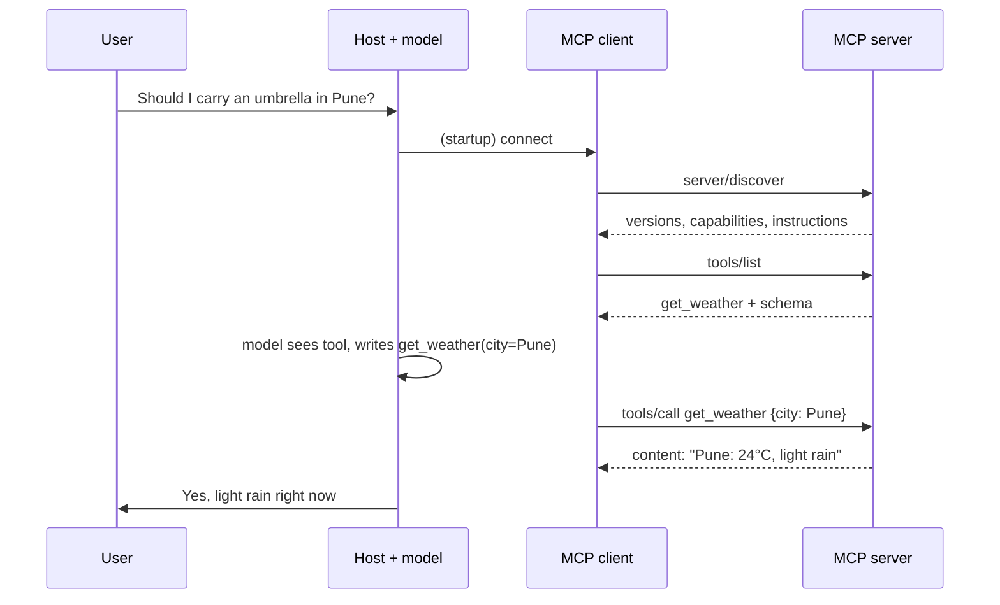
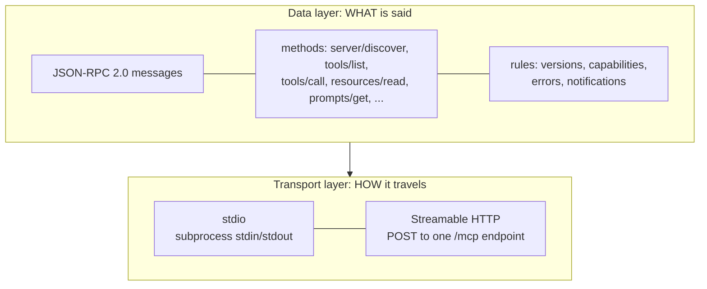

# What is MCP?: The Complete Guide

> 📚 **Before you start**
>
> - [Why MCP Exists: The Fragmentation Problem](why-mcp-exists-the-fragmentation-problem.md), for the N × M problem MCP solves.
> - [Function Calling Step by Step](../../agentic-ai-fundamentals/04-tools-and-function-calling/function-calling-step-by-step.md), for `tool_use` and `tool_result`.

## Introduction

Walk into any railway station in India and you'll see the same pattern on every platform: the train, the platform number, the coach position board, the announcement. A passenger who has used one station can use any station, because the *rules* are shared even though the trains, cities and staff are different.

MCP is a set of shared rules for one specific journey: **an AI application reaching out to an outside program for context or actions**. The application might be a chat app, an IDE or your own agent. The outside program might read files, query a database, call GitHub or book a cab. MCP defines who speaks first, what each message looks like, and what each side is allowed to do.

In this lesson you'll get a precise definition of MCP, see the actual messages on the wire for a complete tool call, run a tiny hand-built MCP server, and learn the vocabulary the rest of the course uses.

> 💡 **Key Insight**
>
> **MCP is an open protocol in which an AI application (through an MCP client) discovers and uses the tools, resources and prompts offered by an MCP server, by exchanging JSON-RPC 2.0 messages over a transport such as stdio or HTTP.** Everything else in this course is a detail of that sentence.

---

## Core Explanation

### 1. The one-sentence definition, unpacked

| Phrase | What it means |
|---|---|
| **Open protocol** | A public specification anyone can implement, versioned by date (current: `2026-07-28`), governed under the Linux Foundation's Agentic AI Foundation |
| **AI application (host)** | The program the user runs: Claude Desktop, VS Code, Cursor, your agent |
| **MCP client** | The part of the host that holds one connection to one server |
| **MCP server** | A program that offers capabilities: tools, resources, prompts |
| **Discovers and uses** | The client asks what is available (`tools/list`), then uses it (`tools/call`) |
| **JSON-RPC 2.0** | A tiny standard for "call this method with these parameters" messages in JSON |
| **Transport** | The pipe the messages travel through: a subprocess's stdin/stdout, or HTTP |

### 2. The big picture


*One host, several clients, one server per client. The messages are the same whatever the pipe.*

You'll study each box in [Hosts, Clients and Servers](hosts-clients-and-servers.md). For now notice three facts:

1. The **model never talks to a server directly**. The host decides what the model sees and which calls actually run.
2. Each **client talks to exactly one server**.
3. Local servers usually use **stdio**; remote servers use **Streamable HTTP**. The JSON messages are identical.

### 3. What a server can offer: the three primitives

| Primitive | What it is | Who decides to use it | Example |
|---|---|---|---|
| **Tools** | Functions the model can call | The model | `add_expense(amount=450, category="food")` |
| **Resources** | Read-only data identified by a URI | The application or user | `expense://summary/2026-10` |
| **Prompts** | Reusable message templates | The user, often as a slash command | `/monthly-review month=October` |

Clients can offer one main feature back to servers in the current spec: **elicitation**, where a server asks the user a question through the client ("Which account should I debit?"). Older features called **sampling** and **roots** still exist but are deprecated as of `2026-07-28`. The [MCP Primitives](mcp-primitives-tools-resources-and-prompts.md) lesson covers all of them.

### 4. The messages: a complete tool call on the wire

Here is everything that crosses the wire when a host discovers a weather tool and calls it, in the current (`2026-07-28`) protocol. Every request carries a small `_meta` block saying which protocol version it speaks and what the client can do.

**Step 1. The client asks what the server is** (optional, but common):

```json
{
  "jsonrpc": "2.0",
  "id": 1,
  "method": "server/discover",
  "params": {
    "_meta": {
      "io.modelcontextprotocol/protocolVersion": "2026-07-28",
      "io.modelcontextprotocol/clientInfo": {"name": "chai-desk", "version": "1.4.0"},
      "io.modelcontextprotocol/clientCapabilities": {}
    }
  }
}
```

```json
{
  "jsonrpc": "2.0",
  "id": 1,
  "result": {
    "resultType": "complete",
    "supportedVersions": ["2026-07-28"],
    "capabilities": {"tools": {}},
    "instructions": "Weather for Indian cities. Temperatures are in Celsius.",
    "_meta": {"io.modelcontextprotocol/serverInfo": {"name": "mausam-server", "version": "0.3.0"}}
  }
}
```

**Step 2. The client lists the tools:**

```json
{"jsonrpc": "2.0", "id": 2, "method": "tools/list",
 "params": {"_meta": {"io.modelcontextprotocol/protocolVersion": "2026-07-28",
                      "io.modelcontextprotocol/clientCapabilities": {}}}}
```

```json
{
  "jsonrpc": "2.0",
  "id": 2,
  "result": {
    "resultType": "complete",
    "tools": [{
      "name": "get_weather",
      "description": "Current weather for an Indian city.",
      "inputSchema": {
        "type": "object",
        "properties": {"city": {"type": "string", "description": "City name, e.g. Pune"}},
        "required": ["city"]
      }
    }],
    "ttlMs": 300000,
    "cacheScope": "public"
  }
}
```

The host now hands this tool definition to the model, in whatever format the model's API wants. The model reads the user's question ("Should I carry an umbrella in Pune?") and writes a tool call.

**Step 3. The client calls the tool:**

```json
{"jsonrpc": "2.0", "id": 3, "method": "tools/call",
 "params": {"name": "get_weather", "arguments": {"city": "Pune"},
            "_meta": {"io.modelcontextprotocol/protocolVersion": "2026-07-28",
                      "io.modelcontextprotocol/clientCapabilities": {}}}}
```

```json
{
  "jsonrpc": "2.0",
  "id": 3,
  "result": {
    "resultType": "complete",
    "content": [{"type": "text", "text": "Pune: 24°C, light rain, humidity 88%"}],
    "isError": false
  }
}
```

The host puts that text into the model's context as the tool result, and the model answers: *"Yes, carry an umbrella: light rain in Pune right now."*



### 5. A hand-built MCP server you can run

To prove there's no magic, here is a server that answers those three methods, written with nothing but the standard library. It takes one JSON-RPC message (as a Python dict) and returns the reply. Later modules put it behind real stdio and HTTP transports.

```python
import json

PROTOCOL = "2026-07-28"
WEATHER = {"pune": "24°C, light rain, humidity 88%", "chennai": "31°C, humid, clear sky"}

TOOLS = [{
    "name": "get_weather",
    "description": "Current weather for an Indian city.",
    "inputSchema": {"type": "object",
                    "properties": {"city": {"type": "string", "description": "City name, e.g. Pune"}},
                    "required": ["city"]},
}]

def handle(message):
    """Answer one JSON-RPC request the way an MCP server would."""
    meta = message.get("params", {}).get("_meta", {})
    if meta.get("io.modelcontextprotocol/protocolVersion") != PROTOCOL:
        return {"jsonrpc": "2.0", "id": message["id"],
                "error": {"code": -32022, "message": "Unsupported protocol version",
                          "data": {"supported": [PROTOCOL],
                                   "requested": meta.get("io.modelcontextprotocol/protocolVersion")}}}
    method = message["method"]
    if method == "server/discover":
        result = {"supportedVersions": [PROTOCOL], "capabilities": {"tools": {}},
                  "instructions": "Weather for Indian cities. Temperatures are in Celsius."}
    elif method == "tools/list":
        result = {"tools": TOOLS, "ttlMs": 300000, "cacheScope": "public"}
    elif method == "tools/call":
        city = message["params"]["arguments"].get("city", "")
        report = WEATHER.get(city.lower())
        if report is None:
            result = {"content": [{"type": "text", "text": f"No data for {city!r}. Try Pune or Chennai."}],
                      "isError": True}
        else:
            result = {"content": [{"type": "text", "text": f"{city}: {report}"}], "isError": False}
    else:
        return {"jsonrpc": "2.0", "id": message["id"],
                "error": {"code": -32601, "message": f"Method not found: {method}"}}
    return {"jsonrpc": "2.0", "id": message["id"], "result": {"resultType": "complete", **result}}

META = {"io.modelcontextprotocol/protocolVersion": PROTOCOL,
        "io.modelcontextprotocol/clientCapabilities": {}}

def request(id_, method, **params):
    return {"jsonrpc": "2.0", "id": id_, "method": method, "params": {**params, "_meta": META}}

reply = handle(request(3, "tools/call", name="get_weather", arguments={"city": "Pune"}))
print(json.dumps(reply, ensure_ascii=False))
```

Output:

```
{"jsonrpc": "2.0", "id": 3, "result": {"resultType": "complete", "content": [{"type": "text", "text": "Pune: 24°C, light rain, humidity 88%"}], "isError": false}}
```

Now play the client: discover, list, and call two tools, including one that fails.

```python
print(handle(request(1, "server/discover"))["result"]["instructions"])
print([t["name"] for t in handle(request(2, "tools/list"))["result"]["tools"]])
for city in ["Chennai", "Shimla"]:
    result = handle(request(4, "tools/call", name="get_weather", arguments={"city": city}))["result"]
    print(("ERROR " if result["isError"] else "OK    ") + result["content"][0]["text"])
old = {"jsonrpc": "2.0", "id": 5, "method": "tools/list",
       "params": {"_meta": {"io.modelcontextprotocol/protocolVersion": "2025-11-25"}}}
print(handle(old)["error"])
```

Output:

```
Weather for Indian cities. Temperatures are in Celsius.
['get_weather']
OK    Chennai: 31°C, humid, clear sky
ERROR No data for 'Shimla'. Try Pune or Chennai.
{'code': -32022, 'message': 'Unsupported protocol version', 'data': {'supported': ['2026-07-28'], 'requested': '2025-11-25'}}
```

Three details here are exactly what the real spec requires:

- A failed tool run (unknown city) is **not** a JSON-RPC error. It's a normal result with `isError: true`, so the model can read the message and try again.
- An unknown **method** *is* a JSON-RPC error (`-32601`), because no model can fix that.
- A request in a version the server doesn't support gets error `-32022` with the list of supported versions, so the client can retry with one of them.

### 6. The two layers of MCP

The spec splits MCP into two layers, and keeping them apart in your head makes everything easier.



| Layer | Question it answers | Lesson |
|---|---|---|
| **Data layer** | Which messages exist and what do they mean? | [The Data Layer: JSON-RPC Messages](../03-how-mcp-components-talk/the-data-layer-json-rpc-messages.md) |
| **Transport layer** | How do the bytes get from client to server, and how is the connection secured? | [The Transport Layer: stdio and Streamable HTTP](../03-how-mcp-components-talk/the-transport-layer-stdio-and-streamable-http.md) |

The `handle` function above is pure data layer: it doesn't care how the message arrived.

### 7. Stateless by design (the 2026 change)

Up to version `2025-11-25`, a client had to open every connection with an `initialize` handshake, after which the server remembered the agreed version and capabilities for the whole session. Since `2026-07-28`, MCP is **stateless**: every request carries its own version and capabilities in `_meta`, and the server must not rely on anything an earlier request said.

| | Handshake era (≤ 2025-11-25) | Stateless era (2026-07-28) |
|---|---|---|
| First message | `initialize`, then `notifications/initialized` | Any request; `server/discover` is optional |
| Where version lives | Agreed once per session | In every request's `_meta` |
| Sessions on HTTP | `Mcp-Session-Id` header | None |
| Server asks client a question | Server sends its own request | Server returns `input_required`, client retries |

Why the change? Stateless servers are much easier to run behind load balancers, scale horizontally and restart without breaking users. You'll see both styles in the wild for a while, because many deployed servers still speak the older versions. [Initialisation: Version and Capability Negotiation](../course.md#m4) covers how clients handle both.

### 8. What MCP is not

| MCP is not... | Because... |
|---|---|
| A model or a model API | It never generates text; the host's model does |
| An agent framework | It has no loop, planner or memory; frameworks *use* MCP to get tools |
| A replacement for REST APIs | Servers usually *wrap* existing APIs and databases |
| A security boundary by itself | It gives hooks (consent, OAuth); the host and server must enforce them |
| Agent-to-agent messaging | That's A2A's job; MCP connects an agent to tools and data. See [Agent-to-Agent (A2A) Protocol](../course.md#m5) |

---

## Try It Yourself

1. **Add a city.** Add `"leh"` to `WEATHER` and call the tool with `"Leh"`. What changes in the reply?
2. **Ask for something missing.** Send `resources/list` to `handle`. What error comes back, and why is it a protocol error rather than `isError: true`?
3. **Read a message.** In the `tools/call` request above, which fields belong to JSON-RPC itself and which are MCP-specific?

<details>
<summary>Show answers</summary>

**1.**

```python
WEATHER["leh"] = "4°C, clear, very dry"
print(handle(request(6, "tools/call", name="get_weather", arguments={"city": "Leh"}))["result"]["content"][0]["text"])
```

Output:

```
Leh: 4°C, clear, very dry
```

Only the server's data changed. The client and the protocol didn't need to know.

**2.**

```python
print(handle(request(7, "resources/list"))["error"])
```

Output:

```
{'code': -32601, 'message': 'Method not found: resources/list'}
```

The server doesn't offer resources at all (its capabilities only list `tools`), so the request itself is invalid. A well-behaved client wouldn't send it, because `server/discover` told it there are no resources.

**3.** `jsonrpc`, `id`, `method` and `params` are JSON-RPC 2.0. Inside `params`, `name`, `arguments` and the `_meta` keys starting with `io.modelcontextprotocol/` are defined by MCP.

</details>

---

## Real-World Examples

- **Claude Desktop and claude.ai** connect to local MCP servers (configured in a JSON file) and remote ones (added as connectors by URL).
- **VS Code, Cursor and other IDEs** load MCP servers from project config files so the coding assistant can query issue trackers, databases and docs.
- **GitHub, Stripe, Cloudflare, Atlassian and many others** publish official MCP servers so any MCP-capable assistant can use their services.
- **Agent SDKs** from Anthropic, OpenAI, Google, Microsoft and LangChain can all consume MCP servers as a tool source.

---

## Common Misconceptions

### "The model connects to the MCP server"

The host's MCP client connects. The model only sees tool definitions and results that the host chooses to show it.

### "An MCP server must be a web server"

Most local servers are ordinary programs that read stdin and write stdout. HTTP is only needed for remote servers.

### "Tool errors should be JSON-RPC errors"

Errors the model can act on (bad city, invalid date, API down) go in a normal result with `isError: true`. JSON-RPC errors are for broken requests: unknown method, unknown tool, malformed parameters, unsupported version.

### "MCP needs a session"

Not any more. Since `2026-07-28` every request is self-contained. Older servers still use the `initialize` handshake and sessions.

---

## Interview Relevance

*"What is MCP and how does it work?"* Strong answers give the one-sentence definition (open protocol; host's client talks to a server; tools, resources, prompts; JSON-RPC 2.0; stdio or Streamable HTTP), then walk through a tool call: discover or list, the model chooses, `tools/call`, result back into context. Mention that the model never talks to the server directly, the two layers (data vs transport), and the distinction between protocol errors and tool execution errors (`isError`). Knowing the `2026-07-28` shift to a stateless core (`_meta` on every request, `server/discover`, no sessions) marks you as current.

---

## Key Takeaways

- **MCP is an open protocol** connecting AI applications (via clients) to servers that offer tools, resources and prompts.
- **Messages are JSON-RPC 2.0**; a tool call is just `tools/list` then `tools/call`.
- **Two layers**: the data layer defines messages; the transport layer (stdio or Streamable HTTP) carries them.
- **Tool failures are results with `isError: true`**; broken requests are JSON-RPC errors.
- **Since `2026-07-28` MCP is stateless**: every request carries its version and capabilities in `_meta`.

---

**Up next:** [Hosts, Clients and Servers](hosts-clients-and-servers.md)
