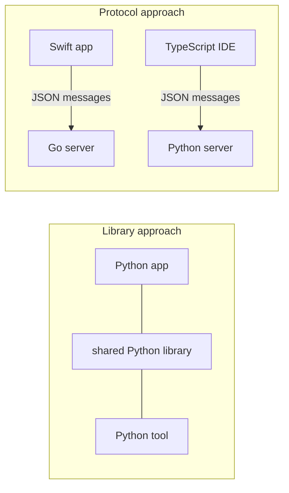

# Why MCP Exists: The Fragmentation Problem: The Complete Guide

> 📚 **Before you start**
>
> - [How This Course Works](../01-start-here/how-this-course-works.md), for how the code in this course runs.
> - [Function Calling Step by Step](../../agentic-ai-fundamentals/04-tools-and-function-calling/function-calling-step-by-step.md), for how a model asks for a tool and gets the result back.
> - [What is a Tool?](../../agentic-ai-fundamentals/04-tools-and-function-calling/what-is-a-tool.md), for tool definitions: a name, a description and an input schema.

## Introduction

Before UPI, paying someone in India from your phone was a small adventure. Each bank had its own app, each wallet had its own balance, and a shopkeeper who wanted to accept payments had to put up a separate QR code for every wallet company. If a new wallet launched, every shop needed a new sticker, and every customer needed yet another app.

UPI fixed this with one shared protocol. Any bank app can pay any merchant through any other bank, because they all agree on the same message format and rules. A new bank joins once, and it instantly works with everyone else.

AI applications hit the same wall in 2023 and 2024. Large language models had learned to call tools, but there was no shared way to **plug those tools in**. Every chat app, IDE and agent framework invented its own connector format. A team that built a "search our Jira" integration for one app had to rebuild it for the next. The **Model Context Protocol** is the UPI of that world.

By the end of this lesson you will be able to explain the fragmentation problem precisely, put numbers on it, see exactly what glue code teams were writing before MCP, and explain why a protocol (rather than another library) was the fix.

> 💡 **Key Insight**
>
> Without a standard, connecting **N** AI applications to **M** tools needs up to **N × M** custom integrations. With a shared protocol, each application implements the client side once and each tool implements the server side once: **N + M** pieces, and every new piece works with everything already built.

---

## Core Explanation

### 1. What "context" means and why models need it

A model only knows two things: what it learned during training, and what is in its **context window** for this request. Everything useful about *your* situation (today's calendar, the file you are editing, last month's expenses, the open ticket) must be brought into the context, or reached through a tool.

There are three common ways an application feeds a model:

| Way | Example | Who decides when it is used |
|---|---|---|
| **Data pasted into the prompt** | The contents of `README.md` | The application or the user |
| **A tool the model can call** | `search_tickets(query="login bug")` | The model |
| **A ready-made instruction template** | A "review this pull request" prompt | The user |

Notice these three. They come back in [MCP Primitives](mcp-primitives-tools-resources-and-prompts.md) as **resources**, **tools** and **prompts**. MCP is literally named after this job: a protocol for giving models **context**.

### 2. The world before MCP: everybody's own glue

Function calling arrived in model APIs in 2023. It solved the *model* side: the model can now write a structured request like `{"name": "get_weather", "input": {"city": "Pune"}}`. It did not solve the *integration* side: where does `get_weather` live, who describes it to the app, how does the app run it, and how does the result come back?

Every product answered differently:

- Chat apps built **plugin systems** with their own manifest formats.
- IDEs built **extension APIs** for their own assistants.
- Agent frameworks shipped **tool classes**, one per framework, each with its own base class and schema rules.
- Model providers used slightly different JSON for the same idea (`parameters` here, `input_schema` there).

Here is what that looks like in code. The same small tool, "convert rupees to dollars", has to be described twice for two pretend applications that expect different formats:

```python
import json

def convert_inr(amount_inr: float, rate: float = 83.0) -> float:
    """Convert Indian rupees to US dollars."""
    return round(amount_inr / rate, 2)

# App A wants OpenAI-style function definitions.
tool_for_app_a = {
    "type": "function",
    "function": {
        "name": "convert_inr",
        "description": "Convert Indian rupees to US dollars.",
        "parameters": {
            "type": "object",
            "properties": {"amount_inr": {"type": "number"}, "rate": {"type": "number"}},
            "required": ["amount_inr"],
        },
    },
}

# App B wants Anthropic-style tool definitions.
tool_for_app_b = {
    "name": "convert_inr",
    "description": "Convert Indian rupees to US dollars.",
    "input_schema": {
        "type": "object",
        "properties": {"amount_inr": {"type": "number"}, "rate": {"type": "number"}},
        "required": ["amount_inr"],
    },
}

print("Same tool, two shapes. Keys differ at the top level:")
print(" App A:", sorted(tool_for_app_a), "->", sorted(tool_for_app_a["function"]))
print(" App B:", sorted(tool_for_app_b))
```

Output:

```
Same tool, two shapes. Keys differ at the top level:
 App A: ['function', 'type'] -> ['description', 'name', 'parameters']
 App B: ['description', 'input_schema', 'name']
```

The schema format is only the visible part. Each app also had its own answer to **how the tool runs** (in-process Python? an HTTP endpoint? a subprocess?), **how errors come back**, **how auth works**, and **how the app learns that tools changed**. Multiply that by every tool and every app and you get the fragmentation problem.

### 3. Putting numbers on it: N × M versus N + M


*Without a shared protocol, every app needs its own connector for every tool. With one, each side is built once.*

The counting argument is simple but powerful. Let's make it concrete:

```python
def integrations_without_protocol(apps, tools):
    return apps * tools          # one custom connector per (app, tool) pair

def pieces_with_protocol(apps, tools):
    return apps + tools          # one client per app, one server per tool

print(f"{'apps':>5} {'tools':>6} {'N x M':>7} {'N + M':>7}")
for apps, tools in [(3, 4), (5, 20), (10, 100), (30, 1000)]:
    print(f"{apps:>5} {tools:>6} {integrations_without_protocol(apps, tools):>7} {pieces_with_protocol(apps, tools):>7}")
```

Output:

```
 apps  tools   N x M   N + M
    3      4      12       7
    5     20     100      25
   10    100    1000     110
   30   1000   30000    1030
```

At small scale the difference looks mild. At ecosystem scale (dozens of AI apps, thousands of services) the left column is impossible and the right column is ordinary. This is the same argument that made USB, HTTP and UPI win.

There is a second, quieter benefit: **reuse across time**. A server built today keeps working with next year's apps, because the apps will still speak the protocol.

### 4. The pain, from each side

The problem hurt three groups of people in different ways:

| Who | Pain before a standard | What a protocol gives them |
|---|---|---|
| **Tool and data owners** (a payments company, a database vendor) | Build and maintain a plugin for each AI app; each has different review rules and formats | Build **one server**; every compatible app can use it |
| **AI app builders** (a chat app, an IDE) | Write and maintain an integration for each popular service; users ask for more every week | Implement **one client**; users bring any server they want |
| **Users and companies** | Locked into whichever integrations their app happens to support | Mix and match: the same internal server works in the IDE, the chat app and the custom agent |

### 5. Why a protocol, not a library?

A fair question: why not just make one great Python library everyone uses? Because the parties involved don't share a language, a process or a company.

- The **app** might be written in TypeScript, Rust or Swift. The **server** might be in Python, Go or Java.
- The **server** might run on your laptop as a small program, or in a data centre in Mumbai.
- The app and the server are often built by **different companies** that never coordinate.

A library can only help code that runs in the same process and language. A **protocol** defines the messages on the wire, so anything that can read and write JSON can join. That's why MCP is defined as JSON-RPC messages plus transport rules, and why there are official SDKs in many languages that all interoperate.



### 6. Where the idea came from

MCP borrowed its central trick from the **Language Server Protocol (LSP)**, which solved the same N × M problem for code editors around 2016. Before LSP, every editor needed its own plugin for every programming language. LSP defined one protocol between "an editor" and "a language server", so a single Python language server could power VS Code, Vim, Emacs and others. MCP does the same between "an AI application" and "a context server", and it even uses the same message format, JSON-RPC 2.0.

| | LSP | MCP |
|---|---|---|
| The many apps | Code editors | AI applications (chat apps, IDE assistants, agents) |
| The many providers | Programming languages | Tools and data sources |
| The shared format | JSON-RPC 2.0 | JSON-RPC 2.0 |
| Typical local transport | stdio | stdio |

### 7. A short history

| When | What happened |
|---|---|
| 2023 | Function calling becomes common in model APIs; every app builds its own plugin or tool format |
| Nov 2024 | Anthropic publishes MCP as an open specification with SDKs and reference servers |
| 2025 | Major AI apps, IDEs and agent frameworks add MCP client support; the spec adds Streamable HTTP, OAuth-based authorization, structured tool output and elicitation |
| Dec 2025 | MCP becomes a founding project of the **Agentic AI Foundation** under the Linux Foundation |
| Jul 2026 | Specification `2026-07-28` makes the core stateless and adds a formal extensions framework |

The move to a neutral foundation matters for the same reason UPI is run by a national body rather than one bank: companies are more willing to build on a standard that no single competitor controls.

### 8. What MCP does *not* solve

A protocol removes integration work. It does not remove judgement. You still have to:

- **Design good tools.** A badly described tool is just as confusing to a model over MCP as it was before.
- **Decide what to trust.** Connecting a server means running someone else's code or sending your data to someone else's service. MCP gives you consent and authorization hooks, not automatic safety. [Agent Security and Safety](../../agent-security-and-safety/course.md#m3) covers malicious servers.
- **Manage context size.** Connecting fifty servers with ten tools each can flood the model's context. [Scaling to Many Tools](../../tools-agent-skills-and-code-execution/course.md#m3) covers tool search and code execution as answers.

---

## Try It Yourself

1. **Count the savings.** A company has 4 internal AI apps and wants to connect them to 15 internal systems. How many integrations without a protocol, and how many pieces with MCP? Use the functions above.
2. **Spot the glue.** Write a function `a_to_b(tool)` that converts `tool_for_app_a` into the shape of `tool_for_app_b`. Then ask yourself: how many such converters would 5 app formats need?
3. **Explain it in one breath.** Write a two-sentence explanation of why MCP exists for a non-technical manager, using an Indian everyday analogy other than UPI.

<details>
<summary>Show answers</summary>

**1.**

```python
print(integrations_without_protocol(4, 15), pieces_with_protocol(4, 15))
```

Output:

```
60 19
```

**2.**

```python
def a_to_b(tool):
    fn = tool["function"]
    return {"name": fn["name"], "description": fn["description"], "input_schema": fn["parameters"]}

print(a_to_b(tool_for_app_a) == tool_for_app_b)
```

Output:

```
True
```

With 5 formats, converting directly between every ordered pair needs 5 × 4 = 20 converters. That's the N × M problem again, one level down. A shared format needs zero.

**3.** One possible answer: *"Every AI app used to need its own custom plug for every company system, like needing a different charger for every phone. MCP is the common socket: each system is wired once, and every AI app that supports MCP can use it."*

</details>

---

## Real-World Examples

- **IDE assistants** such as VS Code with GitHub Copilot and Cursor read the same kind of MCP server configuration, so a team's internal "search our docs" server works in all of them.
- **Chat apps** such as Claude (web and desktop) let users add MCP servers as connectors, so a user can bring a service the app's makers never integrated themselves.
- **Agent frameworks** such as LangChain, the OpenAI Agents SDK and Microsoft Agent Framework can load tools from any MCP server instead of shipping one integration per service.
- **Service vendors** publish one official MCP server (GitHub, databases, payment providers, cloud platforms) instead of one plugin per AI product.

---

## Common Misconceptions

### "MCP makes models smarter"

It doesn't change the model at all. It changes how easily the application can bring tools and data to the model.

### "Function calling already solved this"

Function calling lets a model *ask* for a tool. MCP standardises how the application *finds, describes, runs and connects to* that tool across products and languages.

### "MCP is only for local tools"

It started with local servers launched by desktop apps, but remote servers over HTTPS with OAuth are now a central use case.

### "One protocol means one vendor controls it"

MCP is an open specification governed under the Linux Foundation's Agentic AI Foundation, with SDKs and clients from many companies.

---

## Interview Relevance

*"Why does MCP exist?"* A strong answer names the **N × M integration problem**: before MCP, each AI application needed custom connectors for each tool or data source, with different schemas, execution models, error handling and auth. MCP turns that into **N + M** by defining a shared protocol (JSON-RPC messages plus transports) between AI applications (clients) and context providers (servers). Mention the **LSP analogy**, that it is a **protocol rather than a library** so it works across languages, processes and companies, and that it standardises **integration**, not model behaviour. Bonus points for noting what it doesn't solve: tool design, trust and context size.

---

## Key Takeaways

- **Models need context** (data, tools and instructions) that lives outside the model.
- **Before MCP, integrations were N × M**: every app built its own connector for every tool.
- **A shared protocol makes it N + M**: one client per app, one server per tool, all interoperable.
- **MCP is a protocol, not a library**, so it works across languages, machines and companies, just as LSP did for editors.
- **It removes integration work, not judgement**: tool design, trust and context size remain your job.

---

**Up next:** [What is MCP?](what-is-mcp.md)
