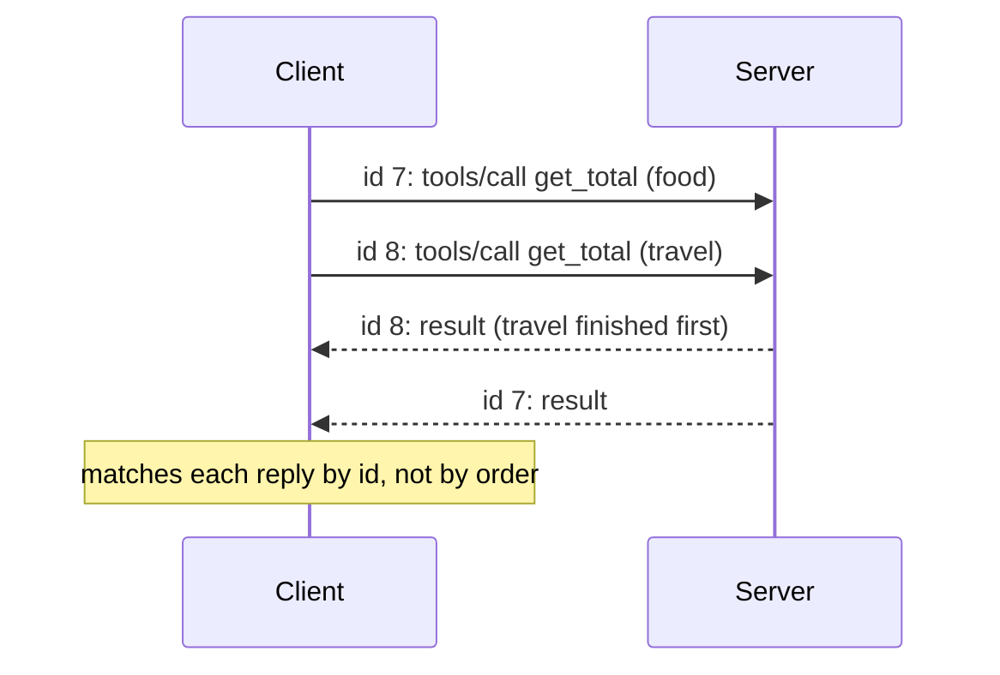
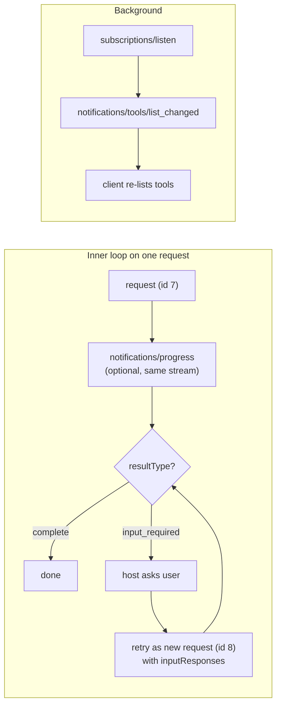

# Data Flow in MCP: The Complete Guide

> 📚 **Before you start**
>
> - [Hosts, Clients and Servers](../02-understanding-mcp/hosts-clients-and-servers.md), for the three roles.
> - [MCP Primitives: Tools, Resources and Prompts](../02-understanding-mcp/mcp-primitives-tools-resources-and-prompts.md), for what servers offer.

## Introduction

Think of how a courier parcel moves from a seller in Jaipur to your door in Kochi. The seller packs it, the courier stamps a tracking number on it, it travels by truck or plane, a hub scans it, and finally someone hands it to you and the tracking page says "Delivered". At every step you could ask: *who is holding it now, what label is on it, and what happens next?*

An MCP request is a parcel too. A user's question turns into a tool call, the tool call becomes a JSON-RPC message with a tracking number (`id`), it travels down a pipe, the server opens it, does the work, and sends back a reply carrying the same `id`. This lesson follows that parcel through every hand that touches it.

By the end you'll be able to trace any MCP interaction step by step, say which component sees which data, know where things usually go wrong, and read a message log from a real host with confidence.

> 💡 **Key Insight**
>
> Data in MCP flows in **two loops**. The **outer loop** runs inside the host: user → model → host → model → user. The **inner loop** runs between client and server: request → response, matched by `id`. The model only ever touches the outer loop; servers only ever touch the inner one. The host is the bridge.

---

## Core Explanation

### 1. The whole journey in one picture


*Follow the arrows clockwise. Purple happens in the host, blue on the wire, green in the server.*

### 2. The phases, before and during a conversation

Not everything happens when the user types. Some work happens when the host starts.

| Phase | When | Messages | Who is involved |
|---|---|---|---|
| **Configure** | User adds a server | none (a config file or a URL) | User, host |
| **Connect** | Host starts or the server is enabled | stdio: launch process. HTTP: nothing yet | Host, client |
| **Discover** | Right after connecting | `server/discover` (optional) | Client, server |
| **List** | After discover, and whenever lists change | `tools/list`, `resources/list`, `prompts/list` | Client, server |
| **Build context** | Each model turn | none on the wire | Host, model |
| **Call** | When the model picks a tool | `tools/call` (maybe several rounds) | Model, host, client, server |
| **Answer** | After results return | none on the wire | Host, model, user |
| **Watch** | In the background | `subscriptions/listen` stream | Client, server |

A useful habit: when something fails, first ask **which phase** it failed in. "The tool isn't showing up" is a List problem. "The model never calls it" is a Build-context problem (usually a vague description). "It says error" is a Call problem.

### 3. Tracing a full interaction (runnable)

Let's wire up all the pieces in plain Python and print a trace of every hop. The server is a compact version of the expense server; the "model" is a pretend function that behaves like a real one would.

```python
import json

PROTOCOL = "2026-07-28"
EXPENSES = [("2026-10-02", 450.0, "food"), ("2026-10-03", 1200.0, "travel"),
            ("2026-10-06", 5670.0, "food"), ("2026-10-09", 15000.0, "rent")]
TRACE = []

def server_handle(raw_line):
    """The server: receives a JSON text line, returns a JSON text line."""
    msg = json.loads(raw_line)
    TRACE.append(("server", "received", msg["method"]))
    if msg["method"] == "tools/list":
        result = {"tools": [{"name": "get_total", "description": "Total spent in a category for a month (YYYY-MM).",
                             "inputSchema": {"type": "object", "properties": {
                                 "category": {"type": "string"}, "month": {"type": "string"}},
                                 "required": ["category", "month"]}}]}
    elif msg["method"] == "tools/call":
        a = msg["params"]["arguments"]
        total = sum(amt for d, amt, c in EXPENSES if c == a["category"] and d.startswith(a["month"]))
        data = {"category": a["category"], "month": a["month"], "total": total}
        result = {"content": [{"type": "text", "text": json.dumps(data)}], "structuredContent": data, "isError": False}
    TRACE.append(("server", "replied", f"id={msg['id']}"))
    return json.dumps({"jsonrpc": "2.0", "id": msg["id"], "result": {"resultType": "complete", **result}})

class Client:
    """One connection: adds id and _meta, sends a line, matches the reply by id."""
    def __init__(self, transport):
        self.transport, self.next_id = transport, 1
    def request(self, method, **params):
        msg = {"jsonrpc": "2.0", "id": self.next_id, "method": method,
               "params": {**params, "_meta": {"io.modelcontextprotocol/protocolVersion": PROTOCOL,
                                              "io.modelcontextprotocol/clientCapabilities": {}}}}
        self.next_id += 1
        TRACE.append(("client", "sent", f"{method} id={msg['id']}"))
        reply = json.loads(self.transport(json.dumps(msg)))
        assert reply["id"] == msg["id"], "reply does not match request"
        TRACE.append(("client", "matched", f"id={reply['id']}"))
        return reply["result"]

def pretend_model(question, tools, tool_results):
    """Behaves like a model: first asks for a tool, then answers from the result."""
    if not tool_results:
        TRACE.append(("model", "chose", "get_total"))
        return {"tool": "get_total", "arguments": {"category": "food", "month": "2026-10"}}
    total = tool_results[-1]["structuredContent"]["total"]
    TRACE.append(("model", "answered", ""))
    return {"answer": f"You spent Rs {total:,.0f} on food in October 2026."}

def host_turn(question, client):
    TRACE.append(("host", "user asked", question))
    tools = client.request("tools/list")["tools"]
    TRACE.append(("host", "built context", f"{len(tools)} tool(s)"))
    results = []
    while True:
        step = pretend_model(question, tools, results)
        if "answer" in step:
            TRACE.append(("host", "showed answer", step["answer"]))
            return step["answer"]
        TRACE.append(("host", "approved", step["tool"]))
        results.append(client.request("tools/call", name=step["tool"], arguments=step["arguments"]))

host_turn("How much did I spend on food in October?", Client(server_handle))
for who, what, detail in TRACE:
    print(f"{who:<7} {what:<14} {detail}".rstrip())
```

Output:

```
host    user asked     How much did I spend on food in October?
client  sent           tools/list id=1
server  received       tools/list
server  replied        id=1
client  matched        id=1
host    built context  1 tool(s)
model   chose          get_total
host    approved       get_total
client  sent           tools/call id=2
server  received       tools/call
server  replied        id=2
client  matched        id=2
model   answered
host    showed answer  You spent Rs 6,120 on food in October 2026.
```

Notice the shape: the **model** appears only between host steps, the **server** appears only between client steps, and the host is the only actor that touches both. That's the two-loop picture from the Key Insight, printed.

### 4. Who sees what

Following the data also tells you **where your data goes**, which matters for privacy and security reviews.

| Piece of data | User | Host | Model | Client | Server |
|---|---|---|---|---|---|
| The user's question | ✅ | ✅ | ✅ | ❌ | ❌ |
| Tool definitions | optional | ✅ | ✅ | ✅ | ✅ (its own) |
| Tool arguments | shown in approval UI | ✅ | ✅ (it wrote them) | ✅ | ✅ |
| Tool results | optional | ✅ | ✅ | ✅ | ✅ |
| Other servers' tools and results | | ✅ | ✅ | ❌ | ❌ |
| Server credentials (API keys) | | config only | ❌ | ❌ | ✅ |

Two practical consequences:

- **Arguments are the only conversation data a server sees.** If a server needs context ("the user is in Pune"), the model has to put it in an argument. That's also why the spec says hosts should show tool inputs to the user before calling: the arguments are exactly what leaves the host.
- **Results go into the model's context.** A server's result text is read by the model, so a malicious server could plant instructions in it ("ignore previous instructions and..."). This is *indirect prompt injection*; hosts treat results as untrusted data.

### 5. The inner loop up close: ids and matching

Every request carries an `id`, and the reply carries the same `id`. That's the courier's tracking number. It lets a client have **several requests in flight at once** on one connection and still know which reply belongs to which request.



Rules from the spec:

- An `id` is a string or an integer, never `null`.
- A sender must not reuse an `id` that is still waiting for a reply.
- **Notifications have no `id`** and get no reply. They're one-way messages like "progress: 60%".

### 6. Extra loops: progress, more input and change notices

Real flows have a few extra arrows. You'll study each in detail later; here is where they fit.



| Extra flow | Trigger | Effect on data flow |
|---|---|---|
| **Progress** | Client put a `progressToken` in `_meta` | Server sends `notifications/progress` before the final reply |
| **Input required** | Server needs user input or a model answer | Interim result, host collects input, client sends a **new** request with a new `id` |
| **List changed** | Server's tools, prompts or resources changed | Client re-fetches the list, host updates the model's menu |
| **Cancellation** | User clicks stop, or a timeout | stdio: `notifications/cancelled`; HTTP: close the response stream |

### 7. Where flows break, and how to find out

| Symptom | Phase | Usual cause | First thing to check |
|---|---|---|---|
| Server never appears in the host | Connect | Wrong command or path, missing runtime (`npx`, `uv`), server crashes on start | Host's MCP log, run the command by hand |
| Server appears, no tools | List | Server didn't declare `tools` capability or raised during `tools/list` | Server's stderr, MCP Inspector |
| Tools listed, model never uses them | Build context | Vague description, too many tools, tool disabled in UI | Read the description as if you were the model |
| Model calls with wrong arguments | Call | Schema too loose, missing `description` on fields | Tighten `inputSchema`, add enums and examples |
| "Unknown tool" error | Call | Host used a prefixed name, or the list changed | Compare names in `tools/list` with the call |
| Garbled messages on stdio | Wire | Server printed debug text to **stdout** | Send all logs to stderr |

The last row catches almost every beginner once. On stdio, stdout *is* the wire. A stray `print("starting...")` corrupts the stream.

---

## Try It Yourself

1. **Add a second category.** Change `pretend_model` so the question "food and travel" makes it call `get_total` twice (once per category) before answering. How many `tools/call` ids appear in the trace?
2. **Find the leak.** In the trace above, which single message carries user-derived data to the server?
3. **Break the matching.** Modify `server_handle` to reply with `msg["id"] + 100`. What does the client do, and why is that the right behaviour?

<details>
<summary>Show answers</summary>

**1.**

```python
def pretend_model(question, tools, tool_results):
    wanted = ["food", "travel"]
    if len(tool_results) < len(wanted):
        return {"tool": "get_total", "arguments": {"category": wanted[len(tool_results)], "month": "2026-10"}}
    totals = {r["structuredContent"]["category"]: r["structuredContent"]["total"] for r in tool_results}
    return {"answer": f"Food Rs {totals['food']:,.0f}, travel Rs {totals['travel']:,.0f}."}

TRACE.clear()
print(host_turn("Food and travel in October?", Client(server_handle)))
print([d for who, what, d in TRACE if what == "sent"])
```

Output:

```
Food Rs 6,120, travel Rs 1,200.
['tools/list id=1', 'tools/call id=2', 'tools/call id=3']
```

**2.** The `tools/call` request: its `arguments` (`category`, `month`) were written by the model from the user's question. The question itself never reaches the server.

**3.**

```python
def bad_server(raw_line):
    reply = json.loads(server_handle(raw_line))
    reply["id"] += 100
    return json.dumps(reply)

try:
    Client(bad_server).request("tools/list")
except AssertionError as e:
    print("client refused:", e)
```

Output:

```
client refused: reply does not match request
```

A reply with an unknown `id` can't be trusted to belong to any request, so a client must not hand it to the host as if it did.

</details>

---

## Real-World Examples

- **MCP Inspector** shows exactly this trace for a server: each request, notification and response, with ids, so you can debug the inner loop without a model.
- **Claude Desktop** writes per-server logs (`mcp-server-NAME.log`) containing the server's stderr, and a general `mcp.log` for connection problems.
- **Observability tools** use OpenTelemetry trace context (`traceparent` in `_meta`, reserved since `2026-07-28`) to follow one user request from host to server and on into the server's own databases and APIs.

---

## Common Misconceptions

### "The server receives the user's message"

It receives only the arguments the model wrote. Everything else stays in the host unless deliberately passed.

### "Replies come back in the order requests were sent"

They can arrive in any order. The `id` is what matches them.

### "A tool call is one message each way"

Often it is, but it can include progress notifications, an `input_required` round and a retry, or a cancellation.

### "Printing to stdout is fine for debugging"

Not on stdio servers. Use stderr or a logging library configured for stderr.

---

## Interview Relevance

*"Walk me through what happens when a user asks a question in an MCP-enabled app."* A strong answer separates startup (configure, connect, discover, list) from the turn (host builds context with tools, model emits a call, host checks consent and routes, client sends JSON-RPC with an `id` and `_meta`, server validates and runs, result returns with the same `id`, host feeds it to the model, model answers). Mention **who sees what** (servers see only arguments; results are untrusted input to the model), **id matching** for concurrent requests, and the extra flows: progress, `input_required` retries, list-changed notifications and cancellation.

---

## Key Takeaways

- **Two loops**: host and model (outer), client and server (inner); the host bridges them.
- **Startup and turns differ**: discover and list happen early; context building and calls happen per turn.
- **Servers see only arguments**; results flow into the model and must be treated as untrusted.
- **Every request has an `id`** and its reply carries the same one; notifications have none.
- **Debug by phase**: connect, list, build context, call, wire.

---

**Up next:** [The Data Layer: JSON-RPC Messages](the-data-layer-json-rpc-messages.md)
