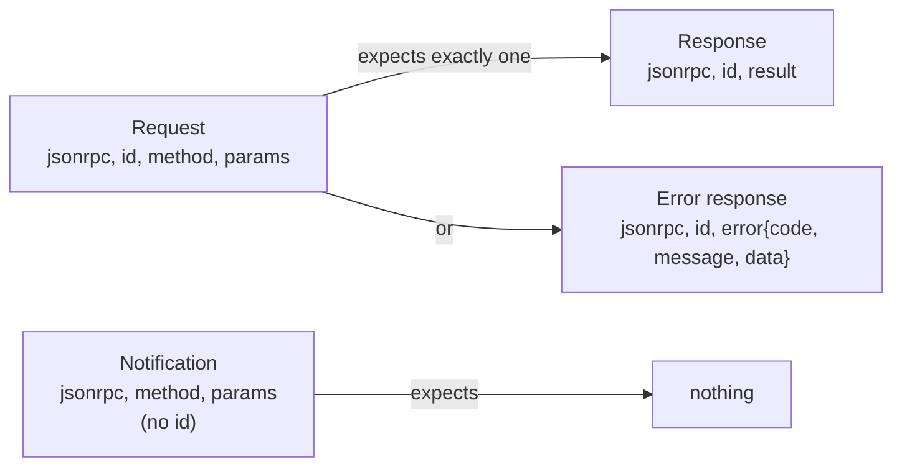

# The Data Layer: JSON-RPC Messages: The Complete Guide

> 📚 **Before you start**
>
> - [Data Flow in MCP](data-flow-in-mcp.md), for how a request travels and how ids match replies.
> - [MCP Primitives: Tools, Resources and Prompts](../02-understanding-mcp/mcp-primitives-tools-resources-and-prompts.md), for the methods you'll see in messages.

## Introduction

Every Indian railway ticket, whether printed at a counter in Howrah or downloaded from an app in Bengaluru, carries the same fields in the same places: PNR, train number, date, class, coach, berth. A TTE anywhere in the country can read any ticket in two seconds because the **format** is fixed, even though the journeys are endless.

MCP's data layer is that ticket format. It uses **JSON-RPC 2.0**, a tiny, decades-old standard for "please run this method with these parameters" messages, and adds MCP's own rules on top: which methods exist, what goes in `_meta`, what every result must contain, and which error codes mean what.

By the end of this lesson you'll be able to read any MCP message and say what kind it is, write correct requests and responses by hand, pick the right error code, and validate incoming messages the way a strict server does.

> 💡 **Key Insight**
>
> There are only **four shapes** of message: a **request** (has `id` and `method`), a **result response** (has `id` and `result`), an **error response** (has `id` and `error`), and a **notification** (has `method` but no `id`). Every MCP feature, from tool calls to subscriptions, is built from these four shapes.

---

## Core Explanation

### 1. JSON-RPC 2.0 in two minutes

JSON-RPC is "remote procedure call" written in JSON. A request names a `method` and passes `params`; the response carries either a `result` or an `error`. The `jsonrpc` field is always the string `"2.0"`.



### 2. The four shapes with real MCP examples

**Request** (client to server):

```json
{
  "jsonrpc": "2.0",
  "id": 12,
  "method": "resources/read",
  "params": {
    "uri": "expense://2026/10/summary",
    "_meta": {
      "io.modelcontextprotocol/protocolVersion": "2026-07-28",
      "io.modelcontextprotocol/clientInfo": {"name": "chai-desk", "version": "1.4.0"},
      "io.modelcontextprotocol/clientCapabilities": {"elicitation": {"form": {}}}
    }
  }
}
```

**Result response** (server to client):

```json
{
  "jsonrpc": "2.0",
  "id": 12,
  "result": {
    "resultType": "complete",
    "contents": [{"uri": "expense://2026/10/summary", "mimeType": "application/json",
                  "text": "{\"total\": 22320.0}"}],
    "ttlMs": 60000,
    "cacheScope": "private",
    "_meta": {"io.modelcontextprotocol/serverInfo": {"name": "kharcha-server", "version": "0.9.1"}}
  }
}
```

**Error response:**

```json
{
  "jsonrpc": "2.0",
  "id": 13,
  "error": {"code": -32602, "message": "Resource not found", "data": {"uri": "expense://2026/13/summary"}}
}
```

**Notification** (no `id`, no reply):

```json
{
  "jsonrpc": "2.0",
  "method": "notifications/progress",
  "params": {"progressToken": "import-42", "progress": 60, "total": 100, "message": "Imported 600 of 1000 rows"}
}
```

### 3. MCP's extra rules on top of JSON-RPC

| Rule | Why it exists |
|---|---|
| Request `id` **must** be a string or integer, **never `null`** | Plain JSON-RPC allows `null`; MCP forbids it so every request is matchable |
| An `id` must not repeat while the earlier request is still pending | So replies can't be confused |
| Every **result** must include `resultType` (`"complete"` or `"input_required"`, or an extension's value such as `"task"`) | The client must know how to read the result. Results from older servers without it are treated as `"complete"` |
| Every **request** must carry `_meta` with `protocolVersion` and `clientCapabilities` | Statelessness: each request stands alone |
| **No batching** | JSON-RPC allows arrays of messages; MCP removed batching in `2025-06-18`. One message at a time |
| Clients **must not** send responses; servers **must not** send requests (since `2026-07-28`) | Server-to-client questions go through `input_required` results instead |

### 4. The `_meta` field

`_meta` is a reserved place for **protocol metadata**, separate from the method's real parameters. Keys starting with a prefix whose second label is `modelcontextprotocol` or `mcp` (such as `io.modelcontextprotocol/`) are reserved for the spec.

| Key | Where | Required | Meaning |
|---|---|---|---|
| `io.modelcontextprotocol/protocolVersion` | every request | yes | Version this request speaks, e.g. `"2026-07-28"` |
| `io.modelcontextprotocol/clientCapabilities` | every request | yes | What the client can do for *this* request (`{}` is fine) |
| `io.modelcontextprotocol/clientInfo` | every request | should | Client name and version (for logs, not security) |
| `io.modelcontextprotocol/logLevel` | request | no | Opt in to server log messages at this level (logging is deprecated) |
| `progressToken` | request | no | Opt in to progress notifications |
| `io.modelcontextprotocol/serverInfo` | every result | should | Server name and version |
| `io.modelcontextprotocol/subscriptionId` | notifications on a listen stream | yes there | Which subscription this notification belongs to |
| `traceparent`, `tracestate`, `baggage` | anywhere | no | OpenTelemetry trace context |

Your own extensions should use your own reverse-DNS prefix, such as `in.kharcha/region`.

A request missing a required `_meta` field is malformed: the server answers with `-32602` (Invalid params), and over HTTP with status 400.

### 5. The method catalogue

**Requests from client to server** (core protocol, `2026-07-28`):

| Method | Purpose | Can return `input_required`? |
|---|---|---|
| `server/discover` | Versions, capabilities, identity, instructions | No |
| `tools/list` | List tools (paginated, cacheable) | No |
| `tools/call` | Run a tool | Yes |
| `resources/list` | List resources (paginated, cacheable) | No |
| `resources/templates/list` | List resource templates | No |
| `resources/read` | Read a resource | Yes |
| `prompts/list` | List prompts | No |
| `prompts/get` | Get a filled-in prompt | Yes |
| `completion/complete` | Autocomplete an argument | No |
| `subscriptions/listen` | Open a long-lived notification stream | No |

**Notifications:**

| Method | Direction | When |
|---|---|---|
| `notifications/progress` | server to client | During a request that sent a `progressToken` |
| `notifications/message` | server to client | Log line, only if the request opted in (deprecated feature) |
| `notifications/cancelled` | client to server (stdio) | Cancel a request; servers send it only to end a subscription |
| `notifications/subscriptions/acknowledged` | server to client | First message on a listen stream |
| `notifications/tools/list_changed` | server to client | Tool list changed (listen stream) |
| `notifications/prompts/list_changed` | server to client | Prompt list changed (listen stream) |
| `notifications/resources/list_changed` | server to client | Resource list changed (listen stream) |
| `notifications/resources/updated` | server to client | A watched resource changed (listen stream) |

**Embedded in `input_required` results** (not sent as separate requests): `elicitation/create`, and the deprecated `sampling/createMessage` and `roots/list`.

**Gone in `2026-07-28`** (you'll still see them in older servers): `initialize`, `notifications/initialized`, `ping`, `logging/setLevel`, `resources/subscribe`, `resources/unsubscribe`, `notifications/roots/list_changed`.

### 6. Error codes

| Code | Name | Use it when |
|---|---|---|
| `-32700` | Parse error | The text isn't valid JSON |
| `-32600` | Invalid request | Valid JSON, but not a valid JSON-RPC request (no `method`, `id` is `null`, ...) |
| `-32601` | Method not found | Unknown method (over HTTP also status 404) |
| `-32602` | Invalid params | Unknown tool, missing required `_meta`, bad arguments shape, **resource not found** |
| `-32603` | Internal error | Something broke inside the server |
| `-32020` | HeaderMismatch | HTTP headers don't match the body (Streamable HTTP) |
| `-32021` | MissingRequiredClientCapability | The request needs a client capability the client didn't declare |
| `-32022` | UnsupportedProtocolVersion | The requested version isn't supported; `data.supported` lists ones that are |

Codes `-32000` to `-32019` are legacy, implementation-defined codes; `-32020` to `-32099` are reserved for the spec. Two older codes you may see: `-32002` (resource not found, before `2026-07-28`) and `-32042` (URL elicitation required, `2025-11-25` only).

And remember the big distinction: **a tool that ran and failed returns a normal result with `isError: true`**, not an error response.

### 7. A strict message parser (runnable)

Let's write the first thing a real server does with an incoming line: parse it, classify it, and reject anything malformed with the right error. We'll use `pydantic` for the shape checks.

```python
import json
from typing import Any, Optional, Union
from pydantic import BaseModel, ConfigDict, ValidationError, field_validator

class Request(BaseModel):
    model_config = ConfigDict(extra="forbid")
    jsonrpc: str
    id: Union[int, str]
    method: str
    params: Optional[dict[str, Any]] = None

    @field_validator("jsonrpc")
    @classmethod
    def must_be_2(cls, v):
        if v != "2.0":
            raise ValueError("jsonrpc must be '2.0'")
        return v

class Notification(BaseModel):
    model_config = ConfigDict(extra="forbid")
    jsonrpc: str
    method: str
    params: Optional[dict[str, Any]] = None

REQUIRED_META = ("io.modelcontextprotocol/protocolVersion", "io.modelcontextprotocol/clientCapabilities")

def error(id_, code, message, data=None):
    body = {"code": code, "message": message}
    if data is not None:
        body["data"] = data
    return {"jsonrpc": "2.0", "id": id_, "error": body}

def classify(line):
    """Return ('request', obj), ('notification', obj) or ('reply', error_response)."""
    try:
        raw = json.loads(line)
    except json.JSONDecodeError:
        return "reply", error(None, -32700, "Parse error")
    if isinstance(raw, list):
        return "reply", error(None, -32600, "Batching is not supported")
    if not isinstance(raw, dict):
        return "reply", error(None, -32600, "Invalid request")
    try:
        if "id" in raw:
            if raw["id"] is None:
                return "reply", error(None, -32600, "id must not be null")
            req = Request.model_validate(raw)
        else:
            return "notification", Notification.model_validate(raw)
    except ValidationError as e:
        return "reply", error(raw.get("id"), -32600, "Invalid request", e.errors()[0]["msg"])
    meta = (req.params or {}).get("_meta", {})
    missing = [k for k in REQUIRED_META if k not in meta]
    if missing:
        return "reply", error(req.id, -32602, "Missing required _meta field(s)", {"missing": missing})
    return "request", req

samples = [
    '{"jsonrpc": "2.0", "id": 1, "method": "tools/list", "params": {"_meta": '
    '{"io.modelcontextprotocol/protocolVersion": "2026-07-28", "io.modelcontextprotocol/clientCapabilities": {}}}}',
    '{"jsonrpc": "2.0", "method": "notifications/cancelled", "params": {"requestId": 1, "reason": "user pressed stop"}}',
    '{"jsonrpc": "2.0", "id": 2, "method": "tools/list"}',
    '{"jsonrpc": "2.0", "id": null, "method": "tools/list"}',
    '[{"jsonrpc": "2.0", "id": 3, "method": "tools/list"}]',
    '{"jsonrpc": "1.0", "id": 4, "method": "tools/list"}',
    '{"jsonrpc": "2.0", "id": 5, "method": "tools/list",',
]
for line in samples:
    kind, obj = classify(line)
    if kind == "reply":
        e = obj["error"]
        print(f"reply    {e['code']:>6}  {e['message']}" + (f"  {e['data']}" if "data" in e else ""))
    else:
        print(f"{kind:<12} {obj.method}")
```

Output:

```
request      tools/list
notification notifications/cancelled
reply    -32602  Missing required _meta field(s)  {'missing': ['io.modelcontextprotocol/protocolVersion', 'io.modelcontextprotocol/clientCapabilities']}
reply    -32600  id must not be null
reply    -32600  Batching is not supported
reply    -32600  Invalid request  Value error, jsonrpc must be '2.0'
reply    -32700  Parse error
```

Each line is a real rule from the spec, enforced. Notice that a **notification never gets a reply**, even a malformed one is just dropped by real servers; we only classify it here.

### 8. Results: the common fields

Since `2026-07-28` every result has a common skeleton, and some results add more:

| Field | Present on | Meaning |
|---|---|---|
| `resultType` | every result | `"complete"`, `"input_required"`, or an extension type |
| `_meta` | any | Server identity, trace context, subscription id |
| `ttlMs`, `cacheScope` | `tools/list`, `prompts/list`, `resources/list`, `resources/templates/list`, `resources/read`, `server/discover` | How long the client may cache this answer, and whether shared caches may store it (`"public"`) or only this user's client (`"private"`) |
| `nextCursor` | list results | Pass as `cursor` to get the next page; absent on the last page |
| `inputRequests`, `requestState` | `input_required` results | What the server needs and opaque state to echo back |

Pagination in practice:

```python
PAGES = {None: (["get_total", "add_expense"], "p2"), "p2": (["delete_expense"], None)}

def tools_list(cursor=None):
    names, nxt = PAGES[cursor]
    result = {"resultType": "complete", "tools": [{"name": n} for n in names]}
    if nxt:
        result["nextCursor"] = nxt
    return result

cursor, all_tools = None, []
while True:
    page = tools_list(cursor)
    all_tools += [t["name"] for t in page["tools"]]
    cursor = page.get("nextCursor")
    if cursor is None:
        break
print(all_tools)
```

Output:

```
['get_total', 'add_expense', 'delete_expense']
```

The cursor is **opaque**: clients must not parse it or build their own.

### 9. Capabilities: what each side declares

Capabilities are plain JSON objects. The server declares them in `server/discover`; the client declares them on every request in `_meta`.

```json
{
  "server": {
    "tools": {"listChanged": true},
    "resources": {"subscribe": true, "listChanged": true},
    "prompts": {"listChanged": false},
    "completions": {},
    "extensions": {"io.modelcontextprotocol/ui": {}}
  },
  "client": {
    "elicitation": {"form": {}, "url": {}},
    "extensions": {"io.modelcontextprotocol/tasks": {}}
  }
}
```

The rule is simple and strict: **nobody uses a feature the other side didn't declare**. A server must not send an elicitation to a client that didn't declare `elicitation`; if a request truly needs it, the server returns `-32021` with `data.requiredCapabilities`.

### 10. JSON Schema inside messages

Tool `inputSchema` and `outputSchema` are JSON Schema. Without a `$schema` key the dialect is **2020-12**. Implementations must not automatically fetch a `$ref` pointing to a network URL (an attacker could use that to make your server call internal addresses), and should cap schema depth and size so a giant schema can't be used to freeze the validator.

---

## Try It Yourself

1. **Classify by hand.** What shape is `{"jsonrpc": "2.0", "id": "a1", "result": {"resultType": "complete"}}`?
2. **Pick the code.** A client calls `tools/call` with `"name": "delete_everything"`, which doesn't exist. Which error code, and is it an error response or `isError: true`?
3. **Extend the parser.** Make `classify` reject a request whose `protocolVersion` isn't `"2026-07-28"` with error `-32022` and `data` listing supported and requested versions.

<details>
<summary>Show answers</summary>

**1.** A **result response**: it has `id` and `result`. The empty-looking result is valid; many methods (like acknowledging a cancellation in some extensions) return only `resultType`.

**2.** An **error response** with `-32602` (Invalid params), message like `"Unknown tool: delete_everything"`. The request itself is wrong, so it's not a tool execution error.

**3.**

```python
SUPPORTED = ["2026-07-28"]

def classify_with_version(line):
    kind, obj = classify(line)
    if kind != "request":
        return kind, obj
    requested = obj.params["_meta"]["io.modelcontextprotocol/protocolVersion"]
    if requested not in SUPPORTED:
        return "reply", error(obj.id, -32022, "Unsupported protocol version",
                              {"supported": SUPPORTED, "requested": requested})
    return kind, obj

old = ('{"jsonrpc": "2.0", "id": 9, "method": "tools/list", "params": {"_meta": '
       '{"io.modelcontextprotocol/protocolVersion": "2025-06-18", "io.modelcontextprotocol/clientCapabilities": {}}}}')
print(classify_with_version(old)[1])
```

Output:

```
{'jsonrpc': '2.0', 'id': 9, 'error': {'code': -32022, 'message': 'Unsupported protocol version', 'data': {'supported': ['2026-07-28'], 'requested': '2025-06-18'}}}
```

</details>

---

## Real-World Examples

- **SDKs** (Python, TypeScript, Go, Java, C#, Rust and others) generate their message types from the spec's `schema.ts`, the TypeScript file that is the source of truth for every message.
- **MCP Inspector** displays raw JSON-RPC traffic, which is the fastest way to learn the shapes by sight.
- **Gateways and proxies** parse the same messages to apply policy (block a tool, redact an argument, log a call) without understanding each server's business logic.

---

## Common Misconceptions

### "`result` and `error` can both appear"

A response has exactly one of them.

### "Notifications are acknowledged"

They never get a reply. If you need confirmation, it must be a request.

### "`_meta` is optional decoration"

Since `2026-07-28`, `protocolVersion` and `clientCapabilities` in `_meta` are required on every request.

### "MCP supports JSON-RPC batches"

It did briefly; batching was removed in `2025-06-18`.

---

## Interview Relevance

*"What's MCP's wire format?"* Strong answers: JSON-RPC 2.0 with four shapes (request, result, error, notification), MCP's additions (non-null unique ids, required `resultType`, per-request `_meta` with version and capabilities, no batching), the main methods (`server/discover`, `tools/*`, `resources/*`, `prompts/*`, `subscriptions/listen`), the error codes that matter (`-32601`, `-32602`, `-32022`) and the protocol error vs `isError` distinction. Mentioning opaque cursors, cache hints and capability rules shows real implementation experience.

---

## Key Takeaways

- **Four shapes**: request, result response, error response, notification (no `id`, no reply).
- **MCP adds rules**: non-null unique ids, `resultType` on every result, required `_meta` on every request, no batching.
- **Methods are few and regular**: `server/discover`, `tools/*`, `resources/*`, `prompts/*`, `subscriptions/listen`.
- **Pick errors carefully**: `-32602` for bad params or unknown tools and resources, `-32022` for versions; tool failures use `isError: true`.
- **Capabilities gate everything**: neither side uses a feature the other didn't declare.

---

**Up next:** [The Transport Layer: stdio and Streamable HTTP](the-transport-layer-stdio-and-streamable-http.md)
