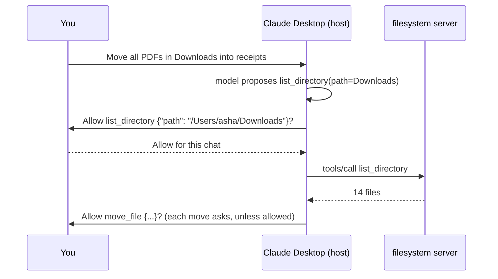

# Using MCP in Claude Desktop and Cursor: The Complete Guide

> 📚 **Before you start**
>
> - [The Transport Layer: stdio and Streamable HTTP](the-transport-layer-stdio-and-streamable-http.md), for what `command`, `args` and `url` actually do.
> - [Hosts, Clients and Servers](../02-understanding-mcp/hosts-clients-and-servers.md), for the host's job of consent and routing.

## Introduction

Installing a new appliance at home is mostly about the plug and the switchboard. The washing machine is clever on its own, but nothing happens until it's connected to the right socket, with the right voltage, and the switch is on.

MCP hosts are the switchboard. Claude Desktop, Cursor, VS Code and other apps don't need new code to use a server; they need **a few lines of configuration** telling them how to start (or where to find) it. Get those lines right and a server you wrote ten minutes ago shows up as tools the assistant can use. Get them slightly wrong (a relative path, a missing runtime, a stray print to stdout) and nothing appears, with no obvious error.

This lesson shows exactly how to connect local and remote MCP servers to Claude Desktop and Cursor, what each config field means in protocol terms, how approvals work, where the logs are, and how to debug the common failures.

> 💡 **Key Insight**
>
> A host's MCP config is just a list of **how to reach each server**: for a local server, the **command and arguments to launch it** (stdio); for a remote server, its **URL** (Streamable HTTP). Everything else (discovery, tool lists, calls) happens automatically over the protocol once the host can reach the server.

---

## Core Explanation

### 1. The shared shape of MCP config files

Most hosts copied the same JSON shape, so learning it once pays off everywhere:

```json
{
  "mcpServers": {
    "<a name you choose>": {
      "command": "<program to run>",
      "args": ["<argument>", "<argument>"],
      "env": {"<VARIABLE>": "<value>"}
    },
    "<another name>": {
      "url": "https://example.com/mcp",
      "headers": {"<Header>": "<value>"}
    }
  }
}
```

| Field | Transport | What the host does with it |
|---|---|---|
| `command` + `args` | stdio | Launches the process with exactly these arguments, pipes stdin/stdout |
| `env` | stdio | Adds environment variables to that process (where API keys usually go) |
| `url` | Streamable HTTP | POSTs MCP messages to this endpoint |
| `headers` | Streamable HTTP | Adds headers to every request (some hosts; OAuth is preferred where supported) |
| The key name (`"filesystem"`) | both | Your label; hosts show it in the UI and often use it to prefix tool names |

### 2. Claude Desktop: local servers

**Where the file is.** Open Claude Desktop's settings from the app menu (not the in-chat settings), go to **Developer**, and click **Edit Config**. That opens (and creates if needed):

| OS | Path |
|---|---|
| macOS | `~/Library/Application Support/Claude/claude_desktop_config.json` |
| Windows | `%APPDATA%\Claude\claude_desktop_config.json` |

**An example with three servers**: the reference filesystem server (Node), a Python server you wrote, and one with a secret:

```json
{
  "mcpServers": {
    "filesystem": {
      "command": "npx",
      "args": ["-y", "@modelcontextprotocol/server-filesystem",
               "/Users/asha/Documents/receipts", "/Users/asha/Downloads"]
    },
    "kharcha": {
      "command": "uv",
      "args": ["--directory", "/Users/asha/code/kharcha-mcp", "run", "server.py"]
    },
    "weather": {
      "command": "uvx",
      "args": ["mausam-mcp"],
      "env": {"MAUSAM_API_KEY": "paste-your-key-here"}
    }
  }
}
```

Read each one in protocol terms:

- **filesystem**: run `npx -y @modelcontextprotocol/server-filesystem <folders>`. The folders are the **only** places that server may touch. This is configuration, not something the model can change.
- **kharcha**: run your own `server.py` inside its project folder with `uv`, which installs its dependencies first. Using `--directory` with an **absolute path** avoids "file not found" surprises, because the host doesn't start the process in your project folder.
- **weather**: `uvx` downloads and runs a published Python package; the API key reaches the server as an environment variable, never through the model.

**Then fully quit and restart Claude Desktop.** It reads the config only at startup. The servers' tools then appear under the connectors menu in the chat box ("Add files, connectors, and more" → **Connectors** → **Manage connectors**), where you can see each server's tools and switch them on or off.

### 3. Claude: remote servers and bundles

- **Remote servers** (Streamable HTTP) are added as **custom connectors** by URL in Claude's connector settings, on the web and desktop. If the server needs sign-in, Claude runs the OAuth flow and stores the token; you never paste a token into a file.
- **MCP Bundles** (`.mcpb` files) package a local server with its manifest so it can be installed with a click instead of hand-editing JSON. Under the hood the result is the same: a command the host launches over stdio.

### 4. Approvals in Claude Desktop

When the model wants to call a tool, Claude asks you first and shows the tool name and its **arguments**. That's the host doing its job from [Hosts, Clients and Servers](../02-understanding-mcp/hosts-clients-and-servers.md). You can allow once, or allow that tool for the conversation. Read the arguments: they're exactly what will be sent to the server.



### 5. Cursor

Cursor reads the same `mcpServers` shape from two places:

| File | Scope |
|---|---|
| `.cursor/mcp.json` in a project | Tools for that project only (commit it so teammates get them) |
| `~/.cursor/mcp.json` | Tools available in every project |

A project config with one local and one remote server:

```json
{
  "mcpServers": {
    "kharcha": {
      "command": "python",
      "args": ["${workspaceFolder}/mcp/server.py"],
      "env": {"KHARCHA_DB": "${workspaceFolder}/data/expenses.db"}
    },
    "team-docs": {
      "url": "https://mcp.docs.internal.example.in/mcp",
      "headers": {"Authorization": "Bearer ${env:TEAM_DOCS_TOKEN}"}
    }
  }
}
```

Cursor resolves variables such as `${workspaceFolder}`, `${userHome}` and `${env:NAME}` in `command`, `args`, `env`, `url` and `headers`, which keeps secrets out of the committed file. It supports stdio, SSE and Streamable HTTP, OAuth for servers that need it, and the tools, prompts, resources, roots and elicitation features. By default it **asks before running MCP tools**; you can allowlist specific tools.

### 6. Other hosts use the same idea

| Host | Config location | Top-level key |
|---|---|---|
| Claude Desktop | `claude_desktop_config.json` | `mcpServers` |
| Cursor | `.cursor/mcp.json`, `~/.cursor/mcp.json` | `mcpServers` |
| VS Code (Copilot) | `.vscode/mcp.json` in the workspace, or user settings | `servers` |
| Claude Code | `.mcp.json` in the project, or `claude mcp add` | `mcpServers` |

Small differences (like VS Code's `servers` key) are why it's worth reading each host's docs once. The protocol underneath is identical.

### 7. Checking a config before you restart (runnable)

Most "my server doesn't show up" problems are visible in the config itself. Here's a small checker for the common mistakes:

```python
import json

def check_config(text):
    problems = []
    try:
        cfg = json.loads(text)
    except json.JSONDecodeError as e:
        return [f"invalid JSON at line {e.lineno}: {e.msg}"]
    servers = cfg.get("mcpServers")
    if not isinstance(servers, dict):
        return ["missing top-level 'mcpServers' object"]
    for name, s in servers.items():
        if "command" in s and "url" in s:
            problems.append(f"{name}: has both 'command' and 'url'; pick one transport")
        elif "command" in s:
            for arg in s.get("args", []):
                if arg.endswith(".py") and not (arg.startswith("/") or arg[1:3] == ":\\" or arg.startswith("${")):
                    problems.append(f"{name}: '{arg}' is a relative path; the host won't start in your folder")
            for key, value in s.get("env", {}).items():
                if any(word in key.upper() for word in ("KEY", "TOKEN", "SECRET")) and not value.startswith("${"):
                    problems.append(f"{name}: secret {key} is written in plain text; keep this file private")
        elif "url" in s:
            if not s["url"].startswith("https://") and "localhost" not in s["url"] and "127.0.0.1" not in s["url"]:
                problems.append(f"{name}: remote URL should use https")
        else:
            problems.append(f"{name}: needs 'command' (stdio) or 'url' (HTTP)")
    return problems or ["looks fine"]

sample = """{
  "mcpServers": {
    "kharcha": {"command": "python", "args": ["server.py"]},
    "weather": {"command": "uvx", "args": ["mausam-mcp"], "env": {"MAUSAM_API_KEY": "abc123"}},
    "docs":    {"url": "http://mcp.docs.example.in/mcp"},
    "broken":  {"args": ["--help"]}
  }
}"""
for line in check_config(sample):
    print("-", line)
print(check_config('{"mcpServers": {"x": {"command": "npx",}}}'))
```

Output:

```
- kharcha: 'server.py' is a relative path; the host won't start in your folder
- weather: secret MAUSAM_API_KEY is written in plain text; keep this file private
- docs: remote URL should use https
- broken: needs 'command' (stdio) or 'url' (HTTP)
['invalid JSON at line 1: Illegal trailing comma before end of object']
```

The last line is the single most common failure: a **trailing comma**, which JSON doesn't allow.

### 8. Debugging when a server doesn't appear

Work through the phases from [Data Flow in MCP](data-flow-in-mcp.md):

| Step | How |
|---|---|
| 1. Is the JSON valid? | Paste it into a validator, or use the checker above |
| 2. Does the command run on its own? | Run the exact `command` and `args` in a terminal. A stdio server should start and wait silently for input |
| 3. Is the runtime on the host's PATH? | GUI apps often don't see the PATH your terminal has. Use the absolute path to `npx`, `uv` or `python` if in doubt |
| 4. What do the logs say? | Claude Desktop on macOS: `~/Library/Logs/Claude/` (Windows: `%APPDATA%\Claude\logs`). `mcp.log` covers connections; `mcp-server-NAME.log` holds that server's stderr |
| 5. Does the server speak the protocol? | Connect with MCP Inspector (`npx @modelcontextprotocol/inspector`) and try `tools/list` |
| 6. Is it printing to stdout? | Any non-JSON line on stdout breaks stdio. Move logs to stderr |

```bash
# Follow Claude Desktop's MCP logs live on macOS
tail -n 20 -f ~/Library/Logs/Claude/mcp*.log
```

Example output:

```
2026-10-11T09:14:02.118Z [kharcha] [info] Initializing server...
2026-10-11T09:14:02.950Z [kharcha] [error] spawn python ENOENT
```

`ENOENT` means "no such file": the host couldn't find `python`. Use the full path, or `uv`.

### 9. Safety habits

- **Only add servers you trust.** A local server runs with your user's permissions; it can read anything you can.
- **Scope local servers narrowly**, such as filesystem servers to one folder, not your home directory.
- **Keep config files with secrets private**; prefer `${env:...}` references or OAuth.
- **Read approval dialogs**, especially for tools that write, delete, send or pay.
- **Watch for tool descriptions that ask the model to do unrelated things.** That's a sign of a poisoned or malicious server.

---

## Try It Yourself

1. **Translate a config.** Convert the Claude Desktop `kharcha` entry above into a Cursor project config that uses `${workspaceFolder}` instead of an absolute path.
2. **Fix the sample.** Rewrite `sample` so `check_config` prints `looks fine`.
3. **Diagnose.** A friend's server works when run in the terminal but Claude Desktop's `mcp-server-kharcha.log` shows `Unexpected token 'S', "Starting k"... is not valid JSON`. What's wrong?

<details>
<summary>Show answers</summary>

**1.**

```json
{
  "mcpServers": {
    "kharcha": {
      "command": "uv",
      "args": ["--directory", "${workspaceFolder}", "run", "server.py"]
    }
  }
}
```

**2.**

```python
fixed = """{
  "mcpServers": {
    "kharcha": {"command": "python", "args": ["/Users/asha/code/kharcha-mcp/server.py"]},
    "weather": {"command": "uvx", "args": ["mausam-mcp"], "env": {"MAUSAM_API_KEY": "${env:MAUSAM_API_KEY}"}},
    "docs":    {"url": "https://mcp.docs.example.in/mcp"}
  }
}"""
print(check_config(fixed))
```

Output:

```
['looks fine']
```

**3.** The server prints a startup message such as `Starting kharcha...` to **stdout**. The host tries to parse it as a JSON-RPC message and fails. Send that message to stderr.

</details>

---

## Real-World Examples

- **Developers** commit `.cursor/mcp.json` or `.vscode/mcp.json` with servers for their issue tracker, database and docs, so every teammate's assistant gets the same tools.
- **Non-developers** install servers into Claude Desktop as MCP Bundles or add remote connectors by URL, never touching JSON.
- **Companies** publish an internal list of approved servers and push host configs through device management, which is the first step towards the gateways covered in [Gateways, Registries and Server Discovery](../course.md#m6).

---

## Common Misconceptions

### "I need to restart only the server"

Claude Desktop reads its config at startup, so after editing it you must fully quit and reopen the app.

### "Relative paths work like in my terminal"

The host doesn't start servers in your project folder. Use absolute paths, `--directory`, or variables like `${workspaceFolder}`.

### "Putting a token in `env` sends it to the model"

`env` values go to the server process only. The model never sees them. They are, however, stored in plain text in the file.

### "If the tool is listed, the model will use it"

Listing only makes it available. The description still has to convince the model it fits the task, and the user may have the tool switched off.

---

## Interview Relevance

*"How do you connect an MCP server to an app like Claude Desktop or Cursor, and how would you debug it?"* A strong answer explains the `mcpServers` config (`command`/`args`/`env` for stdio, `url` for Streamable HTTP), where the files live, that the host launches stdio servers itself and must be restarted to reload config, how approvals show arguments, and a debugging order: valid JSON, command runs alone, absolute paths and PATH, logs (`mcp.log`, `mcp-server-NAME.log`), Inspector, and stdout pollution. Mentioning secrets handling (`${env:...}`, OAuth for remote) and least-privilege scoping is a plus.

---

## Key Takeaways

- **Config tells the host how to reach a server**: `command`/`args`/`env` for stdio, `url` for HTTP.
- **Claude Desktop** uses `claude_desktop_config.json` (edit via Settings → Developer) and needs a full restart; remote servers are added as connectors.
- **Cursor** uses `.cursor/mcp.json` per project or `~/.cursor/mcp.json` globally, with `${workspaceFolder}` and `${env:NAME}` variables.
- **Most failures** are invalid JSON, relative paths, a missing runtime on PATH, or logs printed to stdout.
- **Hosts ask before running tools**; read the arguments and scope servers narrowly.

---

**Up next:** [Initialisation: Version and Capability Negotiation](../course.md#m4)
