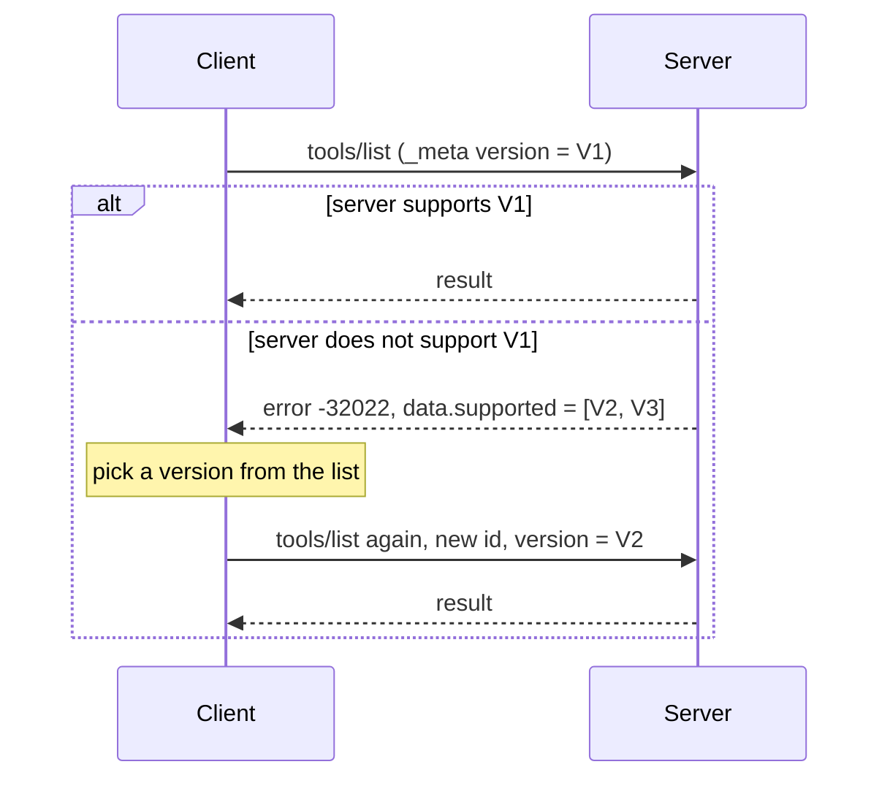
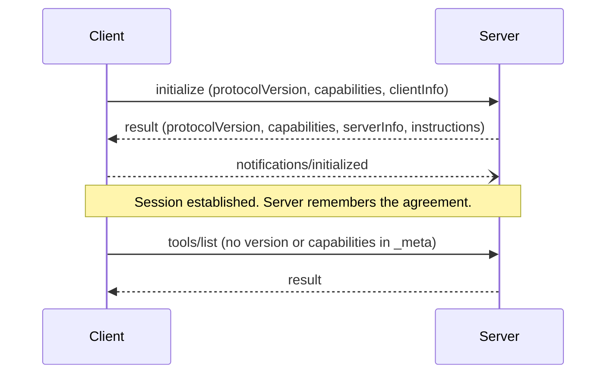

# Initialisation: Version and Capability Negotiation: The Complete Guide

> 📚 **Before you start**
>
> - [The Data Layer: JSON-RPC Messages](../03-how-mcp-components-talk/the-data-layer-json-rpc-messages.md), for `_meta`, capabilities and error codes.
> - [The Transport Layer: stdio and Streamable HTTP](../03-how-mcp-components-talk/the-transport-layer-stdio-and-streamable-http.md), for how messages travel and the headers that mirror them.
> - [Using MCP in Claude Desktop and Cursor](../03-how-mcp-components-talk/using-mcp-in-claude-desktop-and-cursor.md), for what a host does when it starts a server.

## Introduction

When you call a customer-care line in India, the first thing you hear is "Hindi ke liye ek dabaiye, English ke liye do dabaiye". Before anyone talks about your broken washing machine, both sides agree on **which language** the call will use. Then the agent checks **what you're allowed to do** ("this number is registered for a warranty, so I can book a free visit"). Only then does the real conversation start.

Every MCP conversation needs the same two agreements:

1. **Which version of the protocol** are we both speaking? MCP changes over time, and a client built in 2025 and a server built in 2026 might not mean the same thing by the same message.
2. **Which optional features** can each side handle? Can the client show a form to the user? Does the server send change notifications? Does either side understand an extension like MCP Apps?

Agreeing on these is called **negotiation**, and the part of the lifecycle where it happens is **initialisation**. In older versions of MCP this was a formal opening handshake called `initialize`. In the current version, `2026-07-28`, there is no handshake at all: every request carries its own version and capabilities. You need to understand both, because you'll meet both in real servers for a long time.

By the end of this lesson you'll be able to:

- Call `server/discover` and read every field of its result.
- Handle a version mismatch the way the spec requires, and write the retry loop.
- Read and declare capabilities on both sides, including extensions.
- Recognise the old `initialize` handshake and explain what it did.
- Write a **dual-era** client that talks to both modern and old servers, and know how a dual-era server decides which era a client speaks.

> 💡 **Key Insight**
>
> In modern MCP, negotiation is **per request, not per connection**. Every request says "I speak version X and I can do Y" in its `_meta`, and the server either answers or says "I don't speak X, I speak these instead". `server/discover` is just an optional way to ask the server about itself up front. The old `initialize` handshake did the same job once, at the start of a session, and the server remembered the answer.

---

## Core Explanation

### 1. The lifecycle at a glance


*Both eras end up exchanging the same tool, resource and prompt messages. They differ only in how the two sides agree before and during that exchange.*

Every MCP connection goes through three phases:

| Phase | Modern (`2026-07-28`) | Legacy (`2025-11-25` and earlier) |
|---|---|---|
| **Initialisation** | Optional `server/discover`; version and capabilities ride on every request | Mandatory `initialize` request, then `notifications/initialized` |
| **Operation** | Normal requests, each standing alone | Normal requests inside a session |
| **Shutdown** | Close stdin (stdio) or just stop sending (HTTP) | Close stdin (stdio) or send HTTP `DELETE` to end the session |

This lesson covers initialisation in both eras. [Operation and Shutdown](operation-and-shutdown.md) covers the other two phases.

The spec uses three words you'll see everywhere from now on:

| Term | Meaning |
|---|---|
| **Modern** | Versions that put version, identity and capabilities in each request's `_meta` (`2026-07-28` and later) |
| **Legacy** | Versions that open with an `initialize` handshake (`2025-11-25` and earlier) |
| **Dual-era** | A client or server that supports both |

### 2. What gets negotiated

Three things must be agreed before useful work can happen:

| What | Who states it | Modern: where it lives | Legacy: where it lived |
|---|---|---|---|
| **Protocol version** | Client proposes, server accepts or rejects | `_meta["io.modelcontextprotocol/protocolVersion"]` on every request (and the `MCP-Protocol-Version` header on HTTP) | `params.protocolVersion` in `initialize` |
| **Capabilities** | Each side declares its own | Client: `_meta["io.modelcontextprotocol/clientCapabilities"]` on every request. Server: in the `server/discover` result | `params.capabilities` and `result.capabilities` in `initialize` |
| **Identity** | Each side names itself | Client: `_meta["io.modelcontextprotocol/clientInfo"]`. Server: `_meta["io.modelcontextprotocol/serverInfo"]` on results | `clientInfo` and `serverInfo` in `initialize` |

Identity is for **logs and display only**. The spec says clients should not change behaviour or make security decisions based on `serverInfo`, because the server reports it about itself and nobody checks it. A server could claim to be anything.

### 3. `server/discover`: asking a server about itself

Every modern server **must** implement `server/discover`. It takes no parameters beyond the usual `_meta`:

```json
{
  "jsonrpc": "2.0",
  "id": "discover-1",
  "method": "server/discover",
  "params": {
    "_meta": {
      "io.modelcontextprotocol/protocolVersion": "2026-07-28",
      "io.modelcontextprotocol/clientInfo": {"name": "chai-desk", "version": "1.4.0"},
      "io.modelcontextprotocol/clientCapabilities": {}
    }
  }
}
```

And a typical answer from an expense-tracking server:

```json
{
  "jsonrpc": "2.0",
  "id": "discover-1",
  "result": {
    "resultType": "complete",
    "supportedVersions": ["2026-07-28"],
    "capabilities": {
      "tools": {"listChanged": true},
      "resources": {"subscribe": true, "listChanged": true},
      "prompts": {},
      "completions": {}
    },
    "instructions": "Amounts are in rupees. Call get_total before add_expense to avoid duplicates.",
    "ttlMs": 3600000,
    "cacheScope": "public",
    "_meta": {"io.modelcontextprotocol/serverInfo": {"name": "kharcha-server", "version": "0.9.1"}}
  }
}
```

| Field | Meaning |
|---|---|
| `supportedVersions` | Every protocol version the server accepts. The client picks one for its requests. |
| `capabilities` | Which features the server offers (section 5). |
| `instructions` | Optional plain-language advice for the model on using this server well. Hosts often add it to the system prompt. |
| `ttlMs`, `cacheScope` | How long the client may cache this answer, and whether shared caches may store it. `server/discover` is cacheable like the list methods. |
| `_meta` serverInfo | Name and version of the server software, for display and logs. |

**Calling it is optional.** A modern client may skip it and send `tools/list` straight away. It's useful in two situations:

- **Showing server information** (name, capabilities) in one request instead of probing with `tools/list`, `prompts/list` and `resources/list`.
- **Probing an unknown stdio server** to find out whether it is modern or legacy (section 8).

### 4. Version negotiation, request by request

In the modern era nobody "agrees" on a version at the start. The client simply puts its preferred version in `_meta`, and the server checks it on every single request.



The error is fixed by the spec:

```json
{
  "jsonrpc": "2.0",
  "id": 1,
  "error": {
    "code": -32022,
    "message": "Unsupported protocol version",
    "data": {"supported": ["2026-07-28", "2025-11-25"], "requested": "1900-01-01"}
  }
}
```

The rules:

- A server **must** return `-32022` (UnsupportedProtocolVersion) for any version it doesn't implement, whether it has never heard of the version or simply chose not to support it.
- The client **should** pick a version it also supports from `data.supported` and retry. If there's no overlap, it **should** show the user a clear error rather than guess.
- On Streamable HTTP the same version is also in the `MCP-Protocol-Version` header, and the reply comes with HTTP status `400`.
- Clients and servers **may** support several versions at once. A server that lists `["2026-07-28", "2025-11-25"]` is a dual-era server.

Let's build a modern server and a client that negotiates with it. The server is a plain function from a request dictionary to a response dictionary, the same style as earlier lessons, so you can see every rule without transport noise. To show a mismatch we need a client that prefers a version the server doesn't know, so the client below pretends to have been built for an **imaginary future revision** called `2027-01-15`.

```python
import json

SERVER_VERSIONS = ["2026-07-28"]
SERVER_CAPS = {"tools": {"listChanged": True}, "resources": {"subscribe": True}, "prompts": {}}
TOOLS = [
    {"name": "get_total", "description": "Total spent in a category this month",
     "inputSchema": {"type": "object", "properties": {"category": {"type": "string"}}, "required": ["category"]}},
    {"name": "confirm_payment", "description": "Ask the user to confirm, then pay a bill",
     "inputSchema": {"type": "object", "properties": {"bill": {"type": "string"}}, "required": ["bill"]}},
]

def ok(id_, **result):
    return {"jsonrpc": "2.0", "id": id_, "result": {"resultType": "complete", **result,
            "_meta": {"io.modelcontextprotocol/serverInfo": {"name": "kharcha-server", "version": "0.9.1"}}}}

def err(id_, code, message, data=None):
    return {"jsonrpc": "2.0", "id": id_, "error": {"code": code, "message": message, **({"data": data} if data else {})}}

def modern_server(msg):
    meta = msg.get("params", {}).get("_meta", {})
    version = meta.get("io.modelcontextprotocol/protocolVersion")
    caps = meta.get("io.modelcontextprotocol/clientCapabilities")
    if version is None or caps is None:                       # every modern request must carry both
        return err(msg["id"], -32602, "Missing required _meta field(s)")
    if version not in SERVER_VERSIONS:                        # checked on every request, not once
        return err(msg["id"], -32022, "Unsupported protocol version",
                   {"supported": SERVER_VERSIONS, "requested": version})
    if msg["method"] == "server/discover":
        return ok(msg["id"], supportedVersions=SERVER_VERSIONS, capabilities=SERVER_CAPS,
                  instructions="Amounts are in rupees.", ttlMs=3600000, cacheScope="public")
    if msg["method"] == "tools/list":
        return ok(msg["id"], tools=TOOLS, ttlMs=60000, cacheScope="public")
    return err(msg["id"], -32601, "Method not found")

next_id = 0
def request(server, method, version, caps=None, **params):
    global next_id
    next_id += 1
    params["_meta"] = {"io.modelcontextprotocol/protocolVersion": version,
                       "io.modelcontextprotocol/clientCapabilities": caps or {},
                       "io.modelcontextprotocol/clientInfo": {"name": "chai-desk", "version": "1.4.0"}}
    return server({"jsonrpc": "2.0", "id": next_id, "method": method, "params": params})

reply = request(modern_server, "server/discover", "2026-07-28")["result"]
print("versions:", reply["supportedVersions"])
print("capabilities:", sorted(reply["capabilities"]))
print("server:", reply["_meta"]["io.modelcontextprotocol/serverInfo"]["name"])
```

Output:

```
versions: ['2026-07-28']
capabilities: ['prompts', 'resources', 'tools']
server: kharcha-server
```

Now the client side of the rule: try your favourite version, and if the server refuses, pick the best version you both know and retry with a **new request id**.

```python
CLIENT_VERSIONS = ["2027-01-15", "2026-07-28"]   # newest first; 2027-01-15 is imaginary

def call_with_negotiation(server, method, **params):
    version = CLIENT_VERSIONS[0]
    for attempt in (1, 2):
        reply = request(server, method, version, **params)
        print(f"attempt {attempt}: id={reply['id']} version={version} ->",
              "error " + str(reply["error"]["code"]) if "error" in reply else "ok")
        if "error" not in reply or reply["error"]["code"] != -32022:
            return reply, version
        common = [v for v in CLIENT_VERSIONS if v in reply["error"]["data"]["supported"]]
        if not common:
            raise RuntimeError(f"No shared version. Server speaks {reply['error']['data']['supported']}")
        version = common[0]                     # best version both sides know
    raise RuntimeError("Server rejected a version it advertised")

reply, chosen = call_with_negotiation(modern_server, "tools/list")
print("chosen version:", chosen, "| tools:", [t["name"] for t in reply["result"]["tools"]])
```

Output:

```
attempt 1: id=2 version=2027-01-15 -> error -32022
attempt 2: id=3 version=2026-07-28 -> ok
chosen version: 2026-07-28 | tools: ['get_total', 'confirm_payment']
```

A real client remembers the chosen version for that server (in memory, or even on disk) so it doesn't pay for the failed attempt every time. That is a cache, not a session: the server still checks every request on its own.

### 5. Capability negotiation

Capabilities are **promises about optional features**. The core methods (`tools/call`, `resources/read` and so on) need no capability beyond the server listing the primitive. Everything optional must be declared before it may be used.

**Server capabilities** (in the `server/discover` result):

| Capability | Meaning |
|---|---|
| `tools` | The server offers tools. `listChanged: true` means it can notify when the list changes. |
| `resources` | The server offers resources. `subscribe: true`: clients may watch individual resources. `listChanged: true`: list-change notices. |
| `prompts` | The server offers prompts. `listChanged` as above. |
| `completions` | The server supports argument autocompletion (`completion/complete`). |
| `logging` | The server can send log messages (a deprecated feature). |
| `extensions` | A map of extension ids the server supports, such as `"io.modelcontextprotocol/ui"` for MCP Apps or `"io.modelcontextprotocol/tasks"` for Tasks. |

**Client capabilities** (in `_meta` on every request):

| Capability | Meaning |
|---|---|
| `elicitation` | The client can ask the user questions. `form` and `url` are its two modes. |
| `sampling` | The client lets the server borrow its model (deprecated). |
| `roots` | The client can tell the server which folders it may use (deprecated). |
| `extensions` | Extensions the client understands, with per-extension settings. |

Because client capabilities travel with each request, they can differ from request to request. A host might declare `elicitation` only on calls made while a person is watching, and leave it out on calls made by a background job, so the server never tries to ask a question nobody will answer.

The rule on the server side: **never use what the client didn't declare**. If a request truly cannot be served without a missing capability, the server returns `-32021` (MissingRequiredClientCapability) and lists what it needed:

```python
def modern_server_v2(msg):
    if msg["method"] != "tools/call":
        return modern_server(msg)
    meta = msg["params"]["_meta"]
    caps = meta["io.modelcontextprotocol/clientCapabilities"]
    if msg["params"]["name"] == "confirm_payment":
        if "form" not in caps.get("elicitation", {}):        # this tool must ask the user first
            return err(msg["id"], -32021, "Missing required client capability",
                       {"requiredCapabilities": {"elicitation": {"form": {}}}})
        return {"jsonrpc": "2.0", "id": msg["id"], "result": {
            "resultType": "input_required",
            "inputRequests": {"ok": {"method": "elicitation/create", "params": {
                "mode": "form", "message": f"Pay {msg['params']['arguments']['bill']} now?",
                "requestedSchema": {"type": "object", "properties": {"pay": {"type": "boolean"}},
                                    "required": ["pay"]}}}},
            "requestState": "opaque-state-123"}}
    return err(msg["id"], -32602, "Unknown tool")

background_job = request(modern_server_v2, "tools/call", "2026-07-28", name="confirm_payment",
                         arguments={"bill": "electricity bill"})
print("no elicitation declared ->", background_job["error"]["code"], background_job["error"]["data"])

person_watching = request(modern_server_v2, "tools/call", "2026-07-28", caps={"elicitation": {"form": {}}},
                          name="confirm_payment", arguments={"bill": "electricity bill"})
print("elicitation declared    ->", person_watching["result"]["resultType"],
      "|", person_watching["result"]["inputRequests"]["ok"]["params"]["message"])
```

Output:

```
no elicitation declared -> -32021 {'requiredCapabilities': {'elicitation': {'form': {}}}}
elicitation declared    -> input_required | Pay electricity bill now?
```

The same tool behaved correctly in both cases: it asked when it could, and refused clearly when it couldn't. Many servers choose a third option for optional questions: skip the question and use a safe default.

### 6. Extensions: negotiated features outside the core

Since `2026-07-28` MCP has a formal **extension** mechanism. An extension is an optional feature with its own specification (MCP Apps and Tasks are the two official ones today). Both sides advertise extensions inside `capabilities.extensions`, keyed by an id with a reverse-DNS prefix, and each value is that extension's settings object:

```json
{
  "capabilities": {
    "tools": {},
    "extensions": {
      "io.modelcontextprotocol/ui": {"mimeTypes": ["text/html;profile=mcp-app"]},
      "io.modelcontextprotocol/tasks": {}
    }
  }
}
```

An empty object `{}` means "supported, no special settings". The rule that keeps extensions safe: **if one side supports an extension and the other doesn't, the supporting side must either fall back to core behaviour or reject the request with a clear error.** For example, a tool with an MCP Apps interface still returns ordinary text content, so a host without MCP Apps can show something useful. You'll build both extensions' flows in Module 6.

### 7. The legacy handshake: `initialize`

Servers and SDKs written before July 2026 open every connection with a handshake. You need to read it, and if you maintain an older server or a dual-era client, you need to speak it.



The client's opening request (`2025-11-25` era):

```json
{
  "jsonrpc": "2.0",
  "id": 1,
  "method": "initialize",
  "params": {
    "protocolVersion": "2025-11-25",
    "capabilities": {"roots": {"listChanged": true}, "elicitation": {"form": {}}},
    "clientInfo": {"name": "chai-desk", "version": "1.3.0"}
  }
}
```

The server's answer:

```json
{
  "jsonrpc": "2.0",
  "id": 1,
  "result": {
    "protocolVersion": "2025-11-25",
    "capabilities": {"tools": {"listChanged": true}, "resources": {"subscribe": true}, "logging": {}},
    "serverInfo": {"name": "kharcha-server", "version": "0.8.0"},
    "instructions": "Amounts are in rupees."
  }
}
```

Then the client sends `{"jsonrpc": "2.0", "method": "notifications/initialized"}` and normal work begins.

The legacy rules, in short:

- **Version**: the client sends the latest version it supports. If the server supports it, it echoes it back; otherwise it answers with the latest version **it** supports. If the client can't speak that version, it should disconnect. There's one chance to agree, at the start.
- **Ordering**: before the server has answered `initialize`, the client should send nothing except pings. Before `notifications/initialized`, the server should send nothing except pings and log messages.
- **Memory**: the agreed version and capabilities apply to the whole session. Requests after the handshake carry no version.
- **HTTP**: the server put an `Mcp-Session-Id` header on the response to `initialize`, the client sent it back on every later request, and a `DELETE` to the endpoint ended the session.

Why did MCP drop all this? A remembered session ties a client to one server process. Behind a load balancer with ten instances, every instance needs to know about every session, which means sticky routing or a shared session store. With per-request negotiation, any instance can answer any request, and a server that restarts loses nothing.

| | Legacy handshake | Modern per-request |
|---|---|---|
| Round trips before first real request | 2 messages (request, response) + 1 notification | 0 (or 1 if you call `server/discover`) |
| Version agreed | Once, at the start | On every request |
| Client capabilities | Fixed for the session | Can differ per request |
| Server memory needed | Per session | None |
| Restart or scale out | Breaks or needs sticky sessions | Just works |

### 8. Talking to both eras: the dual-era client

Real hosts must work with servers of both eras. On **stdio** there are no HTTP status codes to help, so the spec describes a **probe**: send `server/discover` with your preferred modern version before anything else, and read the outcome.

| Probe outcome | What it means | What to do |
|---|---|---|
| A `DiscoverResult` | Modern server | Pick a version from `supportedVersions` and carry on |
| A recognised modern error, such as `-32022` | Modern server that doesn't speak your preferred version | Retry with a version from `data.supported`. **Do not** fall back to `initialize` |
| Any other error, or no answer within a reasonable timeout | Legacy server | Fall back to the `initialize` handshake |

Two details matter:

- The fallback **must not** be keyed to one specific error code. Legacy servers answer unknown pre-`initialize` requests with whatever their implementation chose (often `-32601` or `-32602`), or with silence.
- The result is a property of the **server**, not of one request. Cache it for the life of the server process (stdio) or origin (HTTP), and re-probe only if the cached answer stops working.

On **Streamable HTTP** the client sends a normal modern request. A modern server answers it, or returns a recognised modern error. A legacy server rejects it with a `4xx` status whose body isn't a recognised modern error, and the client falls back to `initialize` (and, for very old servers, possibly to the deprecated HTTP+SSE transport).

Let's write that probe. Below are two legacy servers that behave differently on an unexpected first message (one returns `-32601`, one says nothing), plus our modern server.

```python
LEGACY_VERSIONS = ["2025-11-25", "2025-06-18"]

def make_legacy_server(silent_before_init):
    state = {"version": None, "ready": False}           # legacy servers remember the session
    def server(msg):
        if msg["method"] == "initialize":
            wanted = msg["params"]["protocolVersion"]
            state["version"] = wanted if wanted in LEGACY_VERSIONS else LEGACY_VERSIONS[0]
            return {"jsonrpc": "2.0", "id": msg["id"], "result": {
                "protocolVersion": state["version"], "capabilities": {"tools": {}},
                "serverInfo": {"name": "old-notes-server", "version": "0.3.0"}}}
        if msg["method"] == "notifications/initialized":
            state["ready"] = True
            return None                                    # notifications get no reply
        if state["version"] is None:                       # anything before initialize
            return None if silent_before_init else err(msg["id"], -32601, "Method not found")
        if msg["method"] == "tools/list":
            return {"jsonrpc": "2.0", "id": msg["id"], "result": {"tools": [{"name": "search_notes"}]}}
        return err(msg["id"], -32601, "Method not found")
    return server

MODERN_ERRORS = {-32020, -32021, -32022}                   # codes only a modern server would send

def connect(server):
    """Probe once, decide the era, and return (era, version)."""
    reply = request(server, "server/discover", "2026-07-28")
    if reply is None:                                      # stands in for a timeout on a real pipe
        outcome = "no reply"
    elif "result" in reply:
        common = [v for v in CLIENT_VERSIONS if v in reply["result"]["supportedVersions"]]
        return "modern", common[0], "DiscoverResult"
    elif reply["error"]["code"] in MODERN_ERRORS:
        common = [v for v in CLIENT_VERSIONS if v in reply["error"]["data"]["supported"]]
        return "modern", common[0], f"modern error {reply['error']['code']}"
    else:
        outcome = f"error {reply['error']['code']}"
    init = server({"jsonrpc": "2.0", "id": 100, "method": "initialize", "params": {
        "protocolVersion": "2025-11-25", "capabilities": {}, "clientInfo": {"name": "chai-desk", "version": "1.4.0"}}})
    server({"jsonrpc": "2.0", "method": "notifications/initialized"})
    return "legacy", init["result"]["protocolVersion"], outcome

servers = {
    "kharcha (modern)": modern_server,
    "notes (legacy, -32601)": make_legacy_server(silent_before_init=False),
    "notes (legacy, silent)": make_legacy_server(silent_before_init=True),
}
for name, server in servers.items():
    era, version, why = connect(server)
    print(f"{name:<24} probe saw: {why:<15} -> {era:<6} {version}")
```

Output:

```
kharcha (modern)         probe saw: DiscoverResult  -> modern 2026-07-28
notes (legacy, -32601)   probe saw: error -32601    -> legacy 2025-11-25
notes (legacy, silent)   probe saw: no reply        -> legacy 2025-11-25
```

Notice that the `-32601` server and the silent server lead to the same decision, which is exactly why the rule says "any other error **or** a timeout", not "error `-32601`".

The spec also explains why even a **modern-only** client should probe on stdio: some legacy servers don't check that `initialize` came first, and would happily run an "era-ambiguous" method like `tools/call` under legacy rules. Probing first turns that silent mismatch into a clean, deterministic failure.

### 9. The full compatibility matrix

| Client | Server | Outcome |
|---|---|---|
| Modern | Modern | Works. `server/discover` optional; mismatches come back as `-32022` and the client retries. |
| Modern | Legacy | Fails. On stdio, probe first so it fails clearly; show the user an actionable error. |
| Dual-era | Modern | Works. The probe (stdio) or first request (HTTP) succeeds or returns a modern error; the client stays modern. |
| Dual-era | Legacy | Works. The probe gets a non-modern error or times out (stdio), or a `4xx` without a modern error body (HTTP); the client falls back to `initialize`. |
| Legacy | Modern | Fails. The server rejects `initialize` (it's an unknown method and lacks the required `_meta`); over HTTP the missing headers cause `400`. Legacy clients can't "fall forward". |
| Legacy | Dual-era | Works. The server answers `initialize` and serves the client under the old rules. |
| Legacy | Legacy | Works under the old rules. |

Because legacy clients have no way to upgrade themselves, the spec asks a modern-only server to **name the versions it supports in any error it returns to `initialize`**. That error message may be the only clue a user of an old client ever sees.

### 10. The dual-era server

A server that wants to serve old and new clients decides **from the first message**:

- A request carrying modern `_meta` (version and client capabilities) is served statelessly, under modern rules.
- An `initialize` request switches that stdio process (or that HTTP session) to legacy rules for the version agreed.

```python
def make_dual_era_server():
    legacy = make_legacy_server(silent_before_init=False)
    def server(msg):
        meta = msg.get("params", {}).get("_meta", {})
        if "io.modelcontextprotocol/protocolVersion" in meta:   # modern envelope: stateless path
            return modern_server(msg)
        return legacy(msg)                                        # initialize, or a legacy session
    return server

dual = make_dual_era_server()
print("modern client:", connect(dual)[:2])
old_client_init = dual({"jsonrpc": "2.0", "id": 1, "method": "initialize", "params": {
    "protocolVersion": "2025-06-18", "capabilities": {}, "clientInfo": {"name": "old-ide", "version": "2.0"}}})
print("legacy client:", old_client_init["result"]["protocolVersion"])
```

Output:

```
modern client: ('modern', '2026-07-28')
legacy client: 2025-06-18
```

The official SDKs do exactly this for you. In the Python SDK (`mcp` 2.x), the high-level `Client` defaults to `mode="auto"`: it probes `server/discover` and falls back to `initialize` on legacy servers. You can force the old handshake with `mode="legacy"`, or pin a modern version (for example `mode="2026-07-28"`) to skip the probe when you already know the server.

```python
# not-run: needs the `mcp` package (2.x) and a server script on disk
import asyncio
from mcp import Client, StdioServerParameters

async def main():
    params = StdioServerParameters(command="python", args=["kharcha_server.py"])
    async with Client(params) as client:            # mode="auto": probe, then modern or legacy
        print(client.protocol_version)
        print(client.server_info.name if client.server_info else "unknown")
        print("tools" if client.server_capabilities.tools else "no tools")

asyncio.run(main())
```

Example output:

```
2026-07-28
kharcha-server
tools
```

### 11. Caching what you learned

Because `server/discover` and the list methods return `ttlMs` and `cacheScope`, a client can avoid asking the same question again and again:

- Cache the discover result for `ttlMs` milliseconds (an hour in our example), keyed by server.
- `cacheScope: "public"` means a shared cache (a company proxy, say) may store it; `"private"` means only this user's client may.
- When a `listChanged` notification arrives, throw the cached list away early.

This is one reason the stateless design isn't slower in practice: a well-behaved client sends `server/discover` rarely, not on every connection.

---

## Try It Yourself

1. **No shared version.** Change `CLIENT_VERSIONS` to `["2027-01-15"]` only and call `call_with_negotiation(modern_server, "tools/list")`. What happens, and what should a real host show the user?
2. **A modern server that refuses your version.** Write `old_modern_server` that supports only an imaginary `"2026-12-01"` and returns `-32022` for anything else. Run `connect()` against it. Does the client fall back to `initialize`? Should it?
3. **Explain the difference.** In one or two sentences each: why does a modern request need `clientCapabilities` every time, while a legacy request needed them only once?

<details>
<summary>Show answers</summary>

**1.** The first attempt gets `-32022` listing `['2026-07-28']`, there's no overlap, and the function raises `RuntimeError`. A host should show something actionable, such as "This server speaks MCP 2026-07-28, which this version of the app doesn't support. Update the app or the server."

```python
CLIENT_VERSIONS = ["2027-01-15"]
try:
    call_with_negotiation(modern_server, "tools/list")
except RuntimeError as e:
    print("host shows:", e)
CLIENT_VERSIONS = ["2027-01-15", "2026-07-28"]          # restore for the next answers
```

Output:

```
attempt 1: id=10 version=2027-01-15 -> error -32022
host shows: No shared version. Server speaks ['2026-07-28']
```

**2.** It must **not** fall back. `-32022` is a recognised modern error, so the server is modern; it just doesn't speak our preferred version. Our `connect()` treats it as modern, and because our client knows no version in common, `common[0]` fails. That's the right outcome: a clear "no shared version" error, not a pointless legacy handshake.

```python
def old_modern_server(msg):
    version = msg["params"]["_meta"]["io.modelcontextprotocol/protocolVersion"]
    if version != "2026-12-01":
        return err(msg["id"], -32022, "Unsupported protocol version",
                   {"supported": ["2026-12-01"], "requested": version})
    return modern_server(msg)

try:
    connect(old_modern_server)
except IndexError:
    print("modern server, but no shared version: report it, don't send initialize")
```

Output:

```
modern server, but no shared version: report it, don't send initialize
```

**3.** A modern server keeps no memory between requests, so each request must bring everything the server needs to decide how to treat it, including what the client can do. A legacy server stored the capabilities from `initialize` in its session and applied them to every later request on that connection.

</details>

---

## Real-World Examples

- **Python SDK** (`mcp` 2.x): `Client(..., mode="auto")` probes and falls back exactly as in section 8; servers built with it answer both `initialize` and modern requests, so they are dual-era by default.
- **Hosts such as Claude Desktop, Cursor and VS Code** connect to a mix of servers written over two years. They rely on their SDK's dual-era logic so that a server released in 2025 keeps working next to one released last week.
- **Gateways and proxies** read the `MCP-Protocol-Version` header to route old and new clients to different backends during a migration.
- **The MCP Inspector** shows the negotiated version and the server's capabilities on its connection screen, which is the quickest way to check what a server claims.

---

## Common Misconceptions

### "No `initialize` means no negotiation"

Negotiation still happens. It moved from one opening message to every request's `_meta`, plus the `-32022` retry rule.

### "`server/discover` is the new `initialize`"

It isn't required before other requests and it creates no session. It's a convenience query and a probe tool. A modern client can skip it entirely.

### "If the probe fails with -32601, the server is legacy"

Any non-modern error **or a timeout** means legacy. And a recognised modern error such as `-32022` means the opposite: the server is modern, so never fall back on it.

### "serverInfo tells me which server I'm really talking to"

It's self-reported and unverified. Use it for logs and display, never for security decisions.

### "Capabilities are fixed for a connection"

In the modern era a client can declare different capabilities on different requests, for example elicitation only when a person is present.

---

## Interview Relevance

*"How do an MCP client and server agree on a protocol version?"* A strong answer separates the eras. Modern (`2026-07-28`): every request carries `protocolVersion` and `clientCapabilities` in `_meta` (and the version in the `MCP-Protocol-Version` header on HTTP); the server checks each request and returns `-32022` with `data.supported` if it can't serve that version; `server/discover` is mandatory for servers but optional for clients. Legacy: an `initialize` request and response, then `notifications/initialized`, with the result remembered in a session (and `Mcp-Session-Id` on HTTP).

*"How would you support old and new servers in one client?"* Probe with `server/discover` on stdio; a `DiscoverResult` or a modern error means modern, anything else or a timeout means legacy; never key the fallback to one error code; cache the decision per server. On HTTP, inspect the body of a `400` before falling back. Bonus points for explaining why the spec moved to statelessness (load balancing, restarts, horizontal scaling) and for the `-32021` rule on capabilities.

---

## Key Takeaways

- **Negotiation is per request** in modern MCP: version and client capabilities ride in every request's `_meta`, and the server answers or returns `-32022` with the versions it supports.
- **`server/discover` is optional for clients** but mandatory for servers; it returns versions, capabilities, instructions and cache hints in one call.
- **Never use an undeclared capability**; if a request can't be served without one, return `-32021` with `requiredCapabilities`. Extensions follow the same rule, with a fallback to core behaviour.
- **The legacy `initialize` handshake** agreed once and stored the result in a session; you'll still meet it in older servers and clients.
- **Dual-era clients probe** with `server/discover`: a result or modern error means modern, any other error or a timeout means legacy. Dual-era servers decide from the first message.

---

**Up next:** [Operation and Shutdown](operation-and-shutdown.md)
