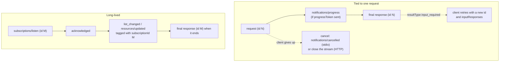

# Operation and Shutdown: The Complete Guide

> 📚 **Before you start**
>
> - [Initialisation: Version and Capability Negotiation](initialisation-version-and-capability-negotiation.md), for how the two sides agree before work starts.
> - [The Transport Layer: stdio and Streamable HTTP](../03-how-mcp-components-talk/the-transport-layer-stdio-and-streamable-http.md), for the stdio pipe and the HTTP POST model.
> - [MCP Primitives: Tools, Resources and Prompts](../02-understanding-mcp/mcp-primitives-tools-resources-and-prompts.md), for the `input_required` round trip.

## Introduction

A busy Udupi restaurant runs on a few unwritten rules. Orders go to the kitchen with a table number, so dishes come back to the right table even if the dosa is ready before the idli ordered earlier. If a family waits long, the waiter says "five more minutes, sir" so they don't walk out. If someone changes their mind, the waiter runs to the kitchen and cancels, and sometimes it's too late and the plate is already on the counter. Regulars can ask to be told when the filter coffee batch is fresh. And at closing time the manager doesn't switch off the lights on people mid-meal: the doors close to new customers, the last plates go out, and only if someone refuses to leave does the security guard step in.

MCP's **operation** and **shutdown** phases are those rules, written down precisely. Operation is everything that happens while client and server are working together: many requests in flight at once, progress updates, cancellations, timeouts, follow-up questions, notification streams and caching. Shutdown is how a connection ends cleanly, and what happens when it doesn't.

By the end of this lesson you'll have run a real stdio server that handles concurrent requests, sends progress, honours cancellation, delivers subscription notifications and shuts down gracefully, and you'll have watched a client force-stop a server that refuses to exit. You'll also know how stateless servers keep state across calls when they genuinely need it.

> 💡 **Key Insight**
>
> During operation, **every request is independent**: it carries its own version and capabilities, it's matched to its reply only by `id`, and it can be cancelled on its own. The only long-lived thing is an explicit `subscriptions/listen` stream. That's why shutdown is so simple: on stdio you close the server's input and wait; on HTTP you just stop sending requests.

---

## Core Explanation

### 1. What happens during operation

Once the client knows the server's era and version, operation is a stream of independent request/response pairs plus a few kinds of notifications.



| Mechanism | Who starts it | Purpose | Section |
|---|---|---|---|
| Concurrent requests | Client | Many calls at once, replies in any order | 2 |
| Progress notifications | Server, if the client asked | "Still working, 60% done" | 3 |
| Timeouts | Client (and server for its own work) | Never wait forever | 4 |
| Cancellation | Client | Stop work nobody wants anymore | 5 |
| Multi round-trip (`input_required`) | Server | Ask for user input mid-request | 6 |
| Subscriptions | Client | Hear about changes without polling | 7 |
| Caching hints | Server | Avoid repeating list calls | 8 |

We'll run all of these against one real server process. Here it is: an expense server that runs each request in its own thread (so requests overlap), sends progress, honours cancellation, supports a subscription, and closes cleanly when its input closes. All of its logging goes to stderr, never stdout.

```python
import json, os, queue, subprocess, sys, tempfile, textwrap, threading, time

SERVER_CODE = textwrap.dedent('''
    import json, sys, threading, time

    out_lock = threading.Lock()
    cancelled = set()                 # request ids the client has cancelled
    subscriptions = {}                # listen request id -> set of watched URIs

    def send(message):
        with out_lock:                # one writer at a time, one message per line
            sys.stdout.write(json.dumps(message) + "\\n")
            sys.stdout.flush()

    def log(*args):
        print(*args, file=sys.stderr, flush=True)

    def result(id_, **fields):
        send({"jsonrpc": "2.0", "id": id_, "result": {"resultType": "complete", **fields}})

    def import_statement(msg):
        rid, token = msg["id"], msg["params"]["_meta"].get("progressToken")
        for step in range(1, 6):
            time.sleep(0.2)                                  # pretend to parse 50 rows
            if rid in cancelled:
                log(f"request {rid} cancelled after step {step - 1}; no reply sent")
                return
            if token is not None:
                send({"jsonrpc": "2.0", "method": "notifications/progress",
                      "params": {"progressToken": token, "progress": step, "total": 5}})
        result(rid, content=[{"type": "text", "text": "Imported 250 rows"}], isError=False)

    def handle(msg):
        method = msg["method"]
        name = msg["params"].get("name")
        if method == "tools/call" and name == "import_statement":
            import_statement(msg)
        elif method == "tools/call" and name == "get_total":
            result(msg["id"], content=[{"type": "text", "text": "Food: Rs 8,450"}], isError=False)
        elif method == "tools/call" and name == "add_expense":
            for sub_id, uris in subscriptions.items():
                if "expense://2026/10/summary" in uris:
                    send({"jsonrpc": "2.0", "method": "notifications/resources/updated",
                          "params": {"uri": "expense://2026/10/summary",
                                     "_meta": {"io.modelcontextprotocol/subscriptionId": sub_id}}})
            result(msg["id"], content=[{"type": "text", "text": "Added Rs 320 for chai"}], isError=False)
        elif method == "subscriptions/listen":
            wanted = msg["params"]["notifications"]
            subscriptions[msg["id"]] = set(wanted.get("resourceSubscriptions", []))
            send({"jsonrpc": "2.0", "method": "notifications/subscriptions/acknowledged",
                  "params": {"notifications": wanted,
                             "_meta": {"io.modelcontextprotocol/subscriptionId": msg["id"]}}})

    stubborn = "--stubborn" in sys.argv
    for line in sys.stdin:                                    # ends when the client closes stdin
        msg = json.loads(line)
        if msg.get("method") == "notifications/cancelled":
            cancelled.add(msg["params"]["requestId"])
            continue
        threading.Thread(target=handle, args=(msg,)).start()   # requests run concurrently

    log("stdin closed")
    if stubborn:
        time.sleep(60)                                        # a badly behaved server ignores EOF
    for sub_id in subscriptions:                              # end every subscription gracefully
        send({"jsonrpc": "2.0", "id": sub_id, "result": {"resultType": "complete",
              "_meta": {"io.modelcontextprotocol/subscriptionId": sub_id}}})
        log(f"closed subscription {sub_id}")
    log("exiting")
''')

SERVER_PATH = os.path.join(tempfile.mkdtemp(), "kharcha_server.py")
with open(SERVER_PATH, "w") as f:
    f.write(SERVER_CODE)
```

And a small client. A background thread reads stdout line by line into a queue, so the client can wait for messages with a timeout. Every request carries the modern `_meta`.

```python
class StdioClient:
    def __init__(self, *extra_args):
        self.proc = subprocess.Popen([sys.executable, SERVER_PATH, *extra_args], stdin=subprocess.PIPE,
                                     stdout=subprocess.PIPE, stderr=subprocess.PIPE, text=True)
        self.inbox, self.next_id = queue.Queue(), 0
        threading.Thread(target=self._read, daemon=True).start()

    def _read(self):
        for line in self.proc.stdout:
            self.inbox.put(json.loads(line))

    def _write(self, message):
        self.proc.stdin.write(json.dumps(message) + "\n")
        self.proc.stdin.flush()

    def request(self, method, progress_token=None, **params):
        self.next_id += 1
        meta = {"io.modelcontextprotocol/protocolVersion": "2026-07-28",
                "io.modelcontextprotocol/clientCapabilities": {}}
        if progress_token:
            meta["progressToken"] = progress_token
        self._write({"jsonrpc": "2.0", "id": self.next_id, "method": method, "params": {**params, "_meta": meta}})
        return self.next_id

    def notify(self, method, **params):
        self._write({"jsonrpc": "2.0", "method": method, "params": params})

    def next_message(self, timeout=2.0):
        return self.inbox.get(timeout=timeout)

def describe(msg):
    if msg.get("method") == "notifications/progress":
        p = msg["params"]
        return f"progress {p['progress']}/{p['total']} (token {p['progressToken']})"
    if "method" in msg:
        sub = msg["params"].get("_meta", {}).get("io.modelcontextprotocol/subscriptionId")
        return f"{msg['method']} (subscription {sub})"
    content = msg["result"].get("content")
    return f"response id={msg['id']}: " + (content[0]["text"] if content else "subscription closed")
```

### 2. Many requests at once, matched by `id`

A client doesn't have to wait for one reply before sending the next request. The server may answer in any order, and the client matches each reply to its request by `id`. Let's start a slow import and, right after it, ask a quick question:

```python
client = StdioClient()
slow = client.request("tools/call", progress_token="imp-1", name="import_statement", arguments={})
quick = client.request("tools/call", name="get_total", arguments={"category": "food"})
print(f"sent id={slow} (slow import) then id={quick} (quick total)")
for _ in range(7):
    print("  <-", describe(client.next_message()))
```

Output:

```
sent id=1 (slow import) then id=2 (quick total)
  <- response id=2: Food: Rs 8,450
  <- progress 1/5 (token imp-1)
  <- progress 2/5 (token imp-1)
  <- progress 3/5 (token imp-1)
  <- progress 4/5 (token imp-1)
  <- progress 5/5 (token imp-1)
  <- response id=1: Imported 250 rows
```

The quick answer (id 2) arrived **before** the slow one (id 1) finished. A client that assumed replies come back in order would have given the import's answer to the wrong question. Two rules make this safe:

- Request ids must be unique among requests still in flight from that client (and never `null`).
- The client keeps a table of pending ids, and hands each reply to whoever is waiting on that id.

### 3. Progress notifications

The import above sent five `notifications/progress` messages because the client opted in by putting a `progressToken` in `_meta`. The rules:

| Rule | Detail |
|---|---|
| Opt-in only | No `progressToken` in the request, no progress messages |
| Token | Any string or integer chosen by the client, unique among its active requests |
| Fields | `progress` (must increase every time), optional `total`, optional human `message` |
| Where they flow | On stdio, the shared stdout. On HTTP, the SSE response stream **of that request** |
| When they stop | Once the final response is sent |

Progress has a second job: it tells the client that work is really happening, which matters for timeouts.

### 4. Timeouts

Every implementation **should** set a timeout on every request it sends. Without one, a hung server ties up the client forever. When a timeout fires, the sender **should** cancel the request (next section) and stop waiting.

A good client uses two clocks:

- An **idle timeout** that resets whenever a progress notification arrives for the request ("no news for 30 seconds means something is wrong").
- A **hard maximum** that progress cannot extend ("never more than 10 minutes, whatever the server says"), so a misbehaving server can't keep a request alive forever by sending fake progress.

```python
class RequestDeadline:
    def __init__(self, start, idle_s, max_s):
        self.start, self.idle_s, self.max_s = start, idle_s, max_s
        self.last_news = start

    def on_progress(self, now):
        self.last_news = now                       # progress proves the server is alive

    def expired(self, now):
        if now - self.start >= self.max_s:
            return "hard maximum reached"
        if now - self.last_news >= self.idle_s:
            return "no progress for too long"
        return None

d = RequestDeadline(start=0, idle_s=30, max_s=600)
for now, event in [(20, "progress"), (45, "progress"), (70, None), (80, None), (590, "progress"), (600, None)]:
    if event:
        d.on_progress(now)
    print(f"t={now:>3}s {event or '-':<8} -> {d.expired(now) or 'keep waiting'}")
```

Output:

```
t= 20s progress -> keep waiting
t= 45s progress -> keep waiting
t= 70s -        -> keep waiting
t= 80s -        -> no progress for too long
t=590s progress -> keep waiting
t=600s -        -> hard maximum reached
```

At `t=80` the request expired because 35 seconds had passed since the last progress at `t=45`; a real client would cancel it right there. The last two lines show the other rule: even with fresh progress at `t=590`, the hard maximum ends the request at `t=600`.

### 5. Cancellation

When the user presses stop, or a timeout fires, the client should tell the server so it can stop wasting effort. **How** depends on the transport:

| Transport | How the client cancels |
|---|---|
| **stdio** | Send `notifications/cancelled` with the `requestId` and an optional `reason`. There's no per-request stream to close. |
| **Streamable HTTP** | Close the SSE response stream of that request. The server **must** treat the disconnect as cancellation. No notification is needed. |

Let's cancel an import after two progress updates:

```python
rid = client.request("tools/call", progress_token="imp-2", name="import_statement", arguments={})
print("  <-", describe(client.next_message()))
print("  <-", describe(client.next_message()))
client.notify("notifications/cancelled", requestId=rid, reason="User pressed stop")
print(f"  -> notifications/cancelled for id={rid}")
try:
    client.next_message(timeout=1.0)
except queue.Empty:
    print(f"  no further messages for id={rid}, as the spec expects")
```

Output:

```
  <- progress 1/5 (token imp-2)
  <- progress 2/5 (token imp-2)
  -> notifications/cancelled for id=3
  no further messages for id=3, as the spec expects
```

What each side must do:

- **Client**: only cancel requests it sent and believes are still running; ignore any reply that arrives after it cancelled.
- **Server**: stop work, free resources and **not** send a response for the cancelled request. It may ignore the notice if the request is unknown, already finished, or can't be stopped.
- **Both**: handle the race gracefully. The notice can cross a reply on the wire. That's why the client must be ready to discard a late reply, and why a server must never treat a cancel for an unknown id as an error.

Servers send `notifications/cancelled` for exactly one purpose: to end a `subscriptions/listen` stream on stdio (section 7). Never for anything else.

### 6. Asking for more input mid-request

You met **multi round-trip requests** in the primitives lesson: instead of sending its own request to the client, the server replies with `resultType: "input_required"`, the client collects the answers and **retries the original request with a new id**, echoing `requestState` untouched. In lifecycle terms, three points matter:

- The first request is **finished** when the `input_required` result arrives. Nothing is left open on the server, so the server can restart, or a different server instance can take the retry.
- Only `tools/call`, `resources/read` and `prompts/get` may return `input_required`.
- The server must assume the client might never retry. Anything that needs cleanup can't depend on the retry arriving.

### 7. Subscriptions: hearing about changes

Some events have no request to ride on: "the tool list changed", "the October summary was updated". For those, the client opens a long-lived `subscriptions/listen` request and says exactly what it wants to hear about:

```json
{
  "jsonrpc": "2.0",
  "id": 4,
  "method": "subscriptions/listen",
  "params": {
    "_meta": {"io.modelcontextprotocol/protocolVersion": "2026-07-28",
              "io.modelcontextprotocol/clientCapabilities": {}},
    "notifications": {"toolsListChanged": true, "resourceSubscriptions": ["expense://2026/10/summary"]}
  }
}
```

| Filter field | Delivers |
|---|---|
| `toolsListChanged` | `notifications/tools/list_changed` |
| `promptsListChanged` | `notifications/prompts/list_changed` |
| `resourcesListChanged` | `notifications/resources/list_changed` |
| `resourceSubscriptions` | `notifications/resources/updated` for those URIs |

The rules:

1. The server's **first** message on the stream must be `notifications/subscriptions/acknowledged`, listing the subset it agreed to (types it doesn't support are left out). The client should compare it with what it asked for.
2. Every notification on the stream carries `io.modelcontextprotocol/subscriptionId` in `_meta`, equal to the `id` of the listen request. On stdio, where everything shares one pipe, that's how the client tells subscriptions apart.
3. The server must not send notification types the client didn't ask for.
4. A subscription ends when the client cancels it (close the stream on HTTP, `notifications/cancelled` on stdio), when the server ends it (it **should** first send a normal result for the listen request, tagged with the subscription id, then close), or when the transport dies.

```python
sub = client.request("subscriptions/listen",
                     notifications={"resourceSubscriptions": ["expense://2026/10/summary"]})
print("  <-", describe(client.next_message()))
client.request("tools/call", name="add_expense", arguments={"amount": 320, "category": "chai"})
print("  <-", describe(client.next_message()))
print("  <-", describe(client.next_message()))
```

Output:

```
  <- notifications/subscriptions/acknowledged (subscription 4)
  <- notifications/resources/updated (subscription 4)
  <- response id=5: Added Rs 320 for chai
```

When the client sees `resources/updated`, it re-reads `expense://2026/10/summary` with `resources/read` if it still needs it. Notifications tell you **that** something changed; they don't carry the new data.

Request-scoped messages (progress, and the deprecated log messages) never travel on the listen stream. They always flow with the request they belong to.

### 8. Caching during operation

Lists don't change often, so the server tells the client how long it may reuse an answer. Results of `tools/list`, `prompts/list`, `resources/list`, `resources/templates/list`, `resources/read` and `server/discover` carry:

- `ttlMs`: how many milliseconds the answer stays fresh.
- `cacheScope`: `"public"` (a shared cache may store it) or `"private"` (only this user's client).

A typical client caches `tools/list` for `ttlMs`, drops the cache early when `notifications/tools/list_changed` arrives, and never shares a `"private"` answer between users. Servers should also return tools in a **stable order**, so caches (including the model provider's prompt cache) keep hitting.

### 9. Keeping state without sessions: explicit handles

"Stateless" doesn't mean a server can't remember anything. It means the **protocol** doesn't remember anything for you. When a workflow genuinely spans several calls (a shopping cart, a draft email, a multi-step booking), the server mints an **explicit handle**, returns it in a tool result, and the model passes it back as an ordinary tool argument. The data lives in a store every server instance can reach (a database or Redis), keyed by the handle.

Here's why that matters, with two server instances behind a load balancer:

```python
SHARED_STORE = {}                          # stands in for Redis or a database

class TripServer:
    def __init__(self, name):
        self.name, self.memory = name, {}  # memory: what a session-style server would rely on

    def create_trip(self, city):
        handle = f"trip-{len(SHARED_STORE) + 1:04d}"
        SHARED_STORE[handle] = [city]
        self.memory["current_trip"] = handle
        return handle

    def add_stop_using_session(self, city):
        handle = self.memory.get("current_trip")
        if handle is None:
            return f"{self.name}: error, no trip in this session"
        SHARED_STORE[handle].append(city)
        return f"{self.name}: added {city}"

    def add_stop(self, trip_id, city):     # stateless: the handle comes in as an argument
        if trip_id not in SHARED_STORE:
            return f"{self.name}: error, unknown trip {trip_id}"
        SHARED_STORE[trip_id].append(city)
        return f"{self.name}: added {city} to {trip_id}"

a, b = TripServer("instance-A"), TripServer("instance-B")
trip = a.create_trip("Jaipur")                      # first call lands on A
print(b.add_stop_using_session("Udaipur"))          # load balancer sends the next call to B
print(b.add_stop(trip, "Udaipur"))                  # same call, with an explicit handle
print(trip, "->", SHARED_STORE[trip])
```

Output:

```
instance-B: error, no trip in this session
instance-B: added Udaipur to trip-0001
trip-0001 -> ['Jaipur', 'Udaipur']
```

The session-style call fails on instance B because B never saw the trip. The handle-style call works on any instance. Two more habits for handles: make them unguessable in production (random or signed, not a counter like our demo), and check on every call that the handle belongs to the authenticated user.

### 10. Shutdown on stdio

Shutdown is where the stateless design pays off: there's no session to tear down, no goodbye message. On stdio the **client** ends things like this:

1. Close the server's **stdin**.
2. Wait for the server to exit.
3. If it doesn't exit in a reasonable time, force it: `SIGTERM`, then `SIGKILL` on Linux and macOS (on Windows, `TerminateProcess` or Job Objects).

The server's side: exit promptly when stdin closes or a read returns end-of-file. That's the main graceful signal and the only portable one. Before exiting, a server that has open subscriptions **should** send each one its final result so the client knows it ended cleanly. A server **may** also decide to stop on its own by closing stdout and exiting.

```python
client.proc.stdin.close()                          # step 1: no more requests
print("  <-", describe(client.next_message()))     # the subscription's graceful end
print("exit code:", client.proc.wait(timeout=3))   # step 2: wait
print("server stderr:")
print(client.proc.stderr.read().rstrip())
client.proc.stdout.close(); client.proc.stderr.close()
```

Output:

```
  <- response id=4: subscription closed
exit code: 0
server stderr:
request 3 cancelled after step 2; no reply sent
stdin closed
closed subscription 4
exiting
```

Read the stderr log from top to bottom and you can see the whole operation phase: the cancelled import, then the clean shutdown with its subscription closed.

Now a server that ignores the closed input. A client must not hang forever on it:

```python
def shutdown(proc, grace_s=0.5):
    proc.stdin.close()
    try:
        return proc.wait(timeout=grace_s), "exited by itself"
    except subprocess.TimeoutExpired:
        proc.terminate()                           # SIGTERM on Linux and macOS
    try:
        return proc.wait(timeout=grace_s), "stopped by SIGTERM"
    except subprocess.TimeoutExpired:
        proc.kill()                                # SIGKILL: cannot be ignored
        return proc.wait(), "stopped by SIGKILL"

polite = StdioClient()
print("polite server:  ", shutdown(polite.proc))
stubborn = StdioClient("--stubborn")
print("stubborn server:", shutdown(stubborn.proc))
for c in (polite, stubborn):
    c.proc.stdout.close(); c.proc.stderr.close()
```

Output:

```
polite server:   (0, 'exited by itself')
stubborn server: (-15, 'stopped by SIGTERM')
```

A negative exit code on Linux and macOS means "killed by that signal number": `-15` is `SIGTERM`.

**Unexpected termination.** If a stdio server crashes, the client should restart it. Because the protocol is stateless, the in-flight requests are simply lost and can be retried against the new process, and any subscriptions must be opened again (the server keeps no subscription state across restarts).

### 11. Shutdown on Streamable HTTP

On HTTP there's nothing to shut down. Each request is its own POST, so a client that's finished just stops sending. A few loose ends:

- Open `subscriptions/listen` streams: close them, which cancels them. When the **server** shuts down (say, during a deploy), it should send each open subscription its final result and then close the stream; a client that sees a stream close **without** that result may reconnect.
- A response stream that breaks mid-request loses that request. Since `2026-07-28` there's no resumption (`Last-Event-ID` was removed), so the client re-sends it as a **new request with a new id**.
- Legacy sessions ended with an HTTP `DELETE` carrying `Mcp-Session-Id`. A modern server answers `DELETE` with `405`.

### 12. Operation and shutdown in the legacy era

For completeness, here's what changed for the operation and shutdown phases in `2026-07-28`:

| Legacy (`2025-11-25` and earlier) | Modern (`2026-07-28`) |
|---|---|
| `ping` request to check the other side is alive | Removed; use timeouts and transport-level health checks |
| `logging/setLevel` request for the session | Removed; opt in per request with `_meta["io.modelcontextprotocol/logLevel"]` (logging itself is deprecated) |
| `resources/subscribe` and `resources/unsubscribe` | Replaced by `subscriptions/listen` |
| HTTP GET stream for server-initiated messages | Replaced by `subscriptions/listen` on a POST |
| Server sends `elicitation/create`, `sampling/createMessage` or `roots/list` as its own requests | Server returns `input_required`; the client retries |
| SSE event ids and `Last-Event-ID` for resuming broken streams | Removed; re-issue the request |
| HTTP `DELETE` to end a session | Removed with sessions |

---

## Try It Yourself

1. **Out of order on purpose.** Using `StdioClient`, send `get_total` three times while one `import_statement` is running. In what order do the replies arrive, and how does your code know which is which?
2. **Cancel before it starts.** Send `import_statement`, then immediately send `notifications/cancelled` for it, before any progress arrives. What does the server log at shutdown?
3. **A misbehaving deadline.** A server sends progress every 10 seconds forever. With `RequestDeadline(start=0, idle_s=30, max_s=600)`, when does the client give up?

<details>
<summary>Show answers</summary>

**1.** The three quick replies arrive first, then the import's progress and reply. Each reply carries the `id` of its request, so the client matches by id, not by order.

```python
c = StdioClient()
slow = c.request("tools/call", name="import_statement", arguments={})
quick_ids = [c.request("tools/call", name="get_total", arguments={"category": "food"}) for _ in range(3)]
replies = []
while len(replies) < 4:
    msg = c.next_message()
    if "id" in msg:
        replies.append(msg["id"])
print("sent:", [slow] + quick_ids, "| first three replies (sorted):", sorted(replies[:3]), "| last:", replies[3])
shutdown(c.proc); c.proc.stdout.close(); c.proc.stderr.close()
```

Output:

```
sent: [1, 2, 3, 4] | first three replies (sorted): [2, 3, 4] | last: 1
```

We sort the first three before printing because they can arrive in any order among themselves: each runs in its own thread. That unpredictability is exactly why matching by id matters.

**2.** The cancel arrives before the first step finishes, so the server stops after step 0 and never replies:

```python
c = StdioClient()
rid = c.request("tools/call", name="import_statement", arguments={})
c.notify("notifications/cancelled", requestId=rid, reason="changed my mind")
time.sleep(0.5)
shutdown(c.proc)
print(c.proc.stderr.read().splitlines()[0])
c.proc.stdout.close(); c.proc.stderr.close()
```

Output:

```
request 1 cancelled after step 0; no reply sent
```

**3.** Never by the idle rule, because progress keeps resetting it, but the hard maximum ends it at 600 seconds. That's exactly why the spec says to enforce a maximum regardless of progress.

```python
d = RequestDeadline(start=0, idle_s=30, max_s=600)
now = 0
while not d.expired(now):
    now += 10
    d.on_progress(now)
print(f"gave up at t={now}s: {d.expired(now)}")
```

Output:

```
gave up at t=600s: hard maximum reached
```

</details>

---

## Real-World Examples

- **Claude Desktop and other hosts** start stdio servers when they launch and stop them by closing stdin when you quit or disable a server; a server that ignores this is the usual cause of "zombie" processes after quitting.
- **IDE agents** run many tool calls in parallel (read three files, search the codebase), relying on id matching exactly as in section 2.
- **Long imports and builds** (database migrations, CI runs) send progress so the host can show a progress bar and keep its idle timeout from firing.
- **Serverless deployments** (Cloud Run, Lambda behind an API gateway) work well with modern MCP because each POST stands alone and explicit handles live in a shared database.

---

## Common Misconceptions

### "Replies come back in the order requests were sent"

They can come back in any order. Always match by `id`.

### "Cancelling guarantees the work stopped"

It's a request, not a command. The work may already be finished, or impossible to stop. The client just stops caring and ignores any late reply.

### "Stateless servers can't do multi-step workflows"

They can, with explicit handles stored in shared storage and passed as tool arguments. What's gone is hidden per-connection state.

### "A notification tells me the new value"

`resources/updated` and the `list_changed` notices only say *something changed*. The client fetches the new data itself.

### "Killing the server process is the normal way to stop it"

Closing stdin is the normal way. `SIGTERM` and `SIGKILL` are the fallback for servers that don't exit.

---

## Interview Relevance

*"Walk me through the MCP lifecycle after initialisation."* A strong answer covers concurrent requests matched by id, opt-in progress via `progressToken`, timeouts with an idle clock reset by progress plus a hard cap, cancellation (`notifications/cancelled` on stdio, closing the stream on HTTP, with race handling), `input_required` retries, `subscriptions/listen` with its acknowledgement, `subscriptionId` tagging and graceful closure, and cache hints. Then shutdown: close stdin, wait, `SIGTERM`, `SIGKILL` on stdio; nothing special on HTTP; restart and retry after a crash because nothing is lost but in-flight requests.

*"How do you keep state across calls if MCP is stateless?"* Server-minted handles passed as tool arguments, backed by shared storage, unguessable and checked against the caller's identity. Mention why sessions were removed: horizontal scaling and restarts.

---

## Key Takeaways

- **Requests are independent**: replies arrive in any order and are matched by `id`; each request can be cancelled, timed out or retried on its own.
- **Progress is opt-in** with a `progressToken`, and lets clients reset an idle timeout; always keep a hard maximum too.
- **Cancel on stdio with `notifications/cancelled`, on HTTP by closing the stream**, and handle the race where a reply crosses the cancel.
- **`subscriptions/listen` is the only long-lived stream**: acknowledged first, every notification tagged with the subscription id, ended with a final result when the server closes it.
- **Shutdown is simple**: close stdin and wait, then `SIGTERM` and `SIGKILL` if needed; on HTTP just stop. Cross-call state lives behind explicit handles, not sessions.

---

**Up next:** [Open MCP Registries (Smithery)](../05-building-with-mcp/open-mcp-registries-smithery.md)
