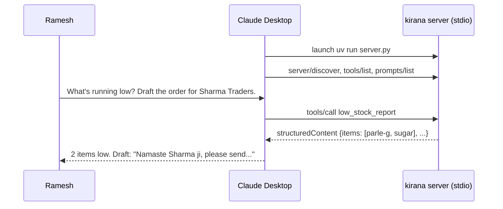

# Building a Local MCP Server with FastMCP: The Complete Guide

> 📚 **Before you start**
>
> - [MCP Primitives: Tools, Resources and Prompts](../02-understanding-mcp/mcp-primitives-tools-resources-and-prompts.md), for what a server offers.
> - [The Transport Layer: stdio and Streamable HTTP](../03-how-mcp-components-talk/the-transport-layer-stdio-and-streamable-http.md), where you wrote a stdio server by hand.
> - [Operation and Shutdown](../04-the-mcp-lifecycle/operation-and-shutdown.md), for progress, cancellation and clean exit.
> - [Open MCP Registries (Smithery)](open-mcp-registries-smithery.md), so you first checked that no one has built your server already.

## Introduction

Ramesh runs a kirana store in Pune. He keeps his stock in a notebook: rice 40 kg, toor dal 12 kg, Parle-G 3 cartons. Every evening he flips through it to decide what to reorder. His daughter wants him to just *ask* his laptop: "What's running low? Draft the WhatsApp order for the supplier." For that, Claude needs a way to read and update his stock. That's an MCP server, and because the data lives on his laptop, it's a **local** one.

You already wrote stdio servers by hand with `json` and a `for line in sys.stdin` loop. That's perfect for learning, and painful for real work: you'd have to write JSON Schemas by hand, validate arguments, format errors, handle `server/discover`, the legacy `initialize` handshake, progress, cancellation, pagination and caching. **FastMCP** removes all of that. You write ordinary Python functions with type hints and docstrings, put a decorator on them, and the framework turns them into tools, resources and prompts that speak correct MCP.

By the end of this lesson you'll understand exactly what FastMCP does under the hood (you'll build a miniature version that runs right here), and you'll be able to write a real local server with the official Python SDK or the standalone `fastmcp` package, test it with the MCP Inspector, and install it in Claude Desktop.

> 💡 **Key Insight**
>
> In FastMCP, **your function signature is the tool's contract**. The function name becomes the tool name, the docstring becomes the description the model reads, the type hints become the JSON Schema, and the return type decides whether the result is plain text or structured data. Write the Python carefully, and the MCP side writes itself.

---

## Core Explanation

### 1. One name, two packages

"FastMCP" means two related things in 2026, and tutorials mix them up:

| | Official SDK: `mcp` (2.x) | Standalone: `fastmcp` (4.x) |
|---|---|---|
| Install | `uv add "mcp[cli]"` | `uv add fastmcp` |
| Server class | `from mcp.server.mcpserver import MCPServer` | `from fastmcp import FastMCP` |
| Decorators | `@mcp.tool()`, `@mcp.resource("uri")`, `@mcp.prompt()` (parentheses required) | `@mcp.tool` (parentheses optional), `@mcp.resource("uri")`, `@mcp.prompt` |
| Maintained by | The MCP project | The FastMCP project (Prefect) |
| Extras | The reference implementation of the spec | Proxies, server composition, OpenAPI import, deploy and install CLIs, many auth providers |

The history explains the confusion. FastMCP started as an independent project; its first version was folded into the official SDK as `mcp.server.fastmcp.FastMCP`. In version 2 of the official SDK that class was **renamed `MCPServer`**, and importing `mcp.server.fastmcp` now fails with a message pointing you to the migration guide. Meanwhile the standalone project kept the `FastMCP` name and grew into a larger framework. Code you find online written as `from mcp.server.fastmcp import FastMCP` is **SDK 1.x code**.

Both work the same way for everything in this lesson. We'll use the official SDK's `MCPServer` as the main example and show the `fastmcp` spelling alongside.

### 2. What the decorator does: a miniature FastMCP you can run

Before using the real thing, let's build a tiny version so nothing is magic. It does the three jobs that matter most: turning a function signature into a JSON Schema with `pydantic`, validating arguments before calling your function, and turning return values into MCP content.

```python
import inspect, json
from typing import Annotated, get_type_hints
from pydantic import BaseModel, Field, ValidationError, create_model

def clean(schema):
    """Drop pydantic's auto 'title' keys so the schema reads like hand-written JSON Schema."""
    if isinstance(schema, dict):
        return {k: clean(v) for k, v in schema.items() if k != "title"}
    if isinstance(schema, list):
        return [clean(v) for v in schema]
    return schema

class MiniFastMCP:
    def __init__(self, name):
        self.name, self.tools = name, {}

    def tool(self):
        def register(fn):
            hints = get_type_hints(fn, include_extras=True)
            fields = {}
            for pname, param in inspect.signature(fn).parameters.items():
                default = ... if param.default is inspect.Parameter.empty else param.default
                fields[pname] = (hints[pname], default)
            args_model = create_model(f"{fn.__name__}_args", **fields)       # one model per tool
            returns = hints.get("return")
            structured = isinstance(returns, type) and issubclass(returns, BaseModel)
            definition = {"name": fn.__name__,
                          "description": inspect.getdoc(fn).split("\n\n")[0],
                          "inputSchema": clean(args_model.model_json_schema())}
            if structured:
                definition["outputSchema"] = clean(returns.model_json_schema())
            self.tools[fn.__name__] = (fn, args_model, structured, definition)
            return fn
        return register

    def handle(self, msg):
        if msg["method"] == "tools/list":
            result = {"tools": [t[3] for t in self.tools.values()]}
        elif msg["method"] == "tools/call":
            fn, args_model, structured, _ = self.tools[msg["params"]["name"]]
            try:
                args = args_model.model_validate(msg["params"].get("arguments", {}))
                value = fn(**dict(args))
            except ValidationError as e:                  # bad arguments: tell the model, as a tool error
                problem = e.errors()[0]
                text = f"Invalid argument {problem['loc'][0]!r}: {problem['msg']}"
                result = {"content": [{"type": "text", "text": text}], "isError": True}
            except ValueError as e:                        # a failure the tool anticipated
                result = {"content": [{"type": "text", "text": str(e)}], "isError": True}
            else:
                if structured:
                    data = value.model_dump()
                    result = {"content": [{"type": "text", "text": json.dumps(data)}],
                              "structuredContent": data, "isError": False}
                else:
                    result = {"content": [{"type": "text", "text": str(value)}], "isError": False}
        return {"jsonrpc": "2.0", "id": msg["id"], "result": {"resultType": "complete", **result}}
```

Now Ramesh's server, written the way you'd write it with the real FastMCP:

```python
STOCK = {"rice": 40.0, "toor dal": 12.0, "sugar": 4.5, "parle-g": 3.0}   # kg, or cartons
REORDER_AT = {"rice": 20, "toor dal": 10, "sugar": 5, "parle-g": 4}

class LowStockReport(BaseModel):
    items: list[str]
    message: str

kirana = MiniFastMCP("kirana")

@kirana.tool()
def check_stock(item: Annotated[str, Field(description="Item name, e.g. 'toor dal'")]) -> str:
    """Return how much of one item is in stock."""
    if item.lower() not in STOCK:
        raise ValueError(f"Unknown item {item!r}. Known items: {', '.join(sorted(STOCK))}")
    return f"{item}: {STOCK[item.lower()]} in stock"

@kirana.tool()
def restock(item: str, quantity: Annotated[float, Field(gt=0, le=500)]) -> str:
    """Add newly delivered stock for an item.

    Use only after the delivery has actually arrived.
    """
    STOCK[item.lower()] = STOCK.get(item.lower(), 0) + quantity
    return f"{item}: now {STOCK[item.lower()]}"

@kirana.tool()
def low_stock_report() -> LowStockReport:
    """List items at or below their reorder level."""
    low = sorted(i for i, qty in STOCK.items() if qty <= REORDER_AT[i])
    return LowStockReport(items=low, message=f"{len(low)} item(s) need reordering")

listing = kirana.handle({"jsonrpc": "2.0", "id": 1, "method": "tools/list"})
print(json.dumps(listing["result"]["tools"][1], indent=2))
```

Output:

```
{
  "name": "restock",
  "description": "Add newly delivered stock for an item.",
  "inputSchema": {
    "properties": {
      "item": {
        "type": "string"
      },
      "quantity": {
        "exclusiveMinimum": 0,
        "maximum": 500,
        "type": "number"
      }
    },
    "required": [
      "item",
      "quantity"
    ],
    "type": "object"
  }
}
```

Look at what came from where:

| In the tool definition | Came from |
|---|---|
| `"name": "restock"` | The function name |
| `"description"` | The first paragraph of the docstring (the second paragraph stays in your code; real FastMCP sends the whole docstring) |
| `"type": "number"`, `"exclusiveMinimum": 0`, `"maximum": 500` | `float` and `Field(gt=0, le=500)` |
| `"required": ["item", "quantity"]` | Parameters with no default |

Now some calls, including two that fail in different ways:

```python
def call(name, **arguments):
    reply = kirana.handle({"jsonrpc": "2.0", "id": 2, "method": "tools/call",
                           "params": {"name": name, "arguments": arguments}})["result"]
    tag = "ERROR" if reply["isError"] else "ok"
    print(f"{name}({arguments}) -> {tag}: {reply['content'][0]['text']}")
    return reply

call("check_stock", item="toor dal")
call("check_stock", item="atta")
call("restock", item="sugar", quantity=-5)
report = call("low_stock_report")
print("structuredContent:", report["structuredContent"])
```

Output:

```
check_stock({'item': 'toor dal'}) -> ok: toor dal: 12.0 in stock
check_stock({'item': 'atta'}) -> ERROR: Unknown item 'atta'. Known items: parle-g, rice, sugar, toor dal
restock({'item': 'sugar', 'quantity': -5}) -> ERROR: Invalid argument 'quantity': Input should be greater than 0
low_stock_report({}) -> ok: {"items": ["parle-g", "sugar"], "message": "2 item(s) need reordering"}
structuredContent: {'items': ['parle-g', 'sugar'], 'message': '2 item(s) need reordering'}
```

Two kinds of failure, both reported as **tool results with `isError: true`**, not protocol errors, so the model can read the message and fix its call: a validation failure from the schema, and an anticipated failure raised by your code. The structured tool returned both a JSON text block (for clients that only show text) and `structuredContent` that matches its `outputSchema` (for clients and code that want data).

That's the core of FastMCP. The real frameworks add: async functions, resources and prompts, a `Context` object for progress and logging, all the lifecycle and transport handling, and the dual-era support you studied in Module 4.

### 3. The real server with the official SDK

Set up a project with `uv` (a fast Python project manager):

```bash
uv init kirana-server
cd kirana-server
uv add "mcp[cli]"
```

Then write `server.py`:

```python
# not-run: needs the `mcp` package (2.x)
import logging
from typing import Annotated

from pydantic import BaseModel, Field
from mcp.server.mcpserver import Context, MCPServer
from mcp.server.mcpserver.exceptions import ToolError
from mcp.types import ToolAnnotations

logging.basicConfig(level=logging.INFO)          # logs go to stderr, never stdout
log = logging.getLogger("kirana")

STOCK = {"rice": 40.0, "toor dal": 12.0, "sugar": 4.5, "parle-g": 3.0}
REORDER_AT = {"rice": 20, "toor dal": 10, "sugar": 5, "parle-g": 4}

mcp = MCPServer(
    "kirana",
    instructions="Quantities are in kg except biscuits, which are in cartons.",
)

class LowStockReport(BaseModel):
    items: list[str]
    message: str

@mcp.tool(annotations=ToolAnnotations(read_only_hint=True))
def check_stock(item: Annotated[str, Field(description="Item name, e.g. 'toor dal'")]) -> str:
    """Return how much of one item is in stock."""
    if item.lower() not in STOCK:
        raise ToolError(f"Unknown item {item!r}. Known items: {', '.join(sorted(STOCK))}")
    return f"{item}: {STOCK[item.lower()]} in stock"

@mcp.tool(annotations=ToolAnnotations(read_only_hint=False, destructive_hint=False))
def restock(item: str, quantity: Annotated[float, Field(gt=0, le=500)]) -> str:
    """Add newly delivered stock for an item. Use only after the delivery has arrived."""
    STOCK[item.lower()] = STOCK.get(item.lower(), 0) + quantity
    log.info("restocked %s by %s", item, quantity)
    return f"{item}: now {STOCK[item.lower()]}"

@mcp.tool(annotations=ToolAnnotations(read_only_hint=True))
async def low_stock_report(ctx: Context) -> LowStockReport:
    """List items at or below their reorder level."""
    low = []
    for n, (item, qty) in enumerate(sorted(STOCK.items()), start=1):
        await ctx.report_progress(n, len(STOCK), f"checked {item}")
        if qty <= REORDER_AT[item]:
            low.append(item)
    return LowStockReport(items=low, message=f"{len(low)} item(s) need reordering")

@mcp.resource("kirana://stock/{item}", mime_type="text/plain")
def stock_resource(item: str) -> str:
    """Current stock of one item, for the app to attach as context."""
    return f"{item}: {STOCK.get(item.lower(), 0)}"

@mcp.prompt()
def reorder_message(supplier: str) -> str:
    """Draft a polite WhatsApp reorder message for a supplier."""
    return (f"Use low_stock_report, then write a short, polite WhatsApp message to {supplier} "
            "ordering enough of each low item to reach twice its reorder level. Use Hindi-English mix.")

if __name__ == "__main__":
    mcp.run()                                      # stdio by default
```

What each piece does:

| Code | MCP result |
|---|---|
| `MCPServer("kirana", instructions=...)` | Name in `serverInfo`; `instructions` in `server/discover` (and `initialize` for legacy clients) |
| `@mcp.tool()` | Entry in `tools/list`; handler for `tools/call`. The parentheses are required in SDK 2.x |
| `ToolAnnotations(read_only_hint=True)` | `annotations: {"readOnlyHint": true}`, a hint to hosts deciding whether to ask for approval |
| `raise ToolError(...)` | A result with `isError: true` and your message. Any **other** exception becomes a generic "Error executing tool" so internal details don't leak |
| `-> LowStockReport` | `outputSchema` plus `structuredContent` in results |
| `ctx: Context` | Injected by the framework, hidden from the schema. `ctx.report_progress` sends `notifications/progress` only if the client asked for progress |
| `@mcp.resource("kirana://stock/{item}")` | A **resource template**; `{item}` becomes a function argument |
| `@mcp.prompt()` | Entry in `prompts/list`; `supplier` becomes a prompt argument |
| `mcp.run()` | Runs over stdio; also answers `server/discover`, legacy `initialize`, pagination and caching hints |

Python's SDK models use snake_case attribute names (`read_only_hint`, `is_error`) and convert them to the camelCase field names the spec uses (`readOnlyHint`, `isError`) on the wire.

The same server with the standalone package differs only in a few lines:

```python
# not-run: needs the `fastmcp` package (4.x)
from fastmcp import Context, FastMCP
from fastmcp.exceptions import ToolError

mcp = FastMCP("kirana", instructions="Quantities are in kg except biscuits, which are in cartons.")

@mcp.tool(annotations={"readOnlyHint": True})        # bare @mcp.tool also works in fastmcp
def check_stock(item: str) -> str:
    """Return how much of one item is in stock."""
    ...

if __name__ == "__main__":
    mcp.run()                                         # stdio by default
```

### 4. Rules for local stdio servers

Everything from the transport lesson still applies, and FastMCP helps with most of it:

- **Never print to stdout.** Use `logging` (which writes to stderr by default) or `print(..., file=sys.stderr)`. A stray `print("loaded!")` breaks the protocol.
- **Use absolute paths** for any files your server reads. Hosts start servers from their own working directory, not your project folder.
- **Read secrets from environment variables** (`os.environ["SUPPLIER_API_KEY"]`), set in the host's config `env` block. Never hard-code them.
- **Keep startup fast.** Hosts may time out a server that takes many seconds to start; load big things lazily on first use.
- **Return helpful errors.** "Unknown item 'atta'. Known items: parle-g, rice, sugar, toor dal" lets the model recover on its own.

### 5. Trying it with the MCP Inspector

The **MCP Inspector** is a small web app for poking at a server by hand: list tools, fill in arguments, call them, read resources, see raw JSON-RPC messages and the server's stderr. Two ways to start it:

```bash
# The SDK's dev command: runs your server under the Inspector
uv run mcp dev server.py

# Or run the Inspector directly against any command
npx @modelcontextprotocol/inspector uv run server.py
```

A browser tab opens. Click **Connect**, open the **Tools** tab, pick `check_stock`, type `atta` and run it. You should see the `isError` result with your helpful message. Then try `low_stock_report` and look at the structured result. Make a habit of this: **every tool should be tried in the Inspector before a model ever sees it**, because it's the fastest way to catch a bad description or schema.

### 6. Testing without any process: the in-memory client

For automated tests, you don't need a subprocess at all. The SDK's `Client` accepts an `MCPServer` object directly and connects to it in memory:

```python
# not-run: needs the `mcp` package (2.x)
import asyncio
import pytest
from mcp import Client
from server import mcp

@pytest.mark.anyio
async def test_unknown_item_is_a_tool_error():
    async with Client(mcp) as client:
        result = await client.call_tool("check_stock", {"item": "atta"})
        assert result.is_error
        assert "Known items" in result.content[0].text

async def main():
    async with Client(mcp) as client:
        tools = await client.list_tools()
        print([t.name for t in tools.tools])

asyncio.run(main())
```

Example output:

```
['check_stock', 'restock', 'low_stock_report']
```

This runs the whole protocol path (schemas, validation, results) with no pipes, so tests are fast and deterministic.

### 7. Installing it in Claude Desktop

You can edit `claude_desktop_config.json` by hand as in Module 3:

```json
{
  "mcpServers": {
    "kirana": {
      "command": "uv",
      "args": ["--directory", "/Users/ramesh/kirana-server", "run", "server.py"]
    }
  }
}
```

Or let a CLI write it for you:

```bash
uv run mcp install server.py --name kirana          # official SDK
fastmcp install claude-desktop server.py             # standalone fastmcp
```

Restart Claude Desktop, check that the `kirana` tools appear, and ask: *"What's running low? Draft the order for Sharma Traders."* Claude should call `low_stock_report`, and you can use the `reorder_message` prompt from the prompt menu.



### 8. Designing the tools well

The framework handles the protocol; the **quality** of the server is still on you. The lessons from [Designing Good Tools](../../agentic-ai-fundamentals/04-tools-and-function-calling/designing-good-tools.md) apply directly:

| Do | Why |
|---|---|
| Name tools as verbs with clear objects: `check_stock`, `restock` | The model picks tools by name and description |
| Write docstrings for the model: what it does, when to use it, what it returns | The docstring **is** the description |
| Constrain inputs with types, `Literal[...]`, `Field(gt=0)` | Bad calls fail fast with a readable message |
| Return just enough: summaries, ids, pagination | Large outputs waste the model's context |
| Mark read-only tools with `read_only_hint` and risky ones with `destructive_hint` | Hosts use these hints when deciding what needs your approval |
| Keep the tool count small and focused | Many overlapping tools confuse the model |

---

## Try It Yourself

1. **Add a tool to the miniature.** Add `set_reorder_level(item: str, level: Annotated[int, Field(ge=1, le=100)])` to `kirana`, then call it with `level=0`. What does the model see?
2. **Read the schema.** Print the `inputSchema` of `check_stock`. Where did the `description` of `item` come from?
3. **Spot the bug.** A teammate's server works in the Inspector's terminal mode but Claude Desktop shows "Server disconnected". Their first line is `print("Kirana server ready")`. Explain.

<details>
<summary>Show answers</summary>

**1.**

```python
@kirana.tool()
def set_reorder_level(item: str, level: Annotated[int, Field(ge=1, le=100)]) -> str:
    """Change the stock level at which an item should be reordered."""
    REORDER_AT[item.lower()] = level
    return f"{item}: reorder at {level}"

call("set_reorder_level", item="rice", level=0)
call("set_reorder_level", item="rice", level=25)
```

Output:

```
set_reorder_level({'item': 'rice', 'level': 0}) -> ERROR: Invalid argument 'level': Input should be greater than or equal to 1
set_reorder_level({'item': 'rice', 'level': 25}) -> ok: rice: reorder at 25
```

The model sees a tool error explaining the limit, so it can retry with a valid number.

**2.**

```python
schema = kirana.handle({"jsonrpc": "2.0", "id": 3, "method": "tools/list"})["result"]["tools"][0]["inputSchema"]
print(schema)
```

Output:

```
{'properties': {'item': {'description': "Item name, e.g. 'toor dal'", 'type': 'string'}}, 'required': ['item'], 'type': 'object'}
```

The description came from `Field(description=...)` inside `Annotated`. Pydantic copies it into the schema, and the model reads it when deciding what to pass.

**3.** On stdio, stdout is the protocol channel. The host reads `Kirana server ready` as if it were a JSON-RPC message, fails to parse it and drops the connection. Log to stderr instead (`logging`, or `print(..., file=sys.stderr)`).

</details>

---

## Real-World Examples

- **The reference servers** in `modelcontextprotocol/servers` (filesystem, git, fetch) are small local servers of exactly this shape, some in Python and some in TypeScript.
- **Database servers** for SQLite and Postgres expose a `query` tool plus a schema resource, built with FastMCP-style decorators.
- **Personal automation**: people wrap their notes folder, their calendar export or a household budget spreadsheet in a 50-line FastMCP server and use it from Claude Desktop.
- **Company developer tools**: internal CLIs (deploy, feature flags) are wrapped as local servers so coding agents can use them with the developer's own credentials.

---

## Common Misconceptions

### "FastMCP is a different protocol"

It's a framework. It produces ordinary MCP messages; any client can talk to a FastMCP server.

### "`from mcp.server.fastmcp import FastMCP` is the current API"

That's SDK 1.x. In SDK 2.x the class is `MCPServer`; the name `FastMCP` lives on in the standalone `fastmcp` package.

### "Raising any exception gives the model a useful error"

Only anticipated errors (`ToolError`, or validation failures) send your message. Unexpected exceptions are hidden behind a generic message, on purpose, so stack traces and secrets don't leak.

### "Local servers don't need careful tool design"

The model reads your names, docstrings and schemas whether the server is local or remote. Bad descriptions cause bad tool use everywhere.

---

## Interview Relevance

*"How would you build an MCP server in Python?"* A strong answer names the official SDK (`MCPServer` in 2.x) or the standalone `fastmcp` package, explains that type hints become the input schema, docstrings become descriptions and return types drive structured output, mentions `ToolError` versus unexpected exceptions, tool annotations, `Context` for progress, resources with URI templates, prompts, stdio rules (no stdout logging), testing with the MCP Inspector and an in-memory client, and installing in a host. Building a mini decorator with pydantic, as in this lesson, is a good way to show you understand what the framework automates.

---

## Key Takeaways

- **Decorators turn functions into MCP primitives**: name, docstring, type hints and return type become the tool definition.
- **`MCPServer` (official SDK 2.x) and `FastMCP` (standalone `fastmcp`) work the same way** for everyday servers; old `mcp.server.fastmcp` code is SDK 1.x.
- **Report anticipated failures as tool errors** with helpful messages; let the framework hide unexpected ones.
- **Local servers follow the stdio rules**: logs to stderr, absolute paths, secrets from `env`, quick startup.
- **Test with the Inspector and an in-memory `Client`**, then install with `mcp install` or `fastmcp install claude-desktop`.

---

**Up next:** [Building and Deploying a Remote MCP Server](building-and-deploying-a-remote-mcp-server.md)
