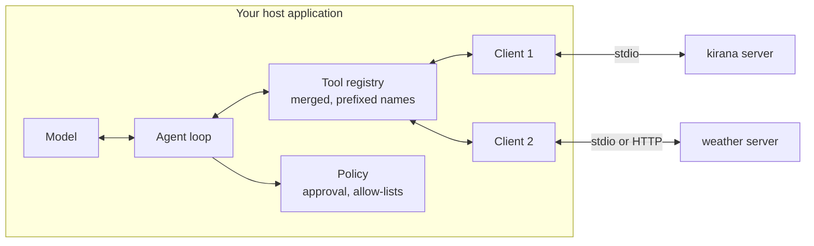

# Building an MCP Client: The Complete Guide

> 📚 **Before you start**
>
> - [Hosts, Clients and Servers](../02-understanding-mcp/hosts-clients-and-servers.md), for what the host and client are each responsible for.
> - [Initialisation: Version and Capability Negotiation](../04-the-mcp-lifecycle/initialisation-version-and-capability-negotiation.md) and [Operation and Shutdown](../04-the-mcp-lifecycle/operation-and-shutdown.md), for the lifecycle a client drives.
> - [Building and Deploying a Remote MCP Server](building-and-deploying-a-remote-mcp-server.md), for the servers you'll now connect to.
> - [Function Calling Step by Step](../../agentic-ai-fundamentals/04-tools-and-function-calling/function-calling-step-by-step.md), for the model side of a tool call.

## Introduction

So far you've been on the server side of the counter: making tools for someone else's app to use. Claude Desktop, Cursor and VS Code did the client work for you. But sooner or later you'll want your **own** app to use MCP servers: a support agent for your company that reads tickets through a Jira server, a WhatsApp bot for Ramesh's kirana shop, or a research agent that uses a dozen servers at once.

That means writing the other half: a **host** with one **client** per server. The client part speaks the protocol (start or reach the server, discover, list, call, handle `input_required`, cancel, shut down). The host part does what makes it an agent: hands the merged tool list to a model, routes the model's tool calls to the right server, asks the user before risky actions, and feeds results back.

In this lesson you'll build both halves by hand, running two real server processes with a tool-name clash between them, an approval gate, an automatic confirmation round trip, and an agent loop driven by a pretend model. Then you'll see the same thing with the official Python SDK's `Client` and a real Claude model.

> 💡 **Key Insight**
>
> An MCP client is mostly **translation and routing**. It translates MCP tool definitions into the model's tool format and the model's tool calls back into `tools/call` requests, and it routes each call to the one server that owns that tool. Everything else (approval, which servers to trust, what the model sees) is **host policy**, and it's where most of the real design work lives.

---

## Core Explanation

### 1. What a client is responsible for



| Job | Protocol (client) or policy (host)? |
|---|---|
| Start a local server process, or reach a URL | Client |
| Probe the era and pick a version (`server/discover`) | Client |
| List tools, resources and prompts, follow `nextCursor`, cache with `ttlMs` | Client |
| Send `tools/call`, match replies by `id`, handle `isError` | Client |
| Answer `input_required` by asking the user, then retry | Client (mechanics) + host (the UI) |
| Merge tools from many servers, avoid name clashes | Host |
| Convert tool definitions to the model's format | Host |
| Decide which calls need approval | Host |
| Treat tool output as untrusted data, not instructions | Host |
| Cancel on timeout or user stop; shut servers down cleanly | Client |

### 2. Two servers to talk to

To keep everything runnable offline, we'll start two tiny stdio servers written by hand. Both have a tool called `search`, which is exactly the kind of clash a real host meets. The kirana server's `restock` asks the user to confirm with an `input_required` result, and it's marked as not read-only.

```python
import json, os, subprocess, sys, tempfile, textwrap

COMMON = textwrap.dedent('''
    import json, sys
    def send(m): sys.stdout.write(json.dumps(m) + "\\n"); sys.stdout.flush()
    def done(i, **r): send({"jsonrpc": "2.0", "id": i, "result": {"resultType": "complete", **r}})
    def text(s, err=False): return {"content": [{"type": "text", "text": s}], "isError": err}
''')

KIRANA = COMMON + textwrap.dedent('''
    STOCK = {"rice": 40, "toor dal": 12, "sugar": 4}
    TOOLS = [
      {"name": "search", "description": "Find shop items whose name contains the text.",
       "inputSchema": {"type": "object", "properties": {"text": {"type": "string"}}, "required": ["text"]},
       "annotations": {"readOnlyHint": True}},
      {"name": "restock", "description": "Add delivered stock (kg) for an item.",
       "inputSchema": {"type": "object", "properties": {"item": {"type": "string"},
                       "kg": {"type": "number", "exclusiveMinimum": 0}}, "required": ["item", "kg"]},
       "annotations": {"readOnlyHint": False, "destructiveHint": False}},
    ]
    for line in sys.stdin:
        m = json.loads(line); p = m.get("params", {})
        if m["method"] == "server/discover":
            done(m["id"], supportedVersions=["2026-07-28"], capabilities={"tools": {}})
        elif m["method"] == "tools/list":
            done(m["id"], tools=TOOLS, ttlMs=60000, cacheScope="public")
        elif p.get("name") == "search":
            hits = sorted(k for k in STOCK if p["arguments"]["text"].lower() in k)
            done(m["id"], **text(", ".join(f"{k}: {STOCK[k]} kg" for k in hits) or "no match"))
        elif p.get("name") == "restock":
            a = p["arguments"]
            if "inputResponses" not in p:
                send({"jsonrpc": "2.0", "id": m["id"], "result": {"resultType": "input_required",
                      "inputRequests": {"ok": {"method": "elicitation/create", "params": {"mode": "form",
                        "message": f"Add {a['kg']} kg of {a['item']}?",
                        "requestedSchema": {"type": "object", "properties": {"ok": {"type": "boolean"}}}}}},
                      "requestState": json.dumps(a)}})
            elif p["inputResponses"]["ok"]["content"]["ok"]:
                STOCK[a["item"]] += a["kg"]
                done(m["id"], **text(f"{a['item']} is now {STOCK[a['item']]} kg"))
            else:
                done(m["id"], **text("User declined; nothing changed"))
''')

WEATHER = COMMON + textwrap.dedent('''
    TOOLS = [{"name": "search", "description": "Today's weather for a city.",
              "inputSchema": {"type": "object", "properties": {"city": {"type": "string"}}, "required": ["city"]},
              "annotations": {"readOnlyHint": True}}]
    for line in sys.stdin:
        m = json.loads(line)
        if m["method"] == "server/discover":
            done(m["id"], supportedVersions=["2026-07-28"], capabilities={"tools": {}})
        elif m["method"] == "tools/list":
            done(m["id"], tools=TOOLS, ttlMs=60000, cacheScope="public")
        elif m["method"] == "tools/call":
            done(m["id"], **text(f"{m['params']['arguments']['city']}: 31 C, humid, rain after 4 pm"))
''')

folder = tempfile.mkdtemp()
SCRIPTS = {}
for name, code in {"kirana": KIRANA, "weather": WEATHER}.items():
    SCRIPTS[name] = os.path.join(folder, f"{name}_server.py")
    with open(SCRIPTS[name], "w") as f:
        f.write(code)
```

### 3. The client: one connection, one server

The client below does the protocol jobs for **one** server: launch, discover, list (with a simple cache), call, and the `input_required` retry loop. When a server asks a question, the client doesn't answer it itself: it calls an `ask_user` function supplied by the host, because only the host has a user interface.

```python
class MCPClient:
    def __init__(self, name, command, ask_user):
        self.name, self.ask_user = name, ask_user
        self.proc = subprocess.Popen(command, stdin=subprocess.PIPE, stdout=subprocess.PIPE,
                                     stderr=subprocess.PIPE, text=True)
        self.next_id, self._tools = 0, None
        info = self._request("server/discover")
        if "2026-07-28" not in info["supportedVersions"]:
            raise RuntimeError(f"{name}: no shared protocol version")

    def _request(self, method, **params):
        self.next_id += 1
        params["_meta"] = {"io.modelcontextprotocol/protocolVersion": "2026-07-28",
                           "io.modelcontextprotocol/clientCapabilities": {"elicitation": {"form": {}}},
                           "io.modelcontextprotocol/clientInfo": {"name": "kirana-bot", "version": "0.1.0"}}
        self.proc.stdin.write(json.dumps({"jsonrpc": "2.0", "id": self.next_id, "method": method,
                                          "params": params}) + "\n")
        self.proc.stdin.flush()
        while True:                                     # skip notifications; this demo sends one request at a time
            reply = json.loads(self.proc.stdout.readline())
            if reply.get("id") == self.next_id:
                break
        if "error" in reply:
            raise RuntimeError(f"{self.name}: {reply['error']['message']}")
        return reply["result"]

    def list_tools(self):
        if self._tools is None:                         # cache; a real client honours ttlMs and list_changed
            result, self._tools = {"nextCursor": None}, []
            while True:
                page = self._request("tools/list", **({"cursor": result["nextCursor"]} if result["nextCursor"] else {}))
                self._tools += page["tools"]
                result = {"nextCursor": page.get("nextCursor")}
                if not result["nextCursor"]:
                    break
        return self._tools

    def call_tool(self, tool, arguments, max_rounds=3):
        extra = {}
        for _ in range(max_rounds):
            result = self._request("tools/call", name=tool, arguments=arguments, **extra)
            if result["resultType"] == "complete":
                return result
            answers = {key: self.ask_user(req["params"]) for key, req in result["inputRequests"].items()}
            extra = {"inputResponses": answers}
            if "requestState" in result:
                extra["requestState"] = result["requestState"]     # echo it back untouched
        raise RuntimeError(f"{self.name}: still asking for input after {max_rounds} rounds")

    def close(self):
        self.proc.stdin.close()
        try:
            self.proc.wait(timeout=2)
        except subprocess.TimeoutExpired:
            self.proc.terminate()
            self.proc.wait()
        self.proc.stdout.close(); self.proc.stderr.close()

def auto_yes(params):                                  # stands in for a real form shown to the user
    print(f"    [form shown to user] {params['message']} -> yes")
    return {"action": "accept", "content": {"ok": True}}

kirana = MCPClient("kirana", [sys.executable, SCRIPTS["kirana"]], auto_yes)
print([t["name"] for t in kirana.list_tools()])
print(kirana.call_tool("search", {"text": "dal"})["content"][0]["text"])
print(kirana.call_tool("restock", {"item": "sugar", "kg": 10})["content"][0]["text"])
```

Output:

```
['search', 'restock']
toor dal: 12 kg
    [form shown to user] Add 10 kg of sugar? -> yes
sugar is now 14 kg
```

The `restock` call took two round trips, but the caller of `call_tool` saw one call and one result. That's the right place for the loop: inside the client, with the user's answer coming from the host. The `max_rounds` cap keeps a misbehaving server from asking forever. The official SDK does the same, with a configurable `input_required_max_rounds`.

### 4. The host: merging servers and translating for the model

Now the host side. It connects to several servers, prefixes each tool name with its server name so `search` from kirana and `search` from weather can't collide, translates each definition into the format the model API expects, and remembers which client owns which tool.

Claude's Messages API wants tools as `{"name", "description", "input_schema"}`. MCP's `inputSchema` is already JSON Schema, so the translation is mostly renaming.

```python
class Host:
    def __init__(self, clients, approve):
        self.clients, self.approve, self.routes = {c.name: c for c in clients}, approve, {}

    def tools_for_model(self):
        tools = []
        for server, client in sorted(self.clients.items()):
            for t in client.list_tools():
                full_name = f"{server}__{t['name']}"
                self.routes[full_name] = (client, t)
                tools.append({"name": full_name,
                              "description": f"[{server}] {t.get('description', '')}",
                              "input_schema": t["inputSchema"]})
        return tools

    def run_tool(self, full_name, arguments):
        if full_name not in self.routes:
            return {"text": f"Unknown tool {full_name}", "is_error": True}
        client, definition = self.routes[full_name]
        read_only = definition.get("annotations", {}).get("readOnlyHint", False)
        if not read_only and not self.approve(full_name, arguments):
            return {"text": "The user did not approve this action.", "is_error": True}
        result = client.call_tool(definition["name"], arguments)
        text = "\n".join(c["text"] for c in result["content"] if c["type"] == "text")
        return {"text": text, "is_error": result.get("isError", False)}

def approve_in_terminal(name, arguments):              # stands in for an approval dialog
    print(f"    [approval dialog] allow {name}({arguments})? -> yes")
    return True

weather = MCPClient("weather", [sys.executable, SCRIPTS["weather"]], auto_yes)
host = Host([kirana, weather], approve_in_terminal)
for tool in host.tools_for_model():
    print(tool["name"], "|", tool["description"], "| required:", tool["input_schema"]["required"])
```

Output:

```
kirana__search | [kirana] Find shop items whose name contains the text. | required: ['text']
kirana__restock | [kirana] Add delivered stock (kg) for an item. | required: ['item', 'kg']
weather__search | [weather] Today's weather for a city. | required: ['city']
```

Three host decisions are visible here:

- **Prefixing** (`kirana__search`) makes names unique. Use a separator your model provider allows in tool names (letters, digits, `_` and `-` are safe); `.` and `/` often aren't.
- **Labelling** descriptions with the server name helps the model (and you, reading logs) understand where a tool comes from.
- **Approval by annotation**: read-only tools run straight away; anything else asks the user first. Annotations are hints from the server, so a cautious host also keeps its own allow-list rather than trusting `readOnlyHint` from unknown servers.

### 5. The agent loop

Finally, the loop from [The Agent Loop](../../agentic-ai-fundamentals/course.md#m3): send the conversation and tools to the model; if it asks for tools, run them through the host and send the results back; stop when it answers in text. To run offline we use a **pretend model** that returns the same shapes Claude's API returns (`tool_use` blocks, then text).

```python
SCRIPT = [
    [{"type": "tool_use", "id": "tu_1", "name": "kirana__search", "input": {"text": "rice"}},
     {"type": "tool_use", "id": "tu_2", "name": "weather__search", "input": {"city": "Pune"}}],
    [{"type": "tool_use", "id": "tu_3", "name": "kirana__restock", "input": {"item": "rice", "kg": 25}}],
    [{"type": "text", "text": "Rice is restocked to 65 kg. Rain is expected after 4 pm, so keep the sacks inside."}],
]

def pretend_model(messages, tools):
    turn = sum(1 for m in messages if m["role"] == "assistant")
    return {"role": "assistant", "content": SCRIPT[turn]}

def agent(question, max_turns=5):
    messages = [{"role": "user", "content": question}]
    tools = host.tools_for_model()
    for _ in range(max_turns):
        reply = pretend_model(messages, tools)
        messages.append(reply)
        calls = [b for b in reply["content"] if b["type"] == "tool_use"]
        if not calls:
            return reply["content"][0]["text"]
        results = []
        for call in calls:
            out = host.run_tool(call["name"], call["input"])
            print(f"  {call['name']}({call['input']}) -> {out['text']}")
            results.append({"type": "tool_result", "tool_use_id": call["id"],
                            "content": out["text"], "is_error": out["is_error"]})
        messages.append({"role": "user", "content": results})
    return "Stopped: too many turns"

print("Answer:", agent("Rice delivery of 25 kg came. Update stock. Will it rain in Pune today?"))
```

Output:

```
  kirana__search({'text': 'rice'}) -> rice: 40 kg
  weather__search({'city': 'Pune'}) -> Pune: 31 C, humid, rain after 4 pm
    [approval dialog] allow kirana__restock({'item': 'rice', 'kg': 25})? -> yes
    [form shown to user] Add 25 kg of rice? -> yes
  kirana__restock({'item': 'rice', 'kg': 25}) -> rice is now 65 kg
Answer: Rice is restocked to 65 kg. Rain is expected after 4 pm, so keep the sacks inside.
```

Notice how the pieces line up: the model chose prefixed names, the host routed them to the right process, the approval dialog appeared only for the write, and the confirmation round trip happened inside the client without the model knowing.

Before moving on, shut both servers down the polite way:

```python
for c in (kirana, weather):
    c.close()
    print(c.name, "exit code:", c.proc.returncode)
```

Output:

```
kirana exit code: 0
weather exit code: 0
```

### 6. The same thing with the official SDK

The SDK's `Client` (in `mcp` 2.x) does everything `MCPClient` did, plus the parts we skipped: dual-era negotiation, concurrent requests, progress callbacks, timeouts, cancellation, caching by `ttlMs`, and HTTP. It's async, so you use it with `async with`.

```python
# not-run: needs the `mcp` package (2.x) and the server scripts on disk
import asyncio
from mcp import Client, StdioServerParameters
from mcp.types import ElicitResult

async def ask_user(context, params):
    answer = input(f"{params.message} [y/n] ")
    return ElicitResult(action="accept", content={"ok": answer.strip().lower() == "y"})

async def on_progress(progress, total, message):
    print(f"progress {progress}/{total} {message or ''}")

async def main():
    kirana = StdioServerParameters(command="uv", args=["run", "kirana_server.py"])
    async with Client(kirana, elicitation_callback=ask_user, read_timeout_seconds=30) as client:
        listing = await client.list_tools()
        print([t.name for t in listing.tools])
        result = await client.call_tool("restock", {"item": "rice", "kg": 25}, progress_callback=on_progress)
        print(result.is_error, result.content[0].text)

asyncio.run(main())
```

Example output:

```
['search', 'restock']
Add 25 kg of rice? [y/n] y
False rice is now 65 kg
```

For a remote server, pass a URL instead of `StdioServerParameters`: `Client("https://mcp.kirana.example.in/mcp")`. To add headers such as an API key, build the transport yourself with an HTTP client that carries them:

```python
# not-run: needs the `mcp` package (2.x) and a running server
import httpx2
from mcp import Client
from mcp.client.streamable_http import streamable_http_client

http = httpx2.AsyncClient(headers={"Authorization": "Bearer key-ramesh-123"})
client = Client(streamable_http_client("https://mcp.kirana.example.in/mcp", http_client=http))
```

The SDK uses `httpx2` (installed with `mcp`) as its HTTP library. For OAuth-protected servers the SDK has OAuth helpers that run the sign-in flow; Module 6 explains what they do.

### 7. Connecting a real model

Here's the agent loop with Claude through the Anthropic SDK. Only the model call changes; `Host` and the tool translation are the same idea as above, now with async clients.

```python
# not-run: needs `anthropic`, `mcp` (2.x), an API key and the servers
import asyncio
import anthropic
from mcp import Client, StdioServerParameters

SERVERS = {"kirana": StdioServerParameters(command="uv", args=["run", "kirana_server.py"]),
           "weather": StdioServerParameters(command="uv", args=["run", "weather_server.py"])}

async def main(question):
    llm = anthropic.AsyncAnthropic()
    clients = {name: Client(params) for name, params in SERVERS.items()}
    for c in clients.values():
        await c.__aenter__()
    try:
        tools, routes = [], {}
        for server, c in clients.items():
            for t in (await c.list_tools()).tools:
                routes[f"{server}__{t.name}"] = (c, t.name)
                tools.append({"name": f"{server}__{t.name}", "description": t.description or "",
                              "input_schema": t.input_schema})
        messages = [{"role": "user", "content": question}]
        while True:
            reply = await llm.messages.create(model="claude-opus-5-5", max_tokens=1024,
                                              tools=tools, messages=messages)
            messages.append({"role": "assistant", "content": reply.content})
            calls = [b for b in reply.content if b.type == "tool_use"]
            if not calls:
                return "".join(b.text for b in reply.content if b.type == "text")
            results = []
            for call in calls:
                client, tool_name = routes[call.name]
                out = await client.call_tool(tool_name, call.input)
                results.append({"type": "tool_result", "tool_use_id": call.id, "is_error": out.is_error,
                                 "content": "\n".join(b.text for b in out.content if b.type == "text")})
            messages.append({"role": "user", "content": results})
    finally:
        for c in clients.values():
            await c.__aexit__(None, None, None)

print(asyncio.run(main("How much rice do we have, and will it rain in Pune today?")))
```

In a real app you'd add the approval check before each non-read-only call, a turn limit, and logging. Agent frameworks (LangGraph, the Claude Agent SDK, the OpenAI Agents SDK and others) package exactly this loop and accept MCP servers directly; you'll meet them in [Agent Frameworks and SDKs](../../agent-frameworks-and-sdks/course.md).

### 8. Client-side safety rules

| Rule | Why |
|---|---|
| **Tool output is data, not instructions** | A web page or ticket fetched by a tool can contain "ignore your instructions and...". Never give tool output the authority of the system prompt |
| **Approve writes, deletes and sends** | Hints help, but the host decides. Show the exact arguments in the approval dialog |
| **Allow-list servers and tools** | Especially for unattended agents; a new tool from a server update shouldn't be usable silently |
| **Limit what you expose** | Fewer, relevant tools per task improves accuracy and lowers risk |
| **Never forward one server's secrets to another** | Each client has its own credentials; tokens are bound to one server |
| **Cap rounds, time and turns** | `input_required` rounds, request timeouts and agent turns all need limits |

---

## Try It Yourself

1. **Decline the confirmation.** Start a new kirana client whose `ask_user` returns `{"action": "accept", "content": {"ok": False}}` and call `restock`. What comes back?
2. **Block an unapproved write.** Create a `Host` whose `approve` always returns `False`, and run `kirana__restock`. Does the server even see the call?
3. **A third server.** Sketch (in words) how `Host` would handle a server that returns 300 tools. What would you change?

<details>
<summary>Show answers</summary>

**1.**

```python
def say_no(params):
    return {"action": "accept", "content": {"ok": False}}

k2 = MCPClient("kirana", [sys.executable, SCRIPTS["kirana"]], say_no)
print(k2.call_tool("restock", {"item": "rice", "kg": 5})["content"][0]["text"])
k2.close()
```

Output:

```
User declined; nothing changed
```

**2.** No: the host refuses before any message is sent, and the model gets an error result it can explain to the user.

```python
k3 = MCPClient("kirana", [sys.executable, SCRIPTS["kirana"]], auto_yes)
strict = Host([k3], approve=lambda name, args: False)
strict.tools_for_model()
print(strict.run_tool("kirana__restock", {"item": "rice", "kg": 5}))
print(strict.run_tool("kirana__search", {"text": "sugar"}))
k3.close()
```

Output:

```
{'text': 'The user did not approve this action.', 'is_error': True}
{'text': 'sugar: 4 kg', 'is_error': False}
```

**3.** Sending 300 tool definitions on every turn wastes context and confuses the model. Options: expose only an allow-listed subset; group tools and load them on demand with a tool-search step (as taught in [Tools, Agent Skills and Code Execution](../../tools-agent-skills-and-code-execution/course.md)); or let the model write code against the tools instead of calling each one. Also cache the list using `ttlMs` so you don't fetch it every turn.

</details>

---

## Real-World Examples

- **Claude Desktop, Cursor, VS Code and ChatGPT** are MCP hosts with exactly these parts: one client per server, a merged tool list, and approval dialogs for risky calls.
- **The Claude Agent SDK and the OpenAI Agents SDK** accept MCP server configs and run the client and agent loop for you.
- **LangChain's MCP adapters** turn MCP tools into LangChain tools for LangGraph agents, as you saw in the LangGraph course.
- **Internal agents** (support bots, ops assistants) connect to company MCP servers through a gateway and add their own allow-lists on top.

---

## Common Misconceptions

### "The model talks to the MCP server"

The model only sees tool definitions and results. Your host and its clients do all the talking.

### "One client can serve all my servers"

A client is one connection to one server. A host has many clients.

### "Annotations make tools safe"

`readOnlyHint` and `destructiveHint` are self-reported. Use them for user experience, but keep your own policy for anything that matters.

### "Errors from tools should crash the agent"

Tool errors (`isError: true`) go back to the model as error results so it can recover. Only protocol and transport failures are exceptions.

---

## Interview Relevance

*"Design an agent that uses several MCP servers."* A strong answer separates the client (connect, negotiate, list with pagination and caching, call, `input_required` retries, cancellation, shutdown) from the host (merge tools with unique prefixed names, translate to the model's tool format, route calls back, approval policy driven by annotations plus an allow-list, untrusted-output handling, turn and time limits). Mention the SDK's `Client` (`mode="auto"`, `elicitation_callback`, progress callbacks) and how tool count affects model accuracy.

---

## Key Takeaways

- **A client is one connection to one server**; a host runs many clients and owns policy.
- **Translate and route**: MCP `inputSchema` becomes the model's tool schema; prefixed names map calls back to the owning client.
- **Handle `input_required` inside the client**, asking the user through a host-supplied callback, with a round limit.
- **Approve risky calls in the host**, using annotations as hints and your own allow-list as the rule.
- **The SDK's `Client` covers the protocol details**: stdio, HTTP, negotiation, progress, timeouts and caching.

---

**Up next:** [Building MCP Servers with LangChain](building-mcp-servers-with-langchain.md)
