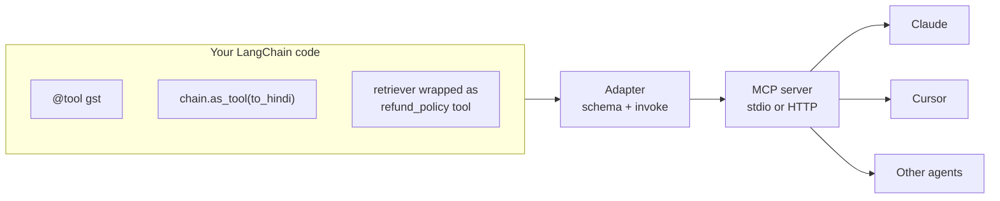

# Building MCP Servers with LangChain: The Complete Guide

> 📚 **Before you start**
>
> - [Tools and Tool Calling](../../langchain-complete-guide/course.md#m7), for `@tool`, `StructuredTool` and tool schemas in LangChain.
> - [Using MCP Tools in LangGraph](../../langgraph-complete-guide/05-workflows-and-agents/using-mcp-tools-in-langgraph.md), which went the other way: MCP tools inside a LangChain agent.
> - [Building a Local MCP Server with FastMCP](building-a-local-mcp-server-with-fastmcp.md) and [Building an MCP Client](building-an-mcp-client.md), for servers and clients in this course.

## Introduction

A Bengaluru fintech team spent a year building LangChain tools: a GST calculator, a lookup over the company's refund policy, a chain that summarises a customer's last ten transactions in Hindi. They work well inside the team's LangGraph agent. Now the support staff want the same abilities inside Claude, the developers want them in Cursor, and another team wants them in an OpenAI Agents SDK app. Rewriting every tool for every app is exactly the N × M problem MCP was invented to solve.

The answer is to **serve the LangChain tools as an MCP server**. Write once in LangChain, publish once over MCP, use everywhere. The LangGraph course showed the opposite direction (pulling MCP tools into a LangChain agent); this lesson covers this direction: LangChain tools, chains and retrievers going **out** through MCP.

By the end you'll know how a LangChain tool maps onto an MCP tool, have run a converter that serves a function tool, a chain and a retriever-backed tool over MCP messages, and be able to build the real server two ways: with the official SDK's `MCPServer`, and with the `to_fastmcp` helper from `langchain-mcp-adapters`.

> 💡 **Key Insight**
>
> A LangChain tool already has everything an MCP tool needs: a **name**, a **description** and an **argument schema** (a pydantic model that becomes JSON Schema). Converting one is mostly copying those three fields into a tool definition and calling `tool.ainvoke(arguments)` when a `tools/call` arrives. The hard parts are the edges: errors, injected arguments, and which SDK version your adapter needs.

---

## Core Explanation

### 1. How the pieces map

| LangChain | MCP | Notes |
|---|---|---|
| `tool.name` | `name` | Must be unique within the server |
| `tool.description` | `description` | From the docstring for `@tool` functions |
| `tool.tool_call_schema.model_json_schema()` | `inputSchema` | Only the arguments the model should fill (injected arguments are excluded) |
| `tool.invoke(args)` / `await tool.ainvoke(args)` | handling `tools/call` | Return value becomes text content |
| `ToolException` raised in the tool | result with `isError: true` | So the model can recover |
| A chain (`Runnable`) | wrap with `chain.as_tool(...)` | Any runnable can become a tool |
| A retriever | wrap in a tool, or expose as a **resource** | Search is usually a tool; fixed documents fit resources |



### 2. Three kinds of LangChain tools

Let's build the team's three tools with `langchain_core`, using a pretend chat model so everything runs offline.

```python
import json, warnings
from langchain_core._api import LangChainBetaWarning
from langchain_core.callbacks import CallbackManagerForRetrieverRun
from langchain_core.documents import Document
from langchain_core.language_models.fake_chat_models import FakeListChatModel
from langchain_core.output_parsers import StrOutputParser
from langchain_core.prompts import ChatPromptTemplate
from langchain_core.retrievers import BaseRetriever
from langchain_core.tools import ToolException, tool

warnings.filterwarnings("ignore", category=LangChainBetaWarning)   # as_tool is a beta API

# 1. A plain function tool
@tool
def gst(amount: float, rate: float = 18.0) -> str:
    """Compute GST in rupees for an amount. Common rates are 5, 12, 18 and 28 percent."""
    if rate not in (0, 5, 12, 18, 28):
        raise ToolException(f"{rate}% is not a GST slab. Use 0, 5, 12, 18 or 28.")
    return f"GST at {rate:g}% on Rs {amount:,.2f} is Rs {amount * rate / 100:,.2f}"

gst.handle_tool_error = True        # turn ToolException into a returned message instead of raising

# 2. A chain turned into a tool
prompt = ChatPromptTemplate.from_template("Translate this customer message into simple Hindi: {text}")
pretend_llm = FakeListChatModel(responses=["Aapka refund 5 din mein aa jayega."])
to_hindi = (prompt | pretend_llm | StrOutputParser()).as_tool(
    name="to_hindi", description="Translate a short English customer message into simple Hindi.")

# 3. A retriever wrapped in a tool
POLICY = [
    Document(page_content="Refunds for failed UPI payments are automatic within 5 working days.",
             metadata={"id": "R1"}),
    Document(page_content="Card refunds take 7 to 10 working days after the merchant approves.",
             metadata={"id": "R2"}),
    Document(page_content="Wallet refunds are instant once approved.", metadata={"id": "R3"}),
]

class KeywordRetriever(BaseRetriever):
    docs: list[Document]
    def _get_relevant_documents(self, query: str, *, run_manager: CallbackManagerForRetrieverRun):
        words = set(query.lower().split())
        return [d for d in self.docs if words & set(d.page_content.lower().replace(".", "").split())]

policy_retriever = KeywordRetriever(docs=POLICY)

@tool
def refund_policy(question: str) -> str:
    """Look up the company's refund policy. Returns matching policy lines with their ids."""
    hits = policy_retriever.invoke(question)
    return "\n".join(f"[{d.metadata['id']}] {d.page_content}" for d in hits) or "No matching policy."

LC_TOOLS = [gst, to_hindi, refund_policy]
SAMPLE_ARGS = {"gst": {"amount": 1200},
               "to_hindi": {"text": "Your refund will arrive in 5 days"},
               "refund_policy": {"question": "upi refund"}}
for t in LC_TOOLS:
    print(f"{t.name}: {t.invoke(SAMPLE_ARGS[t.name])}")
```

Output:

```
gst: GST at 18% on Rs 1,200.00 is Rs 216.00
to_hindi: Aapka refund 5 din mein aa jayega.
refund_policy: [R1] Refunds for failed UPI payments are automatic within 5 working days.
```

### 3. The converter: LangChain tools in, MCP messages out

Now the adapter. It builds MCP tool definitions from the three fields and answers `tools/list` and `tools/call`. It's async, because MCP servers are, and because `ainvoke` lets slow tools (like a real LLM chain) run without blocking others.

```python
import asyncio

def strip_titles(schema):
    if isinstance(schema, dict):
        return {k: strip_titles(v) for k, v in schema.items() if k != "title"}
    if isinstance(schema, list):
        return [strip_titles(v) for v in schema]
    return schema

def to_mcp_definition(lc_tool):
    schema = strip_titles(lc_tool.tool_call_schema.model_json_schema())
    schema.pop("description", None)                     # the description goes at the top level
    return {"name": lc_tool.name, "description": lc_tool.description, "inputSchema": schema}

class LangChainMCPServer:
    def __init__(self, tools):
        self.tools = {t.name: t for t in tools}

    async def handle(self, msg):
        if msg["method"] == "tools/list":
            result = {"tools": [to_mcp_definition(t) for t in self.tools.values()],
                      "ttlMs": 300000, "cacheScope": "public"}
        elif msg["method"] == "tools/call":
            name = msg["params"]["name"]
            if name not in self.tools:
                return {"jsonrpc": "2.0", "id": msg["id"],
                        "error": {"code": -32602, "message": f"Unknown tool: {name}"}}
            try:
                value = await self.tools[name].ainvoke(msg["params"].get("arguments", {}))
                result = {"content": [{"type": "text", "text": str(value)}], "isError": False}
            except Exception as e:                       # validation errors and unexpected failures
                result = {"content": [{"type": "text", "text": f"{type(e).__name__}: {e}".splitlines()[0]}],
                          "isError": True}
        else:
            return {"jsonrpc": "2.0", "id": msg["id"], "error": {"code": -32601, "message": "Method not found"}}
        return {"jsonrpc": "2.0", "id": msg["id"], "result": {"resultType": "complete", **result}}

server = LangChainMCPServer(LC_TOOLS)
listing = asyncio.run(server.handle({"jsonrpc": "2.0", "id": 1, "method": "tools/list"}))
for d in listing["result"]["tools"]:
    print(json.dumps(d))
```

Output:

```
{"name": "gst", "description": "Compute GST in rupees for an amount. Common rates are 5, 12, 18 and 28 percent.", "inputSchema": {"properties": {"amount": {"type": "number"}, "rate": {"default": 18.0, "type": "number"}}, "required": ["amount"], "type": "object"}}
{"name": "to_hindi", "description": "Translate a short English customer message into simple Hindi.", "inputSchema": {"properties": {"text": {"type": "string"}}, "required": ["text"], "type": "object"}}
{"name": "refund_policy", "description": "Look up the company's refund policy. Returns matching policy lines with their ids.", "inputSchema": {"properties": {"question": {"type": "string"}}, "required": ["question"], "type": "object"}}
```

That's a complete, valid tool list. Notice `rate` kept its default of `18.0` and isn't required, exactly as in the Python signature. Now some calls, including bad ones:

```python
async def call(name, **arguments):
    reply = await server.handle({"jsonrpc": "2.0", "id": 2, "method": "tools/call",
                                 "params": {"name": name, "arguments": arguments}})
    if "error" in reply:
        return f"protocol error {reply['error']['code']}: {reply['error']['message']}"
    r = reply["result"]
    return ("ERROR " if r["isError"] else "") + r["content"][0]["text"]

async def demo():
    print(await call("gst", amount=2500, rate=12))
    print(await call("gst", amount=2500, rate=15))             # ToolException, handled by the tool
    print(await call("gst", amount="lots"))                    # fails schema validation
    print(await call("refund_policy", question="card refund"))
    print(await call("send_money", to="me"))                   # not a tool at all

asyncio.run(demo())
```

Output:

```
GST at 12% on Rs 2,500.00 is Rs 300.00
15.0% is not a GST slab. Use 0, 5, 12, 18 or 28.
ERROR ValidationError: 1 validation error for gst
[R2] Card refunds take 7 to 10 working days after the merchant approves.
protocol error -32602: Unknown tool: send_money
```

Look closely at the second line: because we set `handle_tool_error = True`, LangChain caught the `ToolException` itself and **returned** the message as a normal string, so our adapter reported `isError: False`. The model still sees the helpful message, but a client can't tell it was a failure. That's a real trap when converting. Two ways out: leave `handle_tool_error` off (so the exception reaches the adapter, which sets `isError: true`), or have the adapter inspect the result. The official adapter in `langchain-mcp-adapters` lets exceptions propagate to the MCP framework, which reports them as tool errors.

```python
gst.handle_tool_error = False                                 # let the adapter see the failure
print(asyncio.run(call("gst", amount=2500, rate=15)))
```

Output:

```
ERROR ToolException: 15.0% is not a GST slab. Use 0, 5, 12, 18 or 28.
```

### 4. The real server with the official SDK (2.x)

The simplest robust path with the current SDK: register each LangChain tool's underlying function with `MCPServer.add_tool`, passing the LangChain name and description. For tools without a plain function (chains made with `as_tool`, subclasses of `BaseTool`), write a small typed wrapper so the SDK can read the signature.

```python
# not-run: needs the `mcp` package (2.x); `tools.py` holds the LangChain tools above
from mcp.server.mcpserver import MCPServer
from mcp.server.mcpserver.exceptions import ToolError
from langchain_core.tools import ToolException
from tools import gst, refund_policy, to_hindi_chain

mcp = MCPServer("fintech-tools", instructions="Amounts are in Indian rupees.")

for lc_tool in (gst, refund_policy):                  # @tool functions: reuse the function directly
    mcp.add_tool(lc_tool.func, name=lc_tool.name, description=lc_tool.description)

@mcp.tool(name="to_hindi", description="Translate a short English customer message into simple Hindi.")
async def to_hindi(text: str) -> str:                  # a chain needs a typed wrapper
    try:
        return await to_hindi_chain.ainvoke({"text": text})
    except ToolException as e:
        raise ToolError(str(e)) from e                 # anticipated failure -> isError: true

if __name__ == "__main__":
    mcp.run()                                          # or mcp.streamable_http_app(...) for remote
```

Because `add_tool` reads the function's own signature, the schema comes out the same as LangChain's. Run it with `uv run mcp dev server.py`, check the three tools in the Inspector, and install it in a host as in the FastMCP lesson.

One detail: `ToolException` is LangChain's way of saying "anticipated failure"; `ToolError` is the SDK's. Translating one into the other keeps the helpful message reaching the model **and** the `isError` flag set.

### 5. The `to_fastmcp` helper from `langchain-mcp-adapters`

The `langchain-mcp-adapters` package (the same one that gave you `MultiServerMCPClient` in the LangGraph course) also has a function for this direction: `to_fastmcp(tool)` turns any LangChain tool into a FastMCP tool object, including chains made with `as_tool`, with no wrappers.

```python
# not-run: needs `langchain-mcp-adapters` and the 1.x SDK (`mcp<2`) in its own environment
from langchain_mcp_adapters.tools import to_fastmcp
from mcp.server.fastmcp import FastMCP          # the SDK 1.x class name
from tools import gst, refund_policy, to_hindi

mcp = FastMCP("fintech-tools", tools=[to_fastmcp(t) for t in (gst, refund_policy, to_hindi)])

if __name__ == "__main__":
    mcp.run(transport="stdio")
```

Know its limits before choosing it:

| Limit | Detail |
|---|---|
| **SDK version** | At the time of writing, `langchain-mcp-adapters` 0.3.x depends on `mcp<2`, so `to_fastmcp` produces tools for the **1.x** `FastMCP` class. A 1.x server speaks the handshake-era protocol (`2025-11-25` and earlier). Modern dual-era clients still connect (they probe, then fall back to `initialize`), but you don't get `2026-07-28` features. Keep it in its own environment, and check the package's latest release before you start |
| **Argument schemas** | The tool's `args_schema` must be a pydantic model; tools defined with a raw dict schema are rejected |
| **Injected arguments** | Tools with injected arguments (values your app fills in at run time, such as the current user or graph state) aren't supported, because an MCP client can't supply them |

### 6. What doesn't carry over

LangChain tools often depend on things that only exist inside a LangChain run. Plan for these when you publish them:

| LangChain feature | Over MCP | What to do |
|---|---|---|
| Injected arguments (`InjectedToolArg`, runtime context) | The client can't fill them | Read the value on the server side (from the auth token, server config or a handle argument) |
| `response_format="content_and_artifact"` | Only the content is sent as text | Return structured data with an output schema in the SDK, or a resource link for large artifacts |
| Callbacks and tracing (LangSmith) | Don't cross the process boundary | Trace on the server; propagate trace context via `traceparent` in `_meta` |
| Streaming tokens from a chain | Not part of a tool result | Return the final text; send `notifications/progress` for long work |
| Graph state and memory | Live in your agent, not the server | Pass what's needed as explicit arguments or handles |

And the **description quality** problem: many internal LangChain tools have one-line docstrings because only one agent used them, with prompts that filled in the gaps. Over MCP, the docstring is all a stranger's model gets. Rewrite descriptions before publishing: what the tool does, when to use it, what it returns, units and limits.

### 7. When to convert, and when not to

| Situation | Recommendation |
|---|---|
| Tools used by one LangGraph app only | Keep them as LangChain tools; MCP adds a process boundary for no gain |
| The same tools wanted in Claude, IDEs or other frameworks | Serve them over MCP |
| A chain that needs your app's conversation state | Keep it inside the app |
| A retriever over company documents | Serve a search **tool** (and maybe documents as **resources**), with auth on the server |
| Many teams, many tools | One MCP server per domain (payments, refunds, KYC), each owned by its team |

---

## Try It Yourself

1. **Add a tool.** Write a LangChain `@tool` called `emi(principal: float, annual_rate: float, months: int) -> str` that returns the monthly EMI, add it to a new `LangChainMCPServer`, and print its MCP definition.
2. **Spot the missing description.** Create `@tool def lookup(x: str) -> str: "Lookup."` and convert it. What would a model in Claude understand from this definition? Rewrite the docstring.
3. **Injected argument.** A tool's signature is `def my_orders(user_id: str, status: str)`, where `user_id` currently comes from your agent's state. How should the MCP version get the user id instead?

<details>
<summary>Show answers</summary>

**1.** The EMI formula is `P × r × (1 + r)^n / ((1 + r)^n − 1)` with `r` the monthly rate.

```python
@tool
def emi(principal: float, annual_rate: float, months: int) -> str:
    """Monthly EMI in rupees for a loan, given the yearly interest rate in percent and the tenure in months."""
    r = annual_rate / 12 / 100
    value = principal * r * (1 + r) ** months / ((1 + r) ** months - 1)
    return f"EMI: Rs {value:,.0f} per month for {months} months"

loan_server = LangChainMCPServer([emi])
print(json.dumps(asyncio.run(loan_server.handle({"jsonrpc": "2.0", "id": 1, "method": "tools/list"}))["result"]["tools"][0]))
print(asyncio.run(loan_server.handle({"jsonrpc": "2.0", "id": 2, "method": "tools/call", "params": {
    "name": "emi", "arguments": {"principal": 500000, "annual_rate": 9.5, "months": 60}}}))["result"]["content"][0]["text"])
```

Output:

```
{"name": "emi", "description": "Monthly EMI in rupees for a loan, given the yearly interest rate in percent and the tenure in months.", "inputSchema": {"properties": {"principal": {"type": "number"}, "annual_rate": {"type": "number"}, "months": {"type": "integer"}}, "required": ["principal", "annual_rate", "months"], "type": "object"}}
EMI: Rs 10,501 per month for 60 months
```

**2.** The definition says only "Lookup." with an argument called `x`. A model can't tell what it looks up, when to use it, or what to pass. Rewrite it as, for example: `"""Look up a customer's KYC status by their 10-digit mobile number. Returns VERIFIED, PENDING or REJECTED."""` and rename `x` to `mobile_number`.

**3.** Take `user_id` out of the tool's arguments entirely. A remote server reads the caller's identity from the OAuth token on each request (Module 6); a local server for one person can read it from its configuration. Never let the model supply a user id that decides whose data is returned.

</details>

---

## Real-World Examples

- **Platform teams** wrap their existing LangChain tools (internal search, ticket lookup, database queries) as MCP servers so every team's agents and every developer's IDE can use them.
- **`langchain-mcp-adapters`** provides both directions: `MultiServerMCPClient` and `load_mcp_tools` for consuming servers, and `to_fastmcp` for serving LangChain tools.
- **LangChain 1.4+** includes a beta `langchain.mcp.MCPAdapter` for consuming MCP tools, built on the standalone FastMCP client.
- **Retrieval teams** publish their RAG pipelines as a single `search_docs` MCP tool, so the same retrieval quality is available in chat apps and coding agents.

---

## Common Misconceptions

### "LangChain tools and MCP tools are different things"

They describe the same idea (name, description, JSON Schema arguments) in different packaging. Conversion is mostly copying fields.

### "Converting a tool makes it production-ready"

The description, error handling, auth and limits still need work. Over MCP, strangers' models and users rely on them.

### "All LangChain tools can be served over MCP"

Tools that depend on injected run-time values, graph state or LangChain callbacks need redesign first.

### "`to_fastmcp` works with any SDK version"

It targets the SDK 1.x `FastMCP` class at the time of writing. Check the adapter's dependencies before mixing it with SDK 2.x.

---

## Interview Relevance

*"We have dozens of LangChain tools. How do we make them usable from Claude and IDEs?"* A strong answer: serve them as MCP servers grouped by domain; map name, description and `tool_call_schema` to the MCP definition and `ainvoke` to `tools/call`; translate `ToolException` into tool errors; wrap chains and retrievers as tools; rewrite descriptions for outside models; replace injected arguments with server-side identity from auth; choose between SDK 2.x `MCPServer.add_tool` with thin wrappers and `langchain-mcp-adapters`' `to_fastmcp` (1.x SDK, legacy-era protocol); add auth and deploy remotely for shared use.

---

## Key Takeaways

- **A LangChain tool maps directly to an MCP tool**: name, description, `tool_call_schema` as `inputSchema`, and `ainvoke` for calls.
- **Chains and retrievers become tools** with `as_tool` or a small `@tool` wrapper.
- **Watch error handling**: `handle_tool_error=True` hides failures from the protocol; translate `ToolException` into tool errors instead.
- **Two build paths**: SDK 2.x `MCPServer.add_tool` (with typed wrappers where needed), or `to_fastmcp` from `langchain-mcp-adapters` on the 1.x SDK.
- **Redesign what doesn't cross the boundary**: injected arguments, artifacts, callbacks and graph state.

---

**Up next:** [Docker MCP Catalog and Toolkit](docker-mcp-catalog-and-toolkit.md)
