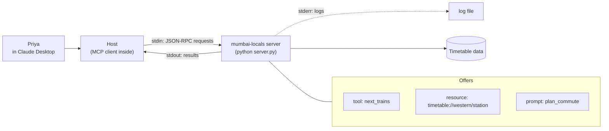

# Lab: Build and Connect Your Own MCP Server

> 📚 **Before you start**
>
> - [MCP Primitives: Tools, Resources and Prompts](../02-understanding-mcp/mcp-primitives-tools-resources-and-prompts.md)
> - [Initialisation, Version and Capability Negotiation](../04-the-mcp-lifecycle/initialisation-version-and-capability-negotiation.md)
> - [Building a Local MCP Server with FastMCP](building-a-local-mcp-server-with-fastmcp.md)
> - [Using MCP in Claude Desktop and Cursor](../03-how-mcp-components-talk/using-mcp-in-claude-desktop-and-cursor.md)

## What You'll Build

Priya commutes from Borivali to Churchgate on Mumbai's Western line every day. She wants to ask Claude *"I need to be at Churchgate by 9:30. Which train should I take from Borivali?"* and get an answer from a real timetable, not a guess.

You'll build a **Mumbai local train MCP server** that offers all three primitives:

- a **tool**, `next_trains`, that returns the next departures from a station after a given time, with an optional "fast trains only" filter;
- a **resource** for each station's full timetable, at `timetable://western/<station>`;
- a **prompt**, `plan_commute`, that sets up a commute-planning conversation.

You'll write the server by hand first, as a plain Python script that speaks JSON-RPC over stdio, so you can see every message. Then you'll drive it from a small client in a subprocess, exactly as a host would, check how it handles errors, and finally write the same server with the official SDK and connect it to Claude Desktop.



> 💡 **Key Insight**
>
> An MCP server is just a program that reads one JSON message per line from stdin and writes one per line to stdout. Once you've written one by hand, the SDKs stop looking like magic: they generate the schemas, validation and plumbing you're about to write yourself.

---

## Step 1: The Timetable Data

Real Western line timetables have hundreds of trains. A handful of morning departures towards Churchgate is enough to build and test with. Each entry is a departure time, the train type (slow or fast) and the arrival time at Churchgate.

```python
import json, os, subprocess, sys, tempfile, textwrap

TIMETABLE = {
    "borivali": [("08:02", "slow", "09:05"), ("08:10", "fast", "08:52"), ("08:21", "slow", "09:24"),
                 ("08:28", "fast", "09:10"), ("08:40", "slow", "09:43"), ("08:47", "fast", "09:29")],
    "andheri":  [("08:15", "slow", "08:52"), ("08:24", "fast", "08:52"), ("08:34", "slow", "09:11"),
                 ("08:42", "fast", "09:10"), ("08:53", "slow", "09:30"), ("09:01", "fast", "09:29")],
    "dadar":    [("08:30", "slow", "08:51"), ("08:38", "fast", "08:52"), ("08:49", "slow", "09:10"),
                 ("08:56", "fast", "09:10"), ("09:08", "slow", "09:29"), ("09:15", "fast", "09:29")],
}
print({station: len(trains) for station, trains in TIMETABLE.items()})
```

Output:

```
{'borivali': 6, 'andheri': 6, 'dadar': 6}
```

Times are `HH:MM` strings. Zero-padded 24-hour strings compare correctly as text (`"08:47" < "09:01"`), which keeps the server simple.

---

## Step 2: Write the Server

The server answers six methods:

| Method | What it returns |
|---|---|
| `server/discover` | Supported versions, capabilities, instructions |
| `tools/list`, `tools/call` | The `next_trains` definition; departures |
| `resources/list`, `resources/read` | One timetable resource per station; its contents |
| `prompts/list`, `prompts/get` | The `plan_commute` definition; its messages |

It follows the rules from earlier lessons: every request must carry a protocol version the server supports (otherwise error `-32022`), every result carries `serverInfo` in `_meta`, unknown methods get `-32601`, a bad resource URI gets `-32602`, and a tool that fails returns `isError: true` so the model can read the problem and try again. Logs go to stderr only.

```python
SERVER_CODE = textwrap.dedent('''
    import json, re, sys

    TIMETABLE = %s
    VERSIONS = ["2026-07-28"]
    SERVER_INFO = {"name": "mumbai-locals", "version": "1.0.0"}

    NEXT_TRAINS = {
        "name": "next_trains",
        "description": "Next Western line departures towards Churchgate from a station after a given time.",
        "inputSchema": {
            "type": "object",
            "properties": {
                "station": {"type": "string", "enum": sorted(TIMETABLE)},
                "after": {"type": "string", "pattern": "^[0-2][0-9]:[0-5][0-9]$",
                          "description": "24-hour time, e.g. 08:30"},
                "fast_only": {"type": "boolean", "default": False},
                "count": {"type": "integer", "minimum": 1, "maximum": 10, "default": 3},
            },
            "required": ["station", "after"],
        },
        "annotations": {"readOnlyHint": True},
    }
    PLAN_COMMUTE = {
        "name": "plan_commute",
        "description": "Plan a morning commute to Churchgate.",
        "arguments": [{"name": "from_station", "required": True},
                      {"name": "arrive_by", "description": "e.g. 09:30", "required": True}],
    }

    def log(*args):
        print(*args, file=sys.stderr, flush=True)

    def text_result(text, is_error=False):
        return {"content": [{"type": "text", "text": text}], "isError": is_error}

    def next_trains(args):
        station = str(args.get("station", "")).lower()
        after = args.get("after", "")
        if station not in TIMETABLE:
            return text_result(f"Unknown station {station!r}. Try one of: {', '.join(sorted(TIMETABLE))}.", True)
        if not re.fullmatch(r"[0-2][0-9]:[0-5][0-9]", str(after)):
            return text_result(f"'after' must look like 08:30, got {after!r}.", True)
        trains = [t for t in TIMETABLE[station] if t[0] >= after]
        if args.get("fast_only"):
            trains = [t for t in trains if t[1] == "fast"]
        trains = trains[: args.get("count", 3)]
        if not trains:
            return text_result(f"No more trains from {station.title()} after {after} in this timetable.")
        lines = [f"{dep} {kind:<4} reaches Churchgate {arr}" for dep, kind, arr in trains]
        return text_result(f"From {station.title()} after {after}:\\n" + "\\n".join(lines))

    def timetable_text(station):
        rows = [f"{dep}  {kind:<4}  arr {arr}" for dep, kind, arr in TIMETABLE[station]]
        return f"{station.title()} to Churchgate (morning)\\n" + "\\n".join(rows)

    def handle(method, params):
        if method == "server/discover":
            return {"supportedVersions": VERSIONS,
                    "capabilities": {"tools": {}, "resources": {}, "prompts": {}},
                    "instructions": "Western line, towards Churchgate only. Times are 24-hour IST."}
        if method == "tools/list":
            return {"tools": [NEXT_TRAINS]}
        if method == "tools/call":
            if params.get("name") != "next_trains":
                return text_result(f"Unknown tool {params.get('name')!r}.", True)
            return next_trains(params.get("arguments", {}))
        if method == "resources/list":
            return {"resources": [{"uri": f"timetable://western/{s}", "name": f"{s.title()} timetable",
                                   "mimeType": "text/plain"} for s in sorted(TIMETABLE)]}
        if method == "resources/read":
            uri = params.get("uri", "")
            station = uri.removeprefix("timetable://western/")
            if not uri.startswith("timetable://western/") or station not in TIMETABLE:
                raise LookupError(f"Resource not found: {uri}")
            return {"contents": [{"uri": uri, "mimeType": "text/plain", "text": timetable_text(station)}]}
        if method == "prompts/list":
            return {"prompts": [PLAN_COMMUTE]}
        if method == "prompts/get":
            a = params.get("arguments", {})
            text = (f"I take the Western line from {a.get('from_station')} to Churchgate and must arrive by "
                    f"{a.get('arrive_by')}. Use next_trains to find the latest train that still gets me there "
                    "on time, and one earlier backup. Prefer fast trains when they arrive in time.")
            return {"messages": [{"role": "user", "content": {"type": "text", "text": text}}]}
        raise NotImplementedError(method)

    def reply(id_, result=None, error=None):
        msg = {"jsonrpc": "2.0", "id": id_}
        if error:
            msg["error"] = error
        else:
            msg["result"] = {**result, "_meta": {"io.modelcontextprotocol/serverInfo": SERVER_INFO}}
        sys.stdout.write(json.dumps(msg) + "\\n")
        sys.stdout.flush()

    log("mumbai-locals started")
    for line in sys.stdin:
        msg = json.loads(line)
        if "id" not in msg:
            continue                                   # notifications need no reply
        params = msg.get("params", {})
        version = params.get("_meta", {}).get("io.modelcontextprotocol/protocolVersion")
        log("<-", msg["method"])
        if msg["method"] != "server/discover" and version not in VERSIONS:
            reply(msg["id"], error={"code": -32022, "message": "Unsupported protocol version",
                                    "data": {"supported": VERSIONS, "requested": version}})
            continue
        try:
            reply(msg["id"], handle(msg["method"], params))
        except NotImplementedError as e:
            reply(msg["id"], error={"code": -32601, "message": f"Method not found: {e}"})
        except LookupError as e:
            reply(msg["id"], error={"code": -32602, "message": str(e)})
    log("stdin closed, exiting")
''') % repr(TIMETABLE)

SERVER_DIR = tempfile.mkdtemp()
SERVER_PATH = os.path.join(SERVER_DIR, "server.py")
with open(SERVER_PATH, "w") as f:
    f.write(SERVER_CODE)
print("wrote", os.path.basename(SERVER_PATH), "-", len(SERVER_CODE.splitlines()), "lines")
```

Output:

```
wrote server.py - 114 lines
```

Notice what's **not** there: no `initialize` handshake and no session. Every request carries its own protocol version in `_meta`, so each one stands alone.

---

## Step 3: Drive It Like a Host

A host launches the server as a subprocess and talks over its stdin and stdout. This client sends one request at a time and reads one line back, which is all a single-threaded server needs. Logs go to a file, so you can read them afterwards.

```python
class LineClient:
    def __init__(self, path, version="2026-07-28"):
        self.log_path = os.path.join(SERVER_DIR, "server.log")
        self.log_file = open(self.log_path, "w")
        self.proc = subprocess.Popen([sys.executable, path], stdin=subprocess.PIPE,
                                     stdout=subprocess.PIPE, stderr=self.log_file, text=True)
        self.version, self.next_id = version, 0

    def request(self, method, **params):
        self.next_id += 1
        params["_meta"] = {"io.modelcontextprotocol/protocolVersion": self.version,
                           "io.modelcontextprotocol/clientCapabilities": {},
                           "io.modelcontextprotocol/clientInfo": {"name": "lab-client", "version": "0.1"}}
        self.proc.stdin.write(json.dumps({"jsonrpc": "2.0", "id": self.next_id,
                                          "method": method, "params": params}) + "\n")
        self.proc.stdin.flush()
        return json.loads(self.proc.stdout.readline())

    def close(self):
        self.proc.stdin.close()                      # EOF tells a stdio server to exit
        code = self.proc.wait(timeout=5)
        self.log_file.close()
        return code

client = LineClient(SERVER_PATH)
info = client.request("server/discover")["result"]
print("versions:", info["supportedVersions"])
print("capabilities:", sorted(info["capabilities"]))
print("server:", info["_meta"]["io.modelcontextprotocol/serverInfo"])
print("instructions:", info["instructions"])
```

Output:

```
versions: ['2026-07-28']
capabilities: ['prompts', 'resources', 'tools']
server: {'name': 'mumbai-locals', 'version': '1.0.0'}
instructions: Western line, towards Churchgate only. Times are 24-hour IST.
```

Now list and use each primitive. First the tool, the way a model would call it for Priya:

```python
tools = client.request("tools/list")["result"]["tools"]
print("tools:", [t["name"] for t in tools], "| required:", tools[0]["inputSchema"]["required"])

answer = client.request("tools/call", name="next_trains",
                        arguments={"station": "borivali", "after": "08:20", "fast_only": True})["result"]
print(answer["content"][0]["text"])
```

Output:

```
tools: ['next_trains'] | required: ['station', 'after']
From Borivali after 08:20:
08:28 fast reaches Churchgate 09:10
08:47 fast reaches Churchgate 09:29
```

The 08:47 fast reaches Churchgate at 09:29, just before Priya's 9:30 deadline, and the 08:28 fast is a safe backup. That's exactly the reasoning the model can now do from real data.

Next the resources and the prompt:

```python
resources = client.request("resources/list")["result"]["resources"]
print("resources:", [r["uri"] for r in resources])
page = client.request("resources/read", uri="timetable://western/dadar")["result"]
print(page["contents"][0]["text"])

prompts = client.request("prompts/list")["result"]["prompts"]
print("prompts:", [(p["name"], [a["name"] for a in p["arguments"]]) for p in prompts])
got = client.request("prompts/get", name="plan_commute",
                     arguments={"from_station": "Borivali", "arrive_by": "09:30"})["result"]
print(got["messages"][0]["role"], "->", got["messages"][0]["content"]["text"][:85] + "...")
```

Output:

```
resources: ['timetable://western/andheri', 'timetable://western/borivali', 'timetable://western/dadar']
Dadar to Churchgate (morning)
08:30  slow  arr 08:51
08:38  fast  arr 08:52
08:49  slow  arr 09:10
08:56  fast  arr 09:10
09:08  slow  arr 09:29
09:15  fast  arr 09:29
prompts: [('plan_commute', ['from_station', 'arrive_by'])]
user -> I take the Western line from Borivali to Churchgate and must arrive by 09:30. Use nex...
```

Remember who controls what: the **model** decides when to call `next_trains`, the **application** decides which timetable resources to attach, and the **user** picks the `plan_commute` prompt from a menu.

---

## Step 4: Check the Unhappy Paths

A good server fails in ways the model and the host can understand. Try a misspelt station, a badly formatted time, a resource that doesn't exist, a method the server doesn't know, and an old protocol version.

```python
bad_station = client.request("tools/call", name="next_trains", arguments={"station": "bandra", "after": "08:00"})
print("tool error:", bad_station["result"]["isError"], "-", bad_station["result"]["content"][0]["text"])

bad_time = client.request("tools/call", name="next_trains", arguments={"station": "andheri", "after": "8.30am"})
print("tool error:", bad_time["result"]["isError"], "-", bad_time["result"]["content"][0]["text"])

missing = client.request("resources/read", uri="timetable://central/thane")
print("resource:", missing["error"])

unknown = client.request("completion/complete")
print("method:", unknown["error"])

print("exit code:", client.close())

old = LineClient(SERVER_PATH, version="2025-06-18")
print("old version:", old.request("tools/list")["error"])
old.close()

with open(old.log_path) as f:
    print("server log:", f.read().split("\n")[:3])
```

Output:

```
tool error: True - Unknown station 'bandra'. Try one of: andheri, borivali, dadar.
tool error: True - 'after' must look like 08:30, got '8.30am'.
resource: {'code': -32602, 'message': 'Resource not found: timetable://central/thane'}
method: {'code': -32601, 'message': 'Method not found: completion/complete'}
exit code: 0
old version: {'code': -32022, 'message': 'Unsupported protocol version', 'data': {'supported': ['2026-07-28'], 'requested': '2025-06-18'}}
server log: ['mumbai-locals started', '<- tools/list', 'stdin closed, exiting']
```

The two kinds of failure behave differently, on purpose:

| Failure | Returned as | Who sees it |
|---|---|---|
| Bad tool arguments, unknown station | A **result** with `isError: true` | The model, which can fix its call and retry |
| Missing resource, unknown method, wrong version | A JSON-RPC **error** | The host, which handles it in code |

The error for the old version lists `supported` versions, so a client can switch to one the server accepts. And the server's log went to stderr, never mixing with the protocol messages on stdout.

---

## Step 5: The Same Server with the SDK

Writing the protocol by hand taught you what's on the wire. For a real server, use the official Python SDK, which generates the schemas from type hints, validates arguments, handles both protocol eras and every transport. The whole server shrinks to this:

```python
# not-run: needs the `mcp` package (2.x); save as server.py in a uv project
from typing import Annotated, Literal

from pydantic import Field
from mcp.server.mcpserver import MCPServer
from mcp.server.mcpserver.exceptions import ToolError
from mcp.types import ToolAnnotations

from timetable import TIMETABLE        # the dict from Step 1, in its own module

Station = Literal["andheri", "borivali", "dadar"]

mcp = MCPServer("mumbai-locals",
                instructions="Western line, towards Churchgate only. Times are 24-hour IST.")

@mcp.tool(annotations=ToolAnnotations(read_only_hint=True))
def next_trains(
    station: Station,
    after: Annotated[str, Field(pattern=r"^[0-2][0-9]:[0-5][0-9]$", description="24-hour time, e.g. 08:30")],
    fast_only: bool = False,
    count: Annotated[int, Field(ge=1, le=10)] = 3,
) -> str:
    """Next Western line departures towards Churchgate from a station after a given time."""
    trains = [t for t in TIMETABLE[station] if t[0] >= after]
    if fast_only:
        trains = [t for t in trains if t[1] == "fast"]
    if not trains:
        raise ToolError(f"No more trains from {station.title()} after {after} in this timetable.")
    return "\n".join(f"{dep} {kind:<4} reaches Churchgate {arr}" for dep, kind, arr in trains[:count])

@mcp.resource("timetable://western/{station}")
def timetable(station: str) -> str:
    """The full morning timetable for one station."""
    rows = [f"{dep}  {kind:<4}  arr {arr}" for dep, kind, arr in TIMETABLE[station]]
    return f"{station.title()} to Churchgate (morning)\n" + "\n".join(rows)

@mcp.prompt()
def plan_commute(from_station: str, arrive_by: str) -> str:
    """Plan a morning commute to Churchgate."""
    return (f"I take the Western line from {from_station} to Churchgate and must arrive by {arrive_by}. "
            "Use next_trains to find the latest train that still gets me there on time, and one earlier "
            "backup. Prefer fast trains when they arrive in time.")

if __name__ == "__main__":
    mcp.run()                          # stdio
```

Every piece of Step 2 has a counterpart: the `Literal` type becomes the `enum`, `Field(pattern=...)` becomes the schema pattern, the docstring becomes the description, `ToolError` becomes `isError: true`, and the URI template in `@mcp.resource` replaces your hand-written prefix check. Because the SDK serves both eras, older hosts that still send `initialize` work too.

Test it before connecting anything:

```bash
uv init mumbai-locals && cd mumbai-locals
uv add "mcp[cli]"
# add server.py and timetable.py
uv run mcp dev server.py          # opens the MCP Inspector against your server
```

In the Inspector, list the tools, call `next_trains` with `{"station": "borivali", "after": "08:20", "fast_only": true}`, read `timetable://western/dadar`, and fill in the `plan_commute` prompt. You should see the same answers as in Step 3.

---

## Step 6: Connect It to Claude Desktop

Add the server to `claude_desktop_config.json` (Settings, then Developer, then Edit Config), using the absolute path of your project:

```json
{
  "mcpServers": {
    "mumbai-locals": {
      "command": "uv",
      "args": ["--directory", "/Users/priya/mumbai-locals", "run", "server.py"]
    }
  }
}
```

Or let the SDK's CLI write the entry for you:

```bash
uv run mcp install server.py --name mumbai-locals
```

Fully quit and restart Claude Desktop. Then:

1. Check that `mumbai-locals` and its `next_trains` tool appear in the tools menu.
2. Ask: *"I need to be at Churchgate by 9:30. Which train should I take from Borivali?"* Approve the `next_trains` call when asked. Claude should suggest the 08:47 fast with the 08:28 fast as a backup.
3. Attach the Dadar timetable from the resources menu and ask: *"Which is the last slow train that gets me in before 9:15?"*
4. Pick the `plan_commute` prompt, fill in the station and time, and send it.

```mermaid
sequenceDiagram
    participant P as Priya
    participant H as Claude Desktop
    participant S as mumbai-locals
    H->>S: launch uv run server.py
    H->>S: server/discover, tools/list, resources/list, prompts/list
    P->>H: Churchgate by 9:30, from Borivali?
    H->>S: tools/call next_trains (borivali, 08:20, fast_only)
    S-->>H: 08:28 fast arr 09:10, 08:47 fast arr 09:29
    H-->>P: Take the 08:47 fast; the 08:28 is your backup
```

**If it doesn't show up:** check the host's MCP logs (on macOS, `~/Library/Logs/Claude/mcp-server-mumbai-locals.log`). The usual causes are a relative path in `args`, `uv` not being on the PATH Claude Desktop sees (use its absolute path, from `which uv`), or a stray `print()` writing to stdout.

---

## Try It Yourself

1. **Add a `count` check.** Call the hand-written server with `count: 1` and `fast_only: false` from Andheri after 08:30. What comes back?
2. **Add a station.** Add a `"bandra"` entry to `TIMETABLE` with two trains, rewrite the server file, and confirm that `resources/list` now has four entries and the earlier "bandra" error has gone.
3. **Explain the split.** Why is an unknown station a tool result with `isError: true`, while an unknown resource URI is a JSON-RPC error?

<details>
<summary>Show answers</summary>

**1.**

```python
c = LineClient(SERVER_PATH)
r = c.request("tools/call", name="next_trains", arguments={"station": "andheri", "after": "08:30", "count": 1})
print(r["result"]["content"][0]["text"])
c.close()
```

Output:

```
From Andheri after 08:30:
08:34 slow reaches Churchgate 09:11
```

**2.** `SERVER_CODE` has the old timetable baked into its `TIMETABLE = ...` line, so swap that line and rewrite the file:

```python
TIMETABLE["bandra"] = [("08:44", "slow", "09:07"), ("08:59", "fast", "09:13")]
lines = SERVER_CODE.split("\n")
lines = [("TIMETABLE = " + repr(TIMETABLE)) if l.startswith("TIMETABLE = ") else l for l in lines]
with open(SERVER_PATH, "w") as f:
    f.write("\n".join(lines))

c = LineClient(SERVER_PATH)
print([r["uri"] for r in c.request("resources/list")["result"]["resources"]])
r = c.request("tools/call", name="next_trains", arguments={"station": "bandra", "after": "08:00"})
print(r["result"]["isError"], "-", r["result"]["content"][0]["text"])
c.close()
```

Output:

```
['timetable://western/andheri', 'timetable://western/bandra', 'timetable://western/borivali', 'timetable://western/dadar']
False - From Bandra after 08:00:
08:44 slow reaches Churchgate 09:07
08:59 fast reaches Churchgate 09:13
```

**3.** A tool call is chosen by the model, so a mistake in it is something the model should see and correct: the result goes back into its context. A resource read is done by the host application in code, usually from a URI it got from `resources/list`, so a bad URI is a programming problem the host should handle, signalled with a standard JSON-RPC error (`-32602`).

</details>

---

## What You've Learned

- **A stdio MCP server is a loop**: read a JSON line from stdin, dispatch on `method`, write one JSON line to stdout, log to stderr, exit when stdin closes.
- **One server can offer all three primitives**: a model-controlled tool, application-controlled resources and a user-controlled prompt.
- **Each modern request stands alone**, carrying its protocol version in `_meta`; an unsupported version gets `-32022` with the supported list.
- **Tool failures are results for the model; protocol failures are errors for the host.**
- **The SDK version is the same server in a quarter of the code**, with schemas from type hints, and it also serves older clients.
- **Connecting is configuration**: an absolute path in `claude_desktop_config.json` or `mcp install`, a restart, and a look at the logs if it doesn't appear.

---

**Up next:** [Lab: Expense tracker MCP server](lab-expense-tracker-mcp-server.md)
