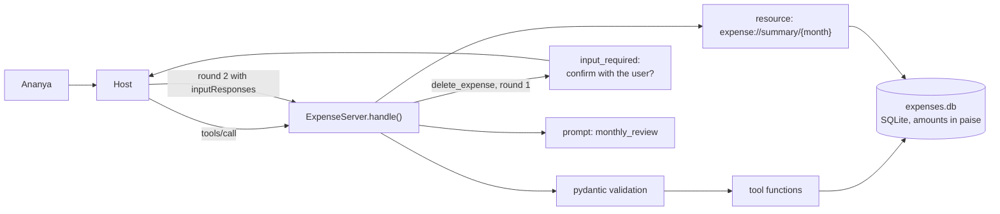
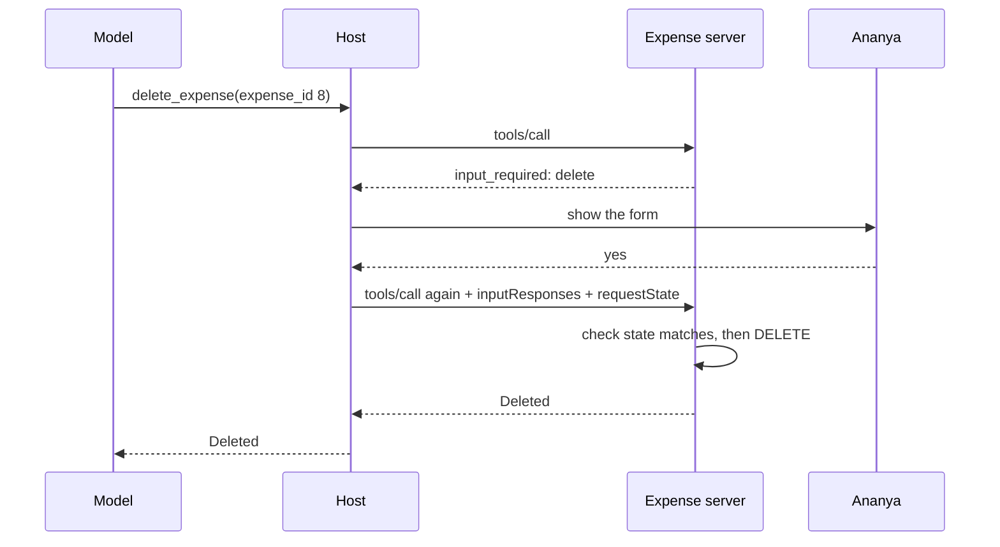

# Lab: Expense Tracker MCP Server

> 📚 **Before you start**
>
> - [Lab: Build and connect your own MCP server](lab-build-and-connect-your-own-mcp-server.md)
> - [Building a Local MCP Server with FastMCP](building-a-local-mcp-server-with-fastmcp.md), for schemas from type hints
> - [Operation and Shutdown](../04-the-mcp-lifecycle/operation-and-shutdown.md), for input-required results and elicitation
> - [Relational Databases and SQL](../../databases-sql-and-nosql/course.md#m2), for basic `SELECT`, `INSERT` and `GROUP BY`

## What You'll Build

Ananya, a software engineer in Pune, wants to tell Claude *"I spent ₹450 on a Swiggy order last night"* and later ask *"How did I do on food this month compared to my budget?"*, with the answers coming from her own records, stored on her laptop.

You'll build an **expense tracker MCP server** backed by SQLite (which ships with Python):

| Primitive | Name | Who uses it |
|---|---|---|
| Tool | `add_expense` | The model, to record a spend |
| Tool | `list_expenses` | The model, to look things up (read-only) |
| Tool | `summary_by_category` | The model, for totals (read-only) |
| Tool | `delete_expense` | The model, but **only after Ananya confirms** (destructive) |
| Resource template | `expense://summary/{month}` | The app, to attach a month's summary |
| Prompt | `monthly_review` | Ananya, from the prompt menu |

This lab adds four things the timetable server didn't have: **writes** to real storage, **input validation** with pydantic, **tool annotations** that tell the host which tools are safe, and a **confirmation step** that asks the user before deleting anything, using the stateless input-required pattern.



> 💡 **Key Insight**
>
> The server, not the model, is the last line of defence for your data. Validate every argument, mark which tools change or destroy things so the host can warn, and for anything irreversible, ask the human through the protocol instead of trusting that the model asked first.

---

## Step 1: The Database

Money is stored as an integer number of **paise** (₹1 = 100 paise), never as a float, so that ₹0.10 + ₹0.20 is exactly ₹0.30. `AUTOINCREMENT` makes sure the id of a deleted expense is never handed to a new one, so an id the model saw earlier can't silently point at a different row. The `CHECK` constraints make the database itself reject nonsense, even if a bug slips past the Python code.

```python
import json, os, sqlite3, tempfile
from datetime import date
from typing import Annotated, Literal

from pydantic import BaseModel, Field, ValidationError

CATEGORIES = ("food", "transport", "rent", "shopping", "bills", "health", "other")
DB_PATH = os.path.join(tempfile.mkdtemp(), "expenses.db")

def connect(path=DB_PATH):
    db = sqlite3.connect(path)
    db.row_factory = sqlite3.Row
    db.execute(f"""
        CREATE TABLE IF NOT EXISTS expenses (
            id INTEGER PRIMARY KEY AUTOINCREMENT,
            spent_on TEXT NOT NULL,
            amount_paise INTEGER NOT NULL CHECK (amount_paise > 0),
            category TEXT NOT NULL CHECK (category IN {CATEGORIES}),
            note TEXT NOT NULL DEFAULT ''
        )""")
    return db

db = connect()
seed = [("2026-10-01", 1800000, "rent", "October rent"), ("2026-10-03", 45000, "food", "Swiggy biryani"),
        ("2026-10-04", 12000, "transport", "Uber to Hinjewadi"), ("2026-10-08", 229900, "shopping", "Running shoes"),
        ("2026-10-09", 31000, "food", "Groceries, D-Mart"), ("2026-10-11", 89900, "bills", "Electricity"),
        ("2026-09-28", 52000, "food", "Team dinner")]
with db:                                                # one transaction
    db.executemany("INSERT INTO expenses (spent_on, amount_paise, category, note) VALUES (?, ?, ?, ?)", seed)

print(db.execute("SELECT COUNT(*) FROM expenses").fetchone()[0], "rows")
try:
    with db:
        db.execute("INSERT INTO expenses (spent_on, amount_paise, category) VALUES ('2026-10-12', -500, 'food')")
except sqlite3.IntegrityError as e:
    print("rejected by the database:", e)
```

Output:

```
7 rows
rejected by the database: CHECK constraint failed: amount_paise > 0
```

A small helper formats paise as Indian rupees, with the lakh-style grouping Ananya is used to (₹1,23,456.00):

```python
def rupees(paise):
    whole, frac = divmod(paise, 100)
    s = str(whole)
    if len(s) > 3:
        head, tail = s[:-3], s[-3:]
        groups = []
        while len(head) > 2:
            groups.insert(0, head[-2:])
            head = head[:-2]
        s = ",".join([head] + groups + [tail]) if head else ",".join(groups + [tail])
    return f"₹{s}.{frac:02d}"

print(rupees(45000), rupees(1800000), rupees(12345678), rupees(5))
```

Output:

```
₹450.00 ₹18,000.00 ₹1,23,456.78 ₹0.05
```

---

## Step 2: The Tools, with Validation

Each tool's arguments are a pydantic model. That gives you the JSON Schema for `tools/list` for free, and turns bad input into a clear message the model can act on. `Literal` becomes an `enum`, `Field(gt=0, le=...)` becomes `exclusiveMinimum` and `maximum`, and `date` becomes `"format": "date"`.

```python
Month = Annotated[str, Field(pattern=r"^\d{4}-(0[1-9]|1[0-2])$", description="Month as YYYY-MM, e.g. 2026-10")]

class AddExpense(BaseModel):
    amount: Annotated[float, Field(gt=0, le=1_000_000, description="Amount in rupees, e.g. 450 or 129.50")]
    category: Literal[CATEGORIES]
    note: Annotated[str, Field(max_length=200)] = ""
    spent_on: Annotated[date | None, Field(description="Date of the spend; defaults to today")] = None

class ListExpenses(BaseModel):
    month: Month
    category: Literal[CATEGORIES] | None = None

class Summary(BaseModel):
    month: Month

class DeleteExpense(BaseModel):
    expense_id: Annotated[int, Field(gt=0)]

def add_expense(a: AddExpense):
    spent_on = (a.spent_on or date(2026, 10, 15)).isoformat()   # a fixed "today" keeps this lab repeatable
    with db:
        cur = db.execute("INSERT INTO expenses (spent_on, amount_paise, category, note) VALUES (?, ?, ?, ?)",
                         (spent_on, round(a.amount * 100), a.category, a.note))
    return f"Saved #{cur.lastrowid}: {rupees(round(a.amount * 100))} on {a.category} ({spent_on})"

def list_expenses(a: ListExpenses):
    sql, params = "SELECT * FROM expenses WHERE substr(spent_on, 1, 7) = ?", [a.month]
    if a.category:
        sql, params = sql + " AND category = ?", params + [a.category]
    rows = db.execute(sql + " ORDER BY spent_on, id", params).fetchall()
    if not rows:
        return f"No expenses for {a.month}" + (f" in {a.category}" if a.category else "") + "."
    return "\n".join(f"#{r['id']} {r['spent_on']} {r['category']:<9} {rupees(r['amount_paise']):>12}  {r['note']}"
                     for r in rows)

def summary_text(month):
    rows = db.execute("""SELECT category, SUM(amount_paise) AS total, COUNT(*) AS n FROM expenses
                         WHERE substr(spent_on, 1, 7) = ? GROUP BY category ORDER BY total DESC""",
                      (month,)).fetchall()
    if not rows:
        return f"No expenses for {month}."
    lines = [f"{r['category']:<9} {rupees(r['total']):>12}  ({r['n']} item{'s' if r['n'] > 1 else ''})" for r in rows]
    lines.append(f"{'total':<9} {rupees(sum(r['total'] for r in rows)):>12}")
    return f"Spending for {month}\n" + "\n".join(lines)

def summary_by_category(a: Summary):
    return summary_text(a.month)

TOOLS = {   # name -> (function, argument model, description, annotations)
    "add_expense": (add_expense, AddExpense, "Record one expense.",
                    {"readOnlyHint": False, "destructiveHint": False, "idempotentHint": False}),
    "list_expenses": (list_expenses, ListExpenses, "List a month's expenses, optionally for one category.",
                      {"readOnlyHint": True}),
    "summary_by_category": (summary_by_category, Summary, "Total spending per category for a month.",
                            {"readOnlyHint": True}),
    "delete_expense": (None, DeleteExpense, "Delete one expense by id. Asks the user to confirm first.",
                       {"readOnlyHint": False, "destructiveHint": True, "idempotentHint": True}),
}

def clean(schema):
    """Drop pydantic's auto-generated 'title' keys so the schema reads like hand-written JSON Schema."""
    if isinstance(schema, dict):
        return {k: clean(v) for k, v in schema.items() if k != "title"}
    if isinstance(schema, list):
        return [clean(v) for v in schema]
    return schema

print(json.dumps(clean(AddExpense.model_json_schema()), indent=1))
```

Output:

```
{
 "properties": {
  "amount": {
   "description": "Amount in rupees, e.g. 450 or 129.50",
   "exclusiveMinimum": 0,
   "maximum": 1000000,
   "type": "number"
  },
  "category": {
   "enum": [
    "food",
    "transport",
    "rent",
    "shopping",
    "bills",
    "health",
    "other"
   ],
   "type": "string"
  },
  "note": {
   "default": "",
   "maxLength": 200,
   "type": "string"
  },
  "spent_on": {
   "anyOf": [
    {
     "format": "date",
     "type": "string"
    },
    {
     "type": "null"
    }
   ],
   "default": null,
   "description": "Date of the spend; defaults to today"
  }
 },
 "required": [
  "amount",
  "category"
 ],
 "type": "object"
}
```

`delete_expense` has no plain function yet: it needs the confirmation step, which you'll write in Step 4.

What the annotations mean to a host:

| Hint | Meaning | What a host might do |
|---|---|---|
| `readOnlyHint: true` | Doesn't change anything | Allow it without asking every time |
| `destructiveHint: true` | May delete or overwrite data | Show a stronger warning before running |
| `idempotentHint: true` | Calling it twice with the same arguments has no extra effect | Retry it safely after a timeout |

They're **hints**: a host can't verify them, so it should only trust them from servers it trusts. That's why the server also enforces its own confirmation for deletes.

---

## Step 3: The Server

Now the dispatcher. It follows the same shape as the timetable server, minus the pipes: `handle()` takes one request and returns one response, so you can test it directly. (Wrapping it in a stdin loop is the same eight lines as before.)

```python
SERVER_INFO = {"name": "expense-tracker", "version": "1.0.0"}

def ok(id_, **result):
    return {"jsonrpc": "2.0", "id": id_, "result": {"resultType": "complete", **result,
                                                     "_meta": {"io.modelcontextprotocol/serverInfo": SERVER_INFO}}}

def err(id_, code, message, data=None):
    error = {"code": code, "message": message}
    if data is not None:
        error["data"] = data
    return {"jsonrpc": "2.0", "id": id_, "error": error}

def tool_result(text, is_error=False):
    return {"content": [{"type": "text", "text": text}], "isError": is_error}

def explain(e: ValidationError):
    problems = [f"{'.'.join(map(str, p['loc'])) or 'arguments'}: {p['msg']}" for p in e.errors()]
    return "Invalid arguments. " + "; ".join(problems)

class ExpenseServer:
    def handle(self, msg):
        params, id_ = msg.get("params", {}), msg["id"]
        version = params.get("_meta", {}).get("io.modelcontextprotocol/protocolVersion")
        if msg["method"] != "server/discover" and version != "2026-07-28":
            return err(id_, -32022, "Unsupported protocol version", {"supported": ["2026-07-28"], "requested": version})
        method = getattr(self, "m_" + msg["method"].replace("/", "_"), None)
        if method is None:
            return err(id_, -32601, f"Method not found: {msg['method']}")
        return method(id_, params)

    def m_server_discover(self, id_, params):
        return ok(id_, supportedVersions=["2026-07-28"],
                  capabilities={"tools": {}, "resources": {}, "prompts": {}},
                  instructions="Amounts are in Indian rupees. Months are YYYY-MM.")

    def m_tools_list(self, id_, params):
        return ok(id_, tools=[{"name": name, "description": desc, "annotations": ann,
                               "inputSchema": clean(model.model_json_schema())}
                              for name, (_, model, desc, ann) in TOOLS.items()])

    def m_tools_call(self, id_, params):
        name = params.get("name")
        if name not in TOOLS:
            return err(id_, -32602, f"Unknown tool: {name}")
        fn, model, _, _ = TOOLS[name]
        try:
            args = model.model_validate(params.get("arguments", {}))
        except ValidationError as e:
            return ok(id_, **tool_result(explain(e), is_error=True))
        if name == "delete_expense":
            return self.delete_with_confirmation(id_, args, params)
        return ok(id_, **tool_result(fn(args)))

    def m_resources_templates_list(self, id_, params):
        return ok(id_, resourceTemplates=[{"uriTemplate": "expense://summary/{month}", "name": "Monthly summary",
                                           "mimeType": "text/plain"}])

    def m_resources_read(self, id_, params):
        uri = params.get("uri", "")
        month = uri.removeprefix("expense://summary/")
        try:
            Summary(month=month)
        except ValidationError:
            return err(id_, -32602, f"Resource not found: {uri}")
        return ok(id_, contents=[{"uri": uri, "mimeType": "text/plain", "text": summary_text(month)}])

    def m_prompts_list(self, id_, params):
        return ok(id_, prompts=[{"name": "monthly_review", "description": "Review a month's spending.",
                                 "arguments": [{"name": "month", "description": "YYYY-MM", "required": True},
                                               {"name": "food_budget", "description": "Rupees", "required": False}]}])

    def m_prompts_get(self, id_, params):
        a = params.get("arguments", {})
        month, budget = a.get("month", ""), a.get("food_budget")
        uri = f"expense://summary/{month}"
        ask = f"Review my spending for {month}. Point out the biggest categories and anything unusual."
        if budget:
            ask += f" My food budget is ₹{budget}; tell me how I'm doing against it."
        return ok(id_, messages=[
            {"role": "user", "content": {"type": "resource",
                                         "resource": {"uri": uri, "mimeType": "text/plain", "text": summary_text(month)}}},
            {"role": "user", "content": {"type": "text", "text": ask}}])

server = ExpenseServer()
next_id = 0

def call(method, **params):
    """Send one request the way a modern client would, and return the response."""
    global next_id
    next_id += 1
    params["_meta"] = {"io.modelcontextprotocol/protocolVersion": "2026-07-28",
                       "io.modelcontextprotocol/clientCapabilities": {"elicitation": {"form": {}}}}
    return server.handle({"jsonrpc": "2.0", "id": next_id, "method": method, "params": params})

for t in call("tools/list")["result"]["tools"]:
    print(f"{t['name']:<20} {t['annotations']}")
```

Output:

```
add_expense          {'readOnlyHint': False, 'destructiveHint': False, 'idempotentHint': False}
list_expenses        {'readOnlyHint': True}
summary_by_category  {'readOnlyHint': True}
delete_expense       {'readOnlyHint': False, 'destructiveHint': True, 'idempotentHint': True}
```

Try the tools as a model would after Ananya's message *"I spent ₹450 on a Swiggy order last night"*:

```python
def text(response):
    r = response["result"]
    return ("ERROR " if r.get("isError") else "") + r["content"][0]["text"]

print(text(call("tools/call", name="add_expense",
                arguments={"amount": 450, "category": "food", "note": "Swiggy order", "spent_on": "2026-10-14"})))
print(text(call("tools/call", name="list_expenses", arguments={"month": "2026-10", "category": "food"})))
print(text(call("tools/call", name="summary_by_category", arguments={"month": "2026-10"})))
```

Output:

```
Saved #8: ₹450.00 on food (2026-10-14)
#2 2026-10-03 food           ₹450.00  Swiggy biryani
#5 2026-10-09 food           ₹310.00  Groceries, D-Mart
#8 2026-10-14 food           ₹450.00  Swiggy order
Spending for 2026-10
rent        ₹18,000.00  (1 item)
shopping     ₹2,299.00  (1 item)
food         ₹1,210.00  (3 items)
bills          ₹899.00  (1 item)
transport      ₹120.00  (1 item)
total       ₹22,528.00
```

And the inputs a confused model might send:

```python
print(text(call("tools/call", name="add_expense", arguments={"amount": -450, "category": "food"})))
print(text(call("tools/call", name="add_expense", arguments={"amount": 450, "category": "groceries"})))
print(text(call("tools/call", name="list_expenses", arguments={"month": "October"})))
print(call("tools/call", name="export_csv", arguments={})["error"])
```

Output:

```
ERROR Invalid arguments. amount: Input should be greater than 0
ERROR Invalid arguments. category: Input should be 'food', 'transport', 'rent', 'shopping', 'bills', 'health' or 'other'
ERROR Invalid arguments. month: String should match pattern '^\d{4}-(0[1-9]|1[0-2])$'
{'code': -32602, 'message': 'Unknown tool: export_csv'}
```

Each message names the field and the problem, so the model can fix its call ("groceries" isn't a category, so it should use "food"). A misspelt tool name is a protocol error instead, because a host should never send a name that wasn't in `tools/list`.

---

## Step 4: Confirm Before Deleting

A model can misread *"remove the duplicate Swiggy entry"* and pick the wrong id. So `delete_expense` asks the human first, using the input-required pattern:

1. The first call returns `resultType: "input_required"` with an elicitation form describing **exactly** what would be deleted, plus a `requestState` naming the expense.
2. The host shows the form to Ananya and retries the same tool call with her answer in `inputResponses` and the `requestState` echoed back.
3. The server checks that the state matches the arguments, and only then deletes.



The server keeps nothing between the two rounds: everything it needs is in the retried request, so it would work even behind a load balancer. This server runs locally for one person, so a plain JSON state is enough; the remote server lesson showed how to sign it when strangers could tamper with it.

```python
def delete_with_confirmation(self, id_, args, params):
    row = db.execute("SELECT * FROM expenses WHERE id = ?", (args.expense_id,)).fetchone()
    if row is None:
        return ok(id_, **tool_result(f"No expense #{args.expense_id}. Use list_expenses to find the id.", True))
    described = f"#{row['id']} {rupees(row['amount_paise'])} on {row['category']} ({row['spent_on']}, {row['note']})"

    if "inputResponses" not in params:                                   # round 1: ask
        return {"jsonrpc": "2.0", "id": id_, "result": {
            "resultType": "input_required",
            "inputRequests": {"confirm": {"method": "elicitation/create", "params": {
                "mode": "form", "message": f"Delete {described}? This can't be undone.",
                "requestedSchema": {"type": "object", "properties": {"delete": {"type": "boolean"}},
                                    "required": ["delete"]}}}},
            "requestState": json.dumps({"expense_id": row["id"], "amount_paise": row["amount_paise"]})}}

    state = json.loads(params.get("requestState", "{}"))                # round 2: verify, then act
    if state.get("expense_id") != args.expense_id:
        return err(id_, -32602, "requestState was issued for a different request")
    if state.get("amount_paise") != row["amount_paise"]:
        return ok(id_, **tool_result("The expense changed since you confirmed. Please try again.", True))
    answer = params["inputResponses"].get("confirm", {})
    if answer.get("action") != "accept" or not answer.get("content", {}).get("delete"):
        return ok(id_, **tool_result(f"Kept {described}. Nothing was deleted."))
    with db:
        db.execute("DELETE FROM expenses WHERE id = ?", (row["id"],))
    return ok(id_, **tool_result(f"Deleted {described}."))

ExpenseServer.delete_with_confirmation = delete_with_confirmation
```

Now play the host. First Ananya says no, then yes:

```python
def ask_then_answer(expense_id, answer):
    first = call("tools/call", name="delete_expense", arguments={"expense_id": expense_id})["result"]
    print("round 1:", first["resultType"], "|", first["inputRequests"]["confirm"]["params"]["message"])
    second = call("tools/call", name="delete_expense", arguments={"expense_id": expense_id},
                  inputResponses={"confirm": answer}, requestState=first["requestState"])
    print("round 2:", text(second))

ask_then_answer(8, {"action": "accept", "content": {"delete": False}})
ask_then_answer(8, {"action": "decline"})
ask_then_answer(8, {"action": "accept", "content": {"delete": True}})
print(text(call("tools/call", name="delete_expense", arguments={"expense_id": 8})))
```

Output:

```
round 1: input_required | Delete #8 ₹450.00 on food (2026-10-14, Swiggy order)? This can't be undone.
round 2: Kept #8 ₹450.00 on food (2026-10-14, Swiggy order). Nothing was deleted.
round 1: input_required | Delete #8 ₹450.00 on food (2026-10-14, Swiggy order)? This can't be undone.
round 2: Kept #8 ₹450.00 on food (2026-10-14, Swiggy order). Nothing was deleted.
round 1: input_required | Delete #8 ₹450.00 on food (2026-10-14, Swiggy order)? This can't be undone.
round 2: Deleted #8 ₹450.00 on food (2026-10-14, Swiggy order).
ERROR No expense #8. Use list_expenses to find the id.
```

A request that reuses the state from a different expense is refused, so an approval for one row can't be replayed against another:

```python
first = call("tools/call", name="delete_expense", arguments={"expense_id": 2})["result"]
swapped = call("tools/call", name="delete_expense", arguments={"expense_id": 1},
               inputResponses={"confirm": {"action": "accept", "content": {"delete": True}}},
               requestState=first["requestState"])
print(swapped["error"])
print(db.execute("SELECT COUNT(*) FROM expenses WHERE id IN (1, 2)").fetchone()[0], "rows still there")
```

Output:

```
{'code': -32602, 'message': 'requestState was issued for a different request'}
2 rows still there
```

---

## Step 5: Resources and the Prompt

The app can attach a month's summary directly through the resource template, without the model calling anything:

```python
print(call("resources/templates/list")["result"]["resourceTemplates"][0]["uriTemplate"])
print(call("resources/read", uri="expense://summary/2026-09")["result"]["contents"][0]["text"])
print(call("resources/read", uri="expense://summary/last-month")["error"])
```

Output:

```
expense://summary/{month}
Spending for 2026-09
food           ₹520.00  (1 item)
total          ₹520.00
{'code': -32602, 'message': 'Resource not found: expense://summary/last-month'}
```

And when Ananya picks **monthly_review** from the prompt menu, the server builds a ready-made conversation: the summary is embedded as a resource, followed by her request.

```python
msgs = call("prompts/get", name="monthly_review", arguments={"month": "2026-10", "food_budget": "6000"})["result"]["messages"]
for m in msgs:
    c = m["content"]
    body = c["resource"]["text"] if c["type"] == "resource" else c["text"]
    print(f"[{m['role']} / {c['type']}]")
    print(body)
```

Output:

```
[user / resource]
Spending for 2026-10
rent        ₹18,000.00  (1 item)
shopping     ₹2,299.00  (1 item)
bills          ₹899.00  (1 item)
food           ₹760.00  (2 items)
transport      ₹120.00  (1 item)
total       ₹22,078.00
[user / text]
Review my spending for 2026-10. Point out the biggest categories and anything unusual. My food budget is ₹6000; tell me how I'm doing against it.
```

Food so far is ₹760, well inside the ₹6,000 budget, and rent is most of the month's total. Those are the points the model should make, now grounded in Ananya's real numbers.

---

## Step 6: The Same Server with the SDK

With the official Python SDK, the validation, schemas and the two-round confirmation come built in. The confirmation is written as a **resolver**: a function the SDK runs before the tool body, which returns `Elicit(...)` to ask the user. On a modern connection the SDK turns that into the input-required round trip you wrote in Step 4 (sealing the state for you); on an older connection it sends a classic elicitation request instead.

```python
# not-run: needs the `mcp` package (2.x); save as server.py
import sqlite3
from datetime import date
from pathlib import Path
from typing import Annotated, Literal

from pydantic import BaseModel, Field
from mcp.server.mcpserver import Elicit, ElicitationResult, AcceptedElicitation, MCPServer, Resolve
from mcp.server.mcpserver.exceptions import ToolError
from mcp.types import ToolAnnotations

DB_PATH = Path.home() / ".expense-tracker" / "expenses.db"      # absolute: hosts start servers elsewhere
Category = Literal["food", "transport", "rent", "shopping", "bills", "health", "other"]
Month = Annotated[str, Field(pattern=r"^\d{4}-(0[1-9]|1[0-2])$")]

mcp = MCPServer("expense-tracker", instructions="Amounts are in Indian rupees. Months are YYYY-MM.")

def db():
    DB_PATH.parent.mkdir(exist_ok=True)
    conn = sqlite3.connect(DB_PATH)
    conn.row_factory = sqlite3.Row
    # CREATE TABLE IF NOT EXISTS ... (as in Step 1)
    return conn

@mcp.tool(annotations=ToolAnnotations(read_only_hint=False, destructive_hint=False))
def add_expense(amount: Annotated[float, Field(gt=0, le=1_000_000)], category: Category,
                note: str = "", spent_on: date | None = None) -> str:
    """Record one expense. Amount is in rupees."""
    ...

@mcp.tool(annotations=ToolAnnotations(read_only_hint=True))
def summary_by_category(month: Month) -> str:
    """Total spending per category for a month."""
    ...

class Confirm(BaseModel):
    delete: bool

def confirm_delete(expense_id: int):                           # gets the tool's own argument by name
    row = db().execute("SELECT * FROM expenses WHERE id = ?", (expense_id,)).fetchone()
    if row is None:
        raise ToolError(f"No expense #{expense_id}. Use list_expenses to find the id.")
    return Elicit(f"Delete #{expense_id} (Rs {row['amount_paise'] / 100:.2f}, {row['note']})? "
                  "This can't be undone.", Confirm)

@mcp.tool(annotations=ToolAnnotations(read_only_hint=False, destructive_hint=True, idempotent_hint=True))
def delete_expense(expense_id: int,
                   answer: Annotated[ElicitationResult[Confirm], Resolve(confirm_delete)]) -> str:
    """Delete one expense by id. Asks the user to confirm first."""
    if not isinstance(answer, AcceptedElicitation) or not answer.data.delete:
        return "Nothing was deleted."
    with db() as conn:
        conn.execute("DELETE FROM expenses WHERE id = ?", (expense_id,))
    return f"Deleted #{expense_id}."

@mcp.resource("expense://summary/{month}")
def monthly_summary(month: str) -> str:
    """Spending per category for one month."""
    ...

@mcp.prompt()
def monthly_review(month: str, food_budget: str = "") -> str:
    """Review a month's spending."""
    ...

if __name__ == "__main__":
    mcp.run()
```

The `answer` parameter isn't part of the tool's input schema: the model only ever sees `expense_id`. Annotating it as `ElicitationResult[Confirm]` lets the tool handle "no", "decline" and "cancel" itself; annotating it as plain `Confirm` would make the SDK abort the call on decline or cancel.

Connect it exactly like the timetable server: `uv run mcp dev server.py` to test in the Inspector, then `uv run mcp install server.py --name expense-tracker` or a `claude_desktop_config.json` entry, and restart Claude Desktop. Ask *"I spent ₹450 on a Swiggy order last night"*, then *"delete that"*, and watch the confirmation form appear before anything is removed.

---

## Try It Yourself

1. **A budget tool.** Add a read-only tool `budget_status(month, category, budget)` that says how much is left (or how much over) and register it in `TOOLS`.
2. **Edit, not delete.** Why should a hypothetical `update_expense` tool have `destructiveHint: true` even though nothing is removed?
3. **A tighter amount.** What happens if the model sends `"amount": 129.999`? Make `add_expense` reject amounts with more than two decimal places.

<details>
<summary>Show answers</summary>

**1.**

```python
class BudgetStatus(BaseModel):
    month: Month
    category: Literal[CATEGORIES]
    budget: Annotated[float, Field(gt=0)]

def budget_status(a: BudgetStatus):
    spent = db.execute("SELECT COALESCE(SUM(amount_paise), 0) FROM expenses "
                       "WHERE substr(spent_on, 1, 7) = ? AND category = ?", (a.month, a.category)).fetchone()[0]
    left = round(a.budget * 100) - spent
    word = "left" if left >= 0 else "over"
    return f"{a.category} in {a.month}: spent {rupees(spent)} of {rupees(round(a.budget * 100))}, {rupees(abs(left))} {word}"

TOOLS["budget_status"] = (budget_status, BudgetStatus, "How a category is doing against a budget.", {"readOnlyHint": True})
print(text(call("tools/call", name="budget_status", arguments={"month": "2026-10", "category": "food", "budget": 6000})))
print(text(call("tools/call", name="budget_status", arguments={"month": "2026-10", "category": "transport", "budget": 2000})))
```

Output:

```
food in 2026-10: spent ₹760.00 of ₹6,000.00, ₹5,240.00 left
transport in 2026-10: spent ₹120.00 of ₹2,000.00, ₹1,880.00 left
```

**2.** `destructiveHint` covers overwriting as well as deleting. Changing ₹4,500 to ₹450 destroys the old value just as surely, and a host should warn about it in the same way.

**3.** It's accepted and rounded to ₹130.00 by `round(a.amount * 100)`, which silently changes what was recorded. Add a validator:

```python
from pydantic import field_validator

class StrictAddExpense(AddExpense):
    @field_validator("amount")
    @classmethod
    def two_decimals(cls, v):
        if round(v * 100) != round(v * 100, 6):
            raise ValueError("use at most two decimal places (paise)")
        return v

TOOLS["add_expense"] = (add_expense, StrictAddExpense) + TOOLS["add_expense"][2:]
print(text(call("tools/call", name="add_expense", arguments={"amount": 129.999, "category": "food"})))
print(text(call("tools/call", name="add_expense", arguments={"amount": 129.5, "category": "food", "note": "Chai and samosa"})))
```

Output:

```
ERROR Invalid arguments. amount: Value error, use at most two decimal places (paise)
Saved #9: ₹129.50 on food (2026-10-15)
```

</details>

---

## What You've Learned

- **Validate at the edge.** Pydantic models give you the input schema and clear, field-level error messages the model can act on; database constraints catch anything that slips through.
- **Store money as integers** (paise), and format it only for display.
- **Annotate tools honestly** (`readOnlyHint`, `destructiveHint`, `idempotentHint`) so hosts can decide what needs approval, but don't rely on hints for safety.
- **Confirm irreversible actions through the protocol**: an input-required result with an elicitation form, with the server re-checking the echoed `requestState` before acting.
- **Resource templates and prompts** let the app and the user bring a month's summary into the conversation without a tool call.
- **The SDK's resolvers** (`Resolve` and `Elicit`) give you the same confirmation flow in a few lines, for both protocol eras.

---

**Up next:** [What Changed in the 2026 MCP Specification](../06-mcp-in-production/what-changed-in-the-2026-mcp-specification.md)
