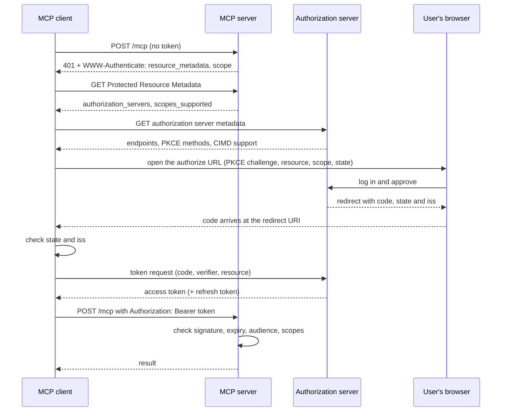

# Authorization with OAuth 2.1: The Complete Guide

> 📚 **Before you start**
>
> - [Building and Deploying a Remote MCP Server](../05-building-with-mcp/building-and-deploying-a-remote-mcp-server.md), for remote servers and API-key auth.
> - [What Changed in the 2026 MCP Specification](what-changed-in-the-2026-mcp-specification.md), for the stateless request model.
> - [Production Considerations](../../apis-and-apps-fastapi-streamlit-and-docker/course.md#m5), for HTTP status codes and headers.

## Introduction

When you check in at a hotel in Jaipur, the front desk looks at your ID once and hands you a key card. The card opens **your** room and the pool for the length of your stay, and nothing else. The room door never sees your Aadhaar card; it only checks the card it was programmed to accept. And a key card from the hotel across the road won't work, even if it looks identical.

OAuth works the same way, and MCP uses it for remote servers:

- The **authorization server** is the front desk: it checks who you are (your Google, GitHub or company login) and issues an **access token**.
- The **MCP server** is the room door: it checks the token on every request and never sees your password.
- The token is limited to **one server** (the audience) and **some permissions** (scopes), and it expires.

In the remote server lesson, you protected a server with an API key. That's fine for your own agents, but a public server that people connect from Claude, ChatGPT, VS Code or Cursor needs each **person** to sign in with their own account, with permissions they approved, without pasting secrets into config files. That's what MCP's authorization spec, built on OAuth 2.1, provides.

In this lesson you'll walk through the full flow as both the client and the server: discovering where to log in, registering the client, PKCE, the `resource` parameter, validating the `iss` in the response, checking tokens on the server, and asking for more scopes when needed.

> 💡 **Key Insight**
>
> In MCP, **the MCP server is only a resource server**. It doesn't handle passwords or logins; it tells clients where to log in (Protected Resource Metadata) and validates the tokens they bring. The two checks that matter most on the server are: **was this token issued for me** (audience), and **does it allow this operation** (scope).

---

## Core Explanation

### 1. The four parties

![Four boxes in a row: the user with a browser, the MCP client inside a host such as Claude, the MCP server acting as a resource server, and the authorization server such as Google, Auth0, Keycloak or Entra ID. Arrows show the client reading Protected Resource Metadata from the MCP server, discovering the authorization server's metadata, sending the user to log in with PKCE and the resource parameter, exchanging the code for a token, and calling the MCP server with a Bearer token that the server checks for audience, expiry and scopes](/img/diagrams/model-context-protocol-mcp/mcp-authorization.svg)
*The MCP server points to the authorization server and checks tokens; it never sees the user's password.*

| Party | OAuth role | In practice |
|---|---|---|
| User | Resource owner | Ananya, who approves access in her browser |
| MCP client (inside the host) | OAuth client | Claude Desktop, VS Code, your own agent |
| MCP server | **Resource server** | `https://mcp.kharcha.in/mcp` |
| Authorization server | Authorization server | Auth0, Okta, Keycloak, Entra ID, Google, or one you run |

The scope of the spec: authorization is optional, but HTTP servers that do it **should** follow it. **Stdio servers should not**: a local process gets its credentials from the environment, as you did with `env` blocks in host configs.

### 2. Step by step



Let's build each step in Python, using only the standard library.

### 3. The 401 challenge

A client first calls the server without a token. A protected server answers `401 Unauthorized` with a `WWW-Authenticate` header that says where its metadata lives and which scopes this operation needs:

```python
import base64, hashlib, hmac, json, re, secrets, time
from urllib.parse import urlencode, urlsplit, parse_qs

def parse_challenge(header):
    """Parse 'Bearer key="value", key2="value2"' into a dict."""
    scheme, _, rest = header.partition(" ")
    params = dict(re.findall(r'(\w+)="([^"]*)"', rest))
    return scheme, params

header = ('Bearer resource_metadata="https://mcp.kharcha.in/.well-known/oauth-protected-resource/mcp", '
          'scope="expenses:read"')
scheme, challenge = parse_challenge(header)
print(scheme, challenge)
```

Output:

```
Bearer {'resource_metadata': 'https://mcp.kharcha.in/.well-known/oauth-protected-resource/mcp', 'scope': 'expenses:read'}
```

The `scope` in the challenge is what the client should ask for first. That's least privilege: start with what this operation needs, not everything the server offers.

### 4. Discovering where to log in

The client fetches the **Protected Resource Metadata** (RFC 9728) from the URL in the challenge. If the challenge didn't include one, it tries well-known URLs, most specific first:

```python
def prm_candidates(server_url):
    parts = urlsplit(server_url)
    origin, path = f"{parts.scheme}://{parts.netloc}", parts.path.rstrip("/")
    urls = []
    if path:
        urls.append(f"{origin}/.well-known/oauth-protected-resource{path}")
    urls.append(f"{origin}/.well-known/oauth-protected-resource")
    return urls

for url in prm_candidates("https://mcp.kharcha.in/mcp"):
    print(url)
```

Output:

```
https://mcp.kharcha.in/.well-known/oauth-protected-resource/mcp
https://mcp.kharcha.in/.well-known/oauth-protected-resource
```

The document it gets back names the authorization server(s):

```python
prm = {
    "resource": "https://mcp.kharcha.in/mcp",
    "authorization_servers": ["https://login.kharcha.in/tenant1"],
    "scopes_supported": ["expenses:read"],
    "bearer_methods_supported": ["header"],
}
```

Then the client fetches the **authorization server's metadata**. Clients must support both OAuth (RFC 8414) and OpenID Connect discovery, and try them in a fixed order. When the issuer URL has a path (common for multi-tenant providers), the order is:

```python
def as_metadata_candidates(issuer):
    parts = urlsplit(issuer)
    origin, path = f"{parts.scheme}://{parts.netloc}", parts.path.rstrip("/")
    if path:
        return [f"{origin}/.well-known/oauth-authorization-server{path}",
                f"{origin}/.well-known/openid-configuration{path}",
                f"{origin}{path}/.well-known/openid-configuration"]
    return [f"{origin}/.well-known/oauth-authorization-server",
            f"{origin}/.well-known/openid-configuration"]

for url in as_metadata_candidates(prm["authorization_servers"][0]):
    print(url)
print(as_metadata_candidates("https://accounts.example.com"))
```

Output:

```
https://login.kharcha.in/.well-known/oauth-authorization-server/tenant1
https://login.kharcha.in/.well-known/openid-configuration/tenant1
https://login.kharcha.in/tenant1/.well-known/openid-configuration
['https://accounts.example.com/.well-known/oauth-authorization-server', 'https://accounts.example.com/.well-known/openid-configuration']
```

```python
as_meta = {
    "issuer": "https://login.kharcha.in/tenant1",
    "authorization_endpoint": "https://login.kharcha.in/tenant1/authorize",
    "token_endpoint": "https://login.kharcha.in/tenant1/token",
    "code_challenge_methods_supported": ["S256"],
    "client_id_metadata_document_supported": True,
    "authorization_response_iss_parameter_supported": True,
    "scopes_supported": ["expenses:read", "expenses:write", "offline_access"],
}

def check_as_metadata(meta, expected_issuer):
    if meta.get("issuer") != expected_issuer:                       # exact string match, no normalising
        raise ValueError(f"issuer mismatch: {meta.get('issuer')!r}")
    if "S256" not in meta.get("code_challenge_methods_supported", []):
        raise ValueError("authorization server does not advertise PKCE S256; refuse to continue")
    return True

print(check_as_metadata(as_meta, "https://login.kharcha.in/tenant1"))
try:
    check_as_metadata(dict(as_meta, issuer="https://login.kharcha.in/tenant1/"), "https://login.kharcha.in/tenant1")
except ValueError as e:
    print("refused:", e)
```

Output:

```
True
refused: issuer mismatch: 'https://login.kharcha.in/tenant1/'
```

Two safety rules are already in play. The metadata's `issuer` must equal the issuer the client asked about, character for character (a trailing slash counts). And if the server doesn't advertise PKCE with `S256`, the client must not proceed.

### 5. Registering the client

The authorization server needs to know which client is asking. MCP clients use, in order of preference:

| Method | When | How |
|---|---|---|
| **Pre-registered** | The client and AS already know each other (a company's own agent) | A `client_id` configured in advance |
| **Client ID Metadata Document (CIMD)** | The AS advertises `client_id_metadata_document_supported` | The `client_id` **is an HTTPS URL** pointing to a JSON document about the client; the AS fetches it |
| Dynamic Client Registration (**deprecated**) | Older authorization servers without CIMD | `POST /register` to get a `client_id` |
| Ask the user | Nothing else works | The user pastes a client id |

CIMD solves the "millions of clients, thousands of servers" problem: no registration step at all, and the AS can see the client's real identity from a URL it controls. A client's metadata document looks like this:

```json
{
  "client_id": "https://app.kharcha.in/oauth/client.json",
  "client_name": "Kharcha Desktop",
  "client_uri": "https://app.kharcha.in",
  "redirect_uris": ["http://127.0.0.1:33418/callback", "https://app.kharcha.in/oauth/callback"],
  "grant_types": ["authorization_code", "refresh_token"],
  "response_types": ["code"],
  "token_endpoint_auth_method": "none"
}
```

The `client_id` inside must equal the URL the document is served from, and the AS only redirects to the listed `redirect_uris`. Client credentials are tied to the authorization server that issued them: a client must store them keyed by issuer and never reuse them with a different one.

### 6. PKCE and the authorization request

**PKCE** (Proof Key for Code Exchange) stops a stolen authorization code from being useful. The client makes a random secret (the **verifier**), sends only its SHA-256 hash (the **challenge**) when the user logs in, and reveals the verifier when it exchanges the code. Someone who intercepts the code doesn't have the verifier.

```python
def pkce_challenge(verifier):
    digest = hashlib.sha256(verifier.encode("ascii")).digest()
    return base64.urlsafe_b64encode(digest).rstrip(b"=").decode("ascii")

# The worked example from RFC 7636, so you can check the maths
print(pkce_challenge("dBjftJeZ4CVP-mB92K27uhbUJU1p1r_wW1gFWFOEjXk"))

verifier = secrets.token_urlsafe(48)                  # a real one: 64 random URL-safe characters
print(len(verifier), "characters; challenge is", len(pkce_challenge(verifier)), "characters")
```

Output:

```
E9Melhoa2OwvFrEMTJguCHaoeK1t8URWbuGJSstw-cM
64 characters; challenge is 43 characters
```

The authorization URL carries the challenge, the scopes, a random `state`, and the **`resource`** parameter (RFC 8707): the canonical URI of the MCP server the token is for. The client records the verifier, state and expected issuer together, for this one login attempt.

```python
def authorization_url(as_meta, client_id, redirect_uri, scope, resource, verifier, state):
    query = {"response_type": "code", "client_id": client_id, "redirect_uri": redirect_uri,
             "scope": scope, "state": state, "resource": resource,
             "code_challenge": pkce_challenge(verifier), "code_challenge_method": "S256"}
    return as_meta["authorization_endpoint"] + "?" + urlencode(query)

pending = {"verifier": "dBjftJeZ4CVP-mB92K27uhbUJU1p1r_wW1gFWFOEjXk", "state": "st_7Hq2",
           "issuer": as_meta["issuer"]}                # stored together for this login only
url = authorization_url(as_meta, "https://app.kharcha.in/oauth/client.json", "http://127.0.0.1:33418/callback",
                        challenge["scope"], "https://mcp.kharcha.in/mcp", pending["verifier"], pending["state"])
for key, value in parse_qs(urlsplit(url).query).items():
    print(f"{key:<22} {value[0]}")
```

Output:

```
response_type          code
client_id              https://app.kharcha.in/oauth/client.json
redirect_uri           http://127.0.0.1:33418/callback
scope                  expenses:read
state                  st_7Hq2
resource               https://mcp.kharcha.in/mcp
code_challenge         E9Melhoa2OwvFrEMTJguCHaoeK1t8URWbuGJSstw-cM
code_challenge_method  S256
```

The `resource` parameter goes in **both** the authorization request and the token request, always, even if the authorization server ignores it. It's what lets the AS put the right audience in the token. The canonical URI has a scheme, no fragment, and normally no trailing slash: `https://mcp.kharcha.in/mcp`, not `mcp.kharcha.in` or `https://mcp.kharcha.in/mcp#x`.

### 7. Checking the redirect: `state` and `iss`

When Ananya approves, the browser comes back to the redirect URI with a code. Before sending that code anywhere, the client checks `state` (that this is the login it started) and the `iss` parameter (RFC 9207), which defends against **mix-up attacks**, where a malicious authorization server tricks the client into sending a code to the wrong token endpoint. The spec's rules:

| AS metadata says it sends `iss` | `iss` in the response | Client action |
|---|---|---|
| `true` | present | Compare with the recorded issuer, exact string match |
| `true` | absent | **Reject** |
| `false` or missing | present | Compare with the recorded issuer |
| `false` or missing | absent | Proceed |

```python
def check_callback(callback_url, pending, as_meta):
    q = {k: v[0] for k, v in parse_qs(urlsplit(callback_url).query).items()}
    if q.get("state") != pending["state"]:
        return "reject: state does not match this login"
    advertised = as_meta.get("authorization_response_iss_parameter_supported", False)
    if "iss" in q:
        if q["iss"] != pending["issuer"]:
            return "reject: iss does not match the recorded issuer (do not show its error text either)"
    elif advertised:
        return "reject: iss missing although the server advertises it"
    if "error" in q:
        return f"login failed: {q['error']}"
    return f"ok: exchange code {q['code']}"

base = "http://127.0.0.1:33418/callback?"
print(check_callback(base + "code=c_91x&state=st_7Hq2&iss=https%3A%2F%2Flogin.kharcha.in%2Ftenant1", pending, as_meta))
print(check_callback(base + "code=c_91x&state=st_7Hq2&iss=https%3A%2F%2Fevil.example", pending, as_meta))
print(check_callback(base + "code=c_91x&state=st_7Hq2", pending, as_meta))
print(check_callback(base + "code=c_91x&state=st_other&iss=https%3A%2F%2Flogin.kharcha.in%2Ftenant1", pending, as_meta))
print(check_callback(base + "code=c_91x&state=st_7Hq2", pending, dict(as_meta, authorization_response_iss_parameter_supported=False)))
```

Output:

```
ok: exchange code c_91x
reject: iss does not match the recorded issuer (do not show its error text either)
reject: iss missing although the server advertises it
reject: state does not match this login
ok: exchange code c_91x
```

The client then sends the code, the **verifier** and the same `resource` to the token endpoint, and gets back an access token (and possibly a refresh token, if it asked for `offline_access` and the AS agreed; clients must not assume one will be issued).

### 8. The server side: validating tokens

On every request, the MCP server checks the token. Most authorization servers issue JWTs signed with a private key, which the server checks against the AS's published public keys (JWKS). To keep this runnable with the standard library, we'll make tokens signed with a shared HMAC key (HS256) instead; the checks that follow are the same.

```python
def b64url(data):
    return base64.urlsafe_b64encode(data).rstrip(b"=").decode()

def b64url_decode(text):
    return base64.urlsafe_b64decode(text + "=" * (-len(text) % 4))

AS_KEY = b"demo-signing-key-from-the-authorization-server"

def issue_token(sub, aud, scopes, lifetime=3600, now=1_760_000_000, key=AS_KEY):
    header = {"alg": "HS256", "typ": "JWT"}
    claims = {"iss": "https://login.kharcha.in/tenant1", "sub": sub, "aud": aud,
              "scope": " ".join(scopes), "iat": now, "exp": now + lifetime}
    signing_input = b64url(json.dumps(header).encode()) + "." + b64url(json.dumps(claims).encode())
    signature = hmac.new(key, signing_input.encode(), hashlib.sha256).digest()
    return signing_input + "." + b64url(signature)

token = issue_token("ananya", "https://mcp.kharcha.in/mcp", ["expenses:read"])
print(token[:60] + "...")
print(json.loads(b64url_decode(token.split(".")[1])))
```

Output:

```
eyJhbGciOiAiSFMyNTYiLCAidHlwIjogIkpXVCJ9.eyJpc3MiOiAiaHR0cHM...
{'iss': 'https://login.kharcha.in/tenant1', 'sub': 'ananya', 'aud': 'https://mcp.kharcha.in/mcp', 'scope': 'expenses:read', 'iat': 1760000000, 'exp': 1760003600}
```

Now the server's check. Note the two kinds of failure: **401** when the token is missing, invalid, expired or for another server, and **403** with `error="insufficient_scope"` when the token is fine but doesn't allow this operation.

```python
RESOURCE = "https://mcp.kharcha.in/mcp"
PRM_URL = "https://mcp.kharcha.in/.well-known/oauth-protected-resource/mcp"
TOOL_SCOPES = {"list_expenses": {"expenses:read"}, "add_expense": {"expenses:write"},
               "delete_expense": {"expenses:write"}}

def unauthorized(reason, scope="expenses:read"):
    return 401, f'Bearer resource_metadata="{PRM_URL}", scope="{scope}", error="invalid_token"', reason

def check_request(auth_header, tool, now=1_760_000_100):
    if not auth_header or not auth_header.startswith("Bearer "):
        return 401, f'Bearer resource_metadata="{PRM_URL}", scope="expenses:read"', "no token"
    token = auth_header.removeprefix("Bearer ")
    try:
        head, body, sig = token.split(".")
        expected = hmac.new(AS_KEY, f"{head}.{body}".encode(), hashlib.sha256).digest()
        if not hmac.compare_digest(expected, b64url_decode(sig)):
            return unauthorized("bad signature")
        claims = json.loads(b64url_decode(body))
    except ValueError:
        return unauthorized("malformed token")
    if claims["iss"] != "https://login.kharcha.in/tenant1":
        return unauthorized("wrong issuer")
    if claims["exp"] <= now:
        return unauthorized("expired")
    audiences = claims["aud"] if isinstance(claims["aud"], list) else [claims["aud"]]
    if RESOURCE not in audiences:                                      # issued for some other server
        return unauthorized("token was not issued for this server")
    needed, granted = TOOL_SCOPES[tool], set(claims["scope"].split())
    if not needed <= granted:
        scope = " ".join(sorted(needed))
        return 403, (f'Bearer error="insufficient_scope", scope="{scope}", resource_metadata="{PRM_URL}"'), \
               f"needs {scope}"
    return 200, None, f"ok: {claims['sub']} may call {tool}"

cases = {
    "no token": (None, "list_expenses"),
    "good read token": ("Bearer " + token, "list_expenses"),
    "read token, write tool": ("Bearer " + token, "add_expense"),
    "token for another server": ("Bearer " + issue_token("ananya", "https://mcp.other.in/mcp", ["expenses:read"]),
                                 "list_expenses"),
    "expired token": ("Bearer " + issue_token("ananya", RESOURCE, ["expenses:read"], lifetime=60), "list_expenses"),
    "forged signature": ("Bearer " + issue_token("ananya", RESOURCE, ["expenses:write"], key=b"attacker"),
                         "add_expense"),
}
for name, (auth, tool) in cases.items():
    status, www, note = check_request(auth, tool)
    print(f"{name:<26} {status}  {note}")
```

Output:

```
no token                   401  no token
good read token            200  ok: ananya may call list_expenses
read token, write tool     403  needs expenses:write
token for another server   401  token was not issued for this server
expired token              401  expired
forged signature           401  bad signature
```

The **audience check** is the one people forget, and it's the most important. Without it, any token from the same authorization server would work here, including one Ananya gave to a dodgy third-party server, which could then replay it against yours. That's also why MCP servers **must not pass tokens through**: if your server calls another API (say, a bank's), it must get its own token for that API, never forward the one the client sent you. A server that forwards tokens becomes a **confused deputy**, doing things with someone else's authority that nobody approved.

### 9. Step-up: asking for more scope

Ananya started with `expenses:read`. When the model calls `add_expense`, the server answers 403 with the scopes this operation needs. The client re-authorizes with the **union** of what it had and what the challenge asks for, so it doesn't lose read access by gaining write access:

```python
def step_up(current_scopes, challenge_header, attempts, max_attempts=2):
    _, params = parse_challenge(challenge_header)
    if params.get("error") != "insufficient_scope":
        return None, "not a scope problem"
    if attempts >= max_attempts:
        return None, "giving up: still insufficient after re-authorizing"
    wanted = sorted(set(current_scopes) | set(params["scope"].split()))
    return wanted, f"re-authorize with scope={' '.join(wanted)}"

status, www, _ = check_request("Bearer " + token, "add_expense")
print(status, www)
print(step_up(["expenses:read"], www, attempts=0))
print(step_up(["expenses:read", "expenses:write"], www, attempts=2))
```

Output:

```
403 Bearer error="insufficient_scope", scope="expenses:write", resource_metadata="https://mcp.kharcha.in/.well-known/oauth-protected-resource/mcp"
(['expenses:read', 'expenses:write'], 're-authorize with scope=expenses:read expenses:write')
(None, 'giving up: still insufficient after re-authorizing')
```

The retry limit matters: a misconfigured server could otherwise send the user to the login page forever.

### 10. Doing it with the SDK

The official Python SDK implements the resource-server side. You provide a `TokenVerifier` (usually a few lines around a JWT library that checks the signature against the AS's JWKS, the issuer, expiry and audience) and `AuthSettings`; the SDK serves the Protected Resource Metadata, returns the 401 challenges, and checks required scopes.

```python
# not-run: needs the `mcp` package (2.x) and a JWT library such as PyJWT
import jwt                                        # PyJWT
from mcp.server.auth.provider import AccessToken, TokenVerifier
from mcp.server.auth.settings import AuthSettings
from mcp.server.auth.middleware.auth_context import get_access_token
from mcp.server.mcpserver import MCPServer

ISSUER = "https://login.kharcha.in/tenant1"
RESOURCE = "https://mcp.kharcha.in/mcp"
jwks = jwt.PyJWKClient(f"{ISSUER}/.well-known/jwks.json")

class JWTVerifier(TokenVerifier):
    async def verify_token(self, token: str) -> AccessToken | None:
        try:
            key = jwks.get_signing_key_from_jwt(token).key
            claims = jwt.decode(token, key, algorithms=["RS256"], audience=RESOURCE, issuer=ISSUER)
        except jwt.PyJWTError:
            return None                           # the SDK answers 401
        return AccessToken(token=token, client_id=claims.get("client_id", ""), scopes=claims["scope"].split(),
                           expires_at=claims["exp"], resource=RESOURCE, subject=claims["sub"])

mcp = MCPServer(
    "kharcha",
    token_verifier=JWTVerifier(),
    auth=AuthSettings(issuer_url=ISSUER, resource_server_url=RESOURCE,
                      required_scopes=["expenses:read"], validate_token_resource=True),
)

@mcp.tool()
def list_expenses(month: str) -> str:
    """List a month's expenses for the signed-in user."""
    user = get_access_token().subject             # whose data to read comes from the token, not the arguments
    ...

app = mcp.streamable_http_app()
```

On the client side, hosts like Claude, ChatGPT, VS Code and Cursor run the whole browser flow for remote servers you add; the user just sees a login page. The SDK's client also has an OAuth helper for your own agents.

---

## Try It Yourself

1. **A trailing slash.** Should a client accept AS metadata whose `issuer` is `https://login.kharcha.in/tenant1/` when it expected `https://login.kharcha.in/tenant1`? Run `check_as_metadata` to confirm, and explain why exactness matters.
2. **Two audiences.** Issue a token whose `aud` is a list containing both `https://mcp.kharcha.in/mcp` and `https://api.kharcha.in`. Does `check_request` accept it for `list_expenses`?
3. **Per-user data.** In the SDK example, why does `list_expenses` get the user from the token rather than taking a `user` argument?

<details>
<summary>Show answers</summary>

**1.** No. Issuer comparison is exact string comparison; a different string could be a different (possibly attacker-controlled) issuer, and normalising would open a gap for mix-up attacks.

```python
try:
    check_as_metadata(dict(as_meta, issuer="https://login.kharcha.in/tenant1/"), "https://login.kharcha.in/tenant1")
except ValueError as e:
    print("refused:", e)
```

Output:

```
refused: issuer mismatch: 'https://login.kharcha.in/tenant1/'
```

**2.** Yes, because this server's resource URI is one of the audiences:

```python
multi = issue_token("ananya", ["https://mcp.kharcha.in/mcp", "https://api.kharcha.in"], ["expenses:read"])
print(check_request("Bearer " + multi, "list_expenses"))
```

Output:

```
(200, None, 'ok: ananya may call list_expenses')
```

Accepting multiple audiences is legal, but a token valid at several places is more valuable to steal; prefer one token per resource, which is what the `resource` parameter gives you.

**3.** The model chooses tool arguments, so a `user` argument could be anything the model (or a prompt injection) writes, including someone else's name. The token's subject was set by the authorization server after Ananya logged in, so it's the only trustworthy source of "who is asking".

</details>

---

## Real-World Examples

- **Remote connectors in Claude and ChatGPT** run this flow when a user adds a protected MCP server: the host discovers the authorization server, opens a login page, and stores the tokens.
- **Companies** put their MCP servers behind their existing identity provider (Entra ID, Okta, Keycloak) so employees sign in with their work accounts and scopes map to roles.
- **SaaS providers** offering MCP servers for their product reuse the OAuth setup they already have for their public API, adding Protected Resource Metadata and audience checks.
- **Local tools** stay on stdio with credentials from the environment, avoiding OAuth entirely.

---

## Common Misconceptions

### "The MCP server handles the login"

It only points to the authorization server and checks tokens. The login page, passwords and consent screens belong to the authorization server.

### "A valid signature means a valid token"

Also check issuer, expiry, audience and scope. A perfectly signed token for a different server must be rejected.

### "I can forward the user's token to my backend API"

That's token passthrough, and the spec forbids it. Get a separate token for the downstream API.

### "Ask for every scope up front to avoid prompts later"

Start with the challenge's scopes (least privilege) and step up when needed, keeping the union of scopes.

---

## Interview Relevance

*"How does authorization work for remote MCP servers?"* A strong answer names the roles (MCP server as OAuth 2.1 resource server, separate authorization server), the discovery chain (401 with `resource_metadata`, Protected Resource Metadata, AS metadata with exact issuer match), client registration (pre-registered, Client ID Metadata Documents, deprecated dynamic registration), PKCE with S256, the `resource` parameter in both requests, `state` and `iss` checks on the redirect, server-side validation (signature, issuer, expiry, **audience**, scope), 401 vs 403 `insufficient_scope` with step-up using the scope union, no token passthrough, and stdio using environment credentials.

---

## Key Takeaways

- **The MCP server is a resource server**: it publishes Protected Resource Metadata and validates tokens; the authorization server does the login.
- **Discovery is a chain**: 401 challenge, then resource metadata, then authorization server metadata whose `issuer` must match exactly.
- **PKCE, `resource`, `state` and `iss`** protect the flow from stolen codes, wrong audiences, forged callbacks and mix-up attacks.
- **Validate audience and scope on every request**: 401 for bad tokens, 403 `insufficient_scope` for missing permissions, and never pass tokens through.
- **Prefer Client ID Metadata Documents** over the now-deprecated dynamic registration, and keep stdio servers on environment credentials.

---

**Up next:** [MCP Apps: Interactive UI from a Tool](mcp-apps-interactive-ui-from-a-tool.md)
