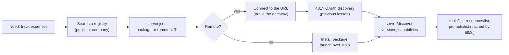

# Gateways, Registries and Server Discovery: The Complete Guide

> 📚 **Before you start**
>
> - [Open MCP Registries (Smithery)](../05-building-with-mcp/open-mcp-registries-smithery.md), for `server.json`, verified namespaces and the registry API.
> - [Docker MCP Catalog and Toolkit](../05-building-with-mcp/docker-mcp-catalog-and-toolkit.md), for the gateway idea on one laptop.
> - [Authorization with OAuth 2.1](authorization-with-oauth-2-1.md), for tokens, audiences and scopes.
> - [The Transport Layer: stdio and Streamable HTTP](../03-how-mcp-components-talk/the-transport-layer-stdio-and-streamable-http.md), for the `Mcp-Method` and `Mcp-Name` headers.

## Introduction

A big housing society in Gurugram doesn't let every delivery rider wander the towers. There's a **directory** at the gate (which flats exist, who lives there), and a **security desk** that every visitor passes: it checks who you are, which tower you're allowed into, and writes you in the register. Residents don't need to vet each visitor themselves.

An organisation that adopts MCP seriously ends up needing the same two things. With three servers and one developer, a config file is enough. With 2,000 employees, a dozen hosts and fifty servers, questions pile up: which servers are approved? Which version? Who called `delete_customer` last Tuesday? How does a new joiner's Claude Desktop find the finance tools, and only the tools their role allows?

- **Registries** answer "what exists and what's approved": the public MCP Registry, curated catalogs, and private registries.
- **Discovery** is how a host goes from "I need a tool for X" to a working connection: search a registry, connect, then call `server/discover`.
- **Gateways** are the security desk: one MCP endpoint in front of many servers that applies identity, policy, routing, and audit to every call.

In this lesson you'll publish a server to the official registry, validate its `server.json`, understand private registries, and build a working multi-server gateway with FastAPI that enforces per-role policy and writes an audit log.

> 💡 **Key Insight**
>
> Registries and gateways split the problem the way the society gate does. The **registry** is a catalogue of what *may* be used (metadata, versions, ownership). The **gateway** is where use actually *happens*, so it's where you enforce who may call which tool, and record that they did. You need both: a catalogue nobody enforces is a suggestion, and a gateway with no catalogue has nothing principled to enforce.

---

## Core Explanation

### 1. MCP in an organisation


*The registry decides what's approved; the gateway enforces it on every call.*

| Layer | Question it answers | Examples |
|---|---|---|
| Public registry | What servers exist, and who really published them? | The official MCP Registry (`registry.modelcontextprotocol.io`, in preview) |
| Curated catalog / marketplace | Which are good, tested, packaged? | Smithery, the GitHub MCP Registry, Docker's MCP Catalog |
| Private registry | Which are approved **here**, at which versions, plus our internal ones? | A company registry implementing the registry's OpenAPI spec |
| Gateway | Who may call what, right now, and what happened? | Docker's MCP Gateway (local), cloud and API-gateway products with MCP support, or your own |
| Host config | Which endpoint do I connect to? | One gateway URL instead of fifty server entries |

### 2. Publishing your server to the official registry

Ananya's team wants other people to find their expense server. Publishing has three steps: describe it in `server.json`, prove you own the namespace, and publish.

The registry's CLI is `mcp-publisher`:

```bash
# in the server's repository
mcp-publisher init                 # creates a server.json template from your project
# ...edit server.json...
mcp-publisher login github         # proves you own io.github.<your-user>/...
mcp-publisher publish              # validates and uploads
```

For a PyPI package, the README must also contain the line `mcp-name: io.github.ananya-dev/kharcha`, so the registry can check that the package points back at the name (npm uses an `mcpName` field in `package.json`, and Docker images use the label `io.modelcontextprotocol.server.name`). To publish under your own domain, such as `in.kharcha/...`, you prove control of `kharcha.in` with a DNS or HTTP challenge instead of GitHub.

The registry rejects invalid entries, but it's quicker to catch mistakes before publishing. Here's a validator for the fields that matter most, using pydantic:

```python
import fnmatch, json, re, time
from typing import Literal

from pydantic import BaseModel, Field, ValidationError, field_validator, model_validator

class EnvVar(BaseModel):
    name: str
    description: str = ""
    isRequired: bool = False
    isSecret: bool = False

class Package(BaseModel):
    registryType: Literal["npm", "pypi", "nuget", "cargo", "oci", "mcpb"]
    identifier: str
    version: str | None = None
    transport: dict
    environmentVariables: list[EnvVar] = []

class Remote(BaseModel):
    type: Literal["streamable-http", "sse"]
    url: str

    @field_validator("url")
    @classmethod
    def https_only(cls, v):                  # our own policy: no plain-HTTP endpoints
        if not v.startswith("https://"):
            raise ValueError("remote URLs must use https")
        return v

class ServerJson(BaseModel):
    name: str = Field(pattern=r"^[a-zA-Z0-9.-]+/[a-zA-Z0-9._-]+$")
    description: str
    version: str
    packages: list[Package] = []
    remotes: list[Remote] = []

    @field_validator("version")
    @classmethod
    def exact_version(cls, v):
        if any(ch in v for ch in "^~*<>") or v == "latest":
            raise ValueError("use an exact version such as 1.2.0, not a range")
        return v

    @model_validator(mode="after")
    def runnable_somehow(self):
        if not self.packages and not self.remotes:
            raise ValueError("needs at least one package or remote")
        return self

def check(doc):
    try:
        s = ServerJson.model_validate(doc)
        return f"ok: {s.name} {s.version} ({len(s.packages)} package(s), {len(s.remotes)} remote(s))"
    except ValidationError as e:
        return "; ".join(f"{'.'.join(map(str, err['loc'])) or 'document'}: {err['msg']}" for err in e.errors())

kharcha = {
    "$schema": "https://static.modelcontextprotocol.io/schemas/2025-12-11/server.schema.json",
    "name": "io.github.ananya-dev/kharcha",
    "description": "Track personal expenses in rupees: add, list, summarise and delete.",
    "version": "1.0.0",
    "packages": [{"registryType": "pypi", "identifier": "kharcha-mcp", "version": "1.0.0",
                  "transport": {"type": "stdio"}}],
    "remotes": [{"type": "streamable-http", "url": "https://mcp.kharcha.in/mcp"}],
}
print(check(kharcha))
print(check(dict(kharcha, version="^1.0")))
print(check(dict(kharcha, name="kharcha", remotes=[{"type": "streamable-http", "url": "http://mcp.kharcha.in/mcp"}])))
print(check(dict(kharcha, packages=[], remotes=[])))
```

Output:

```
ok: io.github.ananya-dev/kharcha 1.0.0 (1 package(s), 1 remote(s))
version: Value error, use an exact version such as 1.2.0, not a range
name: String should match pattern '^[a-zA-Z0-9.-]+/[a-zA-Z0-9._-]+$'; remotes.0.url: Value error, remote URLs must use https
document: Value error, needs at least one package or remote
```

This is a subset with one house rule added (HTTPS-only remotes). The official schema has more fields and rules; the `$schema` URL points to it, and `mcp-publisher publish` checks the full set.

Two things the registry deliberately doesn't do: it doesn't host code (packages stay on npm, PyPI, Docker Hub and so on), and it doesn't accept **private** servers. Internal servers belong in a private registry.

### 3. Private registries and sub-registries

The official registry publishes an **OpenAPI specification** of its API. Anyone can implement it, so a company can run its own registry that hosts clients and tools already know how to read. Two common patterns:

| Pattern | What it does |
|---|---|
| **Sub-registry (filtered mirror)** | Pulls entries from the official registry, keeps only approved ones, and adds its own data: security review status, internal ratings, pinned versions |
| **Private registry** | Lists internal servers that must never appear publicly, often alongside the approved public ones |

Here's the heart of a sub-registry: take official entries, keep the latest active version of approved servers, pin versions, and add review metadata under the company's own `_meta` key.

```python
official = [   # shaped like items from GET /v0.1/servers
    {"server": {"name": "io.github.ananya-dev/kharcha", "version": "1.0.0", "description": "Expenses"},
     "_meta": {"io.modelcontextprotocol.registry/official": {"status": "active", "isLatest": True}}},
    {"server": {"name": "io.github.railyatri-dev/pnr-status", "version": "1.3.0", "description": "PNR status"},
     "_meta": {"io.modelcontextprotocol.registry/official": {"status": "active", "isLatest": True}}},
    {"server": {"name": "io.github.railyatri-dev/pnr-status", "version": "1.2.0", "description": "PNR status"},
     "_meta": {"io.modelcontextprotocol.registry/official": {"status": "active", "isLatest": False}}},
    {"server": {"name": "io.github.random-dev/shell-anything", "version": "0.1.0", "description": "Runs commands"},
     "_meta": {"io.modelcontextprotocol.registry/official": {"status": "active", "isLatest": True}}},
]
APPROVED = {"io.github.ananya-dev/kharcha": {"review": "passed 2026-09-12", "max_version": "1.0.0"},
            "io.github.railyatri-dev/pnr-status": {"review": "passed 2026-08-20", "max_version": "1.2.0"}}
INTERNAL = [{"server": {"name": "com.acme-internal/hr-leave", "version": "2.4.1", "description": "Leave balances"},
             "_meta": {"com.acme/review": {"review": "internal", "owner": "hr-platform"}}}]

def version_key(v):
    return tuple(int(x) for x in v.split("."))

def build_company_registry(official, approved, internal):
    best = {}
    for item in official:
        s, meta = item["server"], item["_meta"]["io.modelcontextprotocol.registry/official"]
        policy = approved.get(s["name"])
        if policy is None or meta["status"] != "active":
            continue
        if version_key(s["version"]) > version_key(policy["max_version"]):
            continue                                            # newer than what we reviewed
        if s["name"] not in best or version_key(s["version"]) > version_key(best[s["name"]]["server"]["version"]):
            best[s["name"]] = {"server": s, "_meta": {"com.acme/review": {"review": policy["review"]}}}
    return sorted(best.values(), key=lambda i: i["server"]["name"]) + internal

for item in build_company_registry(official, APPROVED, INTERNAL):
    print(f"{item['server']['name']:<38} {item['server']['version']:<7} {item['_meta']['com.acme/review']['review']}")
```

Output:

```
io.github.ananya-dev/kharcha           1.0.0   passed 2026-09-12
io.github.railyatri-dev/pnr-status     1.2.0   passed 2026-08-20
com.acme-internal/hr-leave             2.4.1   internal
```

The unreviewed `shell-anything` server never appears, and `pnr-status` stays pinned at 1.2.0 until someone reviews 1.3.0.

### 4. Discovery: from "I need a tool" to a working connection



Discovery happens in layers. A **registry** tells the host *where* a server is and how to run it. **OAuth discovery** (Protected Resource Metadata) tells it where to log in. **`server/discover`** tells it which protocol versions and capabilities the server supports. And the **list methods** tell it what the server offers today, with `ttlMs` saying how long that answer stays fresh.

With a gateway in front, hosts skip most of this: they connect to one URL, log in once with the company's identity provider, and see exactly the tools their role allows.

### 5. Building a gateway

Let's build a small gateway for Acme Corp with FastAPI. It sits in front of two servers, applies per-role policy, routes by the `Mcp-Name` header, refuses header/body mismatches, and audits every call. To keep it runnable in one file, the backend servers are Python functions; in production they'd be HTTP endpoints the gateway calls with **its own** credentials (never the user's token: no passthrough).

```python
from fastapi import FastAPI, Request
from fastapi.responses import JSONResponse
from fastapi.testclient import TestClient

def kharcha_backend(method, params):
    if method == "tools/list":
        return {"tools": [{"name": n, "inputSchema": {"type": "object"}}
                          for n in ("list_expenses", "add_expense", "delete_expense")]}
    return {"content": [{"type": "text", "text": f"kharcha ran {params['name']}"}], "isError": False}

def rail_backend(method, params):
    if method == "tools/list":
        return {"tools": [{"name": "pnr_status", "inputSchema": {"type": "object"}}]}
    return {"content": [{"type": "text", "text": f"PNR {params['arguments'].get('pnr')}: CNF, coach B2"}],
            "isError": False}

BACKENDS = {"kharcha": kharcha_backend, "rail": rail_backend}

# In production: validate OAuth tokens (signature, issuer, expiry, audience) as in the previous lesson.
TOKENS = {"tok-ananya": {"user": "ananya", "role": "employee"},
          "tok-ravi": {"user": "ravi", "role": "finance-admin"}}
POLICY = {"employee": ["kharcha__list_*", "kharcha__add_expense", "rail__*"],
          "finance-admin": ["kharcha__*"]}
AUDIT = []
CLOCK = {"t": 1_760_000_000}

def allowed(role, tool):
    return any(fnmatch.fnmatch(tool, pattern) for pattern in POLICY.get(role, []))

def rpc(id_, result=None, error=None, status=200):
    body = {"jsonrpc": "2.0", "id": id_}
    if error:
        body["error"] = error
    else:
        body["result"] = {"resultType": "complete", **result,
                          "_meta": {"io.modelcontextprotocol/serverInfo": {"name": "acme-gateway", "version": "1.0"}}}
    return JSONResponse(body, status_code=status)

app = FastAPI()

@app.post("/mcp")
async def mcp(request: Request):
    msg = await request.json()
    id_, method, params = msg.get("id"), msg.get("method"), msg.get("params", {})
    token = request.headers.get("authorization", "").removeprefix("Bearer ")
    who = TOKENS.get(token)
    if who is None:
        return JSONResponse({"error": "invalid_token"}, status_code=401,
                            headers={"WWW-Authenticate": 'Bearer resource_metadata="https://mcp.acme.example/'
                                                         '.well-known/oauth-protected-resource/mcp"'})
    name = params.get("name") or params.get("uri")
    if request.headers.get("mcp-method") != method or (name and request.headers.get("mcp-name") != name):
        return rpc(id_, error={"code": -32020, "message": "Header mismatch"}, status=400)

    if method == "server/discover":
        return rpc(id_, {"supportedVersions": ["2026-07-28"], "capabilities": {"tools": {}},
                         "instructions": "Acme tools. Names are prefixed with their server."})
    if method == "tools/list":
        tools = [dict(t, name=f"{server}__{t['name']}")
                 for server, backend in BACKENDS.items() for t in backend("tools/list", {})["tools"]]
        visible = [t for t in tools if allowed(who["role"], t["name"])]
        return rpc(id_, {"tools": visible, "ttlMs": 300_000, "cacheScope": "private"})
    if method == "tools/call":
        server, _, tool = name.partition("__")
        decision = "allowed" if server in BACKENDS and allowed(who["role"], name) else "denied"
        AUDIT.append({"t": CLOCK["t"], "user": who["user"], "tool": name, "decision": decision})
        if decision == "denied":
            return rpc(id_, error={"code": -32602, "message": f"Unknown tool: {name}"})
        result = BACKENDS[server]("tools/call", dict(params, name=tool))
        return rpc(id_, result)
    return rpc(id_, error={"code": -32601, "message": f"Method not found: {method}"})

client = TestClient(app)
next_id = 0

def call(token, method, header_name=None, **params):
    global next_id
    next_id += 1
    params["_meta"] = {"io.modelcontextprotocol/protocolVersion": "2026-07-28"}
    headers = {"Authorization": f"Bearer {token}", "Mcp-Method": method}
    name = header_name or params.get("name")
    if name:
        headers["Mcp-Name"] = name
    r = client.post("/mcp", json={"jsonrpc": "2.0", "id": next_id, "method": method, "params": params},
                    headers=headers)
    return r.status_code, r.json()

for token in ("tok-ananya", "tok-ravi"):
    status, body = call(token, "tools/list")
    print(TOKENS[token]["user"], "sees", [t["name"] for t in body["result"]["tools"]],
          "| cacheScope:", body["result"]["cacheScope"])
```

Output:

```
ananya sees ['kharcha__list_expenses', 'kharcha__add_expense', 'rail__pnr_status'] | cacheScope: private
ravi sees ['kharcha__list_expenses', 'kharcha__add_expense', 'kharcha__delete_expense'] | cacheScope: private
```

Each person sees only what their role allows. The list's `cacheScope` is `private`, because it depends on who's asking; a shared cache must never serve Ravi's list to Ananya.

Now some calls:

```python
def show(label, response):
    status, body = response
    if "result" in body:
        print(f"{label:<34} {status} {body['result']['content'][0]['text']}")
    else:
        print(f"{label:<34} {status} {body.get('error')}")

show("ananya: pnr_status", call("tok-ananya", "tools/call", name="rail__pnr_status", arguments={"pnr": "4521879630"}))
show("ananya: add_expense", call("tok-ananya", "tools/call", name="kharcha__add_expense", arguments={"amount": 450}))
show("ananya: delete_expense", call("tok-ananya", "tools/call", name="kharcha__delete_expense", arguments={"expense_id": 3}))
show("ravi: delete_expense", call("tok-ravi", "tools/call", name="kharcha__delete_expense", arguments={"expense_id": 3}))
show("ravi: pnr_status", call("tok-ravi", "tools/call", name="rail__pnr_status", arguments={"pnr": "1"}))
show("header says list, body says delete", call("tok-ananya", "tools/call", header_name="kharcha__list_expenses",
                                                name="kharcha__delete_expense", arguments={"expense_id": 3}))
show("no token", call("tok-unknown", "tools/list"))
```

Output:

```
ananya: pnr_status                 200 PNR 4521879630: CNF, coach B2
ananya: add_expense                200 kharcha ran add_expense
ananya: delete_expense             200 {'code': -32602, 'message': 'Unknown tool: kharcha__delete_expense'}
ravi: delete_expense               200 kharcha ran delete_expense
ravi: pnr_status                   200 {'code': -32602, 'message': 'Unknown tool: rail__pnr_status'}
header says list, body says delete 400 {'code': -32020, 'message': 'Header mismatch'}
no token                           401 invalid_token
```

A denied tool gets the same answer as a tool that doesn't exist, so the gateway doesn't reveal what other roles can do. The header-mismatch check matters because a network policy upstream might allow or log a request based on its `Mcp-Name` header; if the body could name a different tool, an attacker could slip a `delete` past a rule written for `list`.

And the audit log, which is what the security team will ask for:

```python
for entry in AUDIT:
    print(entry)
```

Output:

```
{'t': 1760000000, 'user': 'ananya', 'tool': 'rail__pnr_status', 'decision': 'allowed'}
{'t': 1760000000, 'user': 'ananya', 'tool': 'kharcha__add_expense', 'decision': 'allowed'}
{'t': 1760000000, 'user': 'ananya', 'tool': 'kharcha__delete_expense', 'decision': 'denied'}
{'t': 1760000000, 'user': 'ravi', 'tool': 'kharcha__delete_expense', 'decision': 'allowed'}
{'t': 1760000000, 'user': 'ravi', 'tool': 'rail__pnr_status', 'decision': 'denied'}
```

### 6. What production gateways add

Your FastAPI gateway has the right shape. Real deployments add:

| Concern | What to add |
|---|---|
| **Identity** | Real OAuth: the gateway is the resource server for hosts, validating tokens from the company's identity provider |
| **Downstream credentials** | The gateway gets its own token or key for each backend (token exchange or a service account), never forwarding the user's |
| **Policy** | Rules from the private registry and identity groups; per-tool rate limits; time-of-day or approval rules for destructive tools |
| **Content inspection** | Scanning arguments and results for secrets or personal data, as Docker's gateway does locally |
| **Tool description pinning** | Remembering each tool's description and schema, and alerting if a server changes them (a defence against tool poisoning) |
| **Observability** | OpenTelemetry traces across host, gateway and server, using the `traceparent` key in `_meta` |
| **Caching** | Respecting `ttlMs` and `cacheScope` for list results |
| **Statelessness** | No sessions in the gateway either, so it scales behind a load balancer like the servers behind it |

---

## Try It Yourself

1. **A new role.** Add an `intern` role that may only call `rail__pnr_status`, give it a token, and show its tool list.
2. **Catch a version range.** What does `check` say about a `server.json` with `"version": "latest"`? Why does the registry insist on exact versions?
3. **Approve the update.** In the sub-registry, raise `pnr-status`'s `max_version` to `1.3.0` and rebuild. Which version is listed now?

<details>
<summary>Show answers</summary>

**1.**

```python
POLICY["intern"] = ["rail__pnr_status"]
TOKENS["tok-meera"] = {"user": "meera", "role": "intern"}
status, body = call("tok-meera", "tools/list")
print([t["name"] for t in body["result"]["tools"]])
```

Output:

```
['rail__pnr_status']
```

**2.**

```python
print(check(dict(kharcha, version="latest")))
```

Output:

```
version: Value error, use an exact version such as 1.2.0, not a range
```

A registry entry is a promise about one specific release. With an exact version, a reviewer, an approval and a gateway policy all refer to the same code; a range would let the code change underneath them.

**3.**

```python
APPROVED["io.github.railyatri-dev/pnr-status"]["max_version"] = "1.3.0"
for item in build_company_registry(official, APPROVED, INTERNAL):
    if "pnr" in item["server"]["name"]:
        print(item["server"]["name"], item["server"]["version"])
```

Output:

```
io.github.railyatri-dev/pnr-status 1.3.0
```

</details>

---

## Real-World Examples

- **Publishers** list servers in the official MCP Registry so hosts and marketplaces can find them under a verified namespace.
- **Marketplaces and catalogs** add search, curation and packaging: Smithery and the GitHub MCP Registry build on registry metadata, while Docker's catalog packages servers as signed container images.
- **Enterprises** run private registries of approved servers and a gateway in front of them, so employees connect once and get role-appropriate tools.
- **Developers** use Docker's MCP Gateway locally for the same pattern on a single machine.

---

## Common Misconceptions

### "The registry hosts the server's code"

It hosts metadata. Code stays on npm, PyPI, Docker Hub, crates.io or the publisher's own HTTPS endpoint.

### "Being in the public registry means a server is safe"

It means the namespace owner is verified, not that the code was reviewed. Curation and approval are your organisation's job.

### "A gateway is just a reverse proxy"

A reverse proxy forwards bytes. An MCP gateway understands the protocol: it merges tool lists, rewrites names, enforces per-tool policy, inspects content and audits calls.

### "With a gateway, backend servers don't need their own checks"

Keep validating inputs and permissions in each server too. The gateway is one layer of defence, not the only one.

---

## Interview Relevance

*"How would you roll out MCP across a 2,000-person company?"* A strong answer covers a private registry of approved servers (fed from the public registry with reviews and pinned versions, plus internal servers), a stateless gateway as the single endpoint (OAuth with the company IdP, per-role tool filtering, routing by the `Mcp-Name` header with header/body mismatch checks, no token passthrough, content inspection, rate limits, audit logs, OpenTelemetry traces), per-user `cacheScope: private` lists, publishing internal servers with exact versions, and keeping validation inside each server as well.

---

## Key Takeaways

- **Registries are catalogues of metadata**: the official MCP Registry verifies namespaces; curated and private registries decide what's approved.
- **Publish with `mcp-publisher`**: a valid `server.json` with exact versions, a verified namespace, and a back-link from the package.
- **Discovery is layered**: registry, then OAuth discovery, then `server/discover`, then the cached list methods.
- **A gateway is the enforcement point**: one endpoint that authenticates, filters tools per role, routes, checks headers, and audits every call.
- **Production gateways stay stateless and never pass tokens through**, and backend servers still validate their own inputs.

---

**Up next:** You've finished the course. Go back to the [course overview](../course.md) to review any module, or explore the [Multi-Agent Systems and Agent Protocols](../../multi-agent-systems-and-agent-protocols/course.md#m3) course to see how agents talk to **each other** with A2A.
