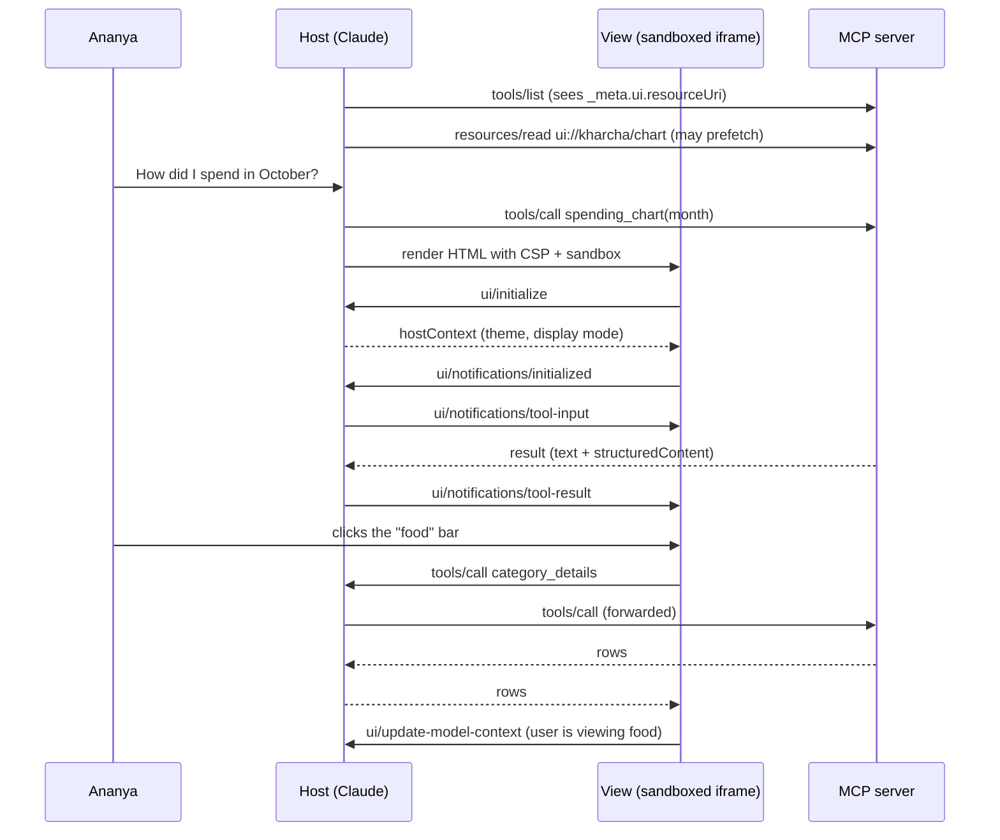

# MCP Apps: Interactive UI from a Tool: The Complete Guide

> 📚 **Before you start**
>
> - [MCP Primitives: Tools, Resources and Prompts](../02-understanding-mcp/mcp-primitives-tools-resources-and-prompts.md), for tools, resources and `_meta`.
> - [Lab: Expense tracker MCP server](../05-building-with-mcp/lab-expense-tracker-mcp-server.md), whose data we'll put on screen.
> - [What Changed in the 2026 MCP Specification](what-changed-in-the-2026-mcp-specification.md), for the `extensions` capability field.

## Introduction

Ask a friend at a chai stall how your month's spending went and they'll tell you in words. Ask a good financial app and it shows you a chart, and you tap the tallest bar to see what's inside it. Some answers are simply better as something you can **look at and click**.

Until now, MCP tools have returned text, images and structured data, and the host decided how to show them. **MCP Apps** (the `io.modelcontextprotocol/ui` extension) lets a tool bring its own **interactive interface**: an HTML page that the host renders right inside the conversation, in a sandboxed iframe. The page can receive the tool's result, call the server's tools when the user clicks something, open links, post a message into the chat, and tell the model what the user is looking at.

MCP Apps work in Claude, Claude Desktop, VS Code GitHub Copilot, Microsoft 365 Copilot, Goose, Postman, MCPJam and Archestra, and hosts that don't support them still get the tool's ordinary text result.

In this lesson you'll learn how a tool points to its UI, what the UI resource looks like, how the host sandboxes it, the postMessage protocol between the page and the host, how visibility keeps some tools away from the model, and how to fall back gracefully. You'll simulate a host and a view in Python, then see the real SDK code.

> 💡 **Key Insight**
>
> An MCP App is just **two primitives you already know, linked by metadata**: a tool whose `_meta.ui.resourceUri` names a `ui://` resource, and that resource, an HTML page served with the MIME type `text/html;profile=mcp-app`. Everything else (the sandbox, the CSP, the postMessage messages) is how the host keeps that page useful but harmless.

---

## Core Explanation

### 1. How the pieces fit



| Part | What it is |
|---|---|
| **Tool** | An ordinary tool with `_meta.ui.resourceUri` (and optionally `_meta.ui.visibility`) |
| **UI resource** | A `ui://` resource with `mimeType: "text/html;profile=mcp-app"`, containing a complete HTML document; its `_meta.ui` can declare CSP domains, permissions and `prefersBorder` |
| **View** | The HTML page running in the host's sandboxed iframe |
| **Host** | Renders the view, enforces the sandbox and CSP, relays messages, forwards the view's tool calls to the server |
| **Extension key** | `io.modelcontextprotocol/ui` in the `extensions` capability, with the MIME types the host can render |

### 2. The server side: a tool and its UI resource

Here's Ananya's expense server from the lab, extended with a chart. The model-facing tool `spending_chart` returns the totals as text (for any host) plus `structuredContent` (for the view), and names its UI. A second tool, `category_details`, is marked app-only: the view calls it when a bar is clicked, and the model never sees it.

```python
import json

UI_EXT = "io.modelcontextprotocol/ui"
APP_MIME = "text/html;profile=mcp-app"

SPENDING = {"2026-10": {"rent": 18000, "shopping": 2299, "bills": 899, "food": 760, "transport": 120}}
DETAILS = {("2026-10", "food"): [("2026-10-03", 450, "Swiggy biryani"), ("2026-10-09", 310, "Groceries, D-Mart")]}

CHART_HTML = """<!DOCTYPE html>
<html><head><meta charset="utf-8"><title>Spending chart</title></head>
<body><div id="chart">Loading...</div>
<script type="module">
  // In a real app: import { App } from "@modelcontextprotocol/ext-apps" (bundled into this file)
  // and draw bars from the tool result's structuredContent.
</script></body></html>"""

TOOLS = [
    {"name": "spending_chart", "description": "Show a month's spending by category as an interactive chart.",
     "inputSchema": {"type": "object", "properties": {"month": {"type": "string"}}, "required": ["month"]},
     "_meta": {"ui": {"resourceUri": "ui://kharcha/spending-chart.html"}}},
    {"name": "category_details", "description": "Expenses in one category (used by the chart).",
     "inputSchema": {"type": "object", "properties": {"month": {"type": "string"}, "category": {"type": "string"}},
                     "required": ["month", "category"]},
     "_meta": {"ui": {"resourceUri": "ui://kharcha/spending-chart.html", "visibility": ["app"]}}},
    {"name": "add_expense", "description": "Record an expense.",
     "inputSchema": {"type": "object", "properties": {"amount": {"type": "number"}}}},
]

def read_resource(uri):
    if uri != "ui://kharcha/spending-chart.html":
        raise LookupError(uri)
    return {"contents": [{"uri": uri, "mimeType": APP_MIME, "text": CHART_HTML,
                          "_meta": {"ui": {"csp": {"resourceDomains": ["https://cdn.jsdelivr.net"]},
                                           "prefersBorder": True}}}]}

def call_tool(name, args, client_caps):
    if name == "spending_chart":
        totals = SPENDING[args["month"]]
        text = ", ".join(f"{c} Rs {v:,}" for c, v in totals.items())
        result = {"content": [{"type": "text", "text": f"{args['month']}: {text}"}],
                  "structuredContent": {"month": args["month"], "totals": totals}, "isError": False}
        supports_ui = APP_MIME in client_caps.get("extensions", {}).get(UI_EXT, {}).get("mimeTypes", [])
        if not supports_ui:                       # graceful fallback: the text alone must be useful
            result["content"][0]["text"] += ". Biggest: rent."
        return result
    if name == "category_details":
        rows = DETAILS.get((args["month"], args["category"]), [])
        return {"content": [{"type": "text", "text": json.dumps(rows)}],
                "structuredContent": {"rows": rows}, "isError": False}
    return {"content": [{"type": "text", "text": "ok"}], "isError": False}

print(json.dumps(TOOLS[0]["_meta"]), "|", TOOLS[1]["_meta"]["ui"]["visibility"])
print(read_resource("ui://kharcha/spending-chart.html")["contents"][0]["mimeType"])
```

Output:

```
{"ui": {"resourceUri": "ui://kharcha/spending-chart.html"}} | ['app']
text/html;profile=mcp-app
```

The resource's `_meta.ui.csp` says which outside origins the page needs. This one loads a charting library from a CDN, so it lists the CDN under `resourceDomains`, and it makes no network calls of its own, so there's no `connectDomains`.

### 3. The host side: visibility

Before any rendering, `_meta.ui.visibility` changes what the model sees:

| `visibility` | In the model's tool list? | Callable by the view? |
|---|---|---|
| omitted (default `["model", "app"]`) | Yes | Yes |
| `["model"]` | Yes | No |
| `["app"]` | **No** | Yes, only from a view of the **same server** |

```python
def visibility(tool):
    return tool.get("_meta", {}).get("ui", {}).get("visibility", ["model", "app"])

def tools_for_model(tools):
    return [t["name"] for t in tools if "model" in visibility(t)]

def view_may_call(tools, name, view_server, tool_server):
    tool = next((t for t in tools if t["name"] == name), None)
    if tool is None or view_server != tool_server:
        return False                              # views never call other servers' tools
    return "app" in visibility(tool)

print("model sees:", tools_for_model(TOOLS))
print("view calls category_details:", view_may_call(TOOLS, "category_details", "kharcha", "kharcha"))
print("view calls add_expense:", view_may_call(TOOLS, "add_expense", "kharcha", "kharcha"))
print("view calls another server's tool:", view_may_call(TOOLS, "category_details", "kharcha", "other"))
```

Output:

```
model sees: ['spending_chart', 'add_expense']
view calls category_details: True
view calls add_expense: True
view calls another server's tool: False
```

Notice `add_expense` has no `_meta.ui` at all, so it defaults to both. A careful server marks write tools `["model"]` if its view has no reason to call them, so a compromised page can't use them.

### 4. The host side: the sandbox and the CSP

The host loads the HTML into a sandboxed iframe, with a **Content Security Policy** built from the resource's declared domains. With no `csp` at all, the page can't load anything from outside or make any network request. Here's the construction the spec describes, in Python:

```python
def build_csp(ui_meta):
    csp = ui_meta.get("csp")
    if csp is None:                                   # the spec's restrictive default
        return ("default-src 'none'; script-src 'self' 'unsafe-inline'; style-src 'self' 'unsafe-inline'; "
                "img-src 'self' data:; media-src 'self' data:; connect-src 'none'")
    res = " ".join(csp.get("resourceDomains", []))
    parts = ["default-src 'none'",
             f"script-src 'self' 'unsafe-inline' {res}".strip(),
             f"style-src 'self' 'unsafe-inline' {res}".strip(),
             f"connect-src 'self' {' '.join(csp.get('connectDomains', []))}".strip(),
             f"img-src 'self' data: {res}".strip(),
             f"font-src 'self' {res}".strip(),
             f"media-src 'self' data: {res}".strip(),
             f"frame-src {' '.join(csp.get('frameDomains', [])) or chr(39) + 'none' + chr(39)}",
             "object-src 'none'",
             f"base-uri {' '.join(csp.get('baseUriDomains', [])) or chr(39) + 'self' + chr(39)}"]
    return "; ".join(parts)

def iframe_allow(ui_meta):
    perms = ui_meta.get("permissions", {})
    names = {"camera": "camera", "microphone": "microphone", "geolocation": "geolocation",
             "clipboardWrite": "clipboard-write"}
    return "; ".join(v for k, v in names.items() if k in perms)

content = read_resource("ui://kharcha/spending-chart.html")["contents"][0]
for directive in build_csp(content["_meta"]["ui"]).split("; "):
    print(directive)
print("default when nothing declared:", build_csp({})[:60] + "...")
print("allow attribute:", repr(iframe_allow({"permissions": {"microphone": {}, "clipboardWrite": {}}})))
```

Output:

```
default-src 'none'
script-src 'self' 'unsafe-inline' https://cdn.jsdelivr.net
style-src 'self' 'unsafe-inline' https://cdn.jsdelivr.net
connect-src 'self'
img-src 'self' data: https://cdn.jsdelivr.net
font-src 'self' https://cdn.jsdelivr.net
media-src 'self' data: https://cdn.jsdelivr.net
frame-src 'none'
object-src 'none'
base-uri 'self'
default when nothing declared: default-src 'none'; script-src 'self' 'unsafe-inline'; style...
allow attribute: 'microphone; clipboard-write'
```

The rules for hosts: they **may** restrict further but **must not** allow domains the resource didn't declare, and they should log CSP configurations for review. A view can request `camera`, `microphone`, `geolocation` and `clipboardWrite` permissions, but should detect whether it actually got them rather than assume.

Inside the sandbox, the page can't read the host's DOM, cookies or storage, can't navigate the parent page, and can't run scripts in the parent. Its only channel to the outside is `postMessage`.

### 5. The view protocol: a JSON-RPC dialect over postMessage

The view and host talk JSON-RPC over `window.postMessage`. Some messages are borrowed from core MCP (`tools/call`, `resources/read`); most are new and start with `ui/`. The apps protocol has its own version, `2026-01-26`.

| Direction | Message | Purpose |
|---|---|---|
| View → host | `ui/initialize` (request), then `ui/notifications/initialized` | Handshake: the view's capabilities (display modes it supports); the host replies with `hostContext` (theme, styles, display mode, container size) |
| Host → view | `ui/notifications/tool-input-partial` (0 or more), `ui/notifications/tool-input` | The tool's arguments, streamed as the model writes them, then complete |
| Host → view | `ui/notifications/tool-result` / `ui/notifications/tool-cancelled` | The tool's result, or that it was cancelled |
| View → host | `tools/call`, `resources/read` | Ask the server for more (subject to visibility and host policy) |
| View → host | `ui/open-link` | Open a URL in the user's browser |
| View → host | `ui/message` | Add a user message to the chat (the host may ask for consent) |
| View → host | `ui/update-model-context` | Tell the model what the user is doing in the view, for future turns; each update replaces the previous one |
| View → host | `ui/request-display-mode` | Ask for `inline`, `fullscreen` or `pip` (picture-in-picture) |
| View → host | `ui/notifications/size-changed` | Report the content size so the host can resize the iframe |
| Host → view | `ui/notifications/host-context-changed` | The theme or display mode changed |
| Host → view | `ui/resource-teardown` (request) | The view is about to be removed; save anything important |

Let's simulate a full exchange with a Python "view" and "host". The host forwards the view's tool calls to the server only after the visibility check.

```python
class FakeView:
    """Stands in for the JavaScript running in the iframe."""
    def __init__(self, post):
        self.post, self.next_id, self.data = post, 0, None

    def request(self, method, params):
        self.next_id += 1
        return self.post({"jsonrpc": "2.0", "id": self.next_id, "method": method, "params": params})

    def notify(self, method, params=None):
        self.post({"jsonrpc": "2.0", "method": method, "params": params or {}})

    def on_message(self, msg):                        # what the host sends to the iframe
        if msg["method"] == "ui/notifications/tool-result":
            self.data = msg["params"]["structuredContent"]
            print("  view: drawing", len(self.data["totals"]), "bars for", self.data["month"])
        else:
            print("  view: got", msg["method"], msg["params"])

class Host:
    def __init__(self):
        self.model_context = None
        self.view = FakeView(self.from_view)

    def from_view(self, msg):
        method, params = msg["method"], msg.get("params", {})
        print(f"host <- {method}")
        if method == "ui/initialize":
            return {"protocolVersion": "2026-01-26", "hostInfo": {"name": "demo-host", "version": "1.0"},
                    "hostContext": {"theme": "dark", "displayMode": "inline",
                                    "availableDisplayModes": ["inline", "fullscreen"]}}
        if method == "tools/call":
            if not view_may_call(TOOLS, params["name"], "kharcha", "kharcha"):
                return {"error": {"code": -32000, "message": f"{params['name']} is not available to this view"}}
            return call_tool(params["name"], params["arguments"], {})
        if method == "ui/update-model-context":
            self.model_context = params                # replaces any earlier update
            return {}
        if method == "ui/request-display-mode":
            return {"mode": params["mode"] if params["mode"] in ("inline", "fullscreen") else "inline"}
        return None

    def to_view(self, method, params):
        print(f"host -> {method}")
        self.view.on_message({"jsonrpc": "2.0", "method": method, "params": params})

host_caps = {"extensions": {UI_EXT: {"mimeTypes": [APP_MIME]}}}
host = Host()
view = host.view

init = view.request("ui/initialize", {"appCapabilities": {"availableDisplayModes": ["inline", "fullscreen"]},
                                      "clientInfo": {"name": "spending-chart", "version": "1.0"},
                                      "protocolVersion": "2026-01-26"})
print("  view: theme is", init["hostContext"]["theme"])
view.notify("ui/notifications/initialized")
host.to_view("ui/notifications/tool-input", {"arguments": {"month": "2026-10"}})
result = call_tool("spending_chart", {"month": "2026-10"}, host_caps)
host.to_view("ui/notifications/tool-result", result)
```

Output:

```
host <- ui/initialize
  view: theme is dark
host <- ui/notifications/initialized
host -> ui/notifications/tool-input
  view: got ui/notifications/tool-input {'arguments': {'month': '2026-10'}}
host -> ui/notifications/tool-result
  view: drawing 5 bars for 2026-10
```

Now Ananya clicks the "food" bar, then presses a button that calls `add_expense`, then goes fullscreen:

```python
rows = view.request("tools/call", {"name": "category_details", "arguments": {"month": "2026-10", "category": "food"}})
print("  view: food rows", rows["structuredContent"]["rows"])
view.request("ui/update-model-context", {"content": [{"type": "text",
             "text": "Ananya is looking at October food spending: Rs 760 over 2 items."}]})
print("  host: model will see ->", host.model_context["content"][0]["text"])

denied = view.request("tools/call", {"name": "add_expense", "arguments": {"amount": 99999}})
print("  view: add_expense ->", denied)
print("  view: display mode ->", view.request("ui/request-display-mode", {"mode": "fullscreen"})["mode"])
```

Output:

```
host <- tools/call
  view: food rows [('2026-10-03', 450, 'Swiggy biryani'), ('2026-10-09', 310, 'Groceries, D-Mart')]
host <- ui/update-model-context
  host: model will see -> Ananya is looking at October food spending: Rs 760 over 2 items.
host <- tools/call
  view: add_expense -> {'content': [{'type': 'text', 'text': 'ok'}], 'isError': False}
host <- ui/request-display-mode
  view: display mode -> fullscreen
```

Notice that `add_expense` went through. With no `visibility`, it defaults to both, so a view **can** call it. That's exactly the point from section 3: if your view shouldn't write data, mark write tools `["model"]`. Let's fix the server and try again:

```python
TOOLS[2]["_meta"] = {"ui": {"visibility": ["model"]}}
print("  view: add_expense ->", view.request("tools/call", {"name": "add_expense", "arguments": {"amount": 99999}}))
print("model still sees:", tools_for_model(TOOLS))
```

Output:

```
host <- tools/call
  view: add_expense -> {'error': {'code': -32000, 'message': 'add_expense is not available to this view'}}
model still sees: ['spending_chart', 'add_expense']
```

### 6. Graceful fallback

A host that doesn't support MCP Apps simply ignores `_meta.ui` and shows the tool's normal result. So the result must stand on its own. A server can check whether the host declared the extension, with the MIME type it renders, and adjust:

```python
plain_host = {}
print("UI host   :", call_tool("spending_chart", {"month": "2026-10"}, host_caps)["content"][0]["text"])
print("plain host:", call_tool("spending_chart", {"month": "2026-10"}, plain_host)["content"][0]["text"])
```

Output:

```
UI host   : 2026-10: rent Rs 18,000, shopping Rs 2,299, bills Rs 899, food Rs 760, transport Rs 120
plain host: 2026-10: rent Rs 18,000, shopping Rs 2,299, bills Rs 899, food Rs 760, transport Rs 120. Biggest: rent.
```

Rules of thumb: always return meaningful `content` text; put the data the view needs in `structuredContent`; and never make the UI the only way to complete a task.

### 7. Building it for real

**The server, with the Python SDK.** The SDK ships the Apps extension in `mcp.server.apps`: decorate UI tools with `@apps.tool(resource_uri=...)`, register the HTML with `add_html_resource`, and pass the extension to the server.

```python
# not-run: needs the `mcp` package (2.x)
from pathlib import Path
from mcp.server.apps import Apps, ResourceCsp, client_supports_apps
from mcp.server.mcpserver import Context, MCPServer

apps = Apps()

@apps.tool(resource_uri="ui://kharcha/spending-chart.html",
           description="Show a month's spending by category as an interactive chart.")
def spending_chart(month: str, ctx: Context) -> dict:
    totals = load_totals(month)                                 # from the expense database
    if not client_supports_apps(ctx):
        return {"month": month, "totals": totals, "summary": describe(totals)}
    return {"month": month, "totals": totals}

@apps.tool(resource_uri="ui://kharcha/spending-chart.html", visibility=["app"],
           description="Expenses in one category (used by the chart).")
def category_details(month: str, category: str) -> dict:
    return {"rows": load_rows(month, category)}

apps.add_html_resource(
    "ui://kharcha/spending-chart.html",
    Path("dist/spending-chart.html").read_text(),                # one bundled file: HTML + JS + CSS
    csp=ResourceCsp(resource_domains=["https://cdn.jsdelivr.net"]),
    prefers_border=True,
)

mcp = MCPServer("kharcha", extensions=[apps])
```

**The view, with the `@modelcontextprotocol/ext-apps` package.** The `App` class wraps the postMessage protocol. Register handlers, then connect:

```javascript
import { App } from "@modelcontextprotocol/ext-apps";

const app = new App({ name: "Spending chart", version: "1.0.0" });

app.ontoolresult = (result) => drawBars(result.structuredContent);   // ui/notifications/tool-result

async function onBarClick(category) {
  const month = currentMonth();
  const details = await app.callServerTool({ name: "category_details", arguments: { month, category } });
  showRows(details.structuredContent.rows);
}

app.connect();                                                      // ui/initialize + initialized
```

Bundle the page into a single HTML file, so the resource needs no outside requests, and test it in a host that supports apps, or in the `basic-host` example from the `ext-apps` repository. Starter templates exist for React, Vue, Svelte, Preact, Solid and plain JavaScript.

**If you build a host**, you don't have to write the sandboxing yourself: the SDK's **AppBridge** module renders views in sandboxed iframes, relays messages, proxies tool calls and enforces policy, and the `@mcp-ui/client` package provides React components on top.

---

## Try It Yourself

1. **A map that needs the network.** A view shows Bengaluru PG listings on a map that fetches tiles from `https://tile.openstreetmap.org` and calls `https://api.kharcha.in`. Write its `_meta.ui.csp` and print the CSP with `build_csp`.
2. **Only the last context counts.** Send two `ui/update-model-context` updates from the view. What does the host keep, and why is that a sensible rule?
3. **Design question.** Should `delete_expense` be callable from the chart's view? What visibility would you give it?

<details>
<summary>Show answers</summary>

**1.** Map tiles are images, so they go in `resourceDomains`; API calls go in `connectDomains`:

```python
map_meta = {"csp": {"resourceDomains": ["https://tile.openstreetmap.org"], "connectDomains": ["https://api.kharcha.in"]}}
for directive in build_csp(map_meta).split("; "):
    if directive.startswith(("img-src", "connect-src")):
        print(directive)
```

Output:

```
connect-src 'self' https://api.kharcha.in
img-src 'self' data: https://tile.openstreetmap.org
```

**2.**

```python
view.request("ui/update-model-context", {"content": [{"type": "text", "text": "Viewing food"}]})
view.request("ui/update-model-context", {"content": [{"type": "text", "text": "Viewing rent"}]})
print(host.model_context["content"][0]["text"])
```

Output:

```
host <- ui/update-model-context
host <- ui/update-model-context
Viewing rent
```

Each update replaces the previous one. The model needs the user's **current** view, not a history of every click, and overwriting keeps the context short.

**3.** No, unless the view has a deliberate delete button with its own confirmation. Give it `"visibility": ["model"]`, so only the model can call it (and the server's confirmation step from the lab still applies). An app-callable destructive tool means any bug or injected script in the page can delete data.

</details>

---

## Real-World Examples

- **Data exploration**: dashboards, heatmaps and maps where the user drills down by clicking instead of asking follow-up questions (the official examples include cohort heatmaps, customer segmentation and a 3D globe).
- **Forms with many options**: configuring a deployment or a report with all choices visible at once, with validation.
- **Rich media**: PDF viewers, video players, sheet music and 3D models inside the chat.
- **Drawing and design**: the Excalidraw MCP App lets Claude draw diagrams the user can then edit.
- **Live monitoring**: system monitors and log viewers that keep updating without new prompts.

---

## Common Misconceptions

### "MCP Apps is a separate protocol"

It's an extension built from core pieces: a tool, a resource, and a JSON-RPC dialect over postMessage that reuses MCP messages where it can.

### "The view can do anything a web page can"

It runs in a sandbox with a strict CSP built from what the resource declared. Without declarations it can't even make network requests.

### "If the host doesn't support apps, the tool breaks"

The host ignores `_meta.ui` and shows the normal result, which is why that result must be meaningful on its own.

### "App-only tools are hidden, so they're safe"

They're hidden from the model, but the view (and anything injected into it) can call them. Validate their inputs like any other tool.

---

## Interview Relevance

*"How would you return an interactive UI from an MCP tool?"* Explain the MCP Apps extension: the tool's `_meta.ui.resourceUri`, the `ui://` resource with `text/html;profile=mcp-app`, sandboxed iframe rendering with a CSP built from `connectDomains`/`resourceDomains`/`frameDomains`/`baseUriDomains`, the postMessage JSON-RPC dialect (`ui/initialize`, tool input and result notifications, `tools/call` from the view, `ui/message`, `ui/update-model-context`), `visibility` for app-only tools, and graceful fallback to text for hosts without the extension. Bonus points for security trade-offs: least-privilege CSP and keeping destructive tools model-only.

---

## Key Takeaways

- **An MCP App = a tool + a `ui://` HTML resource**, linked by `_meta.ui.resourceUri` and negotiated through the `io.modelcontextprotocol/ui` extension.
- **Hosts render views in a sandboxed iframe** with a CSP built only from the domains the resource declares.
- **Views talk to hosts with JSON-RPC over postMessage**: initialise, receive tool input and results, call tools, open links, post messages, update the model's context.
- **`visibility` controls who can call what**: `["app"]` hides a tool from the model; keep write and delete tools away from views that don't need them.
- **Always fall back gracefully**: meaningful text content for hosts that can't render the UI.

---

**Up next:** [Gateways, Registries and Server Discovery](gateways-registries-and-server-discovery.md)
