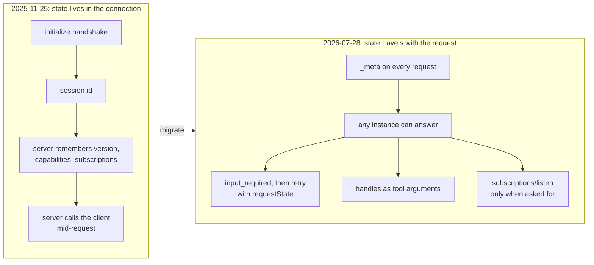

# What Changed in the 2026 MCP Specification: The Complete Guide

> 📚 **Before you start**
>
> - [Initialisation, Version and Capability Negotiation](../04-the-mcp-lifecycle/initialisation-version-and-capability-negotiation.md), for `server/discover`, the per-request `_meta` and the dual-era probe.
> - [Operation and Shutdown](../04-the-mcp-lifecycle/operation-and-shutdown.md), for input-required results, subscriptions and caching hints.
> - [Building and Deploying a Remote MCP Server](../05-building-with-mcp/building-and-deploying-a-remote-mcp-server.md), for why stateless servers scale.

## Introduction

When Indian Railways moved from paper tickets to the UTS app, the trains didn't change, the stations didn't change, and paper tickets kept working for a long time. What changed was **how a passenger proves they belong on the train**: instead of a conductor remembering who boarded where, every ticket carries everything needed to check it.

The `2026-07-28` revision of MCP, released on 28 July 2026, is that kind of change. Tools, resources and prompts work as before. What changed is the plumbing: there's no more `initialize` handshake and no session for the server to remember. **Every request carries its own protocol version and client capabilities**, so any server instance can answer any request.

You've been using the new protocol all through this course. This lesson steps back to give you the whole picture: the full change map against the previous revision (`2025-11-25`), the new Tasks extension for long-running work, explicit handles in place of sessions, which features are deprecated and on what timetable, and a practical playbook for migrating servers, clients and SDK code.

> 💡 **Key Insight**
>
> Nearly every change in `2026-07-28` follows from one decision: **the server must not depend on anything an earlier request said.** Sessions, the handshake, server-to-client requests, the GET stream and SSE resumption all relied on per-connection state, so each was removed or replaced with something that travels inside the request itself.

---

## Core Explanation

### 1. Where this revision sits

| Revision | Headline changes |
|---|---|
| `2024-11-05` | First public specification: tools, resources, prompts, stdio and HTTP+SSE |
| `2025-03-26` | Streamable HTTP replaces HTTP+SSE; OAuth-based authorization; tool annotations |
| `2025-06-18` | Structured tool output, elicitation, resource links |
| `2025-11-25` | URL-mode elicitation, experimental tasks, icons |
| **`2026-07-28`** | **Stateless core**, `server/discover`, multi round-trip requests, `subscriptions/listen`, Tasks as an extension, formal deprecation policy |

Revisions are named by the date they were finalised. A client and server agree on one revision per request; a server may support several at once.

### 2. The change map

Here is every major change, what replaced the old mechanism, and where in this course you met it:

| Removed or changed | Replaced by | Covered in |
|---|---|---|
| `initialize` / `notifications/initialized` handshake | `_meta` on every request: `protocolVersion`, `clientCapabilities`, `clientInfo` | [Initialisation lesson](../04-the-mcp-lifecycle/initialisation-version-and-capability-negotiation.md) |
| Server identity in the handshake | `serverInfo` in each result's `_meta`; mandatory `server/discover` | Same |
| Sessions and the `Mcp-Session-Id` header | Server-minted **handles** passed as ordinary tool arguments (section 4) | This lesson |
| Server-to-client requests (`elicitation/create`, `sampling/createMessage`, `roots/list`) sent mid-call | **Multi round-trip requests**: `resultType: "input_required"` with `inputRequests`, retried with `inputResponses` | [Operation lesson](../04-the-mcp-lifecycle/operation-and-shutdown.md) |
| HTTP GET stream and `resources/subscribe` / `unsubscribe` | `subscriptions/listen`, one opted-in stream tagged with a `subscriptionId` | Same |
| `ping` | Nothing: with no session, there's nothing to keep alive | Same |
| `logging/setLevel` | A per-request `io.modelcontextprotocol/logLevel` in `_meta` | [Data layer lesson](../03-how-mcp-components-talk/the-data-layer-json-rpc-messages.md) |
| `notifications/roots/list_changed` | Nothing (Roots is deprecated) | Section 6 |
| SSE resumability (`Last-Event-ID`) | Re-issue a broken request with a new id | [Transport lesson](../03-how-mcp-components-talk/the-transport-layer-stdio-and-streamable-http.md) |
| Experimental core tasks (`tasks/result`, `tasks/list`) | The **Tasks extension**, polled with `tasks/get` and fed with `tasks/update` | Section 3 |
| Results without a type | Every result has `resultType` (`"complete"`, `"input_required"`, or `"task"` from the Tasks extension) | Operation lesson |

And the smaller changes that still break code if you miss them:

| Change | What to do |
|---|---|
| "Resource not found" is now `-32602` (was `-32002`) | Update error handling on both sides |
| MCP error codes renumbered into `-32020` to `-32099`: `HeaderMismatch` `-32020`, `MissingRequiredClientCapability` `-32021`, `UnsupportedProtocolVersion` `-32022` | Don't hard-code the draft numbers |
| Streamable HTTP POSTs must carry `Mcp-Method` and `Mcp-Name` headers; tool parameters can be mirrored into custom headers with `x-mcp-header` | Lets gateways route without parsing bodies (you'll use this in the gateways lesson) |
| List results and `resources/read` carry `ttlMs` and `cacheScope` | Cache lists; return tools in a stable order |
| `inputSchema` / `outputSchema` may use any JSON Schema 2020-12 keyword | Clients must handle `$ref` and composition keywords |
| `notifications/elicitation/complete` and `elicitationId` removed | Correlate URL-mode elicitations through `requestState` |
| Capabilities gained an `extensions` field | Where MCP Apps and Tasks are negotiated |
| Authorization: validate `iss` in authorization responses (RFC 9207); key client credentials by issuer; `application_type` in dynamic registration; dynamic registration deprecated in favour of Client ID Metadata Documents | Covered in the next lesson |
| OpenTelemetry `traceparent`, `tracestate` and `baggage` conventions in `_meta` | Use them for traces across hosts, gateways and servers |



### 3. The Tasks extension: long-running work without long connections

Some tools take minutes: generating a year's GST report, running a CI pipeline, waiting for a manager's approval. Holding an HTTP request open that long fails on proxies and load balancers, and a dropped connection loses the work. The **Tasks extension** (`io.modelcontextprotocol/tasks`) lets the server return a **durable handle** instead:

1. The client declares `"extensions": {"io.modelcontextprotocol/tasks": {}}` in the `clientCapabilities` it sends with each request. The server advertises the same key in `server/discover`.
2. For a request it decides will take long, the server returns `resultType: "task"` with a `taskId`, a `status`, `ttlMs` (how long it keeps the task) and `pollIntervalMs` (how often to check). The server must never do this for a client that didn't declare the extension.
3. The client polls `tasks/get` until the status is terminal: `completed` (with `result`, exactly what the call would have returned directly), `failed` (with `error`) or `cancelled`.
4. If the status becomes `input_required`, the task carries `inputRequests`; the client answers with `tasks/update`.
5. `tasks/cancel` asks the server to stop; cancellation is cooperative, so the task may still finish.
6. Instead of polling, the client can subscribe to `notifications/tasks` through `subscriptions/listen`.

Compared with the experimental tasks of `2025-11-25`, the blocking `tasks/result` and the `tasks/list` method are gone, and the client no longer opts in per request: the server decides per request whether to make a task.

Let's simulate a GST report task end to end. The server advances work on a fake clock, so the example runs instantly and gives the same output every time.

```python
import json, uuid

CLOCK = {"ms": 0}
TASKS_EXT = "io.modelcontextprotocol/tasks"

class ReportServer:
    def __init__(self):
        self.tasks = {}

    def handle(self, method, params):
        caps = params.get("_meta", {}).get("io.modelcontextprotocol/clientCapabilities", {})
        if method == "tools/call":
            if TASKS_EXT not in caps.get("extensions", {}):         # never hand a task to a client that can't poll
                return {"resultType": "complete", "isError": True, "content": [{"type": "text",
                        "text": "This report takes a few minutes; use a client that supports tasks."}]}
            task = {"taskId": "task_" + uuid.uuid5(uuid.NAMESPACE_URL, json.dumps(params["arguments"])).hex[:8],
                    "status": "working", "statusMessage": "Queued", "createdAt": "2026-10-15T10:00:00Z",
                    "lastUpdatedAt": "2026-10-15T10:00:00Z", "ttlMs": 3_600_000, "pollIntervalMs": 2000}
            self.tasks[task["taskId"]] = {"public": task, "started": CLOCK["ms"], "args": params["arguments"],
                                          "approved": None}
            return {"resultType": "task", **task}
        if method == "tasks/get":
            return {"resultType": "complete", **self.advance(params["taskId"])}
        if method == "tasks/update":
            t = self.tasks[params["taskId"]]
            answer = params["inputResponses"].get("approve", {})
            t["approved"] = answer.get("action") == "accept" and answer.get("content", {}).get("approve", False)
            t["public"].pop("inputRequests", None)
            t["public"].update(status="working", statusMessage="Approval received")
            return {"resultType": "complete"}
        if method == "tasks/cancel":
            t = self.tasks[params["taskId"]]["public"]
            if t["status"] not in ("completed", "failed", "cancelled"):
                t.update(status="cancelled", statusMessage="Cancelled by client")
            return {"resultType": "complete"}

    def advance(self, task_id):
        t = self.tasks[task_id]
        task, elapsed = t["public"], CLOCK["ms"] - t["started"]
        if task["status"] in ("completed", "failed", "cancelled", "input_required"):
            return task
        if elapsed >= 4000 and t["approved"] is None:              # needs a human before filing
            task.update(status="input_required", statusMessage="Waiting for approval",
                        inputRequests={"approve": {"method": "elicitation/create", "params": {
                            "mode": "form", "message": f"File the GSTR-1 for {t['args']['period']} now?",
                            "requestedSchema": {"type": "object", "properties": {"approve": {"type": "boolean"}},
                                                "required": ["approve"]}}}})
        elif t["approved"] is False:
            task.update(status="failed", statusMessage="Not approved",
                        error={"code": -32603, "message": "The user did not approve filing"})
        elif t["approved"] and elapsed >= 8000:
            task.update(status="completed", statusMessage="Done", result={"resultType": "complete",
                        "isError": False, "content": [{"type": "text",
                        "text": f"GSTR-1 for {t['args']['period']} filed: 412 invoices, tax Rs 3,18,560"}]})
        else:
            task["statusMessage"] = f"Processing invoices ({min(100, elapsed // 40)}%)"
        return task
```

And a client that polls, respecting `pollIntervalMs`, and answers the approval request:

```python
def run_task(server, period, approve=True, declare=True, cancel_after_ms=None):
    caps = {"extensions": {TASKS_EXT: {}}} if declare else {}
    meta = {"io.modelcontextprotocol/protocolVersion": "2026-07-28",
            "io.modelcontextprotocol/clientCapabilities": caps}
    first = server.handle("tools/call", {"name": "file_gst_return", "arguments": {"period": period},
                                         "_meta": meta})
    if first["resultType"] != "task":
        print("direct result:", first["content"][0]["text"])
        return
    task_id = first["taskId"]
    print(f"t={CLOCK['ms']:>5}ms task {task_id} {first['status']} (poll every {first['pollIntervalMs']} ms)")
    while True:
        CLOCK["ms"] += first["pollIntervalMs"]                       # wait as the server suggested
        if cancel_after_ms is not None and CLOCK["ms"] >= cancel_after_ms:
            server.handle("tasks/cancel", {"taskId": task_id, "_meta": meta})
            cancel_after_ms = None
        t = server.handle("tasks/get", {"taskId": task_id, "_meta": meta})
        print(f"t={CLOCK['ms']:>5}ms {t['status']:<15} {t['statusMessage']}")
        if t["status"] == "input_required":
            question = t["inputRequests"]["approve"]["params"]["message"]
            print("         ask user:", question, "->", "yes" if approve else "no")
            server.handle("tasks/update", {"taskId": task_id, "_meta": meta, "inputResponses": {
                "approve": {"action": "accept", "content": {"approve": approve}}}})
        elif t["status"] == "completed":
            print("         result:", t["result"]["content"][0]["text"])
            return
        elif t["status"] in ("failed", "cancelled"):
            print("         ended:", t.get("error", {}).get("message", t["statusMessage"]))
            return

server = ReportServer()
run_task(server, "September 2026")
```

Output:

```
t=    0ms task task_1dfca4f3 working (poll every 2000 ms)
t= 2000ms working         Processing invoices (50%)
t= 4000ms input_required  Waiting for approval
         ask user: File the GSTR-1 for September 2026 now? -> yes
t= 6000ms working         Processing invoices (100%)
t= 8000ms completed       Done
         result: GSTR-1 for September 2026 filed: 412 invoices, tax Rs 3,18,560
```

Three other outcomes: Ananya says no, the client cancels, and an old client that never declared the extension:

```python
CLOCK["ms"] = 0
run_task(ReportServer(), "August 2026", approve=False)
CLOCK["ms"] = 0
run_task(ReportServer(), "July 2026", cancel_after_ms=3000)
CLOCK["ms"] = 0
run_task(ReportServer(), "June 2026", declare=False)
```

Output:

```
t=    0ms task task_e7ed3799 working (poll every 2000 ms)
t= 2000ms working         Processing invoices (50%)
t= 4000ms input_required  Waiting for approval
         ask user: File the GSTR-1 for August 2026 now? -> no
t= 6000ms failed          Not approved
         ended: The user did not approve filing
t=    0ms task task_d663f736 working (poll every 2000 ms)
t= 2000ms working         Processing invoices (50%)
t= 4000ms cancelled       Cancelled by client
         ended: Cancelled by client
direct result: This report takes a few minutes; use a client that supports tasks.
```

Because the `taskId` is durable, a client that crashes can store it, restart, and carry on polling. In production the task table lives in a database shared by all instances, like the handles in the next section.

### 4. Handles instead of sessions

Before `2026-07-28`, a server could keep state "for this session": a shopping cart, an open database transaction, a logged-in browser page. With sessions gone, the spec's answer is an **explicit handle**: a tool creates the thing and returns an id, and later tools take that id as an ordinary argument.

```python
import random

SHARED_STORE = {}          # in production: Redis or a database every instance can reach
RNG = random.Random(2026)  # fixed seed so this example repeats; in production use secrets.token_hex(8)

def create_cart(owner):
    cart_id = "cart_" + f"{RNG.getrandbits(32):08x}"
    SHARED_STORE[cart_id] = {"owner": owner, "items": []}
    return cart_id

def add_to_cart(caller, cart_id, item, qty):
    cart = SHARED_STORE.get(cart_id)
    if cart is None:
        return f"Unknown cart {cart_id}; create one with create_cart."
    if cart["owner"] != caller:                         # a handle is not a password: still check who's asking
        return "That cart belongs to someone else."
    cart["items"].append((item, qty))
    return f"{cart_id}: {len(cart['items'])} item(s)"

cart = create_cart("ananya")
print(add_to_cart("ananya", cart, "Tata Salt 1 kg", 2))       # could be served by instance 1
print(add_to_cart("ananya", cart, "Amul butter 500 g", 1))    # ...and this by instance 3
print(add_to_cart("rahul", cart, "Maggi 12-pack", 1))
print(SHARED_STORE[cart]["items"])
```

Output:

```
cart_1e7ea419: 1 item(s)
cart_1e7ea419: 2 item(s)
That cart belongs to someone else.
[('Tata Salt 1 kg', 2), ('Amul butter 500 g', 1)]
```

Handles are better than sessions in three ways: the model can see and reason about them ("add it to the cart you just made"), one conversation can hold several at once (two carts, two browser pages), and they work across server restarts and instances. They're also visible to the model, so treat them as identifiers, not secrets: check authorisation on every use, as `add_to_cart` does.

### 5. Feature lifecycle and deprecation

`2026-07-28` also introduced a formal **feature lifecycle**. Every feature is **Active**, **Deprecated** or **Removed**. A deprecated feature keeps working for at least **twelve months**; it can only be removed in the first revision released on or after that date. The spec keeps a registry of everything currently deprecated.

| Deprecated in `2026-07-28` | Migrate to (the spec's suggestion) |
|---|---|
| **Roots** | Pass folders or files as tool parameters, resource URIs or server configuration |
| **Sampling** | Call an LLM provider's API directly from the server |
| **Logging** | Log to stderr (stdio servers) or use OpenTelemetry |
| **HTTP+SSE transport** (superseded since `2025-03-26`) | Streamable HTTP |
| `includeContext: "thisServer"` / `"allServers"` | Omit the field, or use `"none"` |
| **Dynamic Client Registration** | Client ID Metadata Documents (next lesson); DCR stays for authorization servers that don't support them |

```python
from datetime import date

def earliest_removal(deprecated_on, revisions):
    """The first revision released at least twelve months after deprecation."""
    cutoff = deprecated_on.replace(year=deprecated_on.year + 1)
    later = [r for r in revisions if r >= cutoff]
    return min(later) if later else f"not before {cutoff.isoformat()}"

known = [date(2024, 11, 5), date(2025, 3, 26), date(2025, 6, 18), date(2025, 11, 25), date(2026, 7, 28)]
print("Sampling, Roots, Logging:", earliest_removal(date(2026, 7, 28), known))
print("with an imagined 2027-03 revision:", earliest_removal(date(2026, 7, 28), known + [date(2027, 3, 1)]))
print("with an imagined 2027-09 revision:", earliest_removal(date(2026, 7, 28), known + [date(2027, 9, 15)]))
```

Output:

```
Sampling, Roots, Logging: not before 2027-07-28
with an imagined 2027-03 revision: not before 2027-07-28
with an imagined 2027-09 revision: 2027-09-15
```

So a server that uses sampling today keeps working with `2026-07-28` clients, and has until at least July 2027 to move. New code shouldn't adopt any of these.

### 6. A migration playbook

**For a server:**

1. Implement `server/discover` (mandatory), returning `supportedVersions`, `capabilities` and `serverInfo`.
2. Read the version and capabilities from each request's `_meta`; return `-32022` for a version you don't support, and `-32021` when the request needs a client capability that wasn't declared.
3. Replace session state with handles or a shared store; make every instance able to answer every request.
4. Replace mid-call `elicitation/create` / `sampling/createMessage` / `roots/list` with input-required results and `requestState` (seal it if it matters, as in the remote server lesson).
5. Replace `resources/subscribe` with `subscriptions/listen`; drop `ping` and `logging/setLevel`.
6. Add `resultType` to every result, `ttlMs` and `cacheScope` to cacheable ones, and `serverInfo` to `_meta`.
7. Use `-32602` for resource-not-found; return tools in a stable order.
8. Keep serving the legacy handshake for older clients until your users have moved (the SDKs do this for you).

**For a client or host:**

1. Probe with `server/discover`; fall back to `initialize` on any other error or a timeout (not only on one specific code).
2. Send `_meta` with version, capabilities and `clientInfo` on every request.
3. Handle `input_required` by fulfilling `inputRequests` and retrying with a **new** request id.
4. Treat a result without `resultType` from an old server as `"complete"`.
5. Re-issue a request whose stream broke, with a new id; there's no resumption.
6. Respect `ttlMs`; add `Mcp-Method` and `Mcp-Name` headers on HTTP.

A small linter can find the old patterns in a recorded message log:

```python
REPLACEMENTS = {
    "initialize": "drop the handshake; send _meta on every request and implement server/discover",
    "notifications/initialized": "drop it; there is no handshake",
    "ping": "drop it; nothing to keep alive",
    "logging/setLevel": "send io.modelcontextprotocol/logLevel in each request's _meta",
    "resources/subscribe": "use subscriptions/listen with resourceSubscriptions",
    "elicitation/create": "return an input_required result instead of calling the client mid-request",
    "sampling/createMessage": "deprecated: call your LLM provider directly",
    "roots/list": "deprecated: take folders as tool parameters or configuration",
    "tasks/result": "Tasks extension: poll tasks/get; the result arrives inside the completed task",
}

def lint(log):
    findings = []
    for direction, msg in log:
        method = msg.get("method")
        if method in REPLACEMENTS:
            findings.append(f"{direction} {method}: {REPLACEMENTS[method]}")
        error = msg.get("error", {})
        if error.get("code") == -32002:
            findings.append(f"{direction} error -32002: resource-not-found is now -32602")
        if "result" in msg and "resultType" not in msg["result"]:
            findings.append(f"{direction} result id={msg['id']}: add resultType")
        if "Mcp-Session-Id" in msg.get("headers", {}):
            findings.append(f"{direction} Mcp-Session-Id header: sessions are gone; use handles")
    return findings

old_log = [
    (">", {"jsonrpc": "2.0", "id": 1, "method": "initialize", "params": {"protocolVersion": "2025-11-25"}}),
    ("<", {"jsonrpc": "2.0", "id": 1, "result": {"protocolVersion": "2025-11-25"},
           "headers": {"Mcp-Session-Id": "a1b2"}}),
    (">", {"jsonrpc": "2.0", "method": "notifications/initialized"}),
    (">", {"jsonrpc": "2.0", "id": 2, "method": "resources/subscribe", "params": {"uri": "expense://2026/10"}}),
    ("<", {"jsonrpc": "2.0", "id": 9, "method": "elicitation/create", "params": {"message": "Confirm?"}}),
    ("<", {"jsonrpc": "2.0", "id": 3, "error": {"code": -32002, "message": "Resource not found"}}),
]
for finding in lint(old_log):
    print(finding)
```

Output:

```
> initialize: drop the handshake; send _meta on every request and implement server/discover
< result id=1: add resultType
< Mcp-Session-Id header: sessions are gone; use handles
> notifications/initialized: drop it; there is no handshake
> resources/subscribe: use subscriptions/listen with resourceSubscriptions
< elicitation/create: return an input_required result instead of calling the client mid-request
< error -32002: resource-not-found is now -32602
```

### 7. Upgrading SDK code

The official Python SDK 2.x speaks both eras and hides most of this. The visible changes when upgrading from 1.x are mostly names:

```python
# not-run: needs the `mcp` package (2.x)

# 1.x
# from mcp.server.fastmcp import FastMCP, Context
# mcp = FastMCP("kirana")

# 2.x: the class is now MCPServer, and the old module path no longer exists
from mcp.server.mcpserver import MCPServer, Context
mcp = MCPServer("kirana")

@mcp.tool()                       # parentheses required
def check_stock(item: str) -> str:
    ...

# Clients pick an era explicitly or let the SDK probe
from mcp import Client
async def main():
    async with Client("https://kirana.example.in/mcp", mode="auto") as client:      # or "legacy" / "2026-07-28"
        print(client.protocol_version)
```

Example output:

```
2026-07-28
```

The standalone `fastmcp` package (version 4.x) keeps the `FastMCP` name under its own import path (`from fastmcp import FastMCP`), so check which package a codebase uses before renaming anything. And remember from the LangChain lesson that some libraries still pin `mcp<2`, so a full upgrade may wait on them.

---

## Try It Yourself

1. **Resume after a crash.** Start a task, "crash" the client after the first poll (keep only the `taskId`), then write three lines that resume polling with `tasks/get` from the same server object.
2. **Lint a client log.** Add a check to `lint` that flags a request missing `io.modelcontextprotocol/protocolVersion` in `params._meta`, and run it on one modern and one bad request.
3. **Handles or session?** A browser-automation server keeps one open page per user. Explain in two sentences how to redesign it for `2026-07-28`.

<details>
<summary>Show answers</summary>

**1.**

```python
CLOCK["ms"] = 0
srv = ReportServer()
meta = {"io.modelcontextprotocol/protocolVersion": "2026-07-28",
        "io.modelcontextprotocol/clientCapabilities": {"extensions": {TASKS_EXT: {}}}}
saved_id = srv.handle("tools/call", {"name": "file_gst_return", "arguments": {"period": "May 2026"},
                                     "_meta": meta})["taskId"]
# ... the client process crashes here and restarts with only saved_id ...
CLOCK["ms"] = 5000
t = srv.handle("tasks/get", {"taskId": saved_id, "_meta": meta})
print(saved_id, t["status"], "-", t["statusMessage"])
```

Output:

```
task_edb8b02e input_required - Waiting for approval
```

**2.**

```python
def lint_requests(log):
    out = lint(log)
    for direction, msg in log:
        if direction == ">" and "id" in msg and "method" in msg:
            if "io.modelcontextprotocol/protocolVersion" not in msg.get("params", {}).get("_meta", {}):
                out.append(f"> {msg['method']} id={msg['id']}: missing protocolVersion in _meta")
    return out

print(lint_requests([
    (">", {"jsonrpc": "2.0", "id": 5, "method": "tools/list",
           "params": {"_meta": {"io.modelcontextprotocol/protocolVersion": "2026-07-28"}}}),
    (">", {"jsonrpc": "2.0", "id": 6, "method": "tools/list", "params": {}}),
]))
```

Output:

```
['> tools/list id=6: missing protocolVersion in _meta']
```

**3.** Add an `open_page` tool that returns a page handle (stored in a shared store with its owner), and make every other tool (`click`, `read_text`, `close_page`) take that handle as an argument and check its owner. Pages then survive load balancing, a user can have several at once, and the model can see which page it's working on.

</details>

---

## Real-World Examples

- **SDK upgrades**: the official SDKs serve both eras from the same server code, so for many servers the upgrade is a dependency bump plus renamed imports (`FastMCP` to `MCPServer` in Python).
- **Scaling out**: once a server no longer needs `Mcp-Session-Id`, it can run behind an ordinary round-robin load balancer or on serverless platforms, with no sticky sessions.
- **Long-running tools** such as report generation, CI runs and approval workflows fit the Tasks extension, which survives dropped connections and client restarts.
- **Gateways** can route and apply policy using the `Mcp-Method` and `Mcp-Name` headers without parsing JSON bodies.

---

## Common Misconceptions

### "Stateless means servers can't remember anything"

They can remember plenty: in a database, behind a handle the model passes back. What they can't do is rely on the **connection** to remember it.

### "Old clients stop working"

Servers can keep supporting the legacy handshake alongside the new protocol, and the official SDKs do so by default.

### "Deprecated features are gone"

Deprecated features still work for at least twelve months. They're a signal not to build new things on them.

### "Tasks are for every slow tool"

A few seconds is fine as a normal request with progress notifications. Tasks are for work measured in minutes, work that waits for people, or clients on unreliable connections.

---

## Interview Relevance

*"What changed in MCP in 2026, and why?"* A strong answer leads with statelessness (no handshake or sessions; `_meta` on every request; mandatory `server/discover`) and its motivation (horizontal scaling behind ordinary load balancers, serverless hosting). It then covers the replacements: multi round-trip requests instead of server-to-client calls, `subscriptions/listen`, handles instead of sessions, Tasks as an extension with `tasks/get` and `tasks/update`, the deprecations (Roots, Sampling, Logging, HTTP+SSE, Dynamic Client Registration), the twelve-month deprecation policy, and how dual-era clients probe with `server/discover` and fall back.

---

## Key Takeaways

- **`2026-07-28` makes MCP stateless**: every request carries its version, capabilities and identity in `_meta`, and servers must implement `server/discover`.
- **Per-connection mechanisms were replaced**: input-required retries, `subscriptions/listen`, and explicit handles passed as tool arguments.
- **The Tasks extension handles long work**: a `resultType: "task"` handle, polled with `tasks/get`, fed with `tasks/update`, stopped with `tasks/cancel`.
- **Roots, Sampling, Logging, HTTP+SSE and Dynamic Client Registration are deprecated**, with at least twelve months before removal.
- **Migrate with both eras in mind**: probe and fall back on the client, serve both on the server, and let the SDK do the heavy lifting.

---

**Up next:** [Authorization with OAuth 2.1](authorization-with-oauth-2-1.md)
