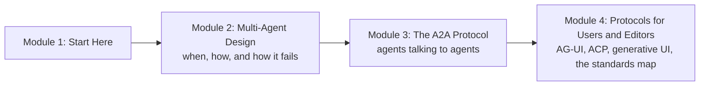
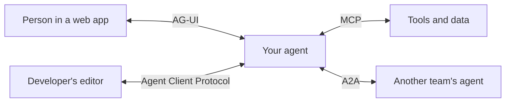

# How This Course Works

## Introduction

Think about how a wedding gets organised in a big Indian family. One person cannot do everything, so the work is split. A caterer handles the food, a decorator handles the mandap, a cousin handles the guest list, and someone (usually an aunt with a notebook) keeps track of who is doing what. Splitting the work is only half the story. The other half is **how all these people talk to each other**: the caterer needs the final head count from the cousin, the decorator needs the muhurat time from the pandit, and the aunt needs a quick update from everyone each evening. When the talking is sloppy, the wedding goes wrong even if every individual is excellent.

AI agents have reached the same point. You already know how to build one agent that loops, calls tools and remembers things. This course is about **many agents working together**, and about the **open protocols** that let agents talk to tools, to each other, to the screens people use and to the code editors developers live in.

The course has two halves. The first half is design: when splitting work across agents is worth it, how to structure the team, and how such teams fail. The second half is protocols: the **Agent2Agent (A2A) protocol** for agents built by different teams to work together, **AG-UI** for streaming an agent's progress into a web page, the **Agent Client Protocol** for plugging agents into editors, generative UI, and the map of open standards and who governs them.

> 💡 **Key Insight**
>
> A multi-agent system is only as good as its **coordination**. Splitting work buys you focus, parallelism and separate context windows, and it costs you tokens, delay and many new ways to lose information. Protocols such as A2A don't make agents smarter; they make the hand-offs between agents **predictable, inspectable and secure**.

---

## What You Will Learn

By the end of this course you will be able to:

- **Decide whether a problem needs several agents at all**, using real numbers on token cost, speed and quality instead of hype.
- **Build an orchestrator with subagents**: write clear task briefs, fan work out in parallel, and merge results without flooding the lead agent's context.
- **Choose and build the main coordination patterns**: handoffs, group chat and Magentic-style orchestration with a planning manager.
- **Recognise and prevent the common failure modes** of multi-agent systems: duplicated work, drift, loops, lost information and cascading errors.
- **Read and write A2A messages by hand**: Agent Cards, tasks, messages, parts, artifacts, streaming events and push notifications, exactly as the **A2A v1.0** specification defines them.
- **Explain clearly how A2A and MCP differ** and how they fit together in one system.
- **Secure agent-to-agent traffic**: authentication schemes, signed Agent Cards, in-task authorisation, webhook safety and treating other agents' messages as untrusted input.
- **Connect two agents built with different frameworks over A2A**, in a lab you run on your own machine.
- **Stream agent events to a frontend with AG-UI**, plug an agent into an editor with the Agent Client Protocol, and choose an approach to generative UI.
- **Place every open standard on one map**: MCP, A2A, AG-UI, ACP, AGENTS.md, Agent Skills, and the foundations that govern them.

### The course at a glance

Module 2 is **design**: no protocols, just the question of how to split work and coordinate it. Module 3 is the **agent-to-agent protocol**: how agents owned by different teams, written in different frameworks and running on different servers discover each other and exchange work. Module 4 covers the **other edges** of an agent: the person looking at a screen, the developer in an editor, and the standards bodies that keep all these protocols open.

### Where the protocols sit

Here is the whole landscape you'll cover, in one picture. Each arrow is a different protocol, because each connection has a different job.

You met the **MCP** arrow in the [Model Context Protocol (MCP)](../../model-context-protocol-mcp/course.md) course. This course adds the other three and explains how they combine.

---

## How Every Lesson Is Built

Every article follows the same shape, so you always know where to look:

| Section | What it gives you |
|---|---|
| **Before you start** | Links to the earlier lessons this one depends on. |
| **Introduction** | Why the topic matters, with an everyday example. |
| **Key Insight** | The one idea to remember. |
| **Core Explanation** | The topic step by step, with diagrams, tables, real-looking messages and runnable code. |
| **Try It Yourself** | Exercises, with answers hidden in a fold. |
| **Real-World Examples** | How shipping products use the idea. |
| **Common Misconceptions** | Mistakes almost everyone makes, corrected. |
| **Interview Relevance** | What interviewers ask and what a strong answer covers. |
| **Key Takeaways** | A one-minute summary for revision. |

**The lab** in Module 3 is a guided build: a LangGraph agent and a separately built client agent talk to each other over real A2A JSON-RPC messages.

---

## What You Need Before Starting

- **Single agents.** You should be comfortable with the agent loop, tool calling and the basic multi-agent shapes from [What are Multi-Agent Systems?](../../agentic-ai-fundamentals/06-multi-agent-systems-and-the-ecosystem/what-are-multi-agent-systems.md). This course starts where that lesson stops.
- **LangGraph.** Several examples use LangGraph graphs, `Send` for fan-out and `Command` for routing. [Parallel Workflows](../../langgraph-complete-guide/03-workflow-patterns-in-langgraph/parallel-workflows.md), [Conditional Workflows](../../langgraph-complete-guide/03-workflow-patterns-in-langgraph/conditional-workflows.md) and [What are Subgraphs?](../../langgraph-complete-guide/09-subgraphs/what-are-subgraphs.md) cover what you need.
- **Context engineering.** Why a fresh context window helps is explained in [Context Rot and Lost in the Middle](../../context-engineering-and-agent-memory/02-the-context-window-as-a-budget/context-rot-and-lost-in-the-middle.md).
- **MCP.** The A2A module compares A2A with MCP all the time. You should know MCP's hosts, clients, servers and JSON-RPC messages from the [Model Context Protocol (MCP)](../../model-context-protocol-mcp/course.md) course.
- **Agent frameworks.** It helps to have seen at least one vendor SDK, such as the OpenAI Agents SDK, Google ADK or Microsoft Agent Framework, from [Agent Frameworks and SDKs](../../agent-frameworks-and-sdks/course.md). Wherever this course shows framework code, it explains it line by line.
- **HTTP and JSON.** You should be able to read an HTTP request and a JSON body. [APIs and Apps: FastAPI, Streamlit and Docker](../../apis-and-apps-fastapi-streamlit-and-docker/course.md) covers FastAPI, which the A2A examples use.
- **Python 3.10 or newer** with the packages in the site's `requirements-lessons.txt` (LangGraph, LangChain Core, FastAPI, httpx, Pydantic and a few others).

### Do I need an API key?

No. Every runnable example uses a pretend model, LangChain's `FakeListChatModel` or plain Python, so it runs offline and prints exactly what the lesson shows. The A2A examples run real HTTP requests against a FastAPI app **inside the same Python process** (FastAPI's `TestClient`), so no server or network is needed. Where real SDK code matters, such as the official `a2a-sdk` package, the Microsoft Agent Framework or the OpenAI Agents SDK, the lesson shows it in a block marked `# not-run`, written for the current versions, with example output.

### Which versions this course follows

| Standard | Version taught | Why it matters |
|---|---|---|
| A2A | **v1.0** (released 12 March 2026; current patch 1.0.1 from 26 May 2026) | v1.0 changed the JSON shapes from earlier drafts. Old tutorials using `"kind": "text"` or `message/send` are for v0.3. |
| MCP | **2026-07-28** | Taught in the MCP course; referenced here when comparing. |
| AG-UI, Agent Client Protocol | Current documentation as of October 2026 | Both move quickly; the lessons stick to stable concepts and say where details change. |

---

## How to Get the Most Out of It

1. **Read the messages.** Every protocol lesson shows the exact JSON that travels on the wire. Read it slowly, field by field, before reading the explanation. Protocols are easy once the messages are familiar.
2. **Count the tokens.** Multi-agent designs are mostly a trade of money for quality and speed. Whenever a lesson estimates cost, change the numbers and see how the decision moves.
3. **Break things on purpose.** Send a message to a finished task, drop an artifact chunk, forge an Agent Card. Seeing the error is the fastest way to understand the rule.
4. **Draw the boundaries.** For any system, sketch which parts are tools (MCP), which are peer agents (A2A), which are user interfaces (AG-UI) and which are editors (ACP). Most design confusion disappears once the boundaries are drawn.

---

## Common Misconceptions

### "More agents means a smarter system"

More agents means more coordination. A single well-built agent beats a badly coordinated team almost every time. Module 2 starts with the evidence for when splitting helps and when it hurts.

### "A2A replaces MCP"

They solve different problems. MCP connects an agent to tools and data it controls. A2A connects an agent to **another agent** that it does not control and cannot see inside. Most real systems use both.

### "A protocol is a library"

A protocol is a contract: message shapes and rules. Libraries such as the A2A Python SDK implement the contract. You will write A2A messages by hand before touching any SDK, so you'll understand what the SDK is doing for you.

---

## Key Takeaways

- **Module 2 is design**: when several agents are worth it, how to coordinate them, and how they fail.
- **Module 3 is A2A v1.0**: Agent Cards, tasks, messages, artifacts, streaming, security and a two-framework lab.
- **Module 4 covers the other edges**: AG-UI for frontends, the Agent Client Protocol for editors, generative UI, and the open standards map.
- **No API key is needed**: runnable code uses pretend models and in-process HTTP; real SDK code is shown in clearly marked blocks.
- **Protocols are contracts, not magic**: once you can read the JSON, every SDK and product becomes easy to understand.

---

**Up next:** [When Multiple Agents Help and When They Hurt](../02-multi-agent-design/when-multiple-agents-help-and-when-they-hurt.md)
