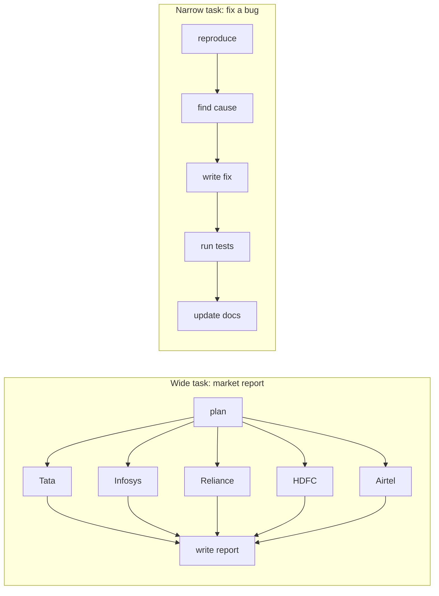

# When Multiple Agents Help and When They Hurt: The Complete Guide

> 📚 **Before you start**
>
> - [What are Multi-Agent Systems?](../../agentic-ai-fundamentals/06-multi-agent-systems-and-the-ecosystem/what-are-multi-agent-systems.md), for the basic shapes (supervisor, pipeline, handoffs) and the tiny supervisor team you built there.
> - [Context Rot and Lost in the Middle](../../context-engineering-and-agent-memory/02-the-context-window-as-a-budget/context-rot-and-lost-in-the-middle.md), for why a model gets worse as its context window fills up.
> - [Parallel Workflows](../../langgraph-complete-guide/03-workflow-patterns-in-langgraph/parallel-workflows.md), for running branches at the same time.

## Introduction

Every Sunday, a gurudwara langar feeds hundreds of people. Nobody expects one cook to do it. Volunteers split up: some knead atta, some roll rotis, some stir the dal, some serve. The work is **wide**: lots of parts that can happen at the same time, and each volunteer only needs to know their own job.

Now think of a cook making one perfect cup of masala chai. Adding four more cooks doesn't help. One adds ginger, another doesn't know and adds more ginger, a third boils it too long while the fourth is still crushing cardamom. The work is **narrow**: every step depends on the one before, and everyone needs to know everything.

Multi-agent systems are exactly like this. For some tasks, several agents working in parallel, each with its own clean context, produce far better results than one agent. For other tasks, splitting the work just multiplies cost and confusion. Experienced teams in 2025 and 2026 have published strong opinions on both sides, and both sides are right about different kinds of work.

By the end of this lesson you'll be able to say exactly **why** a second agent helps (it is almost never "because agents are smart"), estimate what it will cost in tokens and time, spot the tasks where it backfires, and make the call with a simple checklist.

> 💡 **Key Insight**
>
> Multiple agents help when a task splits into parts that need **different context** and can run **at the same time**. They hurt when the parts **share context** or must happen **one after another**. A multi-agent system is mostly a way to **spend more tokens usefully**, so only use one when the task is worth that spend.

---

## Core Explanation

### 1. The baseline: what one agent can already do

Before adding agents, remember how much a single agent can do. It has a loop, tools, instructions and memory. It can plan, call twenty tools, recover from errors and write a long report. Most production agents in 2026, including coding agents, are still **one main agent** for most of their work.

So the question is never "is multi-agent better?". The question is: **what specific limit of a single agent am I hitting?** There are only a handful of honest answers.

| Limit of one agent | What it looks like | Does a second agent fix it? |
|---|---|---|
| **The context window fills up** | After 40 tool calls, the window holds 120,000 tokens of search results and the model starts missing things | Yes. Subagents read in their own windows and return short summaries |
| **Work is slow because it's sequential** | Researching 10 companies one after another takes 20 minutes | Yes, if the parts are independent and run in parallel |
| **Conflicting roles** | "Be creative" and "be a strict reviewer" in one prompt | Often. Separate prompts, or simply a separate review step |
| **Different permissions or models** | The research step needs web access; the payment step must not have it | Yes. Each agent gets only its own tools |
| **Another team owns the capability** | The airline's booking agent is run by the airline, not by you | Yes, and you'll need a protocol such as A2A (Module 3) |
| **The model is not smart enough** | It reasons badly about a hard problem | Rarely. A better model, better tools or better context usually helps more |

### 2. The three forces that make multiple agents work


*The one question to ask first: does the task split into parts with different context that can run at once?*

**Force 1: context isolation.** Each subagent starts with a **fresh context window** that contains only its brief. It can read 50,000 tokens of web pages, keep what matters and hand back a 1,000-token summary. The lead agent never sees the 50,000 tokens. This is the same idea as compaction from the context engineering course, except the compression happens in a separate window. It fights context rot directly.

**Force 2: parallelism.** If five subagents each need 8 tool calls, they can all work at once. Wall-clock time drops from "40 calls in a row" to roughly "8 calls in a row, plus some coordination".

**Force 3: specialisation.** Each agent has its own instructions, tools, model and permissions. A cheap fast model can summarise pages; a strong model can plan and judge. A research agent can browse the web while the agent that sends emails cannot.

A fourth force sits outside your codebase: **ownership**. When the best agent for part of the job belongs to another company or another team, you can't merge it into your prompt. You have to talk to it. That is the problem A2A solves in Module 3.

### 3. What the evidence says

Two public write-ups from 2025 frame the debate well. Read them as data points, not laws.

**Anthropic's research system (June 2025).** Anthropic described the multi-agent system behind Claude's Research feature: a lead agent plans and launches subagents that search in parallel, then combines what they find. Their reported numbers:

| Finding | Number |
|---|---|
| Quality gain of a multi-agent system (Claude Opus 4 lead, Claude Sonnet 4 subagents) over a single Claude Opus 4 agent, on their internal research evaluation | **90.2% better** |
| Tokens used by a typical agent, compared with a chat | **about 4x** |
| Tokens used by the multi-agent system, compared with a chat | **about 15x** |
| Share of performance differences on the BrowseComp benchmark explained by token usage alone | **about 80%** |
| Time saved on complex queries by running subagents (and their tool calls) in parallel | **up to 90%** |

The striking line is the 80%. On broad research tasks, **how many tokens you spend** explains most of the quality. A multi-agent system is a structured way to spend more tokens in parallel, each in a clean window. Anthropic also listed where the approach is a poor fit: tasks where all agents need the same context, tasks with many dependencies between agents, most coding tasks, and tasks whose value doesn't justify the extra cost.

**Cognition's "Don't Build Multi-Agents" (June 2025).** The team behind the Devin coding agent argued the opposite for their kind of work. Their two principles:

1. **Share context.** A subagent that only sees a short task description, not the full history of decisions, will make choices the rest of the system doesn't expect.
2. **Actions carry implicit decisions.** When two agents work on parts of one artefact (say, the background and the bird of a Flappy Bird clone), each makes dozens of small style decisions. If they can't see each other's decisions, the parts don't fit.

Their conclusion for long, tightly coupled tasks such as coding: prefer **one agent with a continuous context**, and use compression of history when the context gets long.

These two views don't conflict. Research is **wide** (many independent searches); building one coherent program is **narrow** (every decision depends on others). Match the architecture to the shape of the work.

### 4. Measuring the token trade-off yourself

Why can a multi-agent system be *cheaper* in some setups and far more expensive in others? Because an agent loop re-sends its whole history on every call. A single agent that does 40 tool calls in one window pays to re-read all earlier results on every step. Subagents with fresh windows don't.

Here is a small model. Each loop step sends a base prompt plus everything gathered so far.

```python
def loop_tokens(steps, base, per_step, cap=None):
    """Total input tokens and peak window size for an agent loop.
    Step k re-sends the base prompt plus k earlier tool results.
    cap simulates compaction: the window never grows past it."""
    sent = []
    for k in range(steps):
        size = base + k * per_step
        if cap is not None:
            size = min(size, cap)
        sent.append(size)
    return sum(sent), max(sent)

# Task: research 5 companies, about 8 tool calls each, about 3,000 tokens per tool result.
single_total, single_peak = loop_tokens(steps=40, base=4_000, per_step=3_000)

sub_total, sub_peak = loop_tokens(steps=8, base=5_000, per_step=3_000)     # each subagent: brief + own results
lead_total, lead_peak = loop_tokens(steps=3, base=6_000, per_step=1_500)   # lead reads 1,500-token summaries
multi_total = 5 * sub_total + lead_total

print(f"Single agent : {single_total:>9,} input tokens, peak window {single_peak:>7,}")
print(f"Multi-agent  : {multi_total:>9,} input tokens, peak window {max(sub_peak, lead_peak):>7,}")
```

Output:

```
Single agent : 2,500,000 input tokens, peak window 121,000
Multi-agent  :   642,500 input tokens, peak window  26,000
```

In this naive setup the single agent re-reads everything forty times, so the multi-agent design wins on both total tokens and peak window. But real single agents don't behave this naively: they **compact** their history. And real subagents don't stop at 8 calls: given their own budget, they **explore more widely**, which is where the extra quality comes from. Let's model both:

```python
# The single agent compacts: its window never grows past 40,000 tokens.
compact_total, compact_peak = loop_tokens(steps=40, base=4_000, per_step=3_000, cap=40_000)

# Each subagent explores more widely: 15 calls instead of 8.
wide_sub_total, wide_sub_peak = loop_tokens(steps=15, base=5_000, per_step=3_000)
wide_multi_total = 5 * wide_sub_total + lead_total

print(f"Single agent with compaction : {compact_total:>9,} tokens, peak {compact_peak:>7,}")
print(f"Multi-agent, wider search    : {wide_multi_total:>9,} tokens, peak {max(wide_sub_peak, lead_peak):>7,}")
print(f"Multi-agent costs {wide_multi_total / compact_total:.2f}x the compacted single agent")
```

Output:

```
Single agent with compaction : 1,366,000 tokens, peak  40,000
Multi-agent, wider search    : 1,972,500 tokens, peak  47,000
Multi-agent costs 1.44x the compacted single agent
```

Now the multi-agent design costs about 1.4 times as much. In return it made 75 tool calls instead of 40, almost twice as many sources, and no window ever needed compaction, so nothing was summarised away mid-task. That's the honest picture: **you are buying breadth and clean context with tokens**. Whether that's a good deal depends on how much the better answer is worth.

### 5. Measuring the time trade-off

Tokens are money; steps in a row are time. A model call with tool use often takes several seconds, so the length of the **longest chain of steps that must happen in order** decides how long the user waits.

```python
SECONDS_PER_STEP = 6

single_seconds = 40 * SECONDS_PER_STEP                       # every call in one long chain
multi_seconds = 8 * SECONDS_PER_STEP + 3 * SECONDS_PER_STEP  # subagents in parallel, then the lead

print(f"Single agent : {single_seconds} s")
print(f"Multi-agent  : {multi_seconds} s  ({1 - multi_seconds / single_seconds:.0%} faster)")
```

Output:

```
Single agent : 240 s
Multi-agent  : 66 s  (72% faster)
```

This only works if the five parts really are independent. If company 2's research needs company 1's answer, the chain gets longer and the speed-up disappears.

### 6. Finding the parallelism hidden in a task

A useful habit is to draw the task as a graph of steps and dependencies. Two numbers then tell you how much parallel agents can help:

- **Total work**: how many steps there are in all.
- **Critical path**: the longest chain of steps that depend on each other. No amount of parallelism can beat it.

The best possible speed-up is roughly *total work ÷ critical path*.

```python
from functools import lru_cache

def analyse(task_graph):
    """task_graph maps each step to the steps it depends on."""
    @lru_cache(maxsize=None)
    def depth(step):
        deps = task_graph[step]
        return 1 + (max(depth(d) for d in deps) if deps else 0)

    total = len(task_graph)
    critical = max(depth(s) for s in task_graph)
    return total, critical, total / critical

market_report = {               # wide: five independent researches, then a merge
    "plan": [],
    "research_tata": ["plan"], "research_infosys": ["plan"], "research_reliance": ["plan"],
    "research_hdfc": ["plan"], "research_airtel": ["plan"],
    "write_report": ["research_tata", "research_infosys", "research_reliance",
                     "research_hdfc", "research_airtel"],
}
fix_a_bug = {                   # narrow: every step needs the previous one
    "reproduce": [], "find_cause": ["reproduce"], "write_fix": ["find_cause"],
    "run_tests": ["write_fix"], "update_docs": ["run_tests"],
}

for name, graph in [("market report", market_report), ("fix a bug", fix_a_bug)]:
    total, critical, best = analyse(graph)
    print(f"{name:<14} steps={total}  critical path={critical}  best speed-up={best:.1f}x")
```

Output:

```
market report  steps=7  critical path=3  best speed-up=2.3x
fix a bug      steps=5  critical path=5  best speed-up=1.0x
```

The market report has a lot of width, so parallel subagents help. Fixing a bug is a straight line; extra agents would just wait for each other or, worse, guess at each other's work.



### 7. Hidden costs that don't show up in token counts

Even when the numbers favour splitting, every extra agent brings costs that are easy to forget:

| Hidden cost | Why it happens |
|---|---|
| **Information loss at every hand-off** | A summary keeps what the subagent *thought* mattered. The detail the lead needed may be gone. |
| **Duplicated work** | Two subagents with vague briefs research the same thing. |
| **Inconsistent decisions** | Subagents make style and design choices independently (Cognition's point). |
| **Harder debugging** | When the final answer is wrong, you must trace which agent introduced the error. |
| **Harder evaluation** | You now evaluate both each agent and the whole team. |
| **Operational complexity** | Long-running parallel agents need careful deployment, retries and state handling. |

Lesson 4 of this module, [Failure Modes of Multi-Agent Systems](failure-modes-of-multi-agent-systems.md), turns these into a full catalogue with fixes.

### 8. A decision checklist you can actually use

Put the reasoning into one small function. It isn't a substitute for judgement, but it forces you to answer the right questions.

```python
def should_split(task):
    reasons_for, reasons_against = [], []
    if task["independent_parts"] >= 3:
        reasons_for.append("several independent parts can run in parallel")
    if task["tokens_read_per_part"] > 30_000:
        reasons_for.append("each part reads a lot; fresh windows avoid context rot")
    if task["needs_different_permissions"]:
        reasons_for.append("parts need different tools or permissions")
    if task["owned_by_other_team"]:
        reasons_for.append("part of the work belongs to another team's agent")
    if task["parts_share_decisions"]:
        reasons_against.append("parts must share each other's decisions")
    if task["value"] == "low":
        reasons_against.append("the answer isn't worth many times the tokens")
    if task["independent_parts"] <= 1:
        reasons_against.append("there is nothing to split")

    verdict = "split into agents" if len(reasons_for) > len(reasons_against) else "keep one agent"
    return verdict, reasons_for, reasons_against

tasks = {
    "Due diligence on 6 suppliers": dict(independent_parts=6, tokens_read_per_part=60_000,
        needs_different_permissions=False, owned_by_other_team=False, parts_share_decisions=False, value="high"),
    "Refactor one Python module": dict(independent_parts=1, tokens_read_per_part=20_000,
        needs_different_permissions=False, owned_by_other_team=False, parts_share_decisions=True, value="high"),
    "Book train + hotel via partner agents": dict(independent_parts=2, tokens_read_per_part=5_000,
        needs_different_permissions=True, owned_by_other_team=True, parts_share_decisions=False, value="high"),
    "What is 18% GST on Rs 2,400?": dict(independent_parts=1, tokens_read_per_part=100,
        needs_different_permissions=False, owned_by_other_team=False, parts_share_decisions=False, value="low"),
}
for name, task in tasks.items():
    verdict, pro, con = should_split(task)
    print(f"{name}\n  -> {verdict}")
    for r in pro:
        print(f"     + {r}")
    for r in con:
        print(f"     - {r}")
```

Output:

```
Due diligence on 6 suppliers
  -> split into agents
     + several independent parts can run in parallel
     + each part reads a lot; fresh windows avoid context rot
Refactor one Python module
  -> keep one agent
     - parts must share each other's decisions
     - there is nothing to split
Book train + hotel via partner agents
  -> split into agents
     + parts need different tools or permissions
     + part of the work belongs to another team's agent
What is 18% GST on Rs 2,400?
  -> keep one agent
     - the answer isn't worth many times the tokens
     - there is nothing to split
```

### 9. A middle path: one agent with helpers

The choice isn't only "one agent" or "a team of peers". Many successful systems use **one main agent that occasionally spawns short-lived helpers** for a well-defined, read-heavy subtask: "search the codebase for every place we call the payments API and list them". The helper works in its own window and returns a short answer; the main agent keeps the full context and makes all the decisions. Coding agents such as Claude Code use exactly this pattern with subagents, which keeps Cognition's "share context" rule for decisions while getting context isolation for reading.

| Design | Who makes decisions | Who reads a lot | Good for |
|---|---|---|---|
| One agent | The agent | The agent | Narrow, coupled work |
| One agent with helpers | The main agent | Helpers | Coding, analysis with heavy look-ups |
| Orchestrator with subagents | The lead, after subagents report | Subagents | Wide research, due diligence |
| Peer agents with handoffs | Whoever holds the conversation | Each in turn | Customer service routing |
| Agents owned by different teams | Each owner | Each owner | Cross-company workflows (A2A) |

The next two lessons build the orchestrator and the peer patterns in detail.

---

## Try It Yourself

1. **Find the break-even.** Using `loop_tokens`, find the smallest number of steps per subagent at which the "wider search" multi-agent design costs more than the compacted single agent.
2. **Add a dependency.** Change `market_report` so that `research_hdfc` depends on `research_reliance` (say, because you're comparing their balance sheets). What happens to the best speed-up?
3. **Classify these tasks** with `should_split`: (a) "Translate a 200-page manual into Hindi, Tamil and Bengali"; (b) "Debug why the UPI webhook fails intermittently". Pick sensible values for each field first.

<details>
<summary>Show answers</summary>

**1.**

```python
for steps in range(5, 20):
    sub, _ = loop_tokens(steps=steps, base=5_000, per_step=3_000)
    if 5 * sub + lead_total > compact_total:
        print(f"Break-even at {steps} steps per subagent")
        break
```

Output:

```
Break-even at 13 steps per subagent
```

**2.**

```python
market_report["research_hdfc"] = ["research_reliance"]
print(analyse(market_report))
```

Output:

```
(7, 4, 1.75)
```

The critical path grows from 3 to 4 steps, so the best speed-up falls. Each dependency you add eats into the benefit of parallel agents.

**3.**

```python
translate = dict(independent_parts=3, tokens_read_per_part=80_000, needs_different_permissions=False,
                 owned_by_other_team=False, parts_share_decisions=False, value="high")
debug_upi = dict(independent_parts=1, tokens_read_per_part=40_000, needs_different_permissions=False,
                 owned_by_other_team=False, parts_share_decisions=True, value="high")
print(should_split(translate)[0])
print(should_split(debug_upi)[0])
```

Output:

```
split into agents
keep one agent
```

Translation into three languages is wide: each language is independent (though you'd share a glossary so terms stay consistent). Debugging is narrow: each finding changes what to look at next.

</details>

---

## Real-World Examples

- **Deep research features** are the textbook "wide" case. Claude's Research feature is publicly documented as a lead agent with parallel subagents; similar products from other vendors run long, many-search sessions whose internals are less public.
- **Coding agents** such as Claude Code keep one main agent in charge and use subagents mainly for exploration and review, keeping decisions in one context.
- **Customer support platforms** route a conversation between a triage agent and specialist agents (billing, technical, returns), because each specialist needs different tools and permissions.
- **Enterprise procurement** increasingly involves agents from different companies (a buyer's agent and a supplier's agent), which is where the A2A protocol in Module 3 comes in.

---

## Common Misconceptions

### "Multi-agent systems are always more expensive"

Not always. Isolation can save tokens when a single agent would otherwise re-read a huge history. In practice they usually cost more because subagents explore more, and that extra exploration is where the quality comes from.

### "Splitting a task makes each agent smarter"

Each agent uses the same kind of model. What improves is the **context** each one works with: shorter, cleaner and focused on one job.

### "If research works with many agents, coding should too"

Research is wide; building one coherent artefact is narrow and full of shared decisions. Architecture must follow the shape of the work.

### "Parallel agents always finish faster"

Only up to the critical path. A chain of dependent steps runs at the speed of its longest chain, however many agents you add.

---

## Interview Relevance

*"When would you choose a multi-agent architecture over a single agent?"* A strong answer names the forces: context isolation (subagents read a lot in fresh windows and return summaries), parallelism over independent parts, specialisation (different tools, models, permissions) and ownership boundaries (another team's agent). It then names the costs: several times the tokens (Anthropic reported about 15x versus chat for their research system, against about 4x for a single agent), information loss at hand-offs, inconsistent decisions and harder debugging. Top answers cite the shape of the task: wide and parallel (research, due diligence) versus narrow and coupled (coding, debugging), and mention the critical path as the limit on speed-up.

*"A colleague wants to split our coding agent into planner, coder and tester agents. What do you ask?"* Ask what single-agent limit they are hitting, whether the parts share decisions (they do), and whether helpers for read-heavy subtasks would be enough. Propose measuring cost and quality on an evaluation set before and after.

---

## Key Takeaways

- **Ask which limit you're hitting**: a full context window, slow sequential work, conflicting roles, permissions or ownership. "It would be cooler" is not a limit.
- **Context isolation, parallelism and specialisation** are the real reasons several agents help.
- **Token spend drives quality on wide tasks**, and multi-agent systems are a structured way to spend more tokens in clean windows.
- **Narrow, coupled tasks** (one artefact, many shared decisions) usually do better with one agent and good context management.
- **The critical path caps the speed-up**: total work divided by the longest dependent chain.

---

**Up next:** [Orchestrator and Subagents](orchestrator-and-subagents.md)
