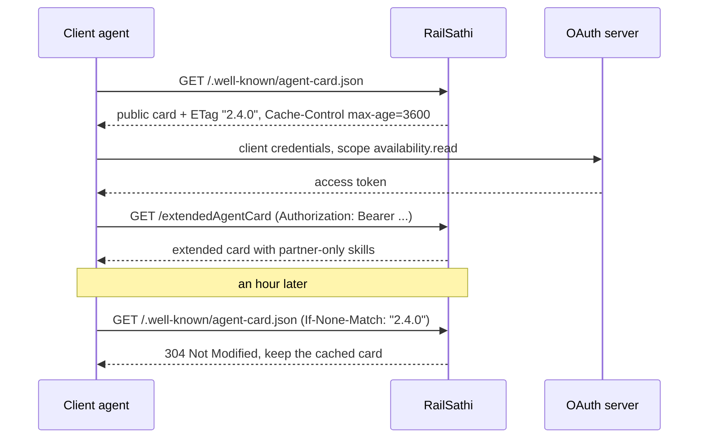

# A2A Deep Dive: Agent Cards and Discovery: The Complete Guide

> 📚 **Before you start**
>
> - [Agent-to-Agent (A2A) Protocol](agent-to-agent-a2a-protocol.md), which introduced the Agent Card, the three bindings and the RailSathi example agent used again here.
> - Pydantic models, from [Pydantic Models](../../apis-and-apps-fastapi-streamlit-and-docker/course.md#m4) in the APIs and Apps course, which also introduced FastAPI and its `TestClient`.

## Introduction

When you open a food delivery app, you never ring a restaurant to ask what it cooks. The listing tells you: the menu, prices, opening hours, whether it delivers to your area and which payment methods it takes. You decide from the listing alone whether to order, and the restaurant keeps its recipes to itself.

An **Agent Card** is that listing for an AI agent. It is a single JSON document that tells any client who the agent is, where to reach it, which wire format it speaks, what it is good at, which optional features it supports, how to authenticate, and (if signed) how to check that the card is genuine. A client should be able to decide everything about the first request from the card alone.

In this lesson you'll take a production-style card apart field by field, write the logic a client uses to choose an interface, a skill and a fallback, validate cards with Pydantic, serve a public and an authenticated **extended** card with HTTP caching, and sign and verify a card the way the v1.0 specification describes.

> 💡 **Key Insight**
>
> The Agent Card is a **contract you read before you call**. A good client never guesses: it picks the binding, the skill, the content type, the authentication and the fallback path from what the card says, and it treats a card it cannot verify like an unknown phone number asking for your OTP.

---

## Core Explanation

### 1. A complete card, field by field

The previous lesson showed a small card. Real agents publish more. Here is version 2.4.0 of the RailSathi card, with three interfaces, OAuth 2.0, an extension and two skills (one of which needs an extra permission). It is held as a JSON string so we can work with it in Python.

```python
import json

CARD_JSON = """
{
  "name": "RailSathi Booking Agent",
  "description": "Checks train seat availability and fares, and holds bookings for partner travel apps.",
  "version": "2.4.0",
  "provider": {"organization": "Example Rail Services Pvt Ltd", "url": "https://rail-agent.example.in"},
  "documentationUrl": "https://rail-agent.example.in/docs/a2a",
  "iconUrl": "https://rail-agent.example.in/static/railsathi.png",
  "supportedInterfaces": [
    {"url": "https://rail-agent.example.in/a2a", "protocolBinding": "JSONRPC", "protocolVersion": "1.0"},
    {"url": "grpc.rail-agent.example.in:443", "protocolBinding": "GRPC", "protocolVersion": "1.0"},
    {"url": "https://rail-agent.example.in/a2a/rest", "protocolBinding": "HTTP+JSON", "protocolVersion": "1.0",
     "tenant": "partners"}
  ],
  "capabilities": {
    "streaming": true,
    "pushNotifications": true,
    "extendedAgentCard": true,
    "extensions": [
      {"uri": "https://rail-agent.example.in/ext/fare-lock/v1",
       "description": "Lets the client hold a quoted fare for up to 15 minutes.",
       "required": false, "params": {"maxHoldMinutes": 15}}
    ]
  },
  "securitySchemes": {
    "railOAuth": {"oauth2SecurityScheme": {
      "flows": {"clientCredentials": {
        "tokenUrl": "https://auth.rail-agent.example.in/oauth2/token",
        "scopes": {"availability.read": "Read seat availability", "booking.write": "Hold and confirm bookings"}}},
      "oauth2MetadataUrl": "https://auth.rail-agent.example.in/.well-known/oauth-authorization-server"}}
  },
  "securityRequirements": [{"schemes": {"railOAuth": {"list": ["availability.read"]}}}],
  "defaultInputModes": ["text/plain"],
  "defaultOutputModes": ["text/plain", "application/json"],
  "skills": [
    {"id": "check-availability", "name": "Check seat availability",
     "description": "Seat availability and fare for a train, date and class.",
     "tags": ["rail", "availability", "fare"],
     "examples": ["Is 3A available on 12951 on 14 Nov?", "{\\"train\\": \\"12951\\", \\"class\\": \\"3A\\"}"],
     "inputModes": ["text/plain", "application/json"]},
    {"id": "hold-booking", "name": "Hold a booking",
     "description": "Holds seats for a passenger list and returns a PNR to confirm or release.",
     "tags": ["rail", "booking"],
     "inputModes": ["application/json"], "outputModes": ["application/json"],
     "securityRequirements": [{"schemes": {"railOAuth": {"list": ["availability.read", "booking.write"]}}}]}
  ]
}
"""
CARD = json.loads(CARD_JSON)
print(CARD["name"], CARD["version"], "|", len(CARD["supportedInterfaces"]), "interfaces |",
      len(CARD["skills"]), "skills | top-level fields:", len(CARD))
```

Output:

```
RailSathi Booking Agent 2.4.0 | 3 interfaces | 2 skills | top-level fields: 13
```

The fields fall into six groups, matching the six questions in the diagram below.

![The Agent Card in the centre, surrounded by six questions it answers. Who is it: name, description, version, provider, iconUrl, documentationUrl. Where and how: supportedInterfaces with url, protocolBinding, protocolVersion and tenant. What can it do: skills with id, name, tags, examples and modes. Which features: capabilities for streaming, push notifications, extensions and the extended card. Who may call it: security schemes and requirements. Can I trust it: JWS signatures over the canonical card. Below, three ways a client finds a card: the well-known URL, a registry or catalogue, and direct configuration](/img/diagrams/multi-agent-systems-and-agent-protocols/agent-card-anatomy.svg)
*Every field in a card answers one of six questions a client has before its first request.*

| Field | Required? | What it's for |
|---|---|---|
| `name`, `description` | Yes | Human- and model-readable identity. A client agent's model often reads `description` to decide whether to delegate. |
| `version` | Yes | The **agent's** version (2.4.0), not the protocol's. Bump it when skills or behaviour change. |
| `supportedInterfaces` | Yes | Endpoints in **preference order**, each with `url`, `protocolBinding` (`JSONRPC`, `GRPC` or `HTTP+JSON`), `protocolVersion` and an optional `tenant`. |
| `capabilities` | Yes | Optional features: `streaming`, `pushNotifications`, `extendedAgentCard` and declared `extensions`. |
| `defaultInputModes`, `defaultOutputModes` | Yes | Media types (`text/plain`, `application/json`, `image/png`...) accepted and produced, unless a skill overrides them. |
| `skills` | Yes | What the agent can do. Each has `id`, `name`, `description` and `tags`, plus optional `examples`, `inputModes`, `outputModes` and `securityRequirements`. |
| `provider` | No | The organisation behind the agent (`organization` and `url` are both required when present). |
| `securitySchemes`, `securityRequirements` | No | How to authenticate and which scheme and scopes a call needs. |
| `documentationUrl`, `iconUrl` | No | Links for humans and catalogue UIs. |
| `signatures` | No | JWS signatures that prove the card came from the provider, covered in section 6. |

Two details are easy to miss. First, **skills can override defaults**: `hold-booking` accepts only JSON and needs the extra scope `booking.write`. Second, a `tenant` on an interface means one endpoint serves several customers; a client using that interface must send exactly that `tenant` value in every request.

### 2. Choosing an interface

The specification gives clients strict rules: walk `supportedInterfaces` in order, take the **first** entry whose binding you support, use that entry's URL, and copy its `tenant` (if any) into every request. Here is that logic, plus a check that the protocol version is one the client speaks.

```python
def select_interface(card, client_bindings, client_versions=("1.0",)):
    for entry in card["supportedInterfaces"]:              # preference order, first wins
        if entry["protocolBinding"] in client_bindings and entry["protocolVersion"] in client_versions:
            return entry
    raise LookupError("No interface in common with this agent")

for bindings in [{"JSONRPC", "HTTP+JSON"}, {"HTTP+JSON"}, {"GRPC"}, {"WEBSOCKET"}]:
    try:
        chosen = select_interface(CARD, bindings)
        print(f"{sorted(bindings)!s:24} -> {chosen['protocolBinding']:9} {chosen['url']}  tenant={chosen.get('tenant')}")
    except LookupError as e:
        print(f"{sorted(bindings)!s:24} -> {e}")
```

Output:

```
['HTTP+JSON', 'JSONRPC'] -> JSONRPC   https://rail-agent.example.in/a2a  tenant=None
['HTTP+JSON']            -> HTTP+JSON https://rail-agent.example.in/a2a/rest  tenant=partners
['GRPC']                 -> GRPC      grpc.rail-agent.example.in:443  tenant=None
['WEBSOCKET']            -> No interface in common with this agent
```

The client that supports both JSON-RPC and HTTP+JSON gets JSON-RPC, because the **server's** order wins. Protocol versions are written as `Major.Minor` (`1.0`): patch numbers such as 1.0.1 never appear in cards or headers and don't affect compatibility.

### 3. Capabilities decide the call pattern

Before calling, a client checks optional features in `capabilities`. Asking for something the card doesn't declare earns an error (`UnsupportedOperationError` for streaming or the extended card, `PushNotificationNotSupportedError` for webhooks), so a careful client plans its fallback up front.

```python
def plan_call(card, long_running):
    caps = card["capabilities"]
    if not long_running:
        return "SendMessage and wait for the reply"
    if caps.get("streaming"):
        return "SendStreamingMessage and read events as they arrive"
    if caps.get("pushNotifications"):
        return "SendMessage with returnImmediately, then wait for a webhook"
    return "SendMessage with returnImmediately, then poll GetTask"

no_stream = {**CARD, "capabilities": {"pushNotifications": False}}
print("RailSathi, quick question :", plan_call(CARD, long_running=False))
print("RailSathi, long job       :", plan_call(CARD, long_running=True))
print("Basic agent, long job     :", plan_call(no_stream, long_running=True))
```

Output:

```
RailSathi, quick question : SendMessage and wait for the reply
RailSathi, long job       : SendStreamingMessage and read events as they arrive
Basic agent, long job     : SendMessage with returnImmediately, then poll GetTask
```

Extensions work the same way. RailSathi declares a `fare-lock` extension with `"required": false`, so clients that don't know it can ignore it. If an extension were `"required": true`, a client that didn't list its URI in the `A2A-Extensions` request header would get `ExtensionSupportRequiredError`.

### 4. Choosing a skill and a content type

Skills are how a client (or the model inside a client agent) decides **whether** this agent fits a job, and how to phrase the request. A skill's `inputModes` and `outputModes` replace the card's defaults when present.

```python
def skill_modes(card, skill):
    return (skill.get("inputModes") or card["defaultInputModes"],
            skill.get("outputModes") or card["defaultOutputModes"])

def find_skills(card, wanted_tags, send_type, need_type):
    matches = []
    for skill in card["skills"]:
        ins, outs = skill_modes(card, skill)
        if set(wanted_tags) <= set(skill["tags"]) and send_type in ins and need_type in outs:
            matches.append(skill["id"])
    return matches

print(find_skills(CARD, ["rail", "fare"], "text/plain", "application/json"))
print(find_skills(CARD, ["booking"], "text/plain", "application/json"))
print(find_skills(CARD, ["booking"], "application/json", "application/json"))
```

Output:

```
['check-availability']
[]
['hold-booking']
```

The second search finds nothing because `hold-booking` refuses plain text. That's useful: the client learns to send a JSON data part **before** wasting a round trip. In LLM-driven clients, the same card fields (`description`, skill `description`, `examples`) become part of the client model's prompt, so clear, concrete descriptions directly improve delegation, just like tool descriptions do for tool calling.

### 5. Validating cards before trusting them

A client fetches cards from other organisations, so it should validate them like any external input. Pydantic models that mirror the required fields catch malformed cards and, very often, old v0.3 cards, which had a single top-level `url` instead of `supportedInterfaces`.

```python
from pydantic import BaseModel, ConfigDict, ValidationError, field_validator

class AgentInterface(BaseModel):
    model_config = ConfigDict(extra="allow")
    url: str
    protocolBinding: str
    protocolVersion: str
    tenant: str | None = None

class AgentSkill(BaseModel):
    model_config = ConfigDict(extra="allow")
    id: str
    name: str
    description: str
    tags: list[str]

class AgentCardModel(BaseModel):
    model_config = ConfigDict(extra="allow")       # unknown future fields are kept, not rejected
    name: str
    description: str
    version: str
    supportedInterfaces: list[AgentInterface]
    capabilities: dict
    defaultInputModes: list[str]
    defaultOutputModes: list[str]
    skills: list[AgentSkill]

    @field_validator("supportedInterfaces")
    @classmethod
    def at_least_one(cls, value):
        if not value:
            raise ValueError("a card must offer at least one interface")
        return value

print("v1.0 card ok:", AgentCardModel.model_validate(CARD).name)

old_card = {"name": "Legacy Agent", "description": "A v0.3 card", "version": "1.0.0",
            "url": "https://legacy.example.com/a2a", "protocolVersion": "0.3.0", "capabilities": {},
            "defaultInputModes": ["text/plain"], "defaultOutputModes": ["text/plain"], "skills": []}
try:
    AgentCardModel.model_validate(old_card)
except ValidationError as e:
    print("Rejected:", [(err["loc"], err["type"]) for err in e.errors()])
```

Output:

```
v1.0 card ok: RailSathi Booking Agent
Rejected: [(('supportedInterfaces',), 'missing')]
```

`extra="allow"` matters: the protocol grows, and a client that rejects any field it doesn't recognise would break every time a provider adopts a new optional field. Validate what you depend on, keep the rest.

### 6. Signing cards: canonical JSON plus JWS

Anyone can host a JSON file. If a client reaches a card through a registry, a proxy or a cache, how does it know the rail company published it and nobody changed the endpoint URL? v1.0 lets providers **sign** cards with JSON Web Signature (JWS, RFC 7515). The trick is that two JSON documents can mean the same thing yet differ in key order and whitespace, so the card is first turned into a **canonical** form using the JSON Canonicalization Scheme (JCS, RFC 8785): keys sorted, no insignificant whitespace, fixed number and string formatting. The specification adds two rules: leave out the `signatures` field itself, and leave out fields that hold default values (such as an empty `extensions` list) unless they are required.

The specification includes a worked example of the canonical form, which our function can be checked against:

```python
def canonical(card):
    def strip(value):
        if isinstance(value, dict):
            return {k: strip(v) for k, v in value.items() if v != [] and v != {}}
        if isinstance(value, list):
            return [strip(v) for v in value]
        return value
    body = {k: v for k, v in card.items() if k != "signatures"}
    # sort_keys + compact separators match RFC 8785 for cards with strings, booleans and integers.
    return json.dumps(strip(body), sort_keys=True, separators=(",", ":"), ensure_ascii=False)

spec_example = {
    "name": "Example Agent", "description": "An example agent that echoes messages.",
    "supportedInterfaces": [{"url": "https://example.com/a2a/v1", "protocolBinding": "JSONRPC", "protocolVersion": "1.0"}],
    "version": "1.0.0", "capabilities": {"streaming": False, "pushNotifications": False, "extensions": []},
    "defaultInputModes": ["text/plain"], "defaultOutputModes": ["text/plain"],
    "skills": [{"id": "echo", "name": "Echo", "description": "Echoes the input.", "tags": ["echo"]}],
}
expected = ('{"capabilities":{"pushNotifications":false,"streaming":false},"defaultInputModes":["text/plain"],'
            '"defaultOutputModes":["text/plain"],"description":"An example agent that echoes messages.",'
            '"name":"Example Agent","skills":[{"description":"Echoes the input.","id":"echo","name":"Echo",'
            '"tags":["echo"]}],"supportedInterfaces":[{"protocolBinding":"JSONRPC","protocolVersion":"1.0",'
            '"url":"https://example.com/a2a/v1"}],"version":"1.0.0"}')
print("matches the specification's canonical form:", canonical(spec_example) == expected)
```

Output:

```
matches the specification's canonical form: True
```

Note that `"streaming": false` stays because it was explicitly set (it's an `optional` field), while the empty `extensions` list goes. A full implementation also needs RFC 8785's exact rules for floating-point numbers; for production use a JCS library.

Now the signature. A JWS has a **protected header** (algorithm `alg`, `typ: "JOSE"`, key ID `kid`, and optionally `jku`, a URL to the provider's public keys), and the signature covers `base64url(header) + "." + base64url(payload)`. Real cards use an asymmetric algorithm such as ES256, so anyone can verify with the public key. The runnable demo below uses HS256 (HMAC with SHA-256) only because it is in Python's standard library; the structure is identical.

```python
import base64, hashlib, hmac

def b64url(data: bytes) -> str:
    return base64.urlsafe_b64encode(data).rstrip(b"=").decode()

DEMO_KEY = b"demo-only-shared-secret"          # stand-in for an ES256 private/public key pair

def sign_card(card, kid):
    header = b64url(json.dumps({"alg": "HS256", "typ": "JOSE", "kid": kid}, separators=(",", ":")).encode())
    signing_input = f"{header}.{b64url(canonical(card).encode())}".encode()
    sig = b64url(hmac.new(DEMO_KEY, signing_input, hashlib.sha256).digest())
    return {**card, "signatures": [{"protected": header, "signature": sig}]}

def verify_card(card):
    for s in card.get("signatures", []):
        signing_input = f"{s['protected']}.{b64url(canonical(card).encode())}".encode()
        good = b64url(hmac.new(DEMO_KEY, signing_input, hashlib.sha256).digest())
        if hmac.compare_digest(good, s["signature"]):
            return True
    return False

signed = sign_card(CARD, kid="railsathi-2026-10")
print("protected header:", base64.urlsafe_b64decode(signed["signatures"][0]["protected"] + "==").decode())
print("genuine card verifies:", verify_card(signed))

tampered = json.loads(json.dumps(signed))
tampered["supportedInterfaces"][0]["url"] = "https://rail-agent.example.in.evil.example/a2a"
print("card with swapped URL verifies:", verify_card(tampered))
```

Output:

```
protected header: {"alg":"HS256","typ":"JOSE","kid":"railsathi-2026-10"}
genuine card verifies: True
card with swapped URL verifies: False
```

The tampered card keeps the old signature, but its canonical form changed, so verification fails. That is exactly the attack signing prevents: someone serving a look-alike card that sends your requests, and your credentials, to their server.

With a real key pair, only the signing step changes. Here is a sketch with the widely used `cryptography` package:

```python
# not-run: needs the cryptography package, which isn't in this course's requirements
from cryptography.hazmat.primitives import hashes
from cryptography.hazmat.primitives.asymmetric import ec
from cryptography.hazmat.primitives.asymmetric.utils import decode_dss_signature

private_key = ec.generate_private_key(ec.SECP256R1())       # keep this in a secrets manager
der = private_key.sign(signing_input, ec.ECDSA(hashes.SHA256()))
r, s = decode_dss_signature(der)                               # JWS wants raw r || s, 32 bytes each
signature = b64url(r.to_bytes(32, "big") + s.to_bytes(32, "big"))
```

The client fetches the provider's public keys (from the `jku` URL over HTTPS, or a trusted key store), picks the one matching `kid`, and verifies. Several signatures may sit in the array during key rotation, and revoked or expired keys must not be accepted.

### 7. Discovery, the extended card and caching

The specification names three ways to find a card:

| Strategy | How it works | Best for |
|---|---|---|
| **Well-known URI** | `GET https://{domain}/.well-known/agent-card.json` | Public agents, or any agent whose domain you know |
| **Curated registry** | A catalogue service stores cards; clients search by skill, tag or provider | Enterprises and marketplaces. The specification doesn't yet define a standard registry API. |
| **Direct configuration** | The card URL or the card itself sits in your config | Private agents and fixed partnerships |

A public card shouldn't reveal everything. If `capabilities.extendedAgentCard` is `true`, an authenticated client can call **Get Extended Agent Card** (`GetExtendedAgentCard` in JSON-RPC, `GET /extendedAgentCard` in HTTP+JSON) to receive a fuller card: extra skills, higher quotas or partner-specific settings. Clients should use the extended card instead of the public one for the rest of their authenticated session.



Cards change rarely, so servers **should** send `Cache-Control` with a `max-age`, and an `ETag` derived from the card's `version` or a content hash; clients **should** revalidate with `If-None-Match`. Here is a server that does both, plus a protected extended card:

```python
from fastapi import FastAPI, Header, Response
from fastapi.responses import JSONResponse
from fastapi.testclient import TestClient

BASE = "https://rail-agent.example.in"
EXTENDED = {**CARD, "skills": CARD["skills"] + [
    {"id": "bulk-availability", "name": "Bulk availability",
     "description": "Availability for up to 50 trains in one request. Partner tier only.",
     "tags": ["rail", "availability", "bulk"]}]}
VALID_TOKENS = {"tok-partner-123": "yatra-partner"}      # issued by the OAuth server in real life

app = FastAPI()

@app.get("/.well-known/agent-card.json")
def public_card(if_none_match: str | None = Header(default=None)):
    etag = f'"{CARD["version"]}"'
    if if_none_match == etag:
        return Response(status_code=304, headers={"ETag": etag})
    return JSONResponse(CARD, headers={"ETag": etag, "Cache-Control": "public, max-age=3600"})

@app.get("/extendedAgentCard")
def extended_card(authorization: str | None = Header(default=None)):
    token = (authorization or "").removeprefix("Bearer ")
    if token not in VALID_TOKENS:
        return JSONResponse({"error": {"code": 401, "status": "UNAUTHENTICATED",
                                       "message": "Bearer token required"}}, status_code=401)
    return JSONResponse(EXTENDED, headers={"Cache-Control": "private, max-age=600"})

http = TestClient(app, base_url=BASE)
first = http.get("/.well-known/agent-card.json")
print(first.status_code, first.headers["etag"], first.headers["cache-control"], "| skills:",
      [s["id"] for s in first.json()["skills"]])
again = http.get("/.well-known/agent-card.json", headers={"If-None-Match": first.headers["etag"]})
print(again.status_code, "| body bytes:", len(again.content))
print(http.get("/extendedAgentCard").status_code, "without a token")
ext = http.get("/extendedAgentCard", headers={"Authorization": "Bearer tok-partner-123"})
print(ext.status_code, "| skills:", [s["id"] for s in ext.json()["skills"]])
```

Output:

```
200 "2.4.0" public, max-age=3600 | skills: ['check-availability', 'hold-booking']
304 | body bytes: 0
401 without a token
200 | skills: ['check-availability', 'hold-booking', 'bulk-availability']
```

The second fetch costs a few bytes instead of the whole card, and the partner-only `bulk-availability` skill never appears in the public card. Note the `private` cache directive on the extended card: shared caches such as CDNs must not store a response meant for one authenticated client.

---

## Try It Yourself

1. **Only gRPC with an old client.** A client supports `GRPC` but only protocol version `0.3`. What does `select_interface` do, and what should the client's owner do about it?
2. **Version bump.** Release version 2.5.0 of the card. What happens when a client revalidates with the old ETag?
3. **Key order.** Build a copy of `signed` with its top-level keys in reverse order. Does it still verify? Why?

<details>
<summary>Show answers</summary>

**1.**

```python
try:
    select_interface(CARD, {"GRPC"}, client_versions=("0.3",))
except LookupError as e:
    print(e)
```

Output:

```
No interface in common with this agent
```

No interface matches, so the client must not guess. The fix is to upgrade the client's SDK to v1.0 (the Python `a2a-sdk` also has a v0.3 compatibility mode for servers that must serve old clients).

**2.**

```python
CARD["version"] = "2.5.0"
r = http.get("/.well-known/agent-card.json", headers={"If-None-Match": '"2.4.0"'})
print(r.status_code, r.headers["etag"])
CARD["version"] = "2.4.0"
```

Output:

```
200 "2.5.0"
```

The ETag no longer matches, so the server sends the full new card with the new ETag. That's why tying the ETag to `version` works: bump the version whenever the card changes.

**3.**

```python
reordered = dict(reversed(list(signed.items())))
print(list(reordered)[:3], "...", verify_card(reordered))
```

Output:

```
['signatures', 'skills', 'defaultOutputModes'] ... True
```

It verifies, because canonicalisation sorts keys before signing and before verifying. Without JCS, any JSON library that reorders keys would break every signature.

</details>

---

## Real-World Examples

- **Enterprise agent catalogues** store A2A cards so employees and agents can search internal agents by skill, the curated-registry strategy from section 7. Because the specification doesn't define a registry API yet, each platform's search API differs.
- **SDK card resolvers** such as `A2ACardResolver` in the Python `a2a-sdk` fetch `/.well-known/agent-card.json` and parse it into typed objects, doing the work of sections 2 and 5.
- **Signed cards** were highlighted in Google's April 2026 A2A update as a v1.0 feature for verifying who published an agent.

---

## Common Misconceptions

### "The card's `version` is the A2A version"

No. `version` is the agent's own release number. The protocol version lives in each interface's `protocolVersion`.

### "If a skill is listed, any authenticated client may use it"

Skills can carry their own `securityRequirements`. RailSathi's `hold-booking` needs the `booking.write` scope on top of the card-level requirement.

### "Signing the card makes the agent trustworthy"

A signature proves **who published** the card and that it wasn't altered. It says nothing about whether that provider is honest or competent. You still need allow-lists, contracts and checks on what the agent returns.

### "Just put the API key in the card so clients can call"

Never. Cards are public or widely shared. They describe **how** to authenticate; credentials are obtained out of band.

---

## Interview Relevance

*"How does an A2A client discover and choose how to talk to an agent?"* Cover the three discovery strategies, the well-known path, `supportedInterfaces` in preference order with the first-supported rule and `tenant`, checking `capabilities` before streaming or push, skill-level modes and security, and caching with ETag.

*"How would you stop someone impersonating an agent?"* HTTPS everywhere, signed cards (JWS over the JCS-canonical card with `signatures` removed), public keys fetched over HTTPS by `kid`, key rotation, plus an allow-list of trusted providers. Point out that a signature proves origin, not good behaviour.

---

## Key Takeaways

- **The card is the contract**: identity, interfaces, capabilities, skills, security and signatures, all read before the first request.
- **The server's interface order wins**: the client takes the first entry it supports and copies its `tenant`.
- **Skills override defaults**: their modes and security requirements can be stricter than the card's.
- **Validate, then verify**: model the fields you rely on (allowing unknown ones) and check JWS signatures over the canonical card.
- **Discovery is layered**: well-known URL, registries or configuration, with an authenticated extended card for sensitive details and HTTP caching for efficiency.

---

**Up next:** [Tasks, Messages, Artifacts and Streaming](tasks-messages-artifacts-and-streaming.md)
