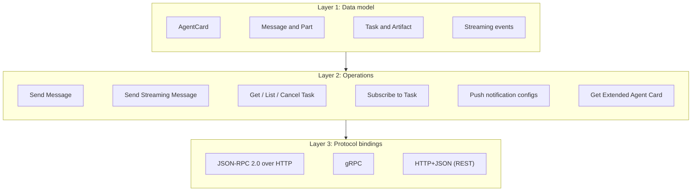

# Agent-to-Agent (A2A) Protocol: The Complete Guide

> 📚 **Before you start**
>
> - [When Multiple Agents Help and When They Hurt](../02-multi-agent-design/when-multiple-agents-help-and-when-they-hurt.md), where "the capability belongs to another team" appeared as a reason to involve a second agent.
> - [Failure Modes of Multi-Agent Systems](../02-multi-agent-design/failure-modes-of-multi-agent-systems.md), for why structured hand-offs beat free text.
> - [The Data Layer: JSON-RPC Messages](../../model-context-protocol-mcp/course.md#m3) in the MCP course, because A2A's most common binding is also JSON-RPC 2.0.

## Introduction

Before UPI, sending money from an SBI account to a friend at HDFC meant knowing their account number and IFSC code, waiting for NEFT batches, and hoping you typed everything right. Each bank had its own app, its own rules and its own way of talking to other banks. UPI changed that with a **shared set of rails**: every bank speaks the same protocol, you address a person by a simple handle, and each bank keeps its own systems completely private. PhonePe doesn't need to know how ICICI's core banking works; it just needs to speak UPI.

AI agents in 2025 had the pre-UPI problem. A travel company's agent built with LangGraph could not talk to an airline's agent built with Google's Agent Development Kit (ADK) or a hotel chain's agent built with Microsoft's framework without custom glue for every pair. And no company wants to expose its agent's prompts, tools and data just so another company's agent can use it.

The **Agent2Agent (A2A) protocol** is the shared rails. It defines how one agent **discovers** another (a JSON "Agent Card"), how it **sends work** (messages made of parts), how that work is **tracked** (tasks with a lifecycle) and how **results come back** (artifacts, with streaming and push notifications for long jobs). It was launched by Google in April 2025, handed to the Linux Foundation two months later, and reached its first stable release, **v1.0**, in March 2026.

This lesson gives you the whole protocol at a high level, then makes it concrete: you'll read a real-looking Agent Card and message exchange, and build a tiny working A2A server and client in FastAPI. The next lessons go deep into each part.

> 💡 **Key Insight**
>
> A2A treats the other agent as an **opaque peer**. You see only what it publishes (its Agent Card) and what it returns (tasks, messages and artifacts). You never see its prompts, model, memory or tools. That is exactly what lets agents from different companies and frameworks work together safely.

---

## Core Explanation

### 1. The problem A2A solves

Without a shared protocol, every pair of agents needs its own integration: n × (n − 1) / 2 of them, so 45 for 10 agents and 1,225 for 50. With one, each agent implements the protocol once: 10 or 50 integrations.

This is the same argument that justified MCP for tools. The difference is **who is on the other side**. MCP connects an agent to tools and data it uses directly. A2A connects an agent to **another agent**: something that has its own goals, takes its own decisions, may take hours, may ask questions back, and belongs to someone else. That changes what the protocol needs:

| An agent on the other side may... | So A2A provides... |
|---|---|
| be unknown until runtime | an **Agent Card** describing who it is and what it can do |
| take minutes or days | **tasks** with a lifecycle, plus streaming and push notifications |
| need more information midway | an **input-required** state and multi-turn messages |
| need extra authorisation midway | an **auth-required** state |
| return files, data and text | **parts** of different kinds, and **artifacts** for results |
| belong to another company | standard web security declared in the card, and **opacity** |

### 2. A short history

| Date | Event |
|---|---|
| 9 April 2025 | Google announces A2A with a group of technology partners |
| 23 June 2025 | Google donates A2A to the **Linux Foundation**; founding members include AWS, Cisco, Microsoft, Salesforce, SAP and ServiceNow |
| 30 July 2025 | v0.3.0: well-known card path renamed to `agent-card.json`, signed cards, gRPC support |
| August 2025 | IBM's **Agent Communication Protocol (ACP)** joins A2A under the Linux Foundation instead of competing with it |
| 12 March 2026 | **v1.0.0**, the first stable release, with breaking clean-ups of the JSON format |
| 26 May 2026 | v1.0.1, a patch release (current as of October 2026) |

The project is governed by a Technical Steering Committee with eight seats held by Google, Microsoft, Cisco, AWS, Salesforce, ServiceNow, SAP and IBM, and Google's April 2026 anniversary post counted **over 100 supporting companies**. Official SDKs exist for Python (`a2a-sdk`), JavaScript, Java, Go, .NET and Rust.

> ⚠️ **Watch the version.** Many tutorials written in 2025 use v0.3 JSON: method names like `message/send`, parts like `{"kind": "text", "text": "..."}` and states like `"working"`. Version 1.0 uses `SendMessage`, `{"text": "..."}` and `"TASK_STATE_WORKING"`. This course teaches v1.0 and points out v0.3 differences where they matter.

### 3. The cast of characters

![A2A at a glance. On the left, a client agent (a trip planner built with LangGraph) that has its own tools and sees only the card, tasks and artifacts. On the right, a remote agent (a rail booking agent built with Google ADK) whose prompts, memory and tools stay private. In the middle, the four steps: read the Agent Card at /.well-known/agent-card.json, send a message with parts, track the task, receive artifacts. At the bottom: the same messages travel over JSON-RPC, gRPC or HTTP+JSON, over HTTPS with authentication declared in the card](/img/diagrams/multi-agent-systems-and-agent-protocols/a2a-big-picture.svg)
*Each side keeps its internals private and speaks only A2A to the other.*

| Term | Meaning | Everyday comparison |
|---|---|---|
| **A2A client** | The application or agent that starts the interaction, on behalf of a user or another system | The customer at the counter |
| **A2A server** (remote agent) | The agent that exposes an A2A endpoint and does the work | The service provider behind the counter |
| **Agent Card** | A JSON document describing the remote agent: name, skills, endpoint URLs, supported features, authentication | The signboard and menu outside a shop |
| **Message** | One turn of communication, with a `role` (user or agent) and one or more parts | One thing said across the counter |
| **Part** | The smallest piece of content: text, a file (inline bytes or a URL) or structured JSON data | A sentence, a photo or a filled form |
| **Task** | The unit of work, with a server-generated ID and a lifecycle state | The token number you get for your order |
| **Artifact** | An output the agent produces for a task, made of parts | The finished order |
| **Context** (`contextId`) | An ID grouping related tasks and messages into one conversation | Your visit, which may involve several orders |

Note the roles. "Client" and "server" are about **who starts the conversation**, not about which agent is smarter. The same agent can be a server to one agent and a client to another; a travel planner might be a server to a chat app and a client to a rail agent.

### 4. One exchange, end to end

Let's watch a complete, real-looking exchange in v1.0 JSON. A trip-planning agent wants to know whether seats are available on a train. The remote agent belongs to a fictional company, Example Rail Services, at `rail-agent.example.in`.

**Step 1: discovery.** The client fetches the Agent Card from a well-known URL.

```http
GET /.well-known/agent-card.json HTTP/1.1
Host: rail-agent.example.in
```

```json
{
  "name": "RailSathi Booking Agent",
  "description": "Checks train seat availability and fares, and holds bookings for partner travel apps.",
  "version": "2.3.0",
  "provider": {"organization": "Example Rail Services Pvt Ltd", "url": "https://rail-agent.example.in"},
  "supportedInterfaces": [
    {"url": "https://rail-agent.example.in/a2a", "protocolBinding": "JSONRPC", "protocolVersion": "1.0"}
  ],
  "capabilities": {"streaming": true, "pushNotifications": false},
  "securitySchemes": {
    "partnerKey": {"apiKeySecurityScheme": {"location": "header", "name": "X-Partner-Key"}}
  },
  "securityRequirements": [{"schemes": {"partnerKey": {"list": []}}}],
  "defaultInputModes": ["text/plain", "application/json"],
  "defaultOutputModes": ["text/plain", "application/json"],
  "skills": [
    {
      "id": "check-availability",
      "name": "Check seat availability",
      "description": "Seat availability and fare for a train, date and class.",
      "tags": ["rail", "availability", "fare"],
      "examples": ["Is 3A available on 12951 on 14 Nov?"]
    }
  ]
}
```

The card tells the client everything it needs: where to send requests (`supportedInterfaces`), which wire format (`JSONRPC`, protocol version `1.0`), how to authenticate (an API key in the `X-Partner-Key` header), whether it can stream, and what it's good at (`skills`). The next lesson takes every field apart.

**Step 2: send a message.** The client sends a JSON-RPC request with the method `SendMessage`. The message has a client-generated `messageId`, a role and parts.

```http
POST /a2a HTTP/1.1
Host: rail-agent.example.in
Content-Type: application/json
A2A-Version: 1.0
X-Partner-Key: pk_live_7Hc2...

{
  "jsonrpc": "2.0",
  "id": 1,
  "method": "SendMessage",
  "params": {
    "message": {
      "messageId": "9b1f6c2e-41d7-4a55-9a43-0c6f2d1e8a10",
      "role": "ROLE_USER",
      "parts": [{"text": "Is 3A available on train 12951 on 14 Nov 2026?"}]
    }
  }
}
```

**Step 3: get a task back.** The server creates a task, works on it and (by default) waits until it reaches a final or interrupted state before replying. The answer comes back as an **artifact**.

```json
{
  "jsonrpc": "2.0",
  "id": 1,
  "result": {
    "task": {
      "id": "3f2a7c1e-8b0d-4e0f-a1b6-5d9c4e2f7a31",
      "contextId": "c7d1e3a9-2f64-4b8e-9c05-7a1b3d5e9f22",
      "status": {"state": "TASK_STATE_COMPLETED", "timestamp": "2026-10-17T09:30:04.512Z"},
      "artifacts": [
        {
          "artifactId": "a1c9e7b5-3d2f-4f6a-8e1c-9b7d5f3a1e04",
          "name": "availability",
          "parts": [
            {"text": "12951 Mumbai Central - New Delhi Rajdhani, 14 Nov 2026, 3A: 42 seats available. Fare Rs 3,215."},
            {"data": {"train": "12951", "date": "2026-11-14", "class": "3A", "available": 42, "fare_inr": 3215},
             "mediaType": "application/json"}
          ]
        }
      ]
    }
  }
}
```

Notice the artifact has **two parts**: a sentence for humans and a structured `data` part for programs. Remember the structured hand-offs from the failure modes lesson? This is how A2A supports them.

Everything else in the protocol is a refinement of these three steps: what happens when the task takes an hour (streaming, polling, push notifications), when the agent needs more information (the `TASK_STATE_INPUT_REQUIRED` state), when it needs extra permission (`TASK_STATE_AUTH_REQUIRED`), and how the client proves who it is (security schemes).

### 5. The three layers of the specification

The v1.0 specification is organised in three layers, so the same ideas can travel over different wire formats.



**Layer 1, the data model**, is defined once, as Protocol Buffers in the file `a2a.proto`. When serialised to JSON, field names are camelCase (`contextId`, `messageId`) and enum values are their full proto names (`TASK_STATE_COMPLETED`, `ROLE_USER`).

**Layer 2, the operations**, are what you can do, independent of wire format. Send Message starts or continues a task (returning a Task, or a plain Message for trivial replies); Send Streaming Message does the same but streams updates; Get, List and Cancel Task manage tasks; Subscribe to Task re-attaches a stream after a disconnect; four push-notification operations manage webhooks; and Get Extended Agent Card fetches a fuller card after authenticating.

**Layer 3, the bindings**, map operations onto real protocols. An agent can offer several and lists them in `supportedInterfaces`, preferred first. The main operations look like this in the JSON-RPC and HTTP+JSON bindings:

| Operation | JSON-RPC method | HTTP+JSON endpoint |
|---|---|---|
| Send Message | `SendMessage` | `POST /message:send` |
| Send Streaming Message | `SendStreamingMessage` | `POST /message:stream` |
| Get Task | `GetTask` | `GET /tasks/{id}` |
| List Tasks | `ListTasks` | `GET /tasks` |
| Cancel Task | `CancelTask` | `POST /tasks/{id}:cancel` |
| Get Extended Agent Card | `GetExtendedAgentCard` | `GET /extendedAgentCard` |

JSON-RPC and HTTP+JSON both stream with **Server-Sent Events** (SSE); gRPC uses its native streaming. The specification requires all bindings an agent offers to behave identically, so choosing one is about your infrastructure, not features.

### 6. Build a tiny A2A server and client

Reading JSON is good; producing it is better. Here is a minimal A2A server in FastAPI with the JSON-RPC binding. It supports three things: serving the Agent Card, `SendMessage` and `GetTask`. It also checks the `A2A-Version` header, as v1.0 servers must. A real server would use the official SDK, but writing one by hand once shows there's no magic.

IDs use a counter so the output is the same every time; real servers use UUIDs.

```python
import itertools, json
from fastapi import FastAPI, Request
from fastapi.testclient import TestClient

BASE = "https://rail-agent.example.in"
AGENT_CARD = {
    "name": "RailSathi Booking Agent",
    "description": "Checks train seat availability and fares for partner travel apps.",
    "version": "2.3.0",
    "supportedInterfaces": [{"url": f"{BASE}/a2a", "protocolBinding": "JSONRPC", "protocolVersion": "1.0"}],
    "capabilities": {"streaming": False, "pushNotifications": False},
    "defaultInputModes": ["text/plain"],
    "defaultOutputModes": ["text/plain", "application/json"],
    "skills": [{"id": "check-availability", "name": "Check seat availability",
                "description": "Seat availability and fare for a train, date and class.",
                "tags": ["rail", "availability"]}],
}
SEATS = {("12951", "3A"): (42, 3215), ("12951", "2A"): (0, 4480)}   # the agent's private data

app = FastAPI()
TASKS = {}
counter = itertools.count(1)

@app.get("/.well-known/agent-card.json")
def agent_card():
    return AGENT_CARD

def check_availability(text):
    """The agent's private logic. A real agent would use a model and tools here."""
    words = [w.strip("?.,!") for w in text.split()]
    train = next((w for w in words if w.isdigit() and len(w) == 5), None)
    cls = "2A" if "2A" in text else "3A"
    seats, fare = SEATS.get((train, cls), (None, None))
    if seats is None:
        return "Sorry, I have no data for that train.", None
    data = {"train": train, "class": cls, "available": seats, "fare_inr": fare}
    return f"Train {train}, {cls}: {seats} seats available, fare Rs {fare:,}.", data

def send_message(params):
    message = params["message"]
    text = " ".join(p["text"] for p in message["parts"] if "text" in p)
    n = next(counter)
    answer, data = check_availability(text)
    parts = [{"text": answer}]
    if data:
        parts.append({"data": data, "mediaType": "application/json"})
    task = {
        "id": f"task-{n:04d}",
        "contextId": message.get("contextId", f"ctx-{n:04d}"),
        "status": {"state": "TASK_STATE_COMPLETED", "timestamp": "2026-10-17T09:30:04.512Z"},
        "artifacts": [{"artifactId": f"artifact-{n:04d}", "name": "availability", "parts": parts}],
        "history": [message],
    }
    TASKS[task["id"]] = task
    return {"task": task}

def error(req_id, code, msg):
    return {"jsonrpc": "2.0", "id": req_id, "error": {"code": code, "message": msg}}

@app.post("/a2a")
async def a2a_endpoint(request: Request):
    body = await request.json()
    req_id = body.get("id")
    if request.headers.get("A2A-Version") != "1.0":      # a missing header means the client speaks v0.3
        return error(req_id, -32009, "Version not supported. This agent speaks A2A 1.0.")
    method, params = body.get("method"), body.get("params", {})
    if method == "SendMessage":
        return {"jsonrpc": "2.0", "id": req_id, "result": send_message(params)}
    if method == "GetTask":
        task = TASKS.get(params.get("id"))
        if task is None:
            return error(req_id, -32001, "Task not found")
        return {"jsonrpc": "2.0", "id": req_id, "result": task}
    return error(req_id, -32601, "Method not found")

client = TestClient(app, base_url=BASE)   # real HTTP requests, handled in this process
print("A2A routes:", [r.path for r in app.routes if r.path in ("/.well-known/agent-card.json", "/a2a")])
```

Output:

```
A2A routes: ['/.well-known/agent-card.json', '/a2a']
```

Now the client side. It discovers the card, picks the first interface it supports, and sends a message, all as plain HTTP with JSON.

```python
card = client.get("/.well-known/agent-card.json").json()
interface = next(i for i in card["supportedInterfaces"] if i["protocolBinding"] == "JSONRPC")
endpoint = interface["url"].removeprefix(BASE)
print("Discovered:", card["name"], "| skills:", [s["id"] for s in card["skills"]])
print("Endpoint  :", interface["url"], "| binding:", interface["protocolBinding"], interface["protocolVersion"])

request = {
    "jsonrpc": "2.0", "id": 1, "method": "SendMessage",
    "params": {"message": {"messageId": "msg-0001", "role": "ROLE_USER",
                           "parts": [{"text": "Is 3A available on train 12951 on 14 Nov 2026?"}]}},
}
response = client.post(endpoint, json=request, headers={"A2A-Version": "1.0"}).json()
task = response["result"]["task"]
print()
print("Task", task["id"], "->", task["status"]["state"])
for part in task["artifacts"][0]["parts"]:
    print("  part:", json.dumps(part))
```

Output:

```
Discovered: RailSathi Booking Agent | skills: ['check-availability']
Endpoint  : https://rail-agent.example.in/a2a | binding: JSONRPC 1.0

Task task-0001 -> TASK_STATE_COMPLETED
  part: {"text": "Train 12951, 3A: 42 seats available, fare Rs 3,215."}
  part: {"data": {"train": "12951", "class": "3A", "available": 42, "fare_inr": 3215}, "mediaType": "application/json"}
```

And the error paths, which a client must handle:

```python
def call(method, params, version="1.0", req_id=2):
    headers = {"A2A-Version": version} if version else {}
    body = {"jsonrpc": "2.0", "id": req_id, "method": method, "params": params}
    return client.post(endpoint, json=body, headers=headers).json()

print(call("GetTask", {"id": "task-0001"})["result"]["status"]["state"])
print(call("GetTask", {"id": "task-9999"})["error"])
print(call("message/send", {})["error"])                        # a v0.3 method name
print(call("SendMessage", request["params"], version=None)["error"])   # no version header
```

Output:

```
TASK_STATE_COMPLETED
{'code': -32001, 'message': 'Task not found'}
{'code': -32601, 'message': 'Method not found'}
{'code': -32009, 'message': 'Version not supported. This agent speaks A2A 1.0.'}
```

The last two lines show two easy mistakes when moving to v1.0: a client using v0.3 method names against a v1.0 server, and a client that forgets the `A2A-Version` header (which the specification says means "0.3").

### 7. What the remote agent hides

Look back at the server. The client never saw `SEATS`, never saw `check_availability`, and couldn't tell whether the answer came from a model, a database or a person. That's **opaque execution**, one of A2A's guiding principles. It has big consequences:

- **Companies can publish agents without publishing their secrets.** The rail company's pricing logic, the model it uses and its prompts all stay internal.
- **Agents can be swapped freely.** If the rail company rewrites its agent from ADK to LangGraph, no client changes, as long as the card and behaviour stay the same.
- **Trust must come from somewhere else.** Since you can't inspect the other agent, you rely on the card (ideally signed), authentication, contracts and your own checks on what comes back. The security lesson in this module covers this.

### 8. What A2A deliberately leaves out

| Not in A2A | Where it lives instead |
|---|---|
| How an agent thinks, plans or calls its tools | The agent's own framework (and MCP for its tools) |
| A global registry of all agents | Well-known URLs, private catalogues and registries, or direct configuration |
| Shared memory between agents | Each agent's own memory; context passes only through messages |
| How a user interface shows agent progress | AG-UI and similar protocols (Module 4) |
| Payments between agents | Extensions built on A2A, such as Google's Agent Payments Protocol (AP2) |

A2A is also extensible. An agent can declare **extensions** in its card (each identified by a URI) for things the core protocol doesn't define, and clients opt in with the `A2A-Extensions` header. Google's April 2026 post describes AP2 (payments), A2UI (agent-to-user interface) and UCP (commerce) as built with this extension model.

### 9. Using the official Python SDK

In real projects you'd use an SDK rather than hand-written JSON. The Python package `a2a-sdk` (version 1.2 as of October 2026) implements v1.0 for JSON-RPC, HTTP+JSON and gRPC, with a compatibility mode for v0.3. On the server side you write an **agent executor** (a subclass of `AgentExecutor` with `execute` and `cancel` methods) that receives the request context and publishes task updates through a `TaskUpdater`. The SDK then turns the executor into routes (`create_agent_card_routes`, `create_jsonrpc_routes`) for a Starlette or FastAPI app, and its client (`create_client`, `A2ACardResolver`) does the discovery and JSON-RPC calls you wrote by hand above. You'll use both sides in the lab at the end of this module.

---

## Try It Yourself

1. **Ask about a full class.** Send a message asking about 2A on train 12951. What does the structured data part say, and how should a client agent react?
2. **Continue a conversation.** Send a second message with `"contextId": "ctx-0001"` in the message. Check that the new task carries that context ID.
3. **Add a method.** Make the server answer `ListTasks` with `{"tasks": [...], "nextPageToken": "", "pageSize": N, "totalSize": N}` containing every stored task without artifacts.

<details>
<summary>Show answers</summary>

**1.**

```python
r = call("SendMessage", {"message": {"messageId": "msg-0002", "role": "ROLE_USER",
                                     "parts": [{"text": "Any 2A seats on 12951?"}]}})
print(r["result"]["task"]["artifacts"][0]["parts"][1]["data"])
```

Output:

```
{'train': '12951', 'class': '2A', 'available': 0, 'fare_inr': 4480}
```

`available` is 0. The client agent should not try to book; it should tell its user and perhaps ask the rail agent about 3A or another date. Because the data part is structured, the client can branch on `available == 0` in code rather than parsing a sentence.

**2.**

```python
r = call("SendMessage", {"message": {"messageId": "msg-0003", "role": "ROLE_USER", "contextId": "ctx-0001",
                                     "parts": [{"text": "And 3A on 12951 again?"}]}})
print(r["result"]["task"]["id"], r["result"]["task"]["contextId"])
```

Output:

```
task-0003 ctx-0001
```

A new task in the same context: the server can use the context to remember the earlier conversation.

**3.**

```python
@app.post("/a2a-list")
async def list_tasks_endpoint(request: Request):
    body = await request.json()
    tasks = [{k: v for k, v in t.items() if k != "artifacts"} for t in TASKS.values()]
    return {"jsonrpc": "2.0", "id": body["id"],
            "result": {"tasks": tasks, "nextPageToken": "", "pageSize": len(tasks), "totalSize": len(tasks)}}

listed = client.post("/a2a-list", json={"jsonrpc": "2.0", "id": 9, "method": "ListTasks", "params": {}}).json()
print([t["id"] for t in listed["result"]["tasks"]], "| artifacts included:", "artifacts" in listed["result"]["tasks"][0])
```

Output:

```
['task-0001', 'task-0002', 'task-0003'] | artifacts included: False
```

(For brevity this adds a separate route; in a real server you'd add a `ListTasks` branch to the same `/a2a` endpoint. The specification says artifacts are left out unless the client sets `includeArtifacts`, and `nextPageToken` is an empty string on the last page.)

</details>

---

## Real-World Examples

- **Agent frameworks** including Google ADK, LangGraph, CrewAI, AG2 and Microsoft Agent Framework can expose agents as A2A servers or call A2A agents, which is how agents built on different stacks delegate to each other.
- **Enterprise platforms** from the project's founding members (Salesforce, SAP, ServiceNow and others) use A2A so their own agents can work with agents from other vendors inside one company.
- **Cloud platforms** offer hosting and registries for A2A agents, so a company can publish internal agents with cards and authentication.
- **A2A extensions** such as AP2 for agent payments show the protocol being used as a base layer for more specialised agent-to-agent standards.

---

## Common Misconceptions

### "A2A is a framework for building agents"

A2A is only the contract between agents. You build each agent with whatever you like (LangGraph, ADK, plain Python) and expose it through A2A.

### "A2A lets agents share their memory and tools"

The opposite: A2A is designed so agents **don't** share internals. Only messages, tasks and artifacts cross the boundary.

### "A2A is a Google protocol"

Google created it, but since June 2025 it has been a Linux Foundation project with an eight-company steering committee and over a hundred supporters.

---

## Interview Relevance

*"What is the A2A protocol and why does it exist?"* A strong answer: an open protocol, now under the Linux Foundation, for independent and opaque agents to discover each other (Agent Cards at `/.well-known/agent-card.json`), exchange messages made of parts, and collaborate on long-running tasks with a lifecycle, streaming and push notifications. It exists because agents from different vendors and frameworks need to work together without exposing prompts, tools or data, and pairwise integrations don't scale. Mention the three layers (data model, operations, bindings over JSON-RPC, gRPC and HTTP+JSON) and that v1.0 shipped in March 2026.

*"How is A2A different from MCP?"* MCP connects an agent to tools and data it controls; A2A connects an agent to another autonomous agent it doesn't control, with tasks that can run for a long time and ask questions back. They're complementary, which is the topic of the A2A vs MCP lesson in this module.

---

## Key Takeaways

- **A2A is the shared rails between agents**: discovery with an Agent Card, messages with parts, tasks with a lifecycle, and artifacts for results.
- **Agents stay opaque**: prompts, models, memory and tools never cross the boundary.
- **Three layers**: one data model (in `a2a.proto`), a set of operations, and bindings over JSON-RPC, gRPC and HTTP+JSON.
- **v1.0 (March 2026) is the stable version**: `SendMessage`, `{"text": ...}` parts, `TASK_STATE_*` enums and the `A2A-Version: 1.0` header.
- **Governed openly**: a Linux Foundation project with an eight-company steering committee and SDKs in six languages.

---

**Up next:** [A2A Deep Dive: Agent Cards and Discovery](a2a-deep-dive-agent-cards-and-discovery.md)
