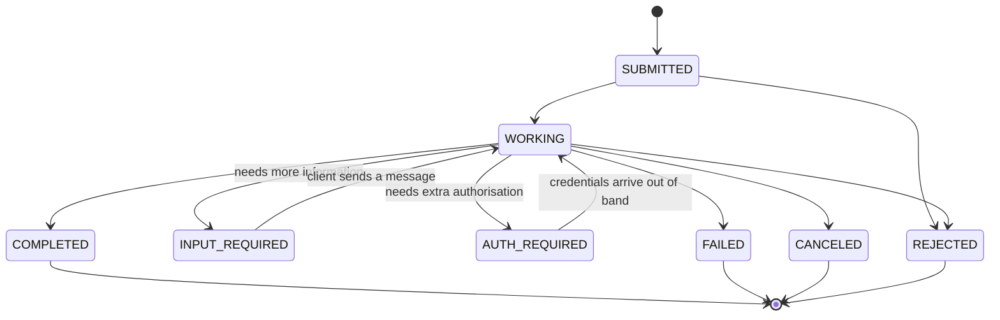

# Tasks, Messages, Artifacts and Streaming: The Complete Guide

> 📚 **Before you start**
>
> - [Agent-to-Agent (A2A) Protocol](agent-to-agent-a2a-protocol.md), for the JSON-RPC server pattern and the basic Task, Message and Artifact shapes.
> - [A2A Deep Dive: Agent Cards and Discovery](a2a-deep-dive-agent-cards-and-discovery.md), for `capabilities.streaming` and `capabilities.pushNotifications`.
> - [Streaming Real-Time Updates](../../langgraph-complete-guide/08-human-in-the-loop-and-debugging/streaming-real-time-updates.md) in the LangGraph course, if streaming progress to a caller is new to you.

## Introduction

Booking a Tatkal ticket through a travel agent is a conversation, not a single request. You ask for a seat; the agent says "I need the passenger's age and ID"; you send them; the agent says "working on it"; ten minutes later you get a PNR, or a message that the quota ran out. Meanwhile you might keep the phone line open, call back every few minutes, or ask them to SMS you when it's done.

A2A models exactly this. A **task** is the booking, with a lifecycle that can pause for more input. **Messages** are the back-and-forth. **Artifacts** are the results, like the PNR slip. And there are three ways to follow progress: keep the line open (**streaming**), call back (**polling**) or get an SMS (**push notifications**).

By the end of this lesson you'll be able to build a multi-turn A2A agent that pauses for missing information, enforce the protocol's rules about task and context IDs, stream status and artifact chunks over Server-Sent Events and reassemble them, and receive push notifications safely.

> 💡 **Key Insight**
>
> **Messages talk, artifacts deliver, and the task's state tells you what to do next.** A client that branches on the state (keep waiting, answer a question, authenticate, or stop) and reads results only from artifacts will work with any well-behaved A2A agent.

---

## Core Explanation

### 1. Parts: the content inside messages and artifacts

Everything an agent sends or receives is made of **parts**. In v1.0 a part holds exactly one kind of content, plus optional `mediaType`, `filename` and `metadata`:

| Part field | Holds | Example |
|---|---|---|
| `text` | A string | `{"text": "Is 3A available?"}` |
| `raw` | Bytes, base64-encoded in JSON | `{"raw": "iVBORw0KGgo...", "mediaType": "image/png", "filename": "id.png"}` |
| `url` | A link to content stored elsewhere | `{"url": "https://files.example.in/pnr/8423.pdf", "mediaType": "application/pdf"}` |
| `data` | Any JSON value | `{"data": {"train": "12951", "class": "3A"}, "mediaType": "application/json"}` |

Use `url` for big files (the receiver downloads them separately) and `raw` for small ones. Here is a validator that enforces the one-kind rule. It also rejects v0.3 parts, which carried a `kind` field:

```python
from pydantic import BaseModel, ConfigDict, ValidationError, model_validator

class Part(BaseModel):
    model_config = ConfigDict(extra="forbid")
    text: str | None = None
    raw: str | None = None
    url: str | None = None
    data: object = None
    mediaType: str | None = None
    filename: str | None = None
    metadata: dict | None = None

    @model_validator(mode="after")
    def exactly_one_kind(self):
        kinds = [k for k in ("text", "raw", "url", "data") if getattr(self, k) is not None]
        if len(kinds) != 1:
            raise ValueError(f"a part needs exactly one of text/raw/url/data, got {kinds}")
        return self

samples = [
    {"text": "Is 3A available?"},
    {"url": "https://files.example.in/pnr/8423.pdf", "mediaType": "application/pdf"},
    {"data": {"train": "12951"}, "mediaType": "application/json"},
    {"text": "hi", "data": {"x": 1}},
    {"kind": "text", "text": "a v0.3 part"},
]
for s in samples:
    try:
        Part.model_validate(s)
        print("ok      ", s)
    except ValidationError as e:
        print("rejected", s, "->", e.errors()[0]["msg"])
```

Output:

```
ok       {'text': 'Is 3A available?'}
ok       {'url': 'https://files.example.in/pnr/8423.pdf', 'mediaType': 'application/pdf'}
ok       {'data': {'train': '12951'}, 'mediaType': 'application/json'}
rejected {'text': 'hi', 'data': {'x': 1}} -> Value error, a part needs exactly one of text/raw/url/data, got ['text', 'data']
rejected {'kind': 'text', 'text': 'a v0.3 part'} -> Extra inputs are not permitted
```

A **message** wraps parts with a `role` (`ROLE_USER` from the client, `ROLE_AGENT` from the agent), a client-made `messageId`, and optional `contextId`, `taskId`, `referenceTaskIds`, `extensions` and `metadata`. An **artifact** wraps parts with an `artifactId`, an optional `name` and `description`, and `metadata`.

The specification draws a clear line between them: **messages are for communication** (starting a task, asking a question, reporting progress), and **results should be returned as artifacts**. Messages may not even be stored in the task's history, so never put the only copy of something important in a message.

### 2. The task lifecycle

A task is created by the server (its ID is always server-generated) and moves through these states:



The diagram shows the usual paths; the specification defines the states and which ones are final rather than a strict transition table. All values are prefixed `TASK_STATE_` on the wire. They fall into three groups, and a client's logic should switch on the group:

| Group | States | What the client does |
|---|---|---|
| **Active** | `SUBMITTED`, `WORKING` | Keep waiting (stream, poll or wait for a push) |
| **Interrupted** | `INPUT_REQUIRED`, `AUTH_REQUIRED` | Read `status.message`, then answer it or authenticate |
| **Terminal** | `COMPLETED`, `FAILED`, `CANCELED`, `REJECTED` | Stop. The task can never change again. |

`REJECTED` means the agent decided not to do the task at all (perhaps it's out of scope or against policy), while `FAILED` means it tried and hit an error. Terminal really means terminal: sending a message to a finished task gets `UnsupportedOperationError`. To follow up on finished work, start a **new task in the same context** and list the old one in `referenceTaskIds`.

By default `SendMessage` **blocks** until the task reaches a terminal or interrupted state. Set `"configuration": {"returnImmediately": true}` to get the task back at once (usually `SUBMITTED` or `WORKING`) and follow it some other way.

### 3. Multi-turn conversations: context and task IDs

Two IDs tie a conversation together:

- **`taskId`** names one unit of work. A client puts it in a message only to continue that task (for example, to answer an input-required question). The server must reject unknown task IDs, and clients can't invent new ones.
- **`contextId`** groups related tasks and messages into one conversation. The server usually generates it; the client can reuse it to start a new task in the same conversation. If the message has a `taskId`, the server infers the context from the task, and it **must** reject a message whose `contextId` doesn't match its task's.

Let's build a booking-hold agent that needs four fields. If anything is missing it pauses in `INPUT_REQUIRED` and asks for it.

```python
import itertools, json
from fastapi import FastAPI, Request
from fastapi.testclient import TestClient

BASE = "https://rail-agent.example.in"
TERMINAL = {"TASK_STATE_COMPLETED", "TASK_STATE_FAILED", "TASK_STATE_CANCELED", "TASK_STATE_REJECTED"}
TASKS, task_ids, msg_ids, clock = {}, itertools.count(1), itertools.count(1), itertools.count(0)

class A2AError(Exception):
    def __init__(self, code, message):
        self.code, self.message = code, message

def stamp():
    return f"2026-10-17T10:{next(clock):02d}:00Z"          # deterministic clock for the lesson

def set_status(task, state, text=None):
    task["status"] = {"state": state, "timestamp": stamp()}
    if text:
        task["status"]["message"] = {"role": "ROLE_AGENT", "messageId": f"agent-msg-{next(msg_ids)}",
                                     "parts": [{"text": text}]}

def hold_booking(task):
    """The agent's private logic: gather four fields from all user messages, then hold a seat."""
    fields = {}
    for m in task["history"]:
        for p in m["parts"]:
            if isinstance(p.get("data"), dict):
                fields.update(p["data"])
    missing = [f for f in ("train", "class", "passenger", "age") if f not in fields]
    if missing:
        set_status(task, "TASK_STATE_INPUT_REQUIRED", "Please send: " + ", ".join(missing))
        return
    task["artifacts"] = [{"artifactId": f"{task['id']}-hold", "name": "booking-hold", "parts": [
        {"data": {"pnr": "8423156790", "status": "HELD", "holdMinutes": 15,
                  "train": fields["train"], "class": fields["class"]}, "mediaType": "application/json"}]}]
    set_status(task, "TASK_STATE_COMPLETED")

def send_message(params):
    msg = params["message"]
    task_id, context_id = msg.get("taskId"), msg.get("contextId")
    if task_id:                                            # continuing an existing task
        task = TASKS.get(task_id)
        if task is None:
            raise A2AError(-32001, "Task not found")
        if context_id and context_id != task["contextId"]:
            raise A2AError(-32602, "contextId does not match the task's context")
        if task["status"]["state"] in TERMINAL:
            raise A2AError(-32004, "Task is in a terminal state and accepts no more messages")
    else:                                                  # a new task, perhaps in an existing context
        n = next(task_ids)
        task = {"id": f"task-{n:04d}", "contextId": context_id or f"ctx-{n:04d}", "history": []}
        TASKS[task["id"]] = task
    task["history"].append(msg)
    hold_booking(task)
    return {"task": task}

def cancel_task(params):
    task = TASKS.get(params["id"])
    if task is None:
        raise A2AError(-32001, "Task not found")
    if task["status"]["state"] in TERMINAL:
        raise A2AError(-32002, "Task cannot be canceled")
    set_status(task, "TASK_STATE_CANCELED")
    return task

METHODS = {"SendMessage": send_message, "CancelTask": cancel_task}
app = FastAPI()

@app.post("/a2a")
async def a2a(request: Request):
    body = await request.json()
    try:
        result = METHODS[body["method"]](body["params"])
        return {"jsonrpc": "2.0", "id": body["id"], "result": result}
    except A2AError as e:
        return {"jsonrpc": "2.0", "id": body["id"], "error": {"code": e.code, "message": e.message}}

client = TestClient(app, base_url=BASE)
counter = itertools.count(1)

def rpc(method, params):
    body = {"jsonrpc": "2.0", "id": next(counter), "method": method, "params": params}
    return client.post("/a2a", json=body, headers={"A2A-Version": "1.0"}).json()

def user_msg(mid, data, **ids):
    return {"message": {"messageId": mid, "role": "ROLE_USER", **ids,
                        "parts": [{"text": "Hold one seat"}, {"data": data, "mediaType": "application/json"}]}}

r = rpc("SendMessage", user_msg("m-1", {"train": "12951", "class": "3A"}))
task = r["result"]["task"]
print(task["id"], task["contextId"], task["status"]["state"], "|", task["status"]["message"]["parts"][0]["text"])
```

Output:

```
task-0001 ctx-0001 TASK_STATE_INPUT_REQUIRED | Please send: passenger, age
```

The task paused and told us what it needs. The client answers by sending a message with the **same `taskId`**:

```python
r = rpc("SendMessage", user_msg("m-2", {"passenger": "Asha Rao", "age": 34}, taskId="task-0001"))
task = r["result"]["task"]
print(task["id"], task["status"]["state"], "| history:", len(task["history"]), "messages")
print("artifact:", task["artifacts"][0]["parts"][0]["data"])

print(rpc("SendMessage", user_msg("m-3", {"age": 35}, taskId="task-0001"))["error"])
print(rpc("SendMessage", user_msg("m-4", {}, taskId="task-0001", contextId="ctx-9999"))["error"])
print(rpc("SendMessage", user_msg("m-5", {}, taskId="task-0042"))["error"])
print(rpc("CancelTask", {"id": "task-0001"})["error"])
```

Output:

```
task-0001 TASK_STATE_COMPLETED | history: 2 messages
artifact: {'pnr': '8423156790', 'status': 'HELD', 'holdMinutes': 15, 'train': '12951', 'class': '3A'}
{'code': -32004, 'message': 'Task is in a terminal state and accepts no more messages'}
{'code': -32602, 'message': "contextId does not match the task's context"}
{'code': -32001, 'message': 'Task not found'}
{'code': -32002, 'message': 'Task cannot be canceled'}
```

Four rules from the specification, each enforced in a few lines: a finished task accepts no messages (`-32004`, UnsupportedOperation), a mismatched context is rejected (the specification requires rejection without naming a code, so this server uses JSON-RPC's invalid-params `-32602`), an unknown task ID gives `-32001` (TaskNotFound) and a finished task can't be canceled (`-32002`, TaskNotCancelable).

`TASK_STATE_AUTH_REQUIRED` works like `INPUT_REQUIRED` but for permissions, for example when the agent needs the user's consent to charge a card. The credentials themselves never travel in an A2A message; the client obtains them out of band and the task then continues. The security lesson in this module goes into this.

### 4. Three ways to follow progress

When a task takes minutes or hours, the client needs updates. A2A offers three mechanisms:

![Three columns. Polling: the client repeatedly calls GetTask on the remote agent; simplest and works everywhere, but wastes calls and notices changes late. Streaming over SSE: SendStreamingMessage keeps one connection open and events arrive instantly and in order, with artifacts in chunks; SubscribeToTask reconnects. Push notifications: the agent POSTs to the client's webhook URL whenever the task changes; no open connection, suits hours-long jobs, delivery is at least once so events must be deduplicated, and the webhook must check authentication and the agent must block SSRF](/img/diagrams/multi-agent-systems-and-agent-protocols/a2a-update-delivery.svg)
*Pick by how long the task runs and whether the client can keep a connection open or receive incoming HTTP calls.*

| Mechanism | Operations | Needs in the card | Best for |
|---|---|---|---|
| Polling | `SendMessage` with `returnImmediately`, then `GetTask` | Nothing | Simple clients, strict firewalls |
| Streaming | `SendStreamingMessage`, `SubscribeToTask` | `capabilities.streaming: true` | Interactive apps, live progress |
| Push | A push config in `SendMessage`, or the push-config operations | `capabilities.pushNotifications: true` | Server-to-server, very long jobs |

### 5. Streaming with Server-Sent Events

With `SendStreamingMessage`, the response is an HTTP stream with content type `text/event-stream` (**Server-Sent Events**, SSE): a series of lines starting with `data: `, separated by blank lines. In the JSON-RPC binding, every event is a full JSON-RPC response whose `result` is a **StreamResponse** holding exactly one of `task`, `message`, `statusUpdate` or `artifactUpdate`.

The rules: the stream starts with the Task (or a single Message, then closes), events arrive in the order they were generated, and the stream closes when the task reaches a terminal state. An `artifactUpdate` can deliver an artifact in **chunks**: `append: true` means "add these parts to the artifact with this ID", and `lastChunk: true` marks the final piece.

Here's a fare-report agent that streams, and a client that reassembles the artifact:

```python
from fastapi.responses import StreamingResponse

def fare_report_events(task_id, ctx):
    rows = ["12951 Rajdhani 3A: Rs 3,215\n", "12951 Rajdhani 2A: Rs 4,480\n", "12953 August Kranti 3A: Rs 2,890\n"]
    yield {"task": {"id": task_id, "contextId": ctx, "status": {"state": "TASK_STATE_SUBMITTED"}}}
    yield {"statusUpdate": {"taskId": task_id, "contextId": ctx, "status": {"state": "TASK_STATE_WORKING",
           "message": {"role": "ROLE_AGENT", "messageId": "s-1", "parts": [{"text": "Fetching fares..."}]}}}}
    for i, row in enumerate(rows):
        yield {"artifactUpdate": {"taskId": task_id, "contextId": ctx, "append": i > 0, "lastChunk": i == len(rows) - 1,
               "artifact": {"artifactId": "fares", "name": "fare-report", "parts": [{"text": row}]}}}
    yield {"statusUpdate": {"taskId": task_id, "contextId": ctx, "status": {"state": "TASK_STATE_COMPLETED"}}}

@app.post("/a2a-stream")
async def a2a_stream(request: Request):
    body = await request.json()
    def sse():
        for event in fare_report_events("task-0100", "ctx-0100"):
            yield "data: " + json.dumps({"jsonrpc": "2.0", "id": body["id"], "result": event}) + "\n\n"
    return StreamingResponse(sse(), media_type="text/event-stream")

request_body = {"jsonrpc": "2.0", "id": 7, "method": "SendStreamingMessage",
                "params": {"message": {"messageId": "m-10", "role": "ROLE_USER",
                                       "parts": [{"text": "Fares Mumbai to Delhi on 14 Nov, all classes"}]}}}
artifacts = {}
with client.stream("POST", "/a2a-stream", json=request_body, headers={"A2A-Version": "1.0"}) as response:
    print("content-type:", response.headers["content-type"])
    for line in response.iter_lines():
        if not line.startswith("data: "):
            continue                                       # blank separator lines
        event = json.loads(line[len("data: "):])["result"]
        kind, payload = next(iter(event.items()))
        if kind == "artifactUpdate":
            art = payload["artifact"]
            text = "".join(p["text"] for p in art["parts"])
            artifacts[art["artifactId"]] = (artifacts.get(art["artifactId"], "") if payload["append"] else "") + text
            print(f"{kind:14} append={payload['append']!s:5} lastChunk={payload['lastChunk']!s:5} +{len(text)} chars")
        else:
            print(f"{kind:14} {payload['status']['state']}")

print()
print(artifacts["fares"], end="")
```

Output:

```
content-type: text/event-stream; charset=utf-8
task           TASK_STATE_SUBMITTED
statusUpdate   TASK_STATE_WORKING
artifactUpdate append=False lastChunk=False +28 chars
artifactUpdate append=True  lastChunk=False +28 chars
artifactUpdate append=True  lastChunk=True  +33 chars
statusUpdate   TASK_STATE_COMPLETED

12951 Rajdhani 3A: Rs 3,215
12951 Rajdhani 2A: Rs 4,480
12953 August Kranti 3A: Rs 2,890
```

If the connection drops mid-stream, the task keeps running on the server. The client reconnects with **`SubscribeToTask`** (task ID only), whose stream always starts with the current Task object so nothing is lost between a `GetTask` and the new stream. Several clients may subscribe to the same task and all receive the same events in the same order. Subscribing to a task that has already finished is an error; just call `GetTask`.

### 6. Push notifications

For a job that takes hours, holding a connection open is wasteful. Instead the client gives the agent a webhook in the request's `configuration`:

```json
{
  "message": {"messageId": "m-20", "role": "ROLE_USER",
              "parts": [{"text": "Find the cheapest 3A seat to Delhi any day next week and hold it"}]},
  "configuration": {
    "returnImmediately": true,
    "taskPushNotificationConfig": {
      "url": "https://planner.example.com/webhooks/a2a",
      "token": "trip-7731",
      "authentication": {"scheme": "Bearer", "credentials": "whk_5f2c9e81d4"}
    }
  }
}
```

When the task changes, the agent POSTs a StreamResponse (the same shapes as streaming events) to that URL, with `Authorization: Bearer whk_5f2c9e81d4`. Delivery is **at least once**: the agent may retry, so the same event can arrive twice. The receiver's job is to check the credentials, check that the task is one it started, acknowledge with a 2xx status, and ignore duplicates:

```python
from fastapi import Response

EXPECTED_AUTH = "Bearer whk_5f2c9e81d4"
MY_TASKS = {"task-0200"}
seen, handled = set(), []
webhook_app = FastAPI()

@webhook_app.post("/webhooks/a2a")
async def receive(request: Request):
    if request.headers.get("authorization") != EXPECTED_AUTH:
        return Response(status_code=401)
    event = await request.json()
    kind, payload = next(iter(event.items()))
    task_id = payload.get("taskId") or payload.get("id")
    if task_id not in MY_TASKS:
        return Response(status_code=404)
    key = (task_id, kind, json.dumps(payload, sort_keys=True))
    if key in seen:
        return Response(status_code=200)                   # duplicate: acknowledge, do nothing
    seen.add(key)
    handled.append(f"{task_id} {kind} {payload.get('status', {}).get('state', '')}")
    return Response(status_code=200)

hook = TestClient(webhook_app, base_url="https://planner.example.com")
done = {"statusUpdate": {"taskId": "task-0200", "contextId": "ctx-0200",
                         "status": {"state": "TASK_STATE_COMPLETED", "timestamp": "2026-10-17T14:05:00Z"}}}
deliveries = [("real agent", EXPECTED_AUTH, done), ("retry of the same event", EXPECTED_AUTH, done),
              ("forged, no secret", "Bearer guess", done),
              ("someone else's task", EXPECTED_AUTH, {"statusUpdate": {**done["statusUpdate"], "taskId": "task-9999"}})]
for label, auth, payload in deliveries:
    status = hook.post("/webhooks/a2a", json=payload, headers={"Authorization": auth}).status_code
    print(f"{label:24} -> {status}")
print("handled:", handled)
```

Output:

```
real agent               -> 200
retry of the same event  -> 200
forged, no secret        -> 401
someone else's task      -> 404
handled: ['task-0200 statusUpdate TASK_STATE_COMPLETED']
```

The retry was acknowledged but processed once, and the forged and unknown deliveries were refused. On the **agent** side, push brings a serious risk: the agent will POST to any URL a client gives it, so an attacker could point it at `http://10.0.0.5/admin` inside the agent's own network. That attack is called **server-side request forgery** (SSRF), and the specification tells agents to reject private, localhost and link-local addresses. You'll write that check in the security lesson.

### 7. Listing, history and errors

**`ListTasks`** returns the tasks the caller is allowed to see, newest status first. Filters include `contextId`, `status` and `statusTimestampAfter`; paging uses `pageSize` and `pageToken`, and the response's `nextPageToken` is an empty string on the last page. Artifacts are left out unless `includeArtifacts` is true. **`historyLength`** (on `GetTask`, `ListTasks` and in `SendMessage` configuration) limits how many recent messages come back: `0` means none, and leaving it out lets the server decide.

The A2A-specific JSON-RPC error codes, which also map to HTTP and gRPC statuses in the other bindings:

| Code | Error | Typical cause |
|---|---|---|
| -32001 | TaskNotFound | Unknown or inaccessible task ID |
| -32002 | TaskNotCancelable | The task already finished |
| -32003 | PushNotificationNotSupported | The card doesn't declare `pushNotifications` |
| -32004 | UnsupportedOperation | Streaming not supported, or a message sent to a terminal task |
| -32005 | ContentTypeNotSupported | A part's media type isn't accepted |
| -32006 | InvalidAgentResponse | The agent returned something that breaks the specification |
| -32007 | ExtendedAgentCardNotConfigured | Extended card declared but not set up |
| -32008 | ExtensionSupportRequired | A required extension wasn't requested by the client |
| -32009 | VersionNotSupported | The `A2A-Version` isn't supported |

Standard JSON-RPC codes (`-32700` parse error, `-32600` invalid request, `-32601` method not found, `-32602` invalid params, `-32603` internal error) apply as well.

---

## Try It Yourself

1. **New task, same conversation.** Start a new hold in context `ctx-0001` for train 12953 3A with all four fields in one message. Which task ID and context ID come back, and what state?
2. **Cancel a paused task.** Start a hold with only the train number, then cancel it. What's the final state, and can you then answer its question?
3. **Resume from a chunk.** Write `reassemble(events)` that rebuilds artifacts from a list of `artifactUpdate` payloads, and test it with the fare events where the client missed nothing.

<details>
<summary>Show answers</summary>

**1.**

```python
r = rpc("SendMessage", user_msg("m-30", {"train": "12953", "class": "3A", "passenger": "Asha Rao", "age": 34},
                                contextId="ctx-0001"))
t = r["result"]["task"]
print(t["id"], t["contextId"], t["status"]["state"])
```

Output:

```
task-0002 ctx-0001 TASK_STATE_COMPLETED
```

A fresh task ID in the old context, completed in one turn because nothing was missing. The agent could use the shared context to remember earlier details.

**2.**

```python
t = rpc("SendMessage", user_msg("m-31", {"train": "12951"}))["result"]["task"]
print(t["id"], t["status"]["state"])
print(rpc("CancelTask", {"id": t["id"]})["result"]["status"]["state"])
print(rpc("SendMessage", user_msg("m-32", {"class": "2A"}, taskId=t["id"]))["error"]["code"])
```

Output:

```
task-0003 TASK_STATE_INPUT_REQUIRED
TASK_STATE_CANCELED
-32004
```

Canceled is terminal, so the follow-up gets `-32004`.

**3.**

```python
def reassemble(updates):
    out = {}
    for u in updates:
        art = u["artifact"]
        text = "".join(p["text"] for p in art["parts"])
        out[art["artifactId"]] = (out.get(art["artifactId"], "") if u["append"] else "") + text
    return out

updates = [e["artifactUpdate"] for e in fare_report_events("t", "c") if "artifactUpdate" in e]
print(len(updates), "chunks ->", repr(reassemble(updates)["fares"][:40]))
```

Output:

```
3 chunks -> '12951 Rajdhani 3A: Rs 3,215\n12951 Rajdha'
```

If you join a stream late with `SubscribeToTask`, the first event is the full Task (with artifacts so far), so you start from that and apply later chunks on top.

</details>

---

## Real-World Examples

- **Research and report agents** stream long artifacts chunk by chunk so the calling agent (or a user interface) can show progress instead of a spinner for minutes.
- **Approval workflows** use `INPUT_REQUIRED`: a procurement agent pauses a purchase task until the requesting agent supplies a cost centre or a manager's approval.
- **Batch jobs** such as reconciling a month of transactions run for hours and report back by push notification, so no connection has to stay open.

---

## Common Misconceptions

### "The agent's final answer is in the last message"

Results belong in **artifacts**. Status messages may be skipped on reconnect and may not be stored in history.

### "I can reopen a completed task with another message"

Terminal states are final. Start a new task in the same context and reference the old one with `referenceTaskIds`.

### "Streaming means the task dies if my connection drops"

The task runs independently of any stream. Reconnect with `SubscribeToTask`, or fall back to `GetTask`.

### "Each webhook call happens exactly once"

Delivery is at least once. Deduplicate, and always verify the caller and the task ID.

---

## Interview Relevance

*"Walk me through an A2A task's lifecycle."* Name the states and their three groups, the server-generated task ID, `contextId` versus `taskId`, input-required multi-turn, why terminal is final, and blocking versus `returnImmediately`.

*"How would you deliver results of a two-hour agent job?"* Compare polling, SSE streaming (with `SubscribeToTask` for reconnects and chunked artifacts with `append` and `lastChunk`) and push notifications (at-least-once delivery, authenticated webhooks, idempotent receivers, SSRF protection on the agent).

---

## Key Takeaways

- **Parts are one-of**: `text`, `raw`, `url` or `data`, each with optional `mediaType`, `filename` and `metadata`.
- **Switch on the state group**: active means wait, interrupted means respond, terminal means stop.
- **IDs have rules**: servers create task IDs, a `taskId` continues a task, a `contextId` groups tasks, and mismatches are rejected.
- **Streaming is ordered SSE**: Task first, then status and artifact updates, closing at a terminal state; chunks use `append` and `lastChunk`.
- **Push is at least once**: authenticate, check the task ID, acknowledge with 2xx and deduplicate.

---

**Up next:** [A2A vs MCP](a2a-vs-mcp.md)
