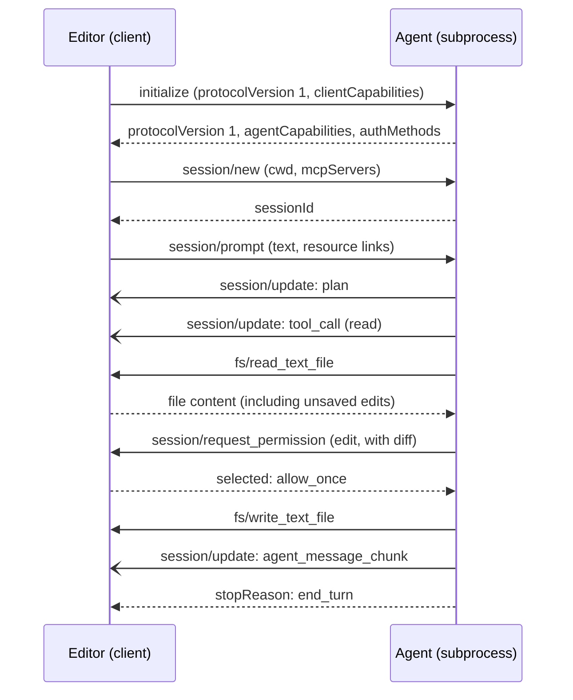

# Agent Client Protocol: Agents inside Editors: The Complete Guide

> 📚 **Before you start**
>
> - [AG-UI: Streaming Agent Events to a Frontend](ag-ui-streaming-agent-events-to-a-frontend.md), for streaming an agent's work into a user interface.
> - [The Transport Layer: stdio and Streamable HTTP](../../model-context-protocol-mcp/course.md#m3) in the MCP course, for JSON-RPC over a subprocess's standard input and output.
> - Basic command-line ideas (processes, stdin and stdout) from [The Command Line and Linux Basics](../../the-command-line-and-linux-basics/course.md).

## Introduction

Think of how phone chargers used to work: every brand had its own pin, so each phone needed its own charger and every hotel room needed a drawer full of cables. USB-C fixed that with one plug that any phone and any charger can use.

Coding agents had the charger problem. Each AI coding agent shipped its own plugin for each editor: one for VS Code, another for JetBrains, maybe one for Neovim. Each editor that wanted a new agent had to build a custom integration. With M agents and N editors, someone was writing M × N plugins.

The **Agent Client Protocol (ACP)** is the USB-C for this case. Zed Industries announced it in August 2025 together with Google's Gemini CLI as the first agent, and JetBrains joined in October 2025. Today the official list includes editors such as Zed, JetBrains IDEs, Neovim and Emacs (via plugins), and VS Code (via extensions), and agents such as Gemini CLI, GitHub Copilot, Goose, OpenCode, Junie, and Claude and Codex through adapters. In this lesson you'll learn how ACP works and run a real ACP conversation between an "editor" and an agent subprocess, entirely in Python.

> 💡 **Key Insight**
>
> In ACP the **editor stays in charge**. The agent runs as a subprocess and owns the model and its loop, but it reads and writes files **through the editor**, asks the editor for **permission** before risky actions, and reports everything it does as **session updates** the editor renders. That split is what makes a third-party agent safe to embed.

> ⚠️ **Name clash.** IBM's *Agent Communication Protocol*, also abbreviated ACP, was an agent-to-agent protocol that merged into A2A in 2025. This lesson is about Zed's *Agent Client Protocol*, for editors.

---

## Core Explanation

### 1. The shape of ACP

![The editor (Zed, JetBrains, Neovim and others) owns the files, the UI and the user's consent, and spawns the agent as a subprocess. They talk JSON-RPC 2.0 over stdio, one message per line: stdin carries editor-to-agent messages, stdout agent-to-editor, stderr is for logs only. The editor calls the agent's methods: initialize, session/new, session/prompt and session/cancel. The agent streams session/update notifications (agent message chunks, tool calls and updates, plans, diffs) and finally a stop reason such as end_turn. The agent can also call the editor: fs/read_text_file and fs/write_text_file, which see unsaved buffers; terminal/create, output, wait_for_exit and kill; and session/request_permission with allow once, allow always and reject options](/img/diagrams/multi-agent-systems-and-agent-protocols/acp-editor-agent.svg)
*Both sides expose methods; the editor provides the files, terminals and consent, the agent provides the intelligence.*

| Aspect | ACP |
|---|---|
| Parties | **Client** = the editor (or any app hosting a coding agent); **agent** = the coding agent |
| Transport | The editor launches the agent as a subprocess; JSON-RPC 2.0 over **stdio**, one UTF-8 JSON message per line (no embedded newlines); stderr may carry logs. A Streamable HTTP transport is a draft proposal. |
| Protocol version | A single integer, currently **1**, agreed during `initialize` |
| Conventions | camelCase keys, snake_case values (`end_turn`, `tool_call`), absolute file paths, 1-based line numbers |
| Relation to MCP | The editor passes MCP server configs to the agent in `session/new`, and the agent connects to them; ACP reuses MCP's content block shapes where it can |

Notice that **both** sides answer requests. The editor calls agent methods (`initialize`, `session/new`, `session/prompt`, `session/cancel` and others), and the agent calls client methods (`fs/read_text_file`, `fs/write_text_file`, the `terminal/*` family, `session/request_permission`) and sends `session/update` notifications.

### 2. The lifecycle



1. **Initialise.** The editor sends its protocol version and capabilities (`fs.readTextFile`, `fs.writeTextFile`, `terminal`...). The agent answers with its own (`loadSession`, `promptCapabilities` for images, audio and embedded context, MCP transports it supports) and any `authMethods`. Neither side may use a feature the other didn't declare.
2. **Open a session.** `session/new` gives the working directory and MCP servers; the agent returns a `sessionId`. Agents that declare `loadSession` can resume earlier sessions with `session/load`.
3. **Prompt turns.** `session/prompt` sends content blocks (text, plus resource links or embedded file contents for context). The agent streams `session/update` notifications and finally answers the prompt request with a **stop reason**: `end_turn`, `max_tokens`, `max_turn_requests`, `refusal` or `cancelled`. The editor can send `session/cancel` at any time, and the agent must then finish with `cancelled`.

The kinds of `session/update` include `agent_message_chunk`, `user_message_chunk`, `agent_thought_chunk`, `tool_call`, `tool_call_update`, `plan`, `available_commands_update` (slash commands), `current_mode_update`, and a few more for configuration, usage and context compaction. Tool calls carry a `kind` (`read`, `edit`, `delete`, `move`, `search`, `execute`, `think`, `fetch`, `switch_mode`, `other`) and a `status` (`pending`, `in_progress`, `completed`, `failed`), so the editor can show the right icon and progress, and their `content` can include **diffs** (`{"type": "diff", "path", "oldText", "newText"}`) the editor renders as a review.

### 3. Run a real ACP conversation

Below, a tiny ACP agent runs as a **real subprocess**, speaking newline-delimited JSON-RPC on stdin and stdout. Its "intelligence" is scripted (it fixes a bug in a GST calculation) so the lesson runs offline; the messages are exactly what an editor would see. First the agent:

```python
AGENT_SOURCE = r'''
import json, sys

def send(msg):
    sys.stdout.write(json.dumps(msg) + "\n"); sys.stdout.flush()

def update(sid, upd):
    send({"jsonrpc": "2.0", "method": "session/update", "params": {"sessionId": sid, "update": upd}})

next_id = 1000
def call_client(method, params):            # the agent calling the editor, then waiting for its reply
    global next_id
    next_id += 1
    send({"jsonrpc": "2.0", "id": next_id, "method": method, "params": params})
    return json.loads(sys.stdin.readline())["result"]

for line in sys.stdin:
    msg = json.loads(line)
    method, params, rid = msg.get("method"), msg.get("params", {}), msg.get("id")
    if method == "initialize":
        send({"jsonrpc": "2.0", "id": rid, "result": {"protocolVersion": 1, "authMethods": [],
              "agentInfo": {"name": "chai-coder", "version": "0.1.0"},
              "agentCapabilities": {"loadSession": False, "promptCapabilities": {"embeddedContext": True}}}})
    elif method == "session/new":
        send({"jsonrpc": "2.0", "id": rid, "result": {"sessionId": "sess-1"}})
    elif method == "session/prompt":
        sid, path = params["sessionId"], "/home/asha/billing/gst.py"
        update(sid, {"sessionUpdate": "plan", "entries": [
            {"content": "Read gst.py", "priority": "high", "status": "in_progress"},
            {"content": "Fix the rate", "priority": "high", "status": "pending"}]})
        update(sid, {"sessionUpdate": "tool_call", "toolCallId": "t1", "title": "Read gst.py",
                     "kind": "read", "status": "pending", "locations": [{"path": path}]})
        old = call_client("fs/read_text_file", {"sessionId": sid, "path": path})["content"]
        update(sid, {"sessionUpdate": "tool_call_update", "toolCallId": "t1", "status": "completed"})
        new = old.replace("0.18 / 100", "18 / 100")
        diff = {"type": "diff", "path": path, "oldText": old, "newText": new}
        update(sid, {"sessionUpdate": "tool_call", "toolCallId": "t2", "title": "Fix GST rate in gst.py",
                     "kind": "edit", "status": "pending", "content": [diff]})
        choice = call_client("session/request_permission", {"sessionId": sid,
            "toolCall": {"toolCallId": "t2", "title": "Fix GST rate in gst.py", "kind": "edit"},
            "options": [{"optionId": "yes", "name": "Allow", "kind": "allow_once"},
                        {"optionId": "no", "name": "Reject", "kind": "reject_once"}]})["outcome"]
        if choice.get("optionId") == "yes":
            call_client("fs/write_text_file", {"sessionId": sid, "path": path, "content": new})
            update(sid, {"sessionUpdate": "tool_call_update", "toolCallId": "t2", "status": "completed"})
            text = "Fixed: the rate was 0.18% instead of 18%."
        else:
            update(sid, {"sessionUpdate": "tool_call_update", "toolCallId": "t2", "status": "failed"})
            text = "Okay, I left the file unchanged."
        update(sid, {"sessionUpdate": "agent_message_chunk", "content": {"type": "text", "text": text}})
        send({"jsonrpc": "2.0", "id": rid, "result": {"stopReason": "end_turn"}})
'''
print(len(AGENT_SOURCE.splitlines()), "lines of agent code")
```

Output:

```
51 lines of agent code
```

Now the editor side. It launches the agent, sends requests, renders `session/update` notifications, and **answers the agent's own requests**: reading from its open buffers (which may hold unsaved edits), asking a permission policy, and writing files.

```python
import json, subprocess, sys

BUFFERS = {"/home/asha/billing/gst.py": "def gst(amount):\n    return round(amount * 0.18 / 100, 2)\n"}

class Editor:
    def __init__(self, approve):
        self.proc = subprocess.Popen([sys.executable, "-c", AGENT_SOURCE], stdin=subprocess.PIPE,
                                     stdout=subprocess.PIPE, text=True)
        self.approve, self.ids, self.log = approve, 0, []

    def _send(self, msg):
        self.proc.stdin.write(json.dumps(msg) + "\n")
        self.proc.stdin.flush()

    def _handle_agent_request(self, msg):
        m, p = msg["method"], msg["params"]
        if m == "fs/read_text_file":
            result = {"content": BUFFERS[p["path"]]}
        elif m == "fs/write_text_file":
            BUFFERS[p["path"]] = p["content"]
            result = {}
        elif m == "session/request_permission":
            option = self.approve(p["toolCall"], p["options"])
            result = {"outcome": {"outcome": "selected", "optionId": option}}
        self.log.append(f"agent asks  : {m} -> {json.dumps(result)[:60]}")
        self._send({"jsonrpc": "2.0", "id": msg["id"], "result": result})

    def request(self, method, params):
        self.ids += 1
        self._send({"jsonrpc": "2.0", "id": self.ids, "method": method, "params": params})
        while True:
            msg = json.loads(self.proc.stdout.readline())
            if msg.get("id") == self.ids and "method" not in msg:
                return msg["result"]                                  # the answer to our request
            if msg.get("method") == "session/update":
                u = msg["params"]["update"]
                detail = u.get("title") or u.get("status") or u.get("content", {}).get("text") or len(u.get("entries", []))
                self.log.append(f"update      : {u['sessionUpdate']:20} {detail}")
            else:
                self._handle_agent_request(msg)

    def close(self):
        self.proc.stdin.close()
        self.proc.wait()

def careful_user(tool_call, options):          # an editor would show a dialog with the diff
    return next(o["optionId"] for o in options if o["kind"] == "allow_once")

ed = Editor(approve=careful_user)
init = ed.request("initialize", {"protocolVersion": 1, "clientInfo": {"name": "mini-editor", "version": "1.0"},
                                 "clientCapabilities": {"fs": {"readTextFile": True, "writeTextFile": True}}})
print("agent:", init["agentInfo"]["name"], "| protocol", init["protocolVersion"])
session = ed.request("session/new", {"cwd": "/home/asha/billing", "mcpServers": []})
done = ed.request("session/prompt", {"sessionId": session["sessionId"],
                                     "prompt": [{"type": "text", "text": "GST looks wrong in gst.py, fix it"}]})
ed.close()
print("\n".join(ed.log))
print("stopReason:", done["stopReason"])
print(BUFFERS["/home/asha/billing/gst.py"], end="")
```

Output:

```
agent: chai-coder | protocol 1
update      : plan                 2
update      : tool_call            Read gst.py
agent asks  : fs/read_text_file -> {"content": "def gst(amount):\n    return round(amount * 0.1
update      : tool_call_update     completed
update      : tool_call            Fix GST rate in gst.py
agent asks  : session/request_permission -> {"outcome": {"outcome": "selected", "optionId": "yes"}}
agent asks  : fs/write_text_file -> {}
update      : tool_call_update     completed
update      : agent_message_chunk  Fixed: the rate was 0.18% instead of 18%.
stopReason: end_turn
def gst(amount):
    return round(amount * 18 / 100, 2)
```

Every file access went through the editor, and the edit waited for an explicit permission answer. In a real editor, the `tool_call` with the diff becomes a review panel and the permission request becomes an "Allow / Reject" prompt; the `plan` becomes a checklist that ticks off as updates arrive.

### 4. Why the editor-in-the-middle design matters

- **Unsaved changes.** Because the agent reads through `fs/read_text_file`, it sees what's in the editor buffer, not a stale copy on disk.
- **Consent and audit.** Edits, deletions and commands can be gated with `session/request_permission`, with options to allow or reject **once** or **always**. The editor keeps the history of what was approved.
- **One integration per side.** An agent implements ACP once and works in every ACP editor; an editor implements it once and hosts every ACP agent.
- **Terminals.** With the `terminal` capability, the agent asks the editor to run commands (`terminal/create`, then `terminal/output` or `terminal/wait_for_exit`), so the user sees the command run in their own terminal and can embed it in a tool call's content.

### 5. ACP compared with its neighbours

| | ACP | AG-UI | MCP |
|---|---|---|---|
| Connects | An editor and a coding agent | A user-facing app and an agent | An agent and its tools |
| Who starts whom | Editor spawns the agent | App calls an HTTP endpoint | Host connects to servers |
| Transport | stdio (HTTP in draft) | HTTP + SSE (or Protobuf) | stdio or Streamable HTTP |
| Calls in both directions | Yes: files, terminals, permissions | No mid-run channel; answers come in the next run | Mostly host to server |
| Typical stream | `session/update` | AG-UI events | Tool results and notifications |

ACP and MCP cooperate: the editor hands its configured MCP servers to the agent in `session/new`, so the user configures tools once in the editor and every agent can use them.

### 6. Building real ACP agents and clients

Official libraries exist for TypeScript (`@agentclientprotocol/sdk`), Python (`agent-client-protocol` on PyPI, 0.12 as of October 2026), Rust, Kotlin and Java, and the JSON Schema for protocol version 1 lives in the protocol repository. They handle framing, request IDs and typed messages, which in the demo above you did by hand. Adapters wrap agents that don't speak ACP natively (the official list shows Claude Agent through Zed's SDK adapter and Codex CLI through an ACP adapter).

---

## Try It Yourself

1. **Reject the edit.** Run the session again with a `cautious_user` who always picks the `reject_once` option. What's in the buffer afterwards, and what's the last tool status?
2. **Count messages by direction.** Change the `Editor` so it counts how many requests each side sent. Why is the agent's count not zero?
3. **Guard a capability.** If the editor had declared `"writeTextFile": False`, what should a well-behaved agent do instead of calling `fs/write_text_file`?

<details>
<summary>Show answers</summary>

**1.**

```python
BUFFERS["/home/asha/billing/gst.py"] = "def gst(amount):\n    return round(amount * 0.18 / 100, 2)\n"

def cautious_user(tool_call, options):
    return next(o["optionId"] for o in options if o["kind"] == "reject_once")

ed2 = Editor(approve=cautious_user)
ed2.request("initialize", {"protocolVersion": 1, "clientInfo": {"name": "mini-editor", "version": "1.0"},
                           "clientCapabilities": {"fs": {"readTextFile": True, "writeTextFile": True}}})
s2 = ed2.request("session/new", {"cwd": "/home/asha/billing", "mcpServers": []})
ed2.request("session/prompt", {"sessionId": s2["sessionId"], "prompt": [{"type": "text", "text": "fix GST"}]})
ed2.close()
print("\n".join(ed2.log[-3:]))
print(BUFFERS["/home/asha/billing/gst.py"], end="")
```

Output:

```
agent asks  : session/request_permission -> {"outcome": {"outcome": "selected", "optionId": "no"}}
update      : tool_call_update     failed
update      : agent_message_chunk  Okay, I left the file unchanged.
def gst(amount):
    return round(amount * 0.18 / 100, 2)
```

The file is unchanged and the edit's tool call ends as `failed`.

**2.** In the first run the agent sent three requests (`fs/read_text_file`, `session/request_permission`, `fs/write_text_file`) and the editor sent three (`initialize`, `session/new`, `session/prompt`). ACP is genuinely bidirectional: the agent is a JSON-RPC client of the editor for files, terminals and permissions.

**3.** It must not call a method the client didn't declare. It could show the change as a `diff` in a tool call and ask the user to apply it, or explain in its message what to change. Capabilities negotiated in `initialize` are binding for the whole connection.

</details>

---

## Real-World Examples

- **Zed** hosts external agents such as Gemini CLI, Claude Agent and Codex CLI through ACP, alongside its own built-in agent.
- **JetBrains IDEs** support ACP agents, so an agent built once works in IntelliJ IDEA, PyCharm and the rest of the family.
- **Neovim and Emacs** users get the same agents through community plugins (CodeCompanion, avante.nvim, agent-shell.el and others) rather than per-agent integrations.

---

## Common Misconceptions

### "ACP is for agents talking to each other"

That's A2A (and IBM's older Agent Communication Protocol). Zed's ACP connects an editor to a coding agent.

### "The agent reads files from disk itself"

It can, but in ACP it should go through `fs/read_text_file` so it sees unsaved buffers and the editor can track access.

### "Once the user approves, the agent can do anything"

Permission is per tool call. "Allow always" is an explicit option the user chooses, and the editor decides how to remember it.

---

## Interview Relevance

*"How would you integrate a third-party coding agent into an editor safely?"* Describe ACP: subprocess over stdio with newline-delimited JSON-RPC, capability negotiation in `initialize`, sessions and prompt turns, streamed `session/update` (plans, tool calls with kinds and statuses, diffs), file and terminal access through the editor, and `session/request_permission` for consent, ending with a stop reason.

*"How do ACP, MCP and AG-UI differ?"* Who they connect, who starts whom, transports, and whether calls flow both ways.

---

## Key Takeaways

- **ACP connects editors and coding agents**, so M agents and N editors need M + N integrations instead of M × N.
- **The editor spawns the agent** and they exchange newline-delimited JSON-RPC 2.0 over stdio, with protocol version 1.
- **Prompt turns stream `session/update`** (message chunks, plans, tool calls with diffs) and end with a stop reason such as `end_turn`.
- **The editor stays in control**: files and terminals go through it, and risky actions wait for `session/request_permission`.
- **Capabilities are binding**: neither side uses what the other didn't declare in `initialize`.

---

**Up next:** [Generative UI](generative-ui.md)
