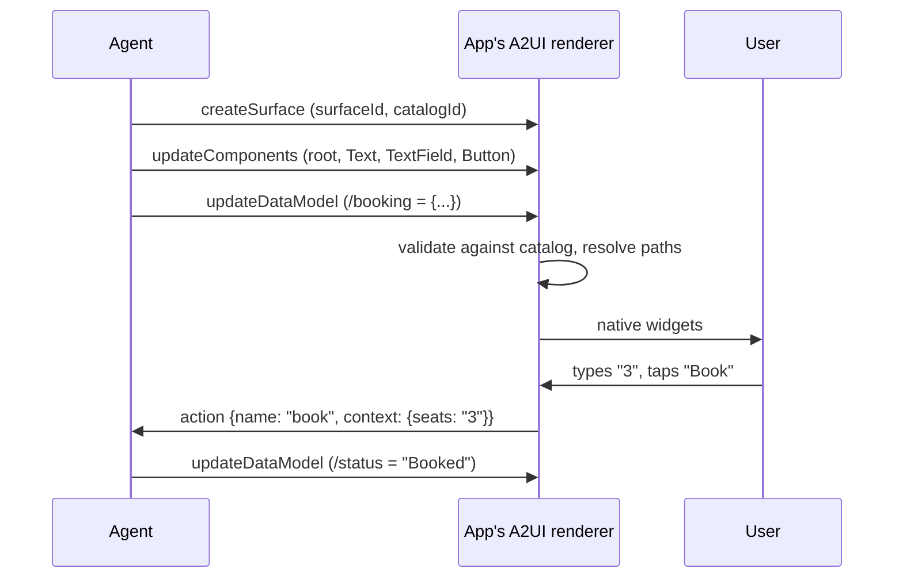

# Generative UI: The Complete Guide

> 📚 **Before you start**
>
> - [AG-UI: Streaming Agent Events to a Frontend](ag-ui-streaming-agent-events-to-a-frontend.md), for frontend tools and how agent events reach an app.
> - [Agent-to-Agent (A2A) Protocol](../03-the-a2a-protocol/agent-to-agent-a2a-protocol.md), since A2UI messages often travel inside A2A messages.
> - [MCP Primitives: Tools, Resources and Prompts](../../model-context-protocol-mcp/course.md#m2) in the MCP course, for MCP tools and resources.
> - Reading basic HTML and JSON.

## Introduction

Imagine asking a travel agent on the phone to book a train from Delhi to Jaipur. They read out ten trains, three classes and four prices, and you try to remember them all. Now imagine they hand you a printed form instead: trains in a table, a dropdown for class, a box for passengers and a "Book" button. Same agent, same knowledge, but a far better experience.

Chat agents have the phone problem: everything comes back as text. **Generative UI** means the agent can answer with **interface**: a form, a card, a chart, a date picker, chosen or built for this moment. The hard question is how much of that interface the agent gets to decide, because whatever the agent sends, your app has to render it, safely, on web and mobile.

In this lesson you'll see the three points on that spectrum, the open specifications behind each (frontend tools, **A2UI** and **MCP Apps**), and you'll build a small but real A2UI renderer in Python that validates components against a catalog, binds them to data and sends user actions back to the agent.

> 💡 **Key Insight**
>
> Generative UI is a trade between **flexibility** and **control**. The more of the screen the agent decides, the less your app can guarantee about safety, look and feel. Declarative specs like A2UI sit in the middle: the agent composes layouts, but only from components **your** app trusts and renders natively.

---

## Core Explanation

### 1. The spectrum

![Three columns. Static: the frontend owns the components and the agent picks one and fills its arguments, as with frontend tools and tool-call renderers such as show_flight_card(from DEL, to BLR); most control, least flexibility, and a new widget needs a release. Declarative: the agent composes a layout as JSON from a catalog of trusted components, as in A2UI and Open-JSON-UI, with Column, Text, TextField and Button bound to data paths; balanced, native look on web and mobile, and no code runs from the agent. Open-ended: the server ships a whole app as HTML and JavaScript in a sandboxed iframe, as in MCP Apps with ui:// resources, built on MCP-UI and the Apps SDK, talking to the host over postMessage JSON-RPC; most flexibility, least control, needs sandbox, CSP and review. Further right, the agent decides more of the screen and the host must trust it less. AG-UI is not on this line: it is the event stream that can carry any of them](/img/diagrams/multi-agent-systems-and-agent-protocols/generative-ui-spectrum.svg)
*Pick the point on the spectrum that matches how much you trust the agent and how much your design team needs control.*

| Approach | Who writes the UI | What travels from the agent | Example specs |
|---|---|---|---|
| **Static** | Your frontend team | A tool call such as `show_flight_card({...})` | Frontend tools in AG-UI and similar SDKs |
| **Declarative** | The agent, from your catalog | JSON describing components and data | **A2UI** (Google), **Open-JSON-UI** (OpenAI) |
| **Open-ended** | The server's developers | A full HTML app, rendered in a sandbox | **MCP Apps** (MCP extension, built on MCP-UI and OpenAI's Apps SDK) |

You've already met the static end in the AG-UI lesson: the agent calls a frontend tool, and a component your team built renders the arguments. It's safe and on-brand, but every new widget needs a frontend release. The other two ends deserve a closer look.

> ⚠️ **AG-UI is not a generative UI spec.** AG-UI's own documentation puts it this way: it's the runtime connection between agent and app, and it can carry A2UI, MCP Apps or your own format. Think of AG-UI as the road and the generative UI specs as the vehicles.

### 2. A2UI: declarative UI from a trusted catalog

**A2UI** (Agent-to-User Interface) is an open project started by Google. The stable version is **v0.9** (with v1.0 in preparation as of October 2026). An agent sends a stream of JSON messages, each with `"version": "v0.9"` and exactly one of four operations:

| Message | What it does |
|---|---|
| `createSurface` | Opens a surface (a piece of UI) with a `surfaceId` and the `catalogId` it uses; optional `theme` and `sendDataModel` |
| `updateComponents` | Adds or replaces components, as a **flat list** with IDs |
| `updateDataModel` | Sets a value at a JSON Pointer path in the surface's data model |
| `deleteSurface` | Removes the surface |

Three design choices make A2UI work for LLMs and for security:

1. **A flat adjacency list.** Components refer to each other by ID (`"children": ["title", "seats"]`, `"child": "label"`) rather than nesting. One component must have the ID `root`. An LLM can stream or fix one component at a time, and the renderer can show parts as they arrive.
2. **Data binding.** Values can be literals or `{"path": "/booking/seats"}`, a JSON Pointer into the data model. The agent can change data without resending the layout, and typing in a field updates the model locally.
3. **A catalog.** The `catalogId` names a set of components and functions the client has agreed to render. The **basic catalog** has 18 components, including `Text`, `Image`, `Icon`, `Row`, `Column`, `List`, `Card`, `Tabs`, `Modal`, `Divider`, `Button`, `TextField`, `CheckBox`, `ChoicePicker`, `Slider` and `DateTimeInput`. Production apps usually define their own catalog that maps to their design system. Nothing outside the catalog renders, and no agent code ever runs.

User interaction comes back as an **`action`** message with `name`, `surfaceId`, `sourceComponentId`, `timestamp` and a `context` built from the button's action definition, with any `{"path"}` values resolved from the data model. A button can instead have a `functionCall` action that runs a catalog function locally (such as `openUrl`) without involving the agent.



Over **A2A**, each A2UI message travels as a data part of an A2A message, and the client lists the catalogs it supports in message metadata (`a2uiClientCapabilities` with `supportedCatalogIds`). It can also travel over AG-UI, MCP or plain WebSockets.

### 3. Build an A2UI renderer

Here are real-looking A2UI v0.9 messages an agent might send for a train booking:

```python
import json

CATALOG = "https://a2ui.org/specification/v0_9/catalogs/basic/catalog.json"

agent_messages = [
    {"version": "v0.9", "createSurface": {"surfaceId": "booking", "catalogId": CATALOG}},
    {"version": "v0.9", "updateComponents": {"surfaceId": "booking", "components": [
        {"id": "root", "component": "Card", "child": "form"},
        {"id": "form", "component": "Column", "children": ["title", "trains", "seats", "book"]},
        {"id": "title", "component": "Text", "text": {"path": "/trip/title"}, "variant": "h2"},
        {"id": "trains", "component": "List", "children": {"path": "/trip/trains", "componentId": "train"}},
        {"id": "train", "component": "Text", "text": {"path": "label"}},
        {"id": "seats", "component": "TextField", "label": "Passengers", "value": {"path": "/booking/seats"}},
        {"id": "book_label", "component": "Text", "text": "Book"},
        {"id": "book", "component": "Button", "child": "book_label", "variant": "primary",
         "action": {"event": {"name": "book_train",
                              "context": {"train": {"path": "/trip/trains/0/number"},
                                          "seats": {"path": "/booking/seats"}}}}},
    ]}},
    {"version": "v0.9", "updateDataModel": {"surfaceId": "booking", "path": "/trip", "value": {
        "title": "Delhi to Jaipur, 14 Nov",
        "trains": [{"number": "12015", "label": "12015 Ajmer Shatabdi 06:10, Rs 905"},
                   {"number": "12958", "label": "12958 Swarna Jayanti 19:55, Rs 640"}]}}},
    {"version": "v0.9", "updateDataModel": {"surfaceId": "booking", "path": "/booking", "value": {"seats": "1"}}},
]
print(sum(len(json.dumps(m)) for m in agent_messages), "bytes in", len(agent_messages), "messages")
```

Output:

```
1390 bytes in 4 messages
```

The renderer below handles all four message types. It **validates** every component against a catalog (here a subset of the basic catalog's required properties), keeps the data model, resolves absolute and relative paths (including `List` templates), renders to text in place of real widgets, and turns a button tap into an `action` message.

```python
from datetime import datetime, timezone

BASIC_CATALOG = {                       # component -> required properties (from the basic catalog)
    "Text": {"text"}, "Card": {"child"}, "Column": {"children"}, "Row": {"children"},
    "List": {"children"}, "Button": {"child", "action"}, "TextField": {"label"},
}

def get_path(model, pointer, scope=""):
    full = pointer if pointer.startswith("/") else f"{scope}/{pointer}"   # relative paths use the scope
    node = model
    for part in [p for p in full.split("/") if p]:
        node = node[int(part)] if isinstance(node, list) else node.get(part)
        if node is None:
            return None
    return node

def set_path(model, pointer, value):
    *parents, last = [p for p in pointer.split("/") if p]
    for p in parents:
        model = model.setdefault(p, {})
    model[last] = value

class Surface:
    def __init__(self, surface_id, catalog_id):
        self.id, self.catalog_id, self.components, self.model = surface_id, catalog_id, {}, {}

    def value(self, v, scope=""):
        return get_path(self.model, v["path"], scope) if isinstance(v, dict) and "path" in v else v

    def render(self, cid="root", depth=0, scope=""):
        c, pad = self.components[cid], "  " * depth
        kind = c["component"]
        if kind == "Text":
            return [pad + str(self.value(c["text"], scope) or "")]
        if kind == "TextField":
            return [f"{pad}{c['label']}: [{self.value(c.get('value'), scope) or ''}]"]
        if kind == "Button":
            return [f"{pad}< {self.render(c['child'])[0].strip()} >"]
        if kind == "Card":
            return [pad + "+--"] + self.render(c["child"], depth + 1, scope) + [pad + "+--"]
        kids = c["children"]
        if isinstance(kids, dict):                         # template: one child per item in a list
            items = get_path(self.model, kids["path"]) or []
            return [line for i in range(len(items))
                    for line in self.render(kids["componentId"], depth + 1, f"{kids['path']}/{i}")]
        return [line for k in kids for line in self.render(k, depth + 1, scope)]

class Renderer:
    def __init__(self, catalogs):
        self.catalogs, self.surfaces, self.outbox = catalogs, {}, []

    def handle(self, msg):
        assert msg.get("version") == "v0.9", "unsupported version"
        op, body = next((k, v) for k, v in msg.items() if k != "version")
        if op == "createSurface":
            if body["catalogId"] not in self.catalogs:
                raise ValueError(f"unknown catalog {body['catalogId']}")
            self.surfaces[body["surfaceId"]] = Surface(body["surfaceId"], body["catalogId"])
        elif op == "updateComponents":
            s = self.surfaces[body["surfaceId"]]
            catalog = self.catalogs[s.catalog_id]
            for comp in body["components"]:
                kind = comp["component"]
                if kind not in catalog:
                    raise ValueError(f"{comp['id']}: '{kind}' is not in the catalog")
                missing = catalog[kind] - comp.keys()
                if missing:
                    raise ValueError(f"{comp['id']}: missing {sorted(missing)}")
                s.components[comp["id"]] = comp
        elif op == "updateDataModel":
            set_path(self.surfaces[body["surfaceId"]].model, body["path"], body["value"])
        elif op == "deleteSurface":
            del self.surfaces[body["surfaceId"]]

    def type_into(self, surface_id, field_id, text):        # local only: no network message
        s = self.surfaces[surface_id]
        set_path(s.model, s.components[field_id]["value"]["path"], text)

    def tap(self, surface_id, button_id):
        s = self.surfaces[surface_id]
        event = s.components[button_id]["action"]["event"]
        self.outbox.append({"version": "v0.9", "action": {
            "name": event["name"], "surfaceId": surface_id, "sourceComponentId": button_id,
            "timestamp": datetime.now(timezone.utc).isoformat(timespec="seconds"),
            "context": {k: s.value(v) for k, v in event.get("context", {}).items()}}})

app = Renderer({CATALOG: BASIC_CATALOG})
for m in agent_messages:
    app.handle(m)
print("\n".join(app.surfaces["booking"].render()))
app.type_into("booking", "seats", "3")
app.tap("booking", "book")
sent = app.outbox[0]["action"]
print({k: sent[k] for k in ("name", "surfaceId", "sourceComponentId", "context")})
```

Output:

```
+--
    Delhi to Jaipur, 14 Nov
      12015 Ajmer Shatabdi 06:10, Rs 905
      12958 Swarna Jayanti 19:55, Rs 640
    Passengers: [1]
    < Book >
+--
{'name': 'book_train', 'surfaceId': 'booking', 'sourceComponentId': 'book', 'context': {'train': '12015', 'seats': '3'}}
```

The agent never sent any code, only a description, yet the user got a card with live data, the list was built from a template, and typing "3" changed the data model locally before the tap sent it back in `context`. Now watch the catalog protect the app when an agent (or an injected prompt) tries something it shouldn't:

```python
bad_messages = [
    {"version": "v0.9", "updateComponents": {"surfaceId": "booking", "components": [
        {"id": "pay", "component": "HtmlEmbed", "html": "<script>steal()</script>"}]}},
    {"version": "v0.9", "updateComponents": {"surfaceId": "booking", "components": [
        {"id": "cancel", "component": "Button", "child": "book_label"}]}},
    {"version": "v0.9", "createSurface": {"surfaceId": "x", "catalogId": "https://evil.example/catalog"}},
]
for m in bad_messages:
    try:
        app.handle(m)
    except ValueError as err:
        print("rejected:", err)
```

Output:

```
rejected: pay: 'HtmlEmbed' is not in the catalog
rejected: cancel: missing ['action']
rejected: unknown catalog https://evil.example/catalog
```

A real A2UI renderer (the project lists renderers for Lit, Angular and React on the web, and Flutter through its GenUI SDK) validates against the catalog's full JSON Schema, reports errors back to the agent with an `error` message so the model can fix its JSON, and maps each component to a native widget.

### 4. MCP Apps: full HTML apps in a sandbox

At the open-ended end, **MCP Apps** is an official MCP extension (`io.modelcontextprotocol/ui`, SEP-1865, stable since its 2026-01-26 specification). It unified two earlier approaches, the community **MCP-UI** project and **OpenAI's Apps SDK** (launched November 2025), and it's supported by hosts such as ChatGPT, Claude, VS Code and Goose.

The pieces fit together like this:

1. The server declares a **UI resource** with a `ui://` URI and the MIME type `text/html;profile=mcp-app`. Its content is a full HTML page.
2. A tool links to it in its metadata: `"_meta": {"ui": {"resourceUri": "ui://trains/picker"}}`. Hosts can preload and review the resource before any tool runs.
3. When the model calls the tool, the host renders the resource in a **sandboxed iframe**, sends it the tool input and result (`ui/notifications/tool-input`, `ui/notifications/tool-result`), and the app talks back over `postMessage` JSON-RPC: `ui/initialize`, `tools/call` (only for tools whose `visibility` includes `"app"`), `ui/message` to post into the chat, `ui/update-model-context`, `ui/open-link` and so on.
4. A **Content Security Policy** is declared with the resource (`csp.connectDomains`, `csp.resourceDomains`); without one, the host applies a restrictive default with no outside network access.

```json
{
  "name": "pick_train",
  "description": "Let the user pick a train and seat visually",
  "inputSchema": {"type": "object", "properties": {"from": {"type": "string"}, "to": {"type": "string"}}},
  "_meta": {"ui": {"resourceUri": "ui://trains/picker", "visibility": ["model", "app"]}}
}
```

This gives you anything HTML can do (seat maps, charts, mini games), at the cost of running third-party code. That's why the iframe sandbox, CSP, the host's ability to block or ask approval for an app's `tools/call`, and pre-review of resources are all part of the spec.

### 5. Choosing an approach

| Question | Static | Declarative (A2UI) | Open-ended (MCP Apps) |
|---|---|---|---|
| Who can add a new kind of UI? | Your frontend team | The agent, within the catalog | The server's developers |
| Runs third-party code in your app? | No | No | Yes, sandboxed |
| Native on mobile? | Yes | Yes (renderer per platform) | Web view |
| Best for | Core flows you care about deeply | Forms, cards, lists that vary per request | Rich experiences shipped by tool providers |

Many products mix them: core flows use static components, the agent fills gaps with declarative UI, and tools from partners appear as MCP Apps.

### 6. Security, in short

- **Treat UI as untrusted output.** A prompt-injected agent can ask for a "Confirm payment" button. The user must still see where an action goes, and your backend must authorise the action itself.
- **Catalogs are allowlists.** Keep them small; don't add a component that renders raw HTML.
- **Sandbox open-ended UI** and restrict its network with CSP, as MCP Apps requires.
- **Data goes back only to its owner.** With `sendDataModel`, A2UI sends a surface's data model only to the agent that created it.

---

## Try It Yourself

1. **Agent updates data, not layout.** Send an `updateDataModel` that changes `/trip/title` to "Delhi to Jaipur, 15 Nov" and re-render. How many components did the agent resend?
2. **Add a third train.** Without touching components, append a train to `/trip/trains` and re-render.
3. **Why flat?** Give two reasons A2UI uses an adjacency list instead of nested components.

<details>
<summary>Show answers</summary>

**1 and 2.**

```python
app.handle({"version": "v0.9", "updateDataModel": {"surfaceId": "booking", "path": "/trip/title",
                                                   "value": "Delhi to Jaipur, 15 Nov"}})
trains = app.surfaces["booking"].model["trip"]["trains"]
app.handle({"version": "v0.9", "updateDataModel": {"surfaceId": "booking", "path": "/trip/trains",
            "value": trains + [{"number": "22985", "label": "22985 Udaipur Humsafar 22:20, Rs 715"}]}})
print("\n".join(app.surfaces["booking"].render()))
```

Output:

```
+--
    Delhi to Jaipur, 15 Nov
      12015 Ajmer Shatabdi 06:10, Rs 905
      12958 Swarna Jayanti 19:55, Rs 640
      22985 Udaipur Humsafar 22:20, Rs 715
    Passengers: [3]
    < Book >
+--
```

Zero components were resent: data binding means the layout stays and only the data changes, and the `List` template made a row for the new train.

**3.** An LLM can generate and stream components one at a time and refer to them by ID, so the client can render progressively; and an update can replace a single component by ID without resending the whole tree (which also makes fixing errors cheap).

</details>

---

## Real-World Examples

- **Flutter's GenUI SDK** uses A2UI under the hood, so a Flutter app can render agent-composed screens as native widgets; A2UI's own quickstart pairs a Gemini-powered ADK agent with a Lit web renderer.
- **ChatGPT, Claude, VS Code and Goose** render MCP Apps, so one tool provider's interactive UI works across them.
- **CopilotKit** ships an A2UI runtime on top of AG-UI, so React and Next.js apps can render A2UI surfaces streamed from LangGraph, CrewAI, Mastra and other agents.

---

## Common Misconceptions

### "Generative UI means the model writes React code"

Only at the open-ended end, and even there it's usually developer-written HTML from a server. Declarative specs send data, not code.

### "AG-UI and A2UI are competitors"

No. AG-UI is the event stream between agent and app; A2UI is one kind of payload it can carry.

### "If the UI is safe, the action is safe"

A safe-looking button can still trigger a harmful action. Authorise on the backend, not in the renderer.

---

## Interview Relevance

*"How would you let an agent show rich UI without letting it run code in your app?"* Describe the spectrum, then a declarative spec like A2UI: flat component list with IDs, data binding via JSON Pointer, a catalog that acts as an allowlist, and `action` messages back to the agent. Mention when you'd accept sandboxed HTML instead (MCP Apps) and what controls that needs.

---

## Key Takeaways

- **Generative UI trades flexibility for control**: static components, declarative JSON, or full sandboxed apps.
- **A2UI v0.9** streams `createSurface`, `updateComponents`, `updateDataModel` and `deleteSurface` messages; components form a flat list rooted at `root`.
- **Catalogs are the safety boundary**: the client renders only components it trusts, natively.
- **Data binding** lets the agent update values without resending layout; user actions return as `action` messages.
- **MCP Apps** ship HTML as `ui://` resources rendered in a sandboxed iframe, linked from tools via `_meta.ui.resourceUri`.

---

**Up next:** [The Open Standards Map: AAIF, MCP, AGENTS.md and A2A](the-open-standards-map-aaif-mcp-agents-md-and-a2a.md)
