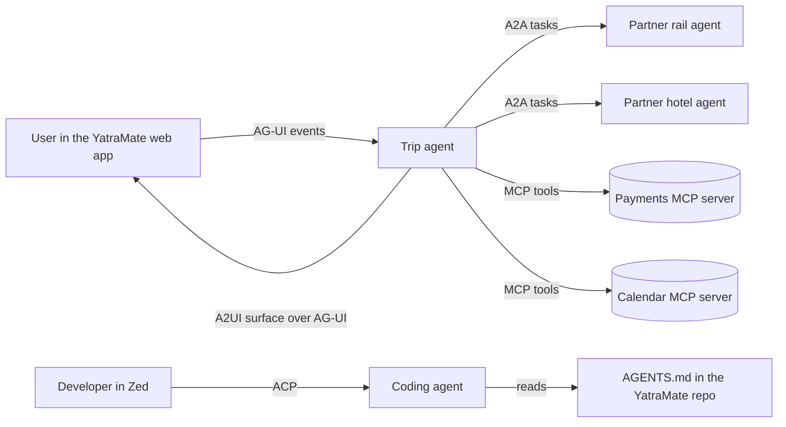

# The Open Standards Map: AAIF, MCP, AGENTS.md and A2A: The Complete Guide

> 📚 **Before you start**
>
> - [A2A vs MCP](../03-the-a2a-protocol/a2a-vs-mcp.md), for how the two biggest agent protocols divide the work.
> - [AG-UI](ag-ui-streaming-agent-events-to-a-frontend.md), [Agent Client Protocol](agent-client-protocol-agents-inside-editors.md) and [Generative UI](generative-ui.md), the user-facing protocols from this module.
> - [What is MCP?](../../model-context-protocol-mcp/course.md#m2) in the MCP course.

## Introduction

Think about the Indian railway network. Trains, signals, tickets and platforms all follow shared standards, so a train from Chennai can run on tracks in Kolkata and a ticket booked on one app works at any station. Different bodies look after different standards, but together they make one network.

Agent standards have reached that stage. In 2024 every framework had its own way to call tools, talk to other agents or show progress in a UI. By late 2026 you've seen a whole family of open standards: **MCP** for tools, **A2A** for other agents, **AG-UI** for app frontends, **ACP** for editors, **A2UI** and **MCP Apps** for generated interfaces, and **AGENTS.md** for repository instructions. And there's a new neutral home for several of them: the **Agentic AI Foundation (AAIF)** under the Linux Foundation.

This final lesson puts them on one map: what each connects, who looks after it, how they combine in a real product, and how to choose. You'll also try AGENTS.md, the simplest standard of all, with a runnable demo of how agents find the right instructions file.

> 💡 **Key Insight**
>
> The standards don't compete; each one covers a **different edge** of an agent: to tools, to peers, to people and to code. The useful question is never "MCP or A2A?" but "which edges does my agent have, and which standard covers each?"

---

## Core Explanation

### 1. The map

![Three bands around one agent. Facing people: AG-UI connects the agent to an app frontend as an event stream, led by CopilotKit; ACP connects a coding agent to an editor with JSON-RPC on stdio, led by Zed; A2UI and MCP Apps describe what the UI looks like, A2UI led by Google and MCP Apps an MCP extension. The agent and its peers: A2A connects agents across teams and companies and is a Linux Foundation project; other agents are found through Agent Cards. Facing tools, data and code: MCP, with the MCP Apps extension, connects the agent to tools, data and prompts under the Agentic AI Foundation; AGENTS.md tells a coding agent how to build, test and behave in a repository, also under AAIF. AAIF launched in December 2025 with MCP, goose and AGENTS.md; A2A is a separate Linux Foundation project. A real product often uses four or five of them at once](/img/diagrams/multi-agent-systems-and-agent-protocols/agent-protocol-stack.svg)
*Each standard covers one kind of connection. Together they let agents built by different teams work in one system.*

| Standard | Connects | Shape | Steward (October 2026) |
|---|---|---|---|
| **MCP** | Agent ↔ tools, data, prompts | JSON-RPC over stdio or Streamable HTTP | Agentic AI Foundation (created by Anthropic) |
| **MCP Apps** | MCP server ↔ UI inside the host | `ui://` HTML resources in a sandboxed iframe | Part of MCP (official extension) |
| **A2A** | Agent ↔ agent | Agent Cards; JSON-RPC, gRPC or HTTP+JSON | Linux Foundation project (created by Google) |
| **AG-UI** | Agent ↔ app frontend | Event stream over SSE (or Protobuf) | Open source, led by CopilotKit |
| **ACP** | Coding agent ↔ editor | JSON-RPC over stdio | Open source, led by Zed |
| **A2UI** | Agent → native UI description | JSON messages and catalogs | Open source, started by Google |
| **AGENTS.md** | Repository → coding agent | A Markdown file | Agentic AI Foundation (created by OpenAI) |

### 2. The Agentic AI Foundation

The Linux Foundation announced the **Agentic AI Foundation (AAIF)** on **9 December 2025** as a neutral home for open agent standards. It launched with three founding projects:

- **Model Context Protocol (MCP)**, contributed by Anthropic.
- **goose**, Block's open-source agent framework.
- **AGENTS.md**, contributed by OpenAI.

Its platinum members include AWS, Anthropic, Block, Bloomberg, Cloudflare, Google, Microsoft and OpenAI, and in February 2026 it announced 97 new members. It also runs community events such as AGNTCon and MCPCon.

Why does a foundation matter to you as a developer? Because "who owns the standard" decides whether it's safe to build on:

- **No single vendor can change the rules** for its own benefit; changes go through open processes (for MCP, Specification Enhancement Proposals, or SEPs, such as SEP-1865 for MCP Apps).
- **Competitors can adopt it** without depending on a rival, which is why OpenAI, Google and Microsoft all support MCP.
- **Trademarks, domains and governance** are held neutrally, so a project survives even if its original company changes direction.

A2A took the same path separately: Google donated it to the Linux Foundation in 2025, and IBM's Agent Communication Protocol merged into it later that year. AG-UI, ACP and A2UI are open source under company leadership today; foundations are where standards often end up once many vendors depend on them.

### 3. AGENTS.md: the simplest standard

**AGENTS.md** is a plain Markdown file that works like a README for agents: how to set up the project, run tests, follow code style and avoid known traps. There are no required fields. Its website says it's used by over 60,000 open-source projects, and it's read by many coding agents, including OpenAI Codex, Google's Jules and Gemini CLI, GitHub Copilot's coding agent, Cursor, Zed, Warp, Aider and goose.

```markdown
# AGENTS.md

## Setup
- Install with `uv sync`; Python 3.12.

## Testing
- Run `pytest -q` before every commit; all tests must pass.

## Conventions
- Money is stored in paise as integers, never floats.
- Do not edit files under `migrations/` by hand.
```

In a monorepo, you can put an AGENTS.md in each package. The rules from the official site are simple: **the closest AGENTS.md to the file being edited wins**, and **an explicit instruction from the user in chat overrides everything**. Here's a small resolver that applies those rules:

```python
from pathlib import PurePosixPath

REPO_FILES = {
    "AGENTS.md": "Run `pytest -q`. Use 4-space indents.",
    "services/payments/AGENTS.md": "Money is integer paise. Run `pytest services/payments -q`.",
    "services/payments/upi/AGENTS.md": "Never log VPAs (UPI IDs).",
    "web/AGENTS.md": "Use pnpm, not npm. Run `pnpm test`.",
}

def instruction_files(edited_file):
    """AGENTS.md files that apply to a file, nearest first."""
    found = []
    folder = PurePosixPath(edited_file).parent
    while True:
        candidate = "AGENTS.md" if str(folder) == "." else f"{folder}/AGENTS.md"
        if candidate in REPO_FILES:
            found.append(candidate)
        if str(folder) == ".":
            return found
        folder = folder.parent

for path in ["services/payments/upi/collect.py", "services/payments/refunds.py", "web/src/App.tsx", "README.md"]:
    files = instruction_files(path)
    print(f"{path:34} nearest: {files[0]:32} applies: {len(files)}")
```

Output:

```
services/payments/upi/collect.py   nearest: services/payments/upi/AGENTS.md  applies: 3
services/payments/refunds.py       nearest: services/payments/AGENTS.md      applies: 2
web/src/App.tsx                    nearest: web/AGENTS.md                    applies: 2
README.md                          nearest: AGENTS.md                        applies: 1
```

Many agents read **all** of these files along the path and let the nearer ones take precedence, so the root file can hold repository-wide rules while packages refine them. When two files disagree, the nearest one wins:

```python
def effective_test_command(edited_file, user_says=None):
    if user_says:                                    # an explicit chat instruction overrides files
        return user_says, "user prompt"
    for f in instruction_files(edited_file):         # nearest first
        text = REPO_FILES[f]
        if "Run `" in text:
            return text.split("Run `")[1].split("`")[0], f
    return None, None

print(effective_test_command("services/payments/upi/collect.py"))
print(effective_test_command("web/src/App.tsx"))
print(effective_test_command("web/src/App.tsx", user_says="pnpm test -- App"))
```

Output:

```
('pytest services/payments -q', 'services/payments/AGENTS.md')
('pnpm test', 'web/AGENTS.md')
('pnpm test -- App', 'user prompt')
```

For a full treatment of repository instructions in coding agents, see [Repository Instructions: AGENTS.md and Custom Instructions](../../coding-agents-and-harness-engineering/03-coding-agents-on-github/repository-instructions-agents-md-and-custom-instructions.md) in the Coding Agents and Harness Engineering course.

### 4. How they combine in one product

Picture **YatraMate**, a travel company's assistant. One user request touches almost every standard:



| Edge | Standard | Why |
|---|---|---|
| Web app ↔ trip agent | AG-UI | Stream text, tool progress and shared state; handle interrupts for payment approval |
| Trip agent → user's screen | A2UI (carried by AG-UI) | A booking form built per request from the company's own component catalog |
| Trip agent ↔ partner agents | A2A | Partners are opaque agents run by other companies; tasks may take minutes |
| Trip agent ↔ payments, calendar | MCP | Well-defined tools and data, with the agent in control |
| Developer's editor ↔ coding agent | ACP | Any coding agent inside the team's editor, with permission prompts |
| Repository → coding agent | AGENTS.md | How to build and test this codebase |

### 5. Choosing, in one checklist

1. **Are you exposing tools or data for agents to use?** Build an MCP server.
2. **Is the other side an agent you don't control, possibly long-running?** Use A2A, and publish an Agent Card.
3. **Does a person watch the agent in your app?** Stream with AG-UI (or your framework's equivalent), and decide where on the generative UI spectrum you sit.
4. **Should your coding agent work in many editors?** Speak ACP.
5. **Does your repository get edited by agents?** Add an AGENTS.md.

And check maturity before betting a product on a spec: MCP and A2A have reached formal releases with multi-vendor governance; AG-UI reached 1.0 in September 2026; A2UI's stable version is v0.9; ACP is at protocol version 1 with its HTTP transport still a draft.

### 6. What hasn't settled yet

- **Identity and trust across organisations.** Signed Agent Cards and OAuth help, but there's no global way yet to decide which unknown agent to trust.
- **Payments between agents**, and how one agent pays another for work.
- **Overlap at the edges**: generative UI has several specs, and whether they converge is still open.

Standards in this space change every few months, so treat the official specifications and changelogs as the source of truth, and check them before you build.

---

## Try It Yourself

1. **A new package.** Add `services/payments/upi/mandates/AGENTS.md` saying "Run `pytest tests/mandates -q`." Which test command applies to `services/payments/upi/mandates/autopay.py`, and to `services/payments/upi/collect.py`?
2. **Map your own project.** For a customer-support product with a web chat, a knowledge base, a ticketing system run by another team's agent and engineers using JetBrains, which standard covers each edge?
3. **Steward check.** Why might a company prefer to build on a standard held by a foundation rather than one held by a single competitor?

<details>
<summary>Show answers</summary>

**1.**

```python
REPO_FILES["services/payments/upi/mandates/AGENTS.md"] = "Run `pytest tests/mandates -q`."
print(effective_test_command("services/payments/upi/mandates/autopay.py"))
print(effective_test_command("services/payments/upi/collect.py"))
```

Output:

```
('pytest tests/mandates -q', 'services/payments/upi/mandates/AGENTS.md')
('pytest services/payments -q', 'services/payments/AGENTS.md')
```

The new file is nearest for `autopay.py`. For `collect.py` the nearest file (`upi/AGENTS.md`) has no test command, so the next one up, the payments file, supplies it.

**2.** Web chat ↔ support agent: AG-UI. Knowledge base: an MCP server. The other team's ticketing agent: A2A. Engineers' coding agent in JetBrains: ACP. The repository: AGENTS.md.

**3.** A neutral foundation means no rival can change the rules, licensing or trademark to its own advantage, and the project keeps going even if one company loses interest. That makes long-term investment safer.

</details>

---

## Real-World Examples

- **OpenAI, Google and Microsoft** support MCP in their products, a direct result of it being an open, vendor-neutral standard.
- **Zed and JetBrains** both host ACP agents, so one agent integration reaches both editor ecosystems.
- **Open-source projects** at scale add an AGENTS.md so contributors' coding agents run the right tests and follow house rules.

---

## Common Misconceptions

### "One protocol will win and replace the others"

They connect different things. A product can use all of them at once.

### "AAIF owns every agent standard"

AAIF launched with MCP, goose and AGENTS.md. A2A is a separate Linux Foundation project, and AG-UI, ACP and A2UI are company-led open-source projects.

### "AGENTS.md needs a special format"

It's plain Markdown with no required fields. Write what a new teammate would need to know.

---

## Interview Relevance

*"Walk me through the agent protocol landscape."* Organise by edge: tools (MCP), peers (A2A), people (AG-UI, generative UI with A2UI or MCP Apps), editors (ACP), repositories (AGENTS.md). Mention governance (AAIF and the Linux Foundation) and maturity, and give a concrete product that combines them.

---

## Key Takeaways

- **Each standard covers one edge**: MCP to tools, A2A to agents, AG-UI to apps, ACP to editors, A2UI and MCP Apps for UI, AGENTS.md for repositories.
- **AAIF** (Linux Foundation, December 2025) is the neutral home of MCP, goose and AGENTS.md; A2A is its own Linux Foundation project.
- **AGENTS.md** is plain Markdown; the nearest file wins and explicit user instructions override it.
- **Real products combine several standards**; pick by asking which connections your agent has.
- **Check maturity and the latest spec** before building, because this space moves fast.

---

**Up next:** [Multi-Agent Research System (Capstone)](../../multi-agent-research-system-capstone/course.md)
